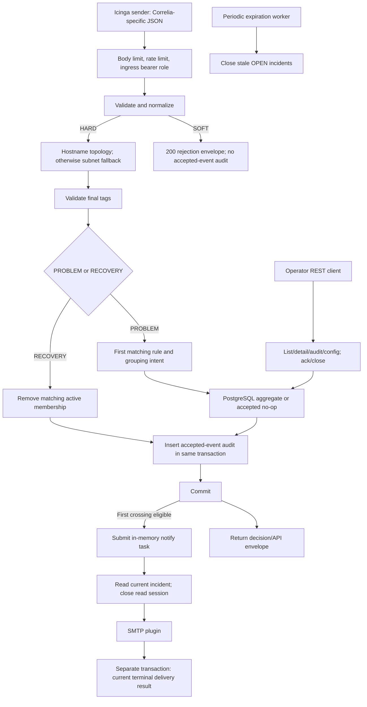
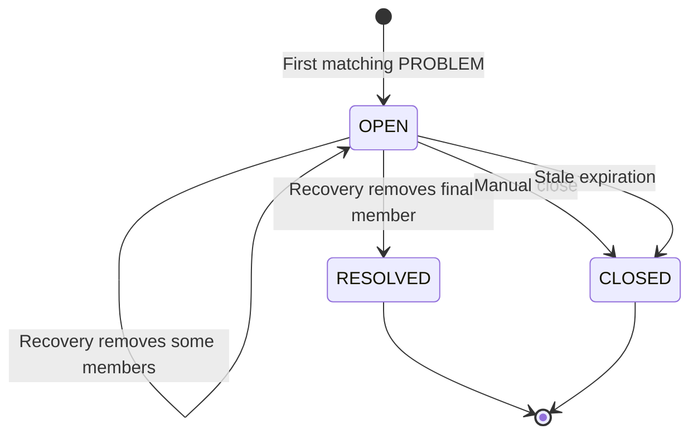

# Correlia legacy audit — knowledge transfer for the rebuild

**Audit date:** 2026-11-03. **Inspected revision:** `fae10f2d1a56e55c1c02949762f997c022718234` (`main`, also live `origin/main` at inspection).

**Bottom line:** This is a real, fairly defensive, single-instance Icinga2-to-PostgreSQL incident aggregator, with SMTP and an operator REST API. It is not a general monitoring platform, a topology graph, a frontend, or a complete Vigilo replacement. The strongest work is database-owned aggregation, transactional accepted-event auditing, strict conversion, and explicit security boundaries. The worst mistakes are conflating object identity with event identity, putting lifecycle membership and threshold history in a mutable JSON bag, tying operational expiry and API synchronization to producer event time, and spending substantial effort hardening compatibility scaffolding while notifications can still disappear after commit.

The rebuild should preserve the useful domain decisions, not reproduce every accidental behavior. A Serverpod + Flutter web implementation does not, by itself, solve any of those problems.

## Evidence and scope

- **CODE** means inspected current implementation. This is static verification, not a claim of production execution.
- **TEST-SOURCE** means an existing test specifies/exercises a behavior, but was not necessarily run during this audit.
- **RUN** means an actual command executed during this audit; results are stated below.
- **DOC** means a claim, requirement, historical result, or proposal in documentation. It is not implementation proof.
- **INFERENCE / RISK** means a reasoned consequence or policy-dependent concern. Concrete defect scenarios in section 6 were established by source analysis, not reproduced against PostgreSQL here.

All `path:line` citations are relative to the Correlia checkout at the revision above. Sources inspected include `AGENTS.md`, `CONCEPTS.md`, `idea.md`, `CONFIGURATION.md`, `.planning/`, `docs/`, runtime code, migrations, tests, manifests, and local Git history. Five independent read-only research slices covered domain/lifecycle, integrations/config, architecture/ops, adversarial correctness, and historical documentation.

**Read-only boundary:** No Correlia source/configuration file was edited, no checkout/branch switch/commit/fetch/push was performed, and no Docker command was run. The only intentionally created file is this report. A read-only `git ls-remote --heads origin` checked live branch heads without fetching objects or changing refs; they matched the cached branch tips. No hosted issue/review/check inventory was fetched. The earlier secret audit is not a new secret scan.

**Executed verification:** Existing `tests/test_domain_events.py` and `tests/test_domain_incidents.py`: **85 passed in 0.27s**, with one warning that `asyncio_mode` was unknown because async-plugin autoload was disabled. Command used `python -B -m pytest -p no:cacheprovider` with `PYTEST_DISABLE_PLUGIN_AUTOLOAD=1` and `PYTHONDONTWRITEBYTECODE=1`, preventing pytest-cache/bytecode writes. This was the already-installed **Python 3.14.4 / pytest 9.0.3 / Pydantic 2.13.4**, not the repository's pinned environment. These are synchronous domain tests, not an application, async, database, deployment, or full-suite pass.

**Not run:** Linters, typechecker, async/API suites, PostgreSQL/migration/concurrency tests, SMTP tests, Compose smoke, dependency audit, and performance qualifiers. There was no `.venv`; installed Python lacked `pydantic_settings`, SQLAlchemy, FastAPI, HTTPX, asyncpg, aiosmtplib, prometheus-client, and pytest-asyncio. Installing/synchronizing would violate the no-network/no-extra-writes verification boundary; full verification additionally requires Linux and Docker. `mise.toml:1-7,9-60` and `tests/conftest.py:19-165` define that distinction. Historical test counts below are not current-run evidence.

# 1. What it does

## 1.1 Purpose and actual product boundary

Correlia reduces related monitoring problems into one topology-tagged incident, keeps incident lifecycle state in PostgreSQL, and sends an initial notification when a configured threshold first crosses. Operators inspect and mutate incidents through REST. There is deliberately **no built-in UI**. See `AGENTS.md:3-13`, `.planning/PROJECT.md:3-9,48-62`, and `app/main.py:330-337`.

The original idea advertised modular inputs, outputs, storage, and task execution and future arbitrary monitoring sources (`idea.md:3-24`). Actual runtime is narrower: one Icinga2-specific ingress processor, static hostname/subnet enrichment, PostgreSQL persistence, one asyncio runner, and email-only output configuration. The plugin seams are real; the catalog of integrations is mostly aspiration.

## 1.2 Domain vocabulary, without the marketing

| Concept | What it actually is | Evidence |
|---|---|---|
| Source | A caller-supplied `source_id` string, not a registered/authenticated source entity. It participates in fingerprints and audit metadata, but not automatically in incident grouping or recovery identity. | `app/plugins/inputs/icinga2.py:32-43,100-111`; `app/persistence/models.py:75-117`; `app/persistence/incidents.py:850-986` |
| Incoming alert/event | One strict webhook object, not a stored first-class alert aggregate. The system normalizes it to a `NormalizedEvent`. There is no `alerts` table. | `app/plugins/inputs/icinga2.py:32-79,114-153`; `app/domain/events.py:102-128`; `app/persistence/models.py:21-117` |
| Normalized event | Fingerprint, source, host, optional service, severity, PROBLEM/RECOVERY type, aware timestamp, tags, message, optional IP. Strict/extra-forbidden validation. | `app/domain/events.py:102-128` |
| Object | An active `(host, service-or-null)` pair. Host-only problems and service problems are distinct members. Source identity and per-object timestamps are absent. | `app/domain/incidents.py:145-173`; `app/persistence/incidents.py:218-245` |
| Incident | Correlated persisted aggregate with identity `(rule_name, group_key)` while OPEN; severity, counts, current membership, threshold metadata, decision context, and lifecycle timestamps. Closed/resolved historical rows can share that identity. | `app/persistence/models.py:21-71`; `migrations/versions/0001_create_incidents.py:68-88` |
| Correlation | The first rule whose predicates match chooses a grouping tuple. Same rule/group merges into one OPEN row. No causal graph, dependency traversal, root-cause inference, or cross-rule suppression is implemented. | `app/processing/rule_engine.py:8-64`; `app/persistence/incidents.py:560-680` |
| Deduplication | A retained fingerprint is counted once inside a bounded event-time window. It is not permanent request idempotency, unique-event storage, or exactly-once processing. | `app/plugins/inputs/icinga2.py:100-111`; `app/persistence/incidents.py:264-314` |
| Tags/topology | A flat string map. Static regex/CIDR enrichment adds `topology.*` tags; incoming tags can carry other attributes. There is no topology node/edge inventory or host/service catalog. | `app/domain/events.py:32-94`; `app/config/topology.py:19-98`; `app/processing/enrichment.py:31-109` |
| Threshold | Distinct retained fingerprints in the configured group's event-time interval. Not a distinct-host threshold and not a count of every check sample. | `app/domain/rules.py:34-39`; `app/persistence/incidents.py:264-314`; `CONFIGURATION.md:919-936` |
| Acknowledgement | Metadata on an OPEN incident. `ACKNOWLEDGED` is a list-filter/API compatibility concept, **not a persisted lifecycle status**. | `app/domain/incidents.py:17-28,48-59`; `app/persistence/incidents.py:443-450,997-1059` |
| Audit event | One append-style accepted normalized-event record with source/normalization/decision snapshots, redacted raw model payload, and HMAC metadata. It is observational; aggregation does not read audit history as its decision state. | `app/processing/ingress.py:194-306`; `app/persistence/models.py:75-117` |
| Notification | Post-commit asynchronous plugin work, plus a current terminal result per incident/plugin. Acceptance, SMTP submission, inbox receipt, and durable scheduling are different things. | `CONCEPTS.md:5-28`; `app/processing/task_runner.py:28-83`; `app/processing/notification_dispatcher.py:45-149` |

## 1.3 End-to-end flow

Boundary evidence: middleware/factory `app/main.py:291-337`; ingress transaction and response `app/processing/ingress.py:112-423`; dispatcher `app/processing/notification_dispatcher.py:45-149`; worker `app/processing/lifecycle_worker.py:57-132`. The last diagram arrow from operator actions denotes shared persistence, not source-event re-ingestion; operator actions do **not** insert source `incident_events` rows.

The API is the only existing consumer surface. There is no bundled web dashboard, WebSocket stream, Flutter client, or Serverpod backend. Notifications do not update a UI directly; a future UI must read APIs or a new change feed.

# 2. Architecture

## 2.1 Modules and ownership

| Area | Responsibility and coupling |
|---|---|
| `app/main.py` | Factory, one effective Settings owner, middleware/router construction, lifespan dependency wiring, config/plugin loading, worker startup/shutdown, task drain, engine disposal. See `:150-337`. |
| `app/api/` | Typed dependency access, bearer roles, ingress/incident/audit/config/plugin/readiness/metrics routes. It is not a separate business-logic implementation. `app/api/deps.py`; `app/api/routers/incidents.py:117-344`. |
| `app/domain/` | Pydantic contracts and enums for events, rules, incidents, audit, and notifications. Useful explicit bounds, but internal/persisted/response contracts often share constraints that collide after rendering. `events.py:102-128`; `rules.py:14-100`; `incidents.py:145-239`. |
| `app/config/` | Environment Settings plus strict YAML validation/compilation for rules, topology, and output registry. `settings.py:8-121`; `rules.py:162-211`; `topology.py:124-174`; `plugins.py:44-78`. |
| `app/processing/` | Normalization/enrichment orchestration, stateless rule intent, aggregation manager, lifecycle manager/worker, notification dispatcher/runner, logging/metrics. Ingress owns accepted-event commit. `ingress.py:194-306`; `incident_manager.py:79-190`. |
| `app/persistence/` | SQLAlchemy models, async engine/sessionmaker, PostgreSQL repositories, JSON window/membership algorithms, audit redaction/projections/cursors. Much domain policy lives in the incident repository. `incidents.py:195-423,560-1186`; `audit.py:53-814`. |
| `app/plugins/` | Input/topology/output protocols; concrete Icinga input and SMTP output; eager allowlisted output loading. There is no runtime input/storage/runner registry. `interfaces.py:10-54`; `loader.py:10-150`. |
| `migrations/` | Three linear Alembic revisions. Database constraints own core status/severity/count/open-row uniqueness. JSON subdocument evolution is largely outside Alembic. |
| `scripts/` | Container startup, standalone Vigilo converter, audit-bound qualifier, verification wrapper, and destructive-resource cleanup guard. These are operator/developer tools, not daemon source adapters. |

Runtime dependencies are explicit via factory injection and `app.state`, rather than a global service locator for core processing. However, metrics/report-projection state is module-global (`app/processing/metrics.py:200-350`), and the Icinga-specific builder also loads configuration already loaded for application status (`app/main.py:184-225`; `app/processing/ingress.py:649-686`). This duplicates startup work and permits a narrow time-of-check/time-of-use discrepancy if files change during startup. There is no atomic versioned config snapshot across all three files.

## 2.2 Persistence schema

There are **two product tables**, plus Alembic's version bookkeeping. There are no source, alert, host, service, tag, user, action-history, durable-job, or notification-attempt tables.

### `incidents`

Source: `app/persistence/models.py:21-71`; migrations `0001_create_incidents.py:22-88` and `0002_add_threshold_state.py:22-44`.

| Columns | Type / meaning |
|---|---|
| `id` | UUID primary key; application creates incident IDs. |
| `rule_name`, `group_key` | Strings identifying the aggregation slot. No foreign key to immutable rule/version identity. |
| `status`, `severity`, `summary` | String values; DB checks status/severity vocabularies. Summary is current display text, not an event log. |
| `event_count` | Integer, DB constraint >=1. Cumulative counted contributions, not every received event or current membership count. |
| `affected_hosts`, `affected_services` | JSONB sorted display projections, each capped at 100 by application logic. Not authoritative membership. |
| `window_state` | JSONB schema 2: interval bounds/duration, threshold, <=100 fingerprint timestamps, count/cap, and **uncapped** `active_objects`. |
| `decision_context` | JSONB current decision/lifecycle notes and current terminal delivery records. Not immutable history. |
| `threshold_crossed`, `notified_at` | Persistent first-crossing marker; nullable time set on successful plugin result. They are not equivalent. |
| `start_time`, `last_update_time` | Producer event-time chronology. Latest problem time drives window and expiry. |
| `acknowledged_at`, `acknowledged_by` | Acknowledgement metadata; status stays OPEN. |
| `resolved_at`, `closed_at` | Separate recovery versus manual/expiration terminal times. |
| `created_at`, `updated_at` | Database/server-side record timestamps. `updated_at` is not what incident `updated_since` filters. |

The partial unique index `incidents_one_open_per_rule_group` is `(rule_name, group_key) WHERE status='OPEN'`. Terminal rows free that slot. DB statuses are exactly OPEN, RESOLVED, CLOSED; severities OK, WARNING, UNKNOWN, CRITICAL. There are no additional incident-list/time/membership indexes in the migration chain (`0001_create_incidents.py:68-88`; `0002_add_threshold_state.py:22-44`). The correctness invariant is good; read-path indexing is underdeveloped.

### `incident_events`

Source: `app/persistence/models.py:75-117`; `migrations/versions/0003_create_incident_events.py:22-155`.

| Columns | Type / meaning |
|---|---|
| `id`, `accepted_at` | Database-generated UUID and acceptance timestamp. Ordering uses `(accepted_at,id)` descending. |
| `event_timestamp`, `source_id`, `fingerprint`, `event_type`, `severity`, `host`, `service` | Searchable duplicated event metadata. |
| `incident_ids` | JSONB string-ID array; one accepted recovery can affect several incidents. No relational foreign keys. |
| `incident_effect` | none / inserted / updated / resolved / affected_set_shrunk. Does not represent operator ack/close/expiry. |
| `decision_summary` | JSONB bounded decision snapshot, notification **intent**, counts, reasons, crossing/replay facts. |
| `normalized_event` | Full normalized/enriched snapshot, not generally secret-free. |
| `raw_payload` | Redacted/capped request-model JSON; not literal HTTP bytes. |
| `raw_payload_original_byte_length`, `raw_payload_stored_byte_length`, `raw_payload_truncated` | Canonical UTF-8 accounting and storage-omission flag. |
| `redaction_version`, `redacted_path_count`, `raw_payload_hmac` | Versioned redaction metadata and keyed canonical pre-redaction digest. |

Checks cover enums, JSON container shape, nonnegative lengths/counts, and stored bytes <= original bytes. Eleven secondary indexes cover `(accepted_at,id)`, GIN incident IDs, fingerprint, source, type, severity, host, service, effect, event timestamp, and a no-dispatch-reason expression. This is substantial per-event index write amplification. There is no retention/partition policy or DB-enforced append-only role/trigger. HMAC authenticates a candidate original payload; it is **not** a hash chain covering decision metadata, row deletion, or complete audit integrity (`app/persistence/audit.py:169-198`; migration `:81-155`).

### Migration hazard

Alembic revisions are `0001` incidents → `0002` threshold columns → `0003` event audit. The later active-membership schema-2 change did not add a migration/backfill. Current code directly requires `data['active_objects']`; docs explicitly prescribe clearing **both tables** for approved disposable predeployment data, not upgrading schema-1 state (`app/persistence/incidents.py:195-215`; `CONFIGURATION.md:249-265,939-951`). This is an explicit data-compatibility break, not an automatic migration feature. Do not point the rebuild at an old database and assume framework migrations recover its JSON semantics.

## 2.3 Configuration system

- `Settings` uses `CORRELIA_` environment names, except `DATABASE_URL` is a validation alias. Required audit HMAC secret is independent of auth. File paths can be omitted, resulting in empty rule/topology/output configuration. Host startup does not automatically read `.env`; Compose interpolation is a different mechanism (`app/config/settings.py:8-59`; `CONFIGURATION.md:189-193,804-810`).
- Rules/topology/plugins use `yaml.safe_load`, strict extra-forbidden models, semantic checks, then compilation/instantiation. Files load at startup, not hot reload (`app/config/rules.py:162-211`; `app/config/topology.py:124-174`; `app/config/plugins.py:65-78`; `app/main.py:184-225`).
- Rules require unique names and priorities, >=1 action, <=20 actions with unique plugin names, `create_incident` as the recognized action, and thresholds 1..100. A nonempty known-output set checks action references; an empty set accidentally disables that check (section 6).
- Rule hash is a deterministic hash of parsed rule configuration. Plugin registry has its own hash; notification tasks can carry the registry hash. These are diagnostic/version checks, not a complete immutable rules+topology+outputs decision version (`app/config/rules.py:201-211`; `app/config/plugins.py:59-78`; `app/processing/notification_dispatcher.py:23-69`).
- Topology accepts hostname regexes, literal/capture tags, and CIDRs. Conflicting overlapping same-family subnets are rejected; this is not longest-prefix routing. A broad subnet and more-specific subnet cannot assign different tags (`app/config/topology.py:78-98`).
- Output registry allows at most 100 entries and only `plugin_type: email`; import paths must be under `app.plugins.outputs.`. Trusted application code is imported and instantiated eagerly; this is an allowlist, not sandboxing (`app/config/plugins.py:10-57`; `app/plugins/loader.py:10-150`).
- No first-class SMTP secret reference exists. Runtime SMTP options accept literal username/password; deployment tooling must render/mount protected config externally. The converter refuses to copy credentials but does not solve runtime secret injection (`app/plugins/outputs/email.py:15-52`; `CONFIGURATION.md:1061-1067`).

## 2.4 API and authentication

| Surface | Role / contract |
|---|---|
| `GET /v1/health` | Public minimal liveness. No database check. |
| `GET /v1/readyz` | Configurable local exposure; operator-protected in valid production. DB/config/registry/plugin-category/lifecycle checks; 503 if not ready. |
| `GET /v1/metrics` | Configurable local exposure; operator-protected in valid production. Prometheus text, not a Prometheus/Thanos input. |
| `POST /v1/icinga2/events` | Ingress role. One event per request. |
| `GET /v1/incidents`, `GET /v1/incidents/{id}` | Operator role. Filter/paginate and full detail. Collection omits full active membership. |
| `POST /v1/incidents/{id}/ack`, `/close` | Operator role; explicit operator/reason inputs. |
| `PATCH /v1/incidents/{id}`, `DELETE /v1/incidents/{id}` | Operator role; selected Vigilo aliases. DELETE means close, not delete. |
| `GET /v1/incident-events` | Operator role; bounded audit projection and filters, not raw export. |
| `GET /v1/plugins`, `/v1/rules`, `/v1/topology` | Operator status summaries; not editable config APIs. |
| `/docs`, `/redoc`, `/openapi.json`, `/docs/oauth2-redirect` | Nonproduction documentation; absent in production. |

Evidence: `app/main.py:261-337`; `app/api/routers/incidents.py:117-344`; `app/api/routers/audit.py:34-144`; `CONFIGURATION.md:812-837`.

Auth is two static bearer secrets, compared with constant-time comparison. Operator and ingress roles do not imply each other. Production must be explicitly selected and rejects disabled auth or public readiness/metrics; omitted environment is local. Tokens must be nonempty/distinct, and HMAC cannot reuse either. There are no users, sessions, RBAC beyond the two roles, tenants, source-scoped permissions, expiration/refresh tokens, or actor attribution from authenticated identity (`app/api/security.py:25-71`; `app/config/settings.py:61-117`). A caller with the shared operator token can supply any permitted `operator` string.

Global/default body limit is 1 MiB with route-class overrides. Body middleware limits declared and streamed bytes and buffers/replays allowed bodies. Rate limiting is an in-process, route-class fixed window, keyed by recognized valid token or client IP. Defaults are operator 60/min, ingress 120/min, metrics 30/min, readiness 60/min, health 120/min. A whole fleet sharing the ingress token shares that 120/min allowance (`app/config/settings.py:37-54`; `app/middleware/size_limit.py:24-111`; `app/middleware/rate_limit.py:28-62,156-231`). These are not distributed/gateway DoS controls.

## 2.5 Deployment, operability, and tests

- Pinned Python **3.14.7**, uv **0.11.7**, one `uv.lock`, strict mypy on `app`, Ruff targeting py314. `pyproject.toml` still calls the package `0.1.0` while planning calls the milestone v1.0/v1.1; version nomenclature is not a release-provenance system (`mise.toml:1-7`; `pyproject.toml:1-7,38-48`).
- Multi-stage image installs locked runtime dependencies, runs non-root, disables bytecode writes, and copies only runtime artifacts. Entrypoint applies Alembic then starts one Uvicorn worker (`Dockerfile:1-32`; `scripts/container-entrypoint.sh:1-19`).
- Compose: PostgreSQL `16.9-alpine` with named `postgres-data` volume; Correlia; Mailpit `v1.26.1`. App/root filesystem read-only with tmpfs, read-only config mount, no-new-privileges, one replica. App 8000 and Mailpit UI 8025 bind host loopback; Postgres has no published host port; networks are internal (`compose.yaml:1-78`). This is a local topology, not an out-of-the-box external SMTP/HA/TLS deployment.
- Readiness authenticates from the container healthcheck. SMTP plugin readiness reports local configuration readiness, not verified remote SMTP reachability (`compose.yaml:51-55`; `app/plugins/outputs/email.py:91-92`; `app/api/routers/health.py:65-132`).
- Named volume persistence was added late. Stable Compose project identity selects the database volume; changing project names can select a healthy empty database. PostgreSQL init variables do not rotate existing-volume credentials. No scheduled backup, replication, restart policy, production proxy, certificate setup, or restore automation is supplied (`compose.yaml:1-78`; `CONFIGURATION.md:225-247`).
- Expiration starts sweeping immediately, then one batch per interval; defaults 100 rows / 30 seconds. It does not drain an arbitrary stale backlog in one tick. With those settings the nominal ceiling is 100 expirations per sweep, excluding work time/lock contention (`app/config/settings.py:22-23`; `app/processing/lifecycle_worker.py:90-112`; `app/persistence/incidents.py:1137-1152`).
- Metrics use finite vocabularies: accepted/rejected events, matches, incident effects, task failures, plugin loads, submission/delivery results, compatibility mutations, audit writes, readiness, lifecycle health, and optional migration-report projection. No per-host/source/operator/unbounded rule/plugin labels. Migration-report reading is bounded and validates schema/status before publication (`app/processing/metrics.py:164-315,349-508`). No general latency histogram/capacity SLO is implemented.
- Logs use allowlisted fields and finite operational schemas; exceptions/credentials/raw payloads are deliberately suppressed. That limits leakage but leaves little diagnostic context for some failures (`app/processing/logging.py:8-158`; `app/api/routers/ingress.py:40-51`).
- Tests span pure contracts, adapters, rules/topology/config, plugin loading, SMTP capture, middleware/auth, incident/audit/lifecycle/API repositories, migrations, deployment, and verification infrastructure. Real PostgreSQL/Testcontainers is used where DB semantics matter; HTTPX ASGITransport exercises API surfaces; pytest-asyncio is the sole intended async owner (`AGENTS.md:82-89`; `tests/conftest.py:218-268`).
- Required Linux verification rejects missing Docker/Compose, selectors/narrowed runs, missing expected smoke, skips, xfails, and incomplete execution; portable is explicitly a subset. `mise run ci` includes dependency advisory network access and the real Compose smoke once, not an offline command (`mise.toml:9-60`; `tests/conftest.py:29-218`; `.github/workflows/ci.yml:1-40`). Configuration of a check is not proof that live branch protection is enabled; no hosted check/protection readback was performed here.

# 3. Integrations

## 3.1 Source and target inventory

| Integration | Actual support | Important boundary |
|---|---|---|
| Icinga2 | **Works: one custom webhook contract.** | This is not an Icinga event-stream consumer or universal native-payload adapter. Sender must emit Correlia's schema. |
| Vigilo / VDE | **Partial compatibility: offline YAML converter and selected incident API operations.** | No Vigilo event input, historical database importer, webhook-URL facade, or exact semantic parity. |
| Prometheus Alertmanager | **Documented-only future input.** | `firing`→PROBLEM and `resolved`→RECOVERY appear only as a future example (`idea.md:333-337`; `.planning/PROJECT.md:50-60`). |
| Thanos | **No implementation or integration contract found.** | No route/model/adapter/config. Prometheus exposition is not ingestion from Thanos. |
| Generic JSON/webhook ingress, API polling | **Documented intent / absent.** | Original idea mentions arbitrary sources/API polls (`idea.md:28-30,197-211`); runtime is Icinga-specific (`app/processing/ingress.py:649-686`). |
| Static hostname/CIDR topology | **Works.** | Local YAML enrichment only; no CMDB/discovery API or topology graph. |
| SMTP email | **Works, best-effort asynchronous delivery.** | One concrete output; TLS/auth options; no retry/outbox/delivery-attempt ledger. |
| Mailpit | **Works as local SMTP capture and UI dependency.** | Not a production alerting destination or upstream alert source (`compose.yaml:18-29`). |
| Slack / generic webhook / PagerDuty / Grafana OnCall | **Documented-only future outputs.** | `.planning/REQUIREMENTS.md:69-72`; current registry is email-only. |
| LLM / AI enrichment or decision assist | **Documented-only.** | Future requirement; converter rejects corresponding source plugin sections. `.planning/REQUIREMENTS.md:69-70`; `CONFIGURATION.md:1030`. |
| Celery / Redis / external task runner | **Documented-only deployment/config integration.** | TaskRunner protocol/injection exists; default is asyncio, no configured durable runner. |
| Alternate storage | **Documented-only original aspiration.** | PostgreSQL/asyncpg repositories are concrete; no storage plugin registry. |
| Prometheus metrics scraping | **Works as output/observability.** | Fixed-label `/v1/metrics`, not alert ingestion. |

Implementation inventory is `app/plugins/inputs/icinga2.py:32-153`, `app/plugins/outputs/email.py:15-138`, `app/config/plugins.py:10-57`, `app/plugins/interfaces.py:10-54`, and the API registration `app/main.py:330-337`. Repository searches for the additional named integrations produced future requirements or no implementation, not undiscovered working adapters.

## 3.2 Exact Icinga mapping

The request is one object with required `source_id`, `host`, `state`, `state_type`, aware ISO timestamp, and `check_output`; optional service/IP/tags. Extra fields are forbidden. Numeric Icinga states and raw arbitrary native webhook documents are not the accepted schema (`app/plugins/inputs/icinga2.py:32-79`).

| Object | Accepted string state | Internal severity | Internal event |
|---|---|---|---|
| Host (`service=null`) | UP | OK | RECOVERY |
| Host | DOWN | CRITICAL | PROBLEM |
| Host | UNREACHABLE | UNKNOWN | PROBLEM |
| Service | OK | OK | RECOVERY |
| Service | WARNING | WARNING | PROBLEM |
| Service | CRITICAL | CRITICAL | PROBLEM |
| Service | UNKNOWN | UNKNOWN | PROBLEM |

All rows require `state_type=HARD` to normalize. SOFT returns a typed non-actionable rejection, HTTP 200, with no accepted-event audit. Payload tag validation still runs before this rejection. Timestamp/message/IP/tags are transferred; `check_output` becomes `message`; fingerprint is SHA-256 truncated to 32 hex characters over pipe-joined source, host, event type, severity, optional service. Timestamp and message do not affect it (`icinga2.py:18-28,100-153`; `app/processing/ingress.py:112-142`).

## 3.3 Vigilo converter: what really maps

CLI inputs are exactly one YAML each for `--rules`, `--topology`, `--plugins`, plus `--out-dir`, optional `--report-path`. It is an **offline config translator**, not event/data migration. Duplicate flags, directories/globs/missing/non-YAML inputs are rejected (`scripts/migrate_vigilo_config.py:181-218,1414-1461,1719-1799`).

| Vigilo source | Correlia target / semantics |
|---|---|
| Rule numeric priority, higher-first | Sorted descending and rewritten into ascending integer ranks. Current native engine is lower-first. |
| `match.severity` | `match.severities`. |
| Host/service globs | `fnmatch.translate()` anchored regex patterns; not arbitrary source regex equivalence. |
| Rule tag names / topology references | Namespaced `topology.*`; tag comparison stays literal. Unsupported wildcard tag values fail. |
| `group_by`, summary placeholders | Supported normalized fields/tag references translated; unmappable semantics rejected. |
| `actions: [email-ops]` | Action objects `{name: create_incident, plugin: email-ops}`. |
| `topology_rules.hostname_patterns[].regex/target_tag` | Hostname rule, literal tags or supported first capture mapped via `tag_capture_groups`. Not a general source expression evaluator. |
| `ip_subnets[].cidr/value/target_tag` | Subnet rule and namespaced tag value. |
| Output `module=app.plugins.outputs.email`, `class=EmailPlugin` | Correlia SMTP class path. Other plugin implementations are unsupported. |
| `smtp_host`, `smtp_port` | `host`, `port`. |
| Address fields, subject prefix | Mapped directly into SMTP options. |
| `use_tls` | `start_tls`; true or omitted means true; explicit false means false. This is a translator-specific mapping, not identical runtime option naming. |

Sources: converter `:41-70,254-428,692-770,868-918,1043-1126,1319-1367`; `CONFIGURATION.md:1031-1067`.

Unsupported: `min_hosts`, `is_dc_level`, empty actions, non-output plugin sections, task-runner/input/LLM config, non-email output types, unknown schema fields, unknown email options, and plaintext SMTP credential keys. Preflight aggregates discovered incompatibilities across all inputs; it does not silently drop unknown source semantics. Arbitrary valid user tag/output names are data, not unknown schema fields (`scripts/migrate_vigilo_config.py:429-691,1151-1402,1820-1859`).

Generated files are staged and validated with the **runtime** loaders and actual SMTP-plugin construction. Three target files are then replaced sequentially, with backups/best-effort rollback on caught errors. Report publication is a separate atomic single-file operation **after** config promotion. It is not a crash-atomic three-file transaction; failure to write the success report can return nonzero after configs changed (`:1483-1494,1544-1592,1644-1665,1689-1716,1879-1908`). See section 6.

## 3.4 Notification envelope and SMTP behavior

The output receives an immutable bounded value containing incident ID, rule, group, severity, summary, and capped host/service displays, not ORM objects/raw input/plugin config (`app/plugins/interfaces.py:10-54`; `app/processing/notification_dispatcher.py:139-149`). Email body includes those fields; contrary to the original design, it does not currently include incident status, event count, or full timeline (`app/plugins/outputs/email.py:112-138`; compare DOC `idea.md:256-264`).

SMTP options support host/port, sender, recipients (<=100), prefix, optional paired username/password, implicit TLS, STARTTLS, certificate validation, and bounded timeout. Authenticated SMTP requires explicit TLS/STARTTLS and certificate validation. No transport retry, escalation, reminder, recovery notification, per-severity routing beyond rule actions, or recipient-resolution system exists (`email.py:15-52,94-138`; `app/processing/lifecycle.py:35-44`).

Dispatcher loads the **current** incident at execution time, closes the read session, sends, and saves a safe finite-category result in another transaction. Thus the notification is not necessarily the immutable threshold-crossing snapshot: it can reflect later summary/membership/severity changes, even after closure. Successful `send` means SMTP/plugin completion, not inbox delivery. Results are one current terminal record per plugin, not attempt history (`app/processing/notification_dispatcher.py:45-129`; `app/persistence/incidents.py:349-407`).

# 4. Correlation and lifecycle rules in detail

This section is the compatibility baseline. **Preserve intentionally, or change explicitly with migration/acceptance examples. Section 6 defects are not recommendations to preserve bugs.**

## 4.1 Enrichment and rule selection

1. Try hostname topology rules in file order using Python regex `.match()` from the start of the hostname. First matching rule wins. Do not merge every matching topology rule.
2. Only if no hostname rule matches, parse IP and try subnet rules in file order. Invalid IP means no subnet enrichment, not a validation error. Hostname match suppresses subnet fallback even if its optional capture is empty.
3. Copy incoming tags; apply topology literals; then nonempty capture-group values. Later values overwrite earlier ones, and diagnostics record additions/conflicts. Validate the complete merged map before rule evaluation/transaction.
4. Sort rules by ascending unique priority. Predicates are severity membership, host regex `.match`, optional service regex `.match` requiring a service, and **literal equality** for every configured tag. `*` or `.+` is not a tag wildcard.
5. Stop at the first predicate match. If its required group field is absent, return an accepted no-op; do **not** try a lower-priority fallback rule. No matching rule likewise yields audited no-op.
6. Group in configured field order as `field=value` segments joined with `|`. Recognized normalized fields are host, service, message, severity, event_type, fingerprint, source_id, timestamp (ISO), IP; other names read tags. Values are not escaped.
7. Render summary by repeated literal `{key}` replacement. Normalized fields override same-named tags in the rendering context; missing values leave placeholders intact. There is no rich templating language.

CODE: `app/processing/enrichment.py:31-109`; `app/processing/ingress.py:144-192`; `app/processing/rule_engine.py:8-114`. TEST-SOURCE: `tests/test_rule_engine.py:48-94,392-494`; `tests/test_topology_enrichment.py`. The native ascending priority and exact membership rules contradict the simpler historical examples in `idea.md:116-143,357-380`.

## 4.2 PROBLEM aggregation, windows, and dedup

- An incident is created on the **first** matching problem, even below notification threshold. Below-threshold incidents are visible OPEN records, not pending invisible buckets.
- Uniqueness is one OPEN row per `(rule_name, group_key)`. The active path is insert `ON CONFLICT DO NOTHING`, then `SELECT OPEN ... FOR UPDATE` and merge. An alternate SQL upsert builder exists but is not the ingress algorithm (`AGENTS.md:11`; `app/persistence/incidents.py:560-680`).
- Initial window end = first event timestamp; start = end minus configured seconds. Merge uses `end=max(existing.last_update_time,new_event.timestamp)`, start=end-duration. Both ends are inclusive.
- Prune fingerprint timestamps outside that interval. If incoming fingerprint is still retained, `replay=true`, it is not counted, and its retained timestamp is **not refreshed**. Otherwise an in-window fingerprint counts; a distinct event older than the interval does not.
- Cap retained fingerprints at 100 (newest timestamp, then fingerprint descending for tie selection), then store deterministically sorted by fingerprint. Dedup protection ends when an entry ages out or is evicted. Threshold 1..100 is enforced at load; it is a representation limit, not a PostgreSQL limit.
- `counted_count` is current retained size. `event_count` grows for `counted=true`, not each accepted HTTP request; cap eviction can occur after a contribution counted. It is not lifetime unique-event cardinality.
- Summary changes only when counted. Severity takes monotone max **CRITICAL > UNKNOWN > WARNING > OK**, including accepted merges that do not count. It never downgrades when a severe member recovers.
- Active membership unions new `(host,service)` objects **even for replay or outside-window events**. Membership does not age out with fingerprints. Display host/service arrays are sorted/capped at 100 independently.
- Latest problem time uses `greatest`, so a replay can advance the window/expiry clock even while its fingerprint timestamp stays old. A continuously repeated same-state problem can count again once the old retained timestamp is pruned.

CODE: `app/persistence/incidents.py:218-314,560-680`; `app/domain/events.py:25-30`; `CONFIGURATION.md:919-936`. TEST-SOURCE: `tests/test_incident_repository.py:202-420,520-650`; `tests/test_ingress_router.py:754-1143`.

**Consequences often mistaken for features:** A threshold of five does not mean five samples of one alert. The fingerprint omits sample time/message, so it generally counts different source/object/state-severity identities during retained history. Nor does it mean five hosts: five services or severity variants can satisfy it. The unsupported Vigilo `min_hosts` rule is genuinely different.

## 4.3 Crossing and notification eligibility

Distinguish four facts:

| Fact | Meaning |
|---|---|
| Current-window `crossed` | `counted_count >= threshold` for this request's persisted window. Can later become false. |
| Incident `threshold_crossed` | Monotone OR of prior marker and current crossing. Never resets within the OPEN incident. |
| `first_threshold_transition` | Marker was false and becomes true in this serialized write. At most one committed first transition per OPEN incident. |
| `notification_count` / triggered | Successful **post-commit task submissions** for configured unique output plugins, not completed deliveries. |

Dispatch suppression order is replay first, then allow a first transition, then `already_notified` if marker is set, else `below_threshold`. The `already_notified` name is misleading: there may have been no delivery at all. There is no retry when the initial submission or SMTP fails. Current window falling below then recrossing does not re-notify. Lowering a rule threshold can make a retained replay set the marker while replay suppression prevents submission; a later new event cannot recreate that first transition (`app/processing/incident_manager.py:244-258`; `app/processing/ingress.py:307-423`; `CONFIGURATION.md:923-929`).

Post-commit missing runner/plugin/submit failures produce safe failure results, persisted separately. Audit records planned intent before dispatch; it is never rewritten into a delivery ledger. The two ingress threshold projections come from the repository's actual write result, not a speculative in-memory counter (`app/processing/ingress.py:249-306,307-423`; `app/processing/incident_manager.py:119-190`).

## 4.4 Recovery and state machine

- RECOVERY bypasses rule aggregation and targets **every matching OPEN incident**, across rules/groups. It is not routed only through whatever rule would match today.
- Service recovery removes exactly `(host,service)`; the same service on another host remains active. Host recovery removes the host-only object **and all service objects** for that host.
- Resolve only when no active objects remain; otherwise leave OPEN with smaller membership. Final resolution clears active membership/displays and sets `resolved_at`. Recovery does not decrement counted-event history, recompute severity downward, reset crossing, or send recovery email.
- No source fence and no event-time ordering fence exists. Those are hazards discussed in section 6, not hidden guarantees.
- Ack retains OPEN status, current membership, and the unique slot. Re-ack preserves first ack time but overwrites actor. Terminal ack/close requests return successful no-op/current row; missing ID returns 404.
- Manual close sets CLOSED/closed_at, retains membership/history, and frees the open slot. Expiration also closes, rather than resolves.
- Expiry predicate is **database now strictly greater than last problem event-time + persisted window_seconds**; equality does not expire. It reads persisted window duration, not a current rule-name lookup. `FOR UPDATE SKIP LOCKED` and bounded batches reduce worker contention.
- Terminal incidents never reopen. A later matching problem can create a **new** OPEN row with a new ID.

CODE: `app/persistence/incidents.py:799-986,997-1186`; `app/domain/incidents.py:260-283`; `app/processing/lifecycle.py:64-102`; `app/processing/lifecycle_worker.py:90-112`.

**Flapping:** There is no flap detector, hysteresis, debounce, maintenance suppression, silence, inhibition, or repeated-notification cadence. HARD-only filtering and retained fingerprints are the available mechanisms. PROBLEM→RECOVERY→PROBLEM after terminal resolution produces new incidents and can notify again. Re-problem while a multi-object incident stays OPEN can restore membership yet be replay-suppressed. Future silences/maintenance are only requirements (`.planning/REQUIREMENTS.md:69-72`).

## 4.5 API/read-model semantics to preserve deliberately

- Incident list filters: status (including derived ACKNOWLEDGED), severity, rule, host, service, updated_since; limit 1..200 (default 50); cursor or offset. If both are supplied, cursor branch wins. Sort/cursor uses `(last_update_time,id)` descending; total is a separate filtered count, not snapshot-consistent with the later page under concurrent writes (`app/api/routers/incidents.py:117-168`; `app/persistence/incidents.py:438-543`).
- `status=OPEN` includes acknowledged OPEN incidents; ACKNOWLEDGED narrows OPEN to populated acknowledgement fields. Host/service filters search complete active membership. If both are supplied they can match **different objects** in one incident. Collection response removes `active_objects` in SQL; detail and mutation responses return the complete set (`incidents.py:443-485`; `CONFIGURATION.md:941-951`).
- PATCH accepts only a body containing status ACKNOWLEDGED or CLOSED. Other keys, including summary, are rejected with 422. Compatibility actor/reason default to `vigilo-compat`; DELETE closes, does not remove history. No `/api/v1` facade or legacy webhook compatibility (`app/api/routers/incidents.py:224-344`; `.planning/PROJECT.md:20-27`).
- Audit list has source/object/type/effect/reason/incident/time filters, cursor/offset, total and limit <=200. Time lower bounds are inclusive and upper bounds exclusive. Cursor order is immutable acceptance time plus ID (`app/api/routers/audit.py:40-144`; `app/persistence/audit.py:603-653,738-814`).
- Source and post-enrichment tags: <=128 entries; ASCII lowercase key syntax, <=64 key bytes; values 1..256 Unicode characters; no NUL/surrogates; aggregate <=16,384 compact UTF-8 JSON bytes. Rejection is fixed input-free 422; body overflow is 413 (`app/domain/events.py:32-94`; `CONFIGURATION.md:14-35`).
- Raw audit default cap 65,536 bytes, redaction version 2. Recursively redact sensitive fragments, HMAC the complete canonical pre-redaction request-model dump, then omit whole top-level fields by descending encoded contribution if needed. Raw cap does not cap the normalized snapshot. Audit response message <=512 chars and tags <=32 entries/4096 JSON bytes, with omission metadata; SQL transfer guard bounds legacy tag decode. Full 200-row response has a documented/qualified 20 MiB ceiling, **not** a typical payload target (`app/persistence/audit.py:53-80,169-360`; `CONFIGURATION.md:37-77`).
- Audit summaries project at most 20 incident IDs and mark truncation/count; the persisted incident_ids list can represent all affected incidents. Do not confuse bounded summary/display projections with authoritative membership (`app/domain/audit.py:41-83`; `app/processing/ingress.py:276-300,548-583`).

# 5. Feature inventory

Status meanings: **works** = implemented path exists (not a blanket runtime certification); **partial** = implemented with a material missing contract/capability; **stub** = placeholder executable behavior; **documented-only** = no implementation found. There is no need to invent stubs: most missing features simply do not exist. Details and limitations are in sections 2–4 and 6–7.

| Feature | Status | Evidence / qualification |
|---|---|---|
| Icinga host/service webhook | works | `app/plugins/inputs/icinga2.py:32-153` |
| HARD/SOFT distinction | works | `icinga2.py:114-133`; SOFT is HTTP-200 rejection |
| Normalized event and explicit recovery type | works | `app/domain/events.py:13-22,102-128` |
| Custom source identifiers | partial | String metadata only; no source registration/ACL/entity |
| Hostname regex topology | works | `app/processing/enrichment.py:35-40` |
| Hostname capture-derived tags | works | `enrichment.py:84-102` |
| CIDR fallback, IPv4/IPv6 | works | `enrichment.py:42-56`; no conflicting subnet overrides |
| Real topology graph/dependency correlation | documented-only | Flat tags/config only; `app/config/topology.py:19-98` |
| Strict bounded tags/final-merge validation | works | `app/domain/events.py:32-94`; `ingress.py:172-177` |
| First-match priority rules | works | `app/processing/rule_engine.py:8-53` |
| Literal tag predicates | works | `rule_engine.py:50-52` |
| Group-by normalized fields/tags | partial | Implemented, unsafe serialization/length boundaries |
| Dynamic summary templates | partial | Literal replacement; expansion/header limitations |
| PostgreSQL open-incident uniqueness | works | `0001_create_incidents.py:81-88` |
| Row-locked incident merge | partial | Threshold races covered; close/upsert race remains |
| Event-time distinct-fingerprint windows | works | `app/persistence/incidents.py:264-314` |
| Permanent idempotency/replay archive | documented-only | Only retained-window dedup exists |
| Distinct-host/min_hosts thresholds | documented-only | Explicit converter/runtime gap; `CONFIGURATION.md:1063` |
| Monotone first crossing | works | `incidents.py:597-600` |
| Current threshold API/audit facts | works | `app/processing/ingress.py:249-306` |
| Complete host/service active membership | works | `incidents.py:218-245,295-312`; uncapped |
| Display-capped membership/list payload | works | `incidents.py:237-245,471-485` |
| Host recovery / exact service recovery | partial | Correct membership, missing time/source fencing |
| Acknowledgement | works | OPEN metadata; `incidents.py:997-1059` |
| Manual close / idempotent terminal no-op | works | `incidents.py:1061-1133` |
| Stale-expiration worker | partial | Event-time clock and bounded one-batch cadence |
| Reopen existing terminal incident | documented-only | Forbidden; new problem creates new incident |
| Severity ordering / max aggregation | works | `app/domain/events.py:25-30`; no downgrade |
| Flap detection / hysteresis | documented-only | No domain/config/runtime implementation |
| Silence / maintenance / inhibition | documented-only | `.planning/REQUIREMENTS.md:71` |
| Incident list/detail/filter/cursor/offset/total | partial | Implemented; incremental-update defects and scale limits |
| ACKNOWLEDGED compatibility filter | works | `incidents.py:443-450` |
| Vigilo PATCH/DELETE aliases | works | `app/api/routers/incidents.py:224-344` |
| Summary editing / comments / collaboration | documented-only | Summary mutation explicitly rejected |
| Accepted-event transactional audit | works | `app/processing/ingress.py:194-306` |
| Redaction/HMAC/raw-cap/read projection | works | `app/persistence/audit.py:53-360`; no general secret guarantee |
| Operator action immutable audit history | documented-only | Logs/latest context only; source audit is not this |
| Audit retention / archival / partitions | documented-only | No migration/worker/retention command |
| Output allowlist/eager validation | works | `app/plugins/loader.py:10-150` |
| Immutable bounded output envelope | works | `app/plugins/interfaces.py:10-54` |
| SMTP and TLS/auth options | works | `app/plugins/outputs/email.py:15-138` |
| Per-plugin terminal delivery outcomes | works | `app/persistence/incidents.py:349-407` |
| Delivery attempt history / retry / outbox | documented-only | In-memory tasks and one terminal record |
| Recovery/escalation/reminder notifications | documented-only | No dispatcher intent for recovery |
| TaskRunner protocol and shutdown drain | works | `app/processing/task_runner.py:20-83` |
| Configured Celery/Redis runner | documented-only | No loader/implementation |
| Vigilo config converter | partial | Strict supported subset; no set-level crash atomicity |
| Unknown-source-field rejection | works | `scripts/migrate_vigilo_config.py:429-691`; fix #62 |
| Config hot reload / dry run API | documented-only | Startup loaders; future requirement |
| Runtime input/enricher/storage registry | documented-only | Protocol seams are not configured registries |
| SMTP secret-file/env references | documented-only | Plain literal options; `CONFIGURATION.md:1067` |
| Static operator/ingress authentication | works | `app/api/security.py:25-71` |
| Production-safe app route exposure | works | `app/config/settings.py:61-75`; `app/main.py:275-284` |
| Users/tenancy/SSO/fine-grained permissions | documented-only | No schema/auth surface |
| Body-size and route-class quotas | works | `app/middleware/size_limit.py`; `rate_limit.py` |
| Distributed quotas / horizontal service model | documented-only | Single-process counters/tasks |
| Health/readiness/config/plugin status | partial | Works; SMTP reachability/task backlog not readiness guarantees |
| Low-cardinality Prometheus/JSON logs | works | `app/processing/metrics.py:164-315`; `logging.py:8-158` |
| Bounded converter-report metric projection | works | `metrics.py:349-508` |
| Non-root read-only-capable image | works | `Dockerfile:1-32`; `compose.yaml:56-62` |
| Local Postgres/Mailpit Compose stack | works | `compose.yaml:1-78` |
| Named data volume and manual legacy cutover guide | partial | Persistence/manual narrow procedure, not backup system |
| Automatic schema-1 membership upgrade | documented-only | Explicitly absent; disposable reset required |
| Automated production TLS/HA/backups | documented-only | Deployment-specific responsibilities |
| Full Linux verification/portable subset tasks | works | Defined in `mise.toml:38-60`; not executed here |
| Flutter web UI / Serverpod backend | documented-only rebuild intent | No implementation in this repo |
| Alertmanager and other source integrations | documented-only | Section 3 source inventory |
| Thanos integration | documented-only / no contract found | Not even a supported future mapping found |

# 6. Bugs and recurring corrective work

## 6.1 Current concrete defects and reproducible-by-construction scenarios

All findings below are **static findings, not runtime reproductions**. Severity reflects plausible operational impact, not measured exploit prevalence. Explicit policy-dependent cases are separated in 6.2.

### B1 — High: old recovery can clear a newer problem

**Evidence:** `app/domain/incidents.py:145-173`; `app/persistence/incidents.py:295-312,850-986`.

Process PROBLEM at t2, then delayed RECOVERY at t1 where t1<t2 for the same host/service. Recovery selects current OPEN membership and removes it without comparing source event times. If it was the last member, incident resolves incorrectly. `recovery_time` is recorded in context, not used to fence mutation; membership stores no per-object problem timestamp/version with which to do so.

**Why it matters:** alert pipelines reorder and retry. This is not hypothetical SHA collision trivia; delivery ordering can hide a real outage. The inverse is also possible: a stale problem delivered after recovery recreates active state because no durable object-state tombstone fences it.

**Rebuild:** define object-state ordering and equal-time precedence, preserve source sequence/time evidence, and test stale problem/recovery permutations. Do not just serialize arrivals more aggressively.

### B2 — Medium: insert-conflict then concurrent close can produce 500

**Evidence:** `app/persistence/incidents.py:560-595,642-680`; close/recovery/expiry `:824-847,1061-1186`; generic error mapping `app/api/routers/ingress.py:40-51`.

Insert finds an existing OPEN row and does nothing on conflict. Before fallback SELECT obtains the OPEN row, another transaction closes/resolves it. The OPEN-filtered SELECT returns no row, but `scalar_one()` assumes exactly one. Valid problem ingestion fails instead of claiming the newly free OPEN slot. The same failure can occur after waiting for a concurrent updater whose committed row no longer satisfies OPEN.

Uniqueness is preserved; availability/acceptance is not. Existing tests cover later insertion after closure and threshold races, not this particular close-versus-upsert interleaving (`tests/test_incident_repository.py:1328-1374`; `tests/test_ingress_router.py:957-1143`).

### B3 — Medium: incremental incident polling misses lifecycle and delivery updates

**Evidence:** filter uses `last_update_time` at `app/persistence/incidents.py:467-468`; cursor ordering `:489-535`; lifecycle writes `:799-847,1037-1051,1106-1121,1171-1181`; notification result `:397-407`.

Ack, manual close, recovery shrink/resolution, expiry, and delivery-result persistence update `updated_at`, not `last_update_time`. A client asking `updated_since` after the last problem but before one of those changes will not receive the changed row. A new Flutter dashboard using that API for incremental refresh can remain visibly wrong. Cursor ordering likewise does not advance for these changes.

**Rebuild:** separate `last_problem_event_at` from monotone record/change-feed position. A polling cursor must describe changes, not producer alert time.

### B4 — Medium: recovery closure_count is wrong for multiple incidents

**Evidence:** `app/processing/lifecycle.py:34-61,185-218`; ingress response `app/processing/ingress.py:355-362`; multi-row recovery queries `app/persistence/incidents.py:858-865,929-939`.

A single recovery can resolve N incidents across historical rule/group slots, but `resolved_count` returns 1 whenever aggregate effect is resolved, otherwise 0. For N>1, API `closure_count` underreports. Mixed shrink+resolve outcomes are flattened into a single effect as well. Full affected IDs/count in audit are richer than this scalar API outcome.

**Rebuild:** return counts per effect, not infer a count from a collapsed enum.

### B5 — Medium: distinct groups can serialize to the same key

**Evidence:** `app/processing/rule_engine.py:55-64`; permissive string values `app/plugins/inputs/icinga2.py:35-43`; bounded group key `app/domain/rules.py:14,84`.

For `group_by=[host,service]`, `(host='a|service=b',service='c')` and `(host='a',service='b|service=c')` both produce `host=a|service=b|service=c`. They therefore share the supposedly unique incident identity. Neither `|` nor `=` is escaped or prohibited in these input values.

**Rebuild:** canonical structured tuple encoding/hash plus separately stored display components. Do not fix only one delimiter or rely on DNS-host conventions that the contract does not enforce.

### B6 — Medium: valid request fields can fail later as generic 500

**Evidence:** webhook `app/plugins/inputs/icinga2.py:35-43`; normalized `app/domain/events.py:114`; rendered `app/domain/rules.py:14,84-86`; rendering `app/processing/rule_engine.py:18-35,55-64,94-114`; router `app/api/routers/ingress.py:40-51`.

Three independent boundary mismatches:

- `check_output` has no request-model maximum, but normalized message max is 4096. A 4097-character check output fits the default body cap, passes the route schema, and fails normalization as a server error.
- Host max is 256; grouping just `host=<value>` adds five characters, but group key max is 256. Hosts of 252..256 characters pass ingress validation and fail RuleMatch validation.
- A legal short summary template can expand a 256-character tag/host or 4096-character message past the rendered summary's 256-character cap. It passes config loading, then fails a normal event.

This is a composition error in contracts, not bad source data by the published request schema. Apply consistent validation/error classification at the boundary; separate machine identity from short display summary.

### B7 — Low: naive updated_since becomes an uncaught internal validation error

**Evidence:** `app/domain/incidents.py:190-208`; dependency `app/api/routers/incidents.py:117-144`; compare audit's catch/mapping `app/api/routers/audit.py:66-87`.

A syntactically valid naive datetime query parses, then the filter model rejects it for missing timezone. The incident dependency does not translate that Pydantic ValidationError to client 422. It can escape as 500. Audit filters already show the correct contrasting error-mapping pattern.

### B8 — Medium: empty output registry bypasses reference validation

**Evidence:** `app/config/rules.py:162-194`, specifically `if known_plugins and action.plugin not in known_plugins`; startup passes actual names `app/main.py:184-191`; missing-plugin dispatch path `app/processing/ingress.py:400-423`.

With rules naming an output and an empty output registry, the empty set disables validation instead of proving every reference invalid. Startup accepts the rules; first threshold can be consumed on a missing-plugin outcome. Since crossing is monotone and retries are absent, merely adding the plugin later does not automatically recover the missed notification for that incident.

An omitted validation context and an explicitly empty registry should not be represented by the same falsey sentinel.

### B9 — Medium: converter failure does not always mean output was untouched

**Evidence:** `scripts/migrate_vigilo_config.py:1544-1592,1689-1716,1879-1908`; stronger claim in `CONFIGURATION.md:1057-1058`; root guidance explicitly warns against crash-atomic claims (`AGENTS.md:70`).

Normal preflight/staging failures preserve output. But successful config promotion happens before success-report publication; an unwritable `--report-path` can return exit 1 with already-replaced configs. Three sequential `os.replace` calls are also not one atomic set; process termination between them can leave mixed versions, and rollback copying can itself fail.

The implementation has useful ordinary-failure defenses. The blanket documented promise is stronger than those defenses. A caller using nonzero as “nothing changed” is wrong under a permitted path.

### B10 — Low/Medium: re-acknowledgement combines first time with last actor

**Evidence:** `app/persistence/incidents.py:1037-1051`.

Ack uses `coalesce(acknowledged_at,now())` but always writes `acknowledged_by=operator`. Alice acknowledges at t1; Bob acknowledges at t2; returned metadata says Bob at t1. There is no immutable action history to reconstruct the truth. If re-ack is intended to transfer ownership, model that explicitly; otherwise preserve both original fields together.

### B11 — Medium, configuration-dependent: multiline summary breaks SMTP subject

**Evidence:** message accepts ordinary strings including line breaks (`app/domain/events.py:114`); summary literal replacement `app/processing/rule_engine.py:94-114`; direct subject assignment and rendering `app/plugins/outputs/email.py:94-117`.

A rule that inserts a short multiline `message` into its summary creates a newline-containing email Subject. `EmailMessage` rejects newline-bearing header values; dispatcher reports generic plugin failure, with no automatic retry. This is **not header-injection success**—the email library's rejection is protective—but legitimate multiline monitoring output can suppress notification. Subject needs an explicit single-line rendering contract; the body can preserve multiline text.

## 6.2 Material behavioral hazards, not unqualified policy bugs

| Hazard | Exact behavior and evidence | Why the owner must choose policy |
|---|---|---|
| Future timestamps poison operational expiry | Any aware timestamp is accepted; future problem advances `last_update_time` and window end. Expiry waits for future time+duration. Normal current events can become outside-window. `icinga2.py:51-68`; `incidents.py:264-270,610,1125-1152`. | Event time may be useful for correlation, but arrival-time freshness and allowed clock skew are separate policies. |
| Cross-source recovery | Membership identity has only host/service. Recovery has no source predicate, even if incidents were grouped separately by source. `app/domain/incidents.py:145-149`; `incidents.py:850-986`. | Safe only if host/service names are globally canonical or cross-source recovery is intentionally trusted. |
| Ambiguous pre-hash fingerprint encoding | Source `a|b`, host `c` versus source `a`, host `b|c` share the pipe-joined preimage for same remaining fields. Can false-dedup within a common group. `icinga2.py:100-111`. | A structural encoding defect, not a cryptographic SHA collision. Practical exposure depends on allowed identifiers/grouping. |
| Stable identity is not sample identity | Same source/object/type/severity but new time/message is replay while retained. Severity changes are different fingerprints. `icinga2.py:100-111`; `incidents.py:273-294`. | Decide whether threshold means samples, objects, hosts, or state transitions; current behavior mixes several intuitions. |
| First crossing is not successful notification | Submission/SMTP failure or crash never resets crossing; no automatic recovery. `incident_manager.py:244-258`; `task_runner.py:48-65`. | Explicit current best-effort contract; unacceptable if operational alert delivery is essential. |
| Stale problem can restore membership without counting | Membership union is independent of `inside_window` and replay. `incidents.py:279-312`. | Threshold-history validity and active-state validity need different ordering rules. |
| No severe-member recovery downgrade | Incident severity only takes max, even after that member recovers. `incidents.py:611`; recovery `:799-847`. | May be intended “worst ever” severity, but UI must not label it current remaining severity. |

## 6.3 Recent fixes: classes of bugs that kept recurring

**RUN:** `git log -35` on main and `git log --all --since=2026-09-01` exposed both landed squash commits and work-branch follow-ups. Dates below are Git commit dates. Fixed defects are not being reported as still present.

| Landed commit | What the corrective history shows | Transfer lesson |
|---|---|---|
| `fae10f2` #65, 2026-10-01 | Complete host-only and service membership replaced lossy display-derived lifecycle state. Follow-ups `ca9453e`, `dde6966`, `5aeb9fd`, `cb96a07` fixed full-membership filters/counts and SQL list payload bounds. Current code `incidents.py:218-245,443-485,850-986`. | Fixing authoritative storage is not enough: every projection/filter/count/recovery path must migrate together. A display cap must never become truth. |
| `792d198` #64, 2026-10-01 | Named PostgreSQL persistence and old-volume cutover; follow-ups fixed off-loopback credential proof, Compose start behavior, tmpfs probes, safe namespace ownership, bounded audit projections. Current `compose.yaml:2-5`; `CONFIGURATION.md:225-785`. | Initial local deployment did not make data ownership/durability obvious. Volume identity, credentials, cleanup, and restore need first-class contracts. |
| `f0151b4` #63, 2026-09-30 | Explicit production auth/exposure; one settings owner; role and persisted-state tests; docs absent in production. `bb9a30f`, `ed44808`, `302ec16`, `55f81fd`. | Security policy cannot be inferred from deployment intent or added only around a few endpoints. |
| `a61e989` #62, 2026-09-30 | Converter began rejecting unmapped source fields rather than silently dropping semantics. `scripts/migrate_vigilo_config.py:41-70,429-691`. | “Conversion succeeded” without loss accounting is not compatibility. |
| `9b2a287` #61, 2026-09-29 | Tag matching example used regex-looking text where runtime uses literal equality. Current `CONFIGURATION.md:916-917`. | Incorrect examples can make a working engine look broken; examples need executable behavioral evidence. |
| `8cec078` #60, 2026-09-29 | Threshold outputs now come from persisted outcomes; unreachable >100 threshold configurations rejected. `incident_manager.py:119-190`; `domain/rules.py:34-39`. | Stateless intent and durable decision must not masquerade as the same result. Representation limits belong in config validation. |
| `727d652` #59, 2026-09-29 | Ingress tag bounds, faster bounded raw retention, SQL-safe legacy projection, full-page/HTTP responsiveness qualification. Boundary follow-up `30613df`. | “Bounded” at one layer does not bound CPU, decoding, storage, or HTTP bytes at another. |
| `d4b52e4` #58, 2026-09-28 | Credential ignore/prevention and historical audit; `32eacde` corrected Windows export byte fidelity; `3550f8c` removed conflicting async fixture ownership. | Secrets/privacy and verification provenance were not solved by tests passing; Windows EOL and plugin order can invalidate evidence. |
| `8fd4569` #57, 2026-09-24 | Pinned runtime/tools, known dependency advisory fixes, fail-closed complete Linux verification, actual service-container lookup after restart, pinned action releases. | A green partial/skipped run was too easy to mistake for the required environment proof. |
| `ad612ae` #4, 2026-07-10 | Retain structured terminal delivery results instead of losing them during later incident changes. `incidents.py:349-407`; `docs/solutions/security-issues/plugin-notification-boundary-convergence.md:24-103`. | Mutable “latest decision” blobs erase operational facts unless ownership/merge rules are explicit. |
| `3b97f1f`, `0580e4a`, 2026-06-18 | Commit ownership moved from managers to ingress; one accepted-event audit row shares the mutation transaction. `ingress.py:194-306`. | Transaction ownership was corrected after features grew; establish the unit of work first in the rebuild. |

The recurring pattern is **boundary drift**: authoritative versus displayed state, planned versus persisted decision, submitted versus delivered work, transformed versus lost config semantics, local versus production safety, and passing versus actually complete verification. There is good repair work here, but many repairs are convergence on invariants that should have been explicit before adding compatibility surfaces.

# 7. Shortcomings and design mistakes

## 7.1 Scalability and concurrency

1. **One hot JSON row per correlation group.** Every event in a broad DC group locks the same incident, decodes/rebuilds/sorts membership and fingerprint state, then rewrites JSONB. The schema serializes exactly the groups likely to receive alert storms. No throughput benchmark for large complete membership was run here (`incidents.py:264-314,585-623`).
2. **Unbounded authoritative membership is the right correctness fix but an unfinished storage design.** It prevents dropped active objects; it also permits ever-growing JSON, uncapped detail/mutation responses, and linear whole-state work. Display cap 100 and fingerprint cap 100 do not solve this (`app/domain/incidents.py:151-173`; `incidents.py:295-312`; `CONFIGURATION.md:939-951`). Normalize membership or explicitly qualify/bound supported scale without throwing truth away.
3. **No incident read-path indexes beyond the active uniqueness index.** List order, incremental filters, JSON membership search, and expiry can scan a growing history. Audit has the opposite tendency: many low-cardinality single-column indexes and a count on every page (`0001_create_incidents.py:81-88`; `0003_create_incident_events.py:127-155`; `incidents.py:471-487`; `audit.py:750-753`). Choose indexes from real queries/cardinality rather than symmetry.
4. **Cursor pagination still pays for full totals, and mutable event-time order is not a change stream.** Count/page statements are separate under ordinary isolation; total may not match page during writes. Offsets become increasingly expensive. New UI pagination and synchronization should be distinct contracts.
5. **Single-process state is an architectural limit, not a worker-count setting.** Extra replicas multiply rate allowances, fragment metrics/task ownership, and duplicate sweep activity. DB locks protect some mutations, not end-to-end work ownership (`task_runner.py:28-65`; `rate_limit.py:35-62`; `compose.yaml:69-70`).
6. **Unbounded pending notification task count.** Each accepted task creates an asyncio task; no queue capacity, semaphore, backpressure, durable lease, or retry budget exists. SMTP timeout bounds the stock plugin, not arbitrary trusted plugin behavior (`task_runner.py:48-65`; `email.py:30`).
7. **Batch expiration backlog has no catch-up loop.** Defaults close <=100 per 30-second iteration, and an OPEN row with future event time may never become eligible within the operationally expected period. Worker “healthy” is not a freshness/backlog SLO (`lifecycle_worker.py:90-132`).

## 7.2 Data-model mistakes

- **Object identity, sample identity, incident identity, and delivery identity were not separated cleanly.** Fingerprints are object/state identities used as event counters; grouping strings are both machine keys and display; source identity disappears in recovery. These are domain choices, not ORM details.
- **`window_state` owns two unrelated lifetimes.** Short retained threshold history and long active-problem membership evolve together in the same JSON document. A small bounded cache became a container for complete lifecycle truth.
- **`decision_context` is a mutable kitchen drawer.** Latest match facts, lifecycle action notes, and current delivery results coexist, requiring preservation code. It is neither a stable incident version nor an action history. The API silently falls back to an empty DecisionContext if persisted validation fails, concealing corrupt/incompatible context (`app/api/routers/incidents.py:70-83`).
- **Rule names are durable identity.** Renaming a rule creates new slots; changing its grouping/window/threshold applies new policy to existing rows without immutable rule-version provenance. Config hashes do not supply a complete migration policy (`incidents.py:585-610`; `app/config/rules.py:201-211`).
- **JSON schema changes escaped migration discipline.** Schema-2 membership requires deleting disposable history, with no upgrade path. That may be acceptable predeployment, but it cannot silently become the rebuild's production evolution strategy.
- **No complete operational audit.** Accepted source events are recorded; ack/close/expiry/delivery are logs plus current fields, not a durable chronological action ledger. A shared token plus caller-claimed actor is insufficient for accountability.
- **No relational link integrity for event→incident IDs.** JSON arrays avoid many-to-many tables, but leave referential integrity, deletion/reset behavior, and query ergonomics to application convention (`0003_create_incident_events.py:44-50,91-98`).

## 7.3 Why CONFIGURATION.md is roughly 85 KB

It is **82.8 KiB in the inspected listing, 1,067 lines**, not 85 KB of YAML semantics. It combines:

- tag/audit storage/read bounds and performance qualification (`:14-98`);
- Git secret hygiene and verification/advisory/cleanup policy (`:99-201`);
- local Compose lifecycle and persistence (`:203-248`);
- destructive predeployment reset plus a large manual anonymous-volume PostgreSQL cutover/recovery runbook (`:249-785`);
- production auth, route matrix, TLS/proxy/network qualification (`:789-860`);
- rate limits, actual rules/topology/plugins, and converter usage (`:862-1067`).

The old-volume procedure alone spans roughly half the document. Its careful stop-writers/identify-source/record-baseline/restore/verify/rollback guidance is useful, but burying it beside everyday configuration is poor information architecture. Much length is compensating for deployment/data-ownership risks and evidence requirements, not inherent correlation complexity.

**Blunt diagnosis:** this became the repository's catch-all operational safety manual. Meanwhile planning files still say work is not started after it shipped. `.planning/PROJECT.md:11-17` still focuses on Phase 8; `.planning/ROADMAP.md:20-25,202-215` leaves 9/10 unstarted although notification boundaries and deployment are implemented and landed (`ad612ae`, `7cf53de`). `idea.md` still has four statuses, higher-first native priority, old recovery matching, and obsolete module/route examples. `.planning/v1.0-MILESTONE-AUDIT.md:29-34,124-144` says no gaps for a historical scope, not no current defects. Treating all these documents as simultaneous truth is how future agents reintroduce fixed bugs.

Rebuild docs should separate: domain contract; configuration reference; deployment/backup/recovery runbooks; contributor verification; and explicitly archived design/history. One source owns each behavior. Do not port the paperwork wholesale.

## 7.4 Security and privacy

**Good controls to keep:** strict input/config models; bounded tags/body/projections; safe error/log schemas; separated roles/HMAC; TLS-required authenticated SMTP; allowlisted trusted output loading; non-root/read-only runtime; production exposure rejection. No concrete auth bypass or body-size bypass was established in this audit.

**Missing boundaries:**

- Local is the default environment; production safety relies on explicitly selecting production and correct edge deployment. HTTP backend/loopback publication is not end-to-end TLS or isolation. No reverse proxy/TLS/certificates are supplied (`CONFIGURATION.md:789-860`).
- Shared bearer tokens do not supply human identity, per-source authorization, tenancy, or safe browser session management. Do not put a shared all-powerful operator secret into a Flutter web bundle. New browser auth must be a deliberate backend contract.
- Raw redaction is substring-based, not universal secret detection. Full normalized messages/tags are stored and may retain secrets; source tags/diagnostics and incident summaries can also expose data to authorized operators/SMTP recipients. HMAC is integrity metadata, not encryption (`CONFIGURATION.md:37-45`; `app/persistence/audit.py:64-77`; `app/processing/ingress.py:280-300,332-350`).
- Application DB credentials also run migrations in the container. Least-privilege runtime/migrator roles are not provided by the Compose sample (`scripts/container-entrypoint.sh:1-19`; `compose.yaml:7-9,39-51`).
- Audit is append-only by API convention, not tamper-resistant storage. No key identifier/rotation workflow or whole-history integrity chain is modeled.
- Regexes are operator-controlled and run synchronously in the event loop. There is no regex execution timeout/complexity policy; a pathological trusted pattern can stall ingestion. This is an operator/config trust risk, not unauthenticated arbitrary-regex injection (`app/config/rules.py:116-160`; `app/processing/rule_engine.py:39-53`).
- Static SMTP credentials can only arrive as literal options absent external rendering; config hashes/status safety do not make the underlying YAML secret-free.

The dated `docs/security/secret-exposure-audit.md:1-13,99-118` reports zero confirmed credentials within a frozen historical scope after owner attestation, and a specific native GitHub web-commit protection proof. It explicitly excludes unavailable/unreachable/hosted non-Git material and later revisions. Do not relabel it “current repo guaranteed secret-free.” The paused feedback sweep (`docs/feedback-sweep/state.yml:1-11`) fetched 50 issues, ingested zero, and stopped partial; it is not a completed issue inventory.

## 7.5 Test and operational evidence gaps

- Tests are stronger than a toy prototype's, but old pass counts and checklist completeness did not prevent current ordering/identity/boundary defects. The missing cases in section 6 are cross-feature compositions, not another batch of happy-path model assertions.
- No executed real-producer interoperability evidence was available here. Custom Icinga JSON examples and synthetic fixtures are not proof that an owner's deployed sender emits the accepted schema.
- No current load/soak qualification for large active membership, hot groups, audit retention, task backlog, or real external SMTP was run. Existing concurrent-health qualifier is explicitly a bounded smoke, not a production capacity SLO (`CONFIGURATION.md:79-97`).
- SMTP readiness is optimistic local status. Submission/delivery counters exist, but no persistent pending-work count or retry/dead-letter queue lets operators recover missed first notifications.
- Some metrics are not durable-fact counters despite their names: event accepted is incremented before final enrichment/tag/transaction success, and incident effects are recorded before ingress commit. A rollback can leave metrics reflecting work not persisted (`app/processing/ingress.py:126-177`; `app/processing/incident_manager.py:129-131`; `app/processing/metrics.py:238-259`). Keep request-attempt telemetry separate from committed-outcome telemetry.
- CI itself has substantial cleanup/ownership machinery and a growing deployment test. That machinery addresses real hazards, but complexity in verification is not a substitute for a smaller, clearer product model.
- No general backup/restore/upgrade/rollback automation, deployment restart supervision, on-call runbook, or data-retention enforcement is supplied. The long manual cutover guide qualifies a narrow synthetic/default PG16 scenario, not every production installation (`CONFIGURATION.md:267-274,744-785`).

# 8. Open branches on origin: purpose and whether they landed

**RUN, live read-only evidence:** `git ls-remote --heads origin` returned eight `feat/*`/`fix/*` heads plus `main` and `docs/repository-guidelines`. Every live tip matched its local remote-tracking ref. No fetch occurred. Branch existence is not an open-PR claim.

For every requested branch, `git merge-base --is-ancestor <tip> HEAD` was false. That **does not mean unmerged**: these were squash-landed. I compared the stable patch ID of `git diff $(git merge-base HEAD <branch>) <branch>` against the corresponding main squash commit's full patch, using byte-captured Git output, not Windows text rewriting. **All eight aggregate patch IDs matched exactly.** Their cumulative changes landed on main; the still-present branch refs are stale branch housekeeping, not eight unfinished feature sets.

| Live branch | Tip | Purpose | Landed main commit | Landing evidence |
|---|---|---|---|---|
| `feat/coordinated-linux-verification` | `db1eac6` | Pin toolchain/deps; shared complete Linux gate, portable subset, correct restart smoke, modern pinned Actions. | `8fd4569` (#57) | Aggregate stable patch ID equal: `80aa99525c36c05daf5492c5127a1e5ba71a5f7c` |
| `feat/local-postgres-persistence` | `4a0fba4` | Named PG volume, qualified local lifecycle/cutover, guarded cleanup namespace. | `792d198` (#64) | Equal: `195c132e990a24a931f0ad99489391a144d53d68` |
| `feat/production-auth-exposure` | `5faa1a4` | Fail-closed production auth/exposure, one settings owner, route/state regression tests, dependency advisory follow-up. | `f0151b4` (#63) | Equal: `149d956df6dc262659626f1a498ddeb16d13b3de` |
| `fix/bounded-ingress-audit` | `30613df` | Source/final tags, raw retention/projection CPU/byte safety, legacy JSONB guard and boundary qualification. | `727d652` (#59) | Equal: `751f8cced1c7e1e5442f0d0fe23ee5bbecf29477` |
| `fix/literal-tag-documentation` | `dcb9c58` | Correct the datacenter-rule literal-tag example. | `9b2a287` (#61) | Equal: `78cfdb6d3c71b611e85e509e83e5f218f68537d7` |
| `fix/preserve-mixed-incident-membership` | `0d545a6` | Complete structured host/service membership, full filters/counts, bounded list projection; disposable reset docs. | `fae10f2` (#65) | Equal: `92effd8005fd6ab6648418a1c792a3d2d1330005` |
| `fix/secret-exposure-protection` | `3550f8c` | Secret prevention/history audit, exact Windows byte evidence, single async test owner. | `d4b52e4` (#58) | Equal: `cf0e67160d9a6e2f14a9403fb0aa7b15188f4236` |
| `fix/vigilo-unknown-source-fields` | `3490f5a` | Fail closed on unmapped Vigilo source schema fields. | `a61e989` (#62) | Equal: `b338f8997335ebadd826cdfdd7267a71b5884d51` |

Main was `fae10f2d1a56e55c1c02949762f997c022718234`. An additional live `docs/repository-guidelines` head was `134d6adf05c7eeba2ac641001ee4c91e41bdadf6`, outside the requested feat/fix inventory. Its topic corresponds to main's `1d84e05` #56, but no separate patch-equivalence claim for that docs branch is made here. There is no live feat/fix branch with an unlanded cumulative patch in the checked inventory. No branch was deleted or changed.

# 9. Lessons for the Serverpod + Flutter web rebuild

Ranking prioritizes correctness and operational trust before framework/UI convenience. These are design recommendations, not claims that Serverpod supplies them automatically. No Serverpod API/configuration guidance was researched or implemented in this audit.

| Rank | Keep / change / drop | Decision and reason |
|---|---|---|
| P0.1 | **KEEP** database-owned active uniqueness and transactional unit of work | Incident state plus accepted-event decision must commit together. Port the invariant, including real PostgreSQL concurrency tests, not SQLAlchemy code. Solve close-versus-insert retry/serialization explicitly. |
| P0.2 | **CHANGE** object/event/source identity and ordering | Use canonical structured identities; decide source namespace; retain event ID/sequence or per-object ordering evidence. Fence stale recovery/problem and define equal-time rules. These are the most dangerous silent-correctness gaps. |
| P0.3 | **CHANGE** delivery into durable work | Persist a notification intent/outbox in the same transaction, give workers leases/idempotency/attempt records and bounded retries. Accept possible duplicates honestly; do not promise exactly-once SMTP. Choose crossing snapshot versus current state explicitly. |
| P0.4 | **CHANGE** JSON membership into an owned durable model | Store complete active membership without display loss, with source/object identity and timestamps/version. Separate threshold contribution history and lifecycle membership. Keep display projections capped. |
| P0.5 | **CHANGE** browser/operator authentication | Real user sessions/identities and source-scoped machine credentials as needed. Never ship the legacy shared operator bearer in Flutter assets. Derive actor from auth, not a text field. |
| P0.6 | **CHANGE** clocks and change-feed semantics | Event time for correlation; observed/accepted time for operational freshness; monotone record version/feed for UI synchronization. Add a clock-skew policy. |
| P1.1 | **KEEP** recovery membership invariant | Exact service pair removal; host recovery clears that host's objects; resolve only after active membership empties. Add ordering/source policy rather than regress to display arrays/group-key substring checks. |
| P1.2 | **KEEP, CLARIFY** deterministic first-match rules | Ascending priority, explicit literal tags, hostname-before-subnet semantics are understandable. Make missing-field/no-fallback behavior visible in a rule simulator and examples. |
| P1.3 | **CHANGE** threshold contract before UI implementation | Name whether threshold counts samples, active objects, distinct hosts, or transitions. Do not let a fingerprint cache accidentally define the product. Add distinct-host rules only if actually needed. |
| P1.4 | **KEEP, SIMPLIFY** acknowledgement orthogonal to status | OPEN/RESOLVED/CLOSED plus acknowledgement is coherent. Define re-ack/ownership/unack semantics and immutable operator action history. Avoid reviving ACKNOWLEDGED as a competing stored state merely to match old docs. |
| P1.5 | **KEEP** strict, bounded ingress/config and fail-closed conversion | Unknown semantics must be reported, not dropped. Align end-to-end bounds before render/group/transport; bounds on source fields alone are insufficient. |
| P1.6 | **CHANGE** retention/indexing/scale policy early | Choose audit retention, deletion/export/privacy rules, hot-group limits and indexes from target traffic. Avoid COUNT(*) on every UI cursor page unless totals justify cost. Measure large membership and burst ingestion. |
| P1.7 | **KEEP** real PostgreSQL and actual HTTP/SMTP acceptance paths | Preserve race, rollback, replay, full-membership and projection regressions. Add stale-order, identity-collision, composed-length, close/upsert and crash/outbox cases. Synthetic tests remain labeled synthetic. |
| P1.8 | **CHANGE** configuration publication/versioning | One immutable validated config version covering rules/topology/outputs, atomically activated. A UI editor is useful only if it has validation, preview, audit, rollback and running-version visibility. |
| P1.9 | **KEEP** truthful observability | Separate accepted request, committed incident, scheduled durable work, attempted send, successful SMTP acceptance, and known delivery failure. Expose backlog/age and safe actionable diagnostics, not raw secrets. |
| P1.10 | **CHANGE** operational baseline | Durable storage ownership, backup schedule/restore drill, schema upgrade/backfill, least-privilege DB roles, TLS, supervision, and explicit deployment topology belong in the initial deployable slice. |
| P2.1 | **DROP** speculative universal plugin/storage/runner framework | Retain small seams where there are real collaborators. One source and one output do not justify an installable plugin ecosystem or pluggable storage promise. |
| P2.2 | **DROP unless a real client requires it** accidental Vigilo aliases | Keep compatibility only from a named consumer/traffic contract. Do not reintroduce `/api/v1`, unsupported source adapters, ambiguous DELETE, or all legacy YAML syntax merely because plans mention them. |
| P2.3 | **DROP** mutable decision blob as history | Use current-state projections plus typed event/action/delivery records with clear ownership. Redaction/HMAC policy must cover the intended data, not imply blanket audit integrity. |
| P2.4 | **DROP** config manual as universal document | Split domain/config/operator/contributor references and archive stale plans. Keep concise executable examples and dated evidence, not contradictory milestones as live specifications. |

### Minimum end-to-end acceptance examples for the new design

These are transfer cases, not tests added to the legacy repo:

1. Two concurrent distinct problems enter one group; exactly one active incident exists, both contributions persist, and only one eligible threshold-transition work record is created.
2. Incident mutation succeeds but audit/outbox insert fails; transaction rolls back and retry can safely retry the event.
3. Process dies immediately after commit; pending notification work is recovered, with attempts/outcome inspectable. SMTP success followed by worker crash has an explicit duplicate/idempotency policy.
4. Host-only plus two service objects coexist; one service recovery shrinks only that pair; host recovery clears all that host's objects but not another host. Members beyond display cap remain authoritative.
5. Older recovery arrives after newer problem, and older problem after recovery; neither resurrects/clears newer state under the chosen ordering policy.
6. Two sources reuse the same host/service names; behavior follows explicit source canonicalization/namespace policy, not accidental source erasure.
7. Delimiter-bearing identifiers and maximum-length legal fields do not collide or turn valid requests into 500; multiline monitoring text cannot break an email header.
8. UI sees acknowledgement, partial recovery, closure, expiry, and delivery updates through its change-feed contract without waiting for another PROBLEM event.
9. Rule priority/tag/topology examples execute to their documented decisions; missing grouping field is either visible no-op or deliberate fallback, never unspecified.
10. Existing retained data upgrades without silent loss. Restore verification happens before background startup mutates old OPEN incidents. Destructive reset is never an implicit production migration.

# 10. Open questions only the owner can answer

These are product/operating decisions not inferable from repository code. Tool-answerable facts such as current branch landing are resolved above, not bounced back to the owner.

1. **What is actually deployed and valuable today?** Which real senders/clients use this repository, at what traffic/incident rate, and which saved data must survive? Is this a clean predeployment replacement or migration of operational history?
2. **What is the canonical monitored-object namespace?** Are host/service names globally unique, or scoped to source/site/tenant/environment? Should one monitoring source ever recover another source's problem?
3. **What should a threshold count?** Samples, distinct objects, distinct hosts, active problems, state transitions, or a selectable policy? Which actual outage examples require each? Is Vigilo `min_hosts` essential?
4. **What is the ordering authority?** Source sequence, source time, reception time, or a combination? How much clock skew and lateness are acceptable, and what wins for equal-time PROBLEM/RECOVERY?
5. **What does “one alert” promise?** First notification only, recurring reminders, escalation, recovery notification, or acknowledgement-dependent behavior? What loss/duplicate rate is tolerable? Must an unsent first crossing always be recoverable?
6. **What is the desired lifecycle after manual close?** Should still-active problems immediately create a new incident, remain suppressed, or require a fresh source transition? Should resolved/closed incidents ever reopen, and for how long should related history be linked?
7. **What does acknowledgement mean operationally?** Seen, owned, silenced, assigned, or all of these? Can it be removed/transferred? Must the actual authenticated person and action time be retained?
8. **Which integrations are real rebuild scope?** Icinga2 only, deployed Vigilo senders/config, Alertmanager, Thanos-mediated workflows, or something else? No implemented legacy Alertmanager/Thanos behavior exists to port. Which native payloads and output providers must be accepted at launch?
9. **Which legacy consumers require compatibility?** Actual `/v1` routes, PATCH/DELETE aliases, field names, offset totals, YAML files? Can the new API break them with a coordinated cutover, instead of inheriting compatibility debt indefinitely?
10. **Who uses the Flutter web UI and from where?** Single trusted operator, team with roles, multiple tenants, external customers? SSO/session requirements and browser exposure determine the auth model; the shared legacy token is not a safe default.
11. **What data may be retained or sent externally?** Raw/normalized check output, hostnames, topology, tags, actor identity, email recipients, audit originals; required retention, deletion, encryption, access/export and HMAC-key continuity policy?
12. **Who edits rules and topology?** Git-managed operator config, UI edits, or both? Is preview/dry-run/version approval/rollback required? Is hostname/CIDR tagging enough, or is a real dependency graph a product requirement?
13. **What are the operating targets?** Burst/steady event rate, hosts/services, hot-group size, audit retention, notification latency, acceptable stale-incident lag, RPO/RTO, HA needs, and deployment owner. Current smoke budgets are not answers to those targets.
14. **Which legacy quirks are intentional?** UNKNOWN above WARNING, severity never downgrading, missing-group no-fallback, cross-source host recovery, terminal no-op mutation, and first-crossing suppression after failed delivery need explicit acceptance or rejection.
15. **Which nonessential ambitions should be killed?** Universal plugins, LLM assistance, exact VDE parity, arbitrary output types, and dynamic config machinery should survive only if there is a real operator need—not because they appeared in a planning checklist.

---

**Transfer conclusion:** Port the invariants and operator intent, not the implementation's accidental coupling. The existing service has worthwhile engineering and unusually explicit safety caveats; it also repeatedly repaired boundary mistakes after declaring earlier milestones complete. The rebuild's success criterion is correct object state, trustworthy notification work, observable changes, and recoverable data—not a different backend framework with a prettier incident list.
