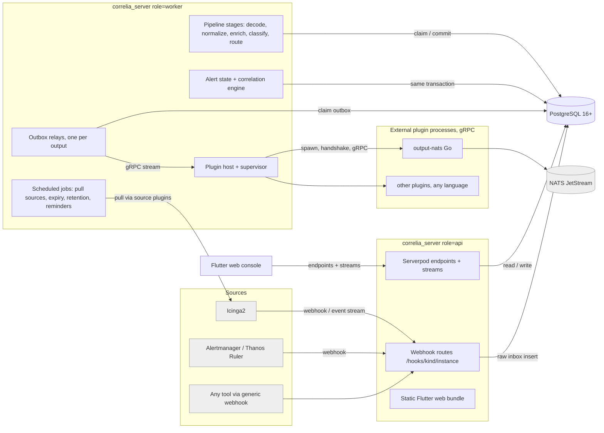

# Correlia Architecture

The current system shape. Change designs read this first. Detail lives in the ADRs (`docs/adr/`), the
research (`docs/research/`) and the change designs.

## System triage

- **T1 Components: yes.** The system has an api role, a worker role with pipeline stages and relays, a
  plugin host, external plugin processes, a Flutter web console and Postgres.
- **T2 State: yes.** It holds the alert state, the incident lifecycle state machine, rule versions,
  outbox/delivery state and plugin supervision state.
- **T3 Concurrency: yes.** Workers are claim-based and run on several instances and isolates, with
  per-fingerprint ordering. Relays and supervisors run in the background.
- **T4 Boundaries: yes.** These are versioned contracts:
  - the canonical event format (CloudEvents + protobuf/JSON);
  - the plugin gRPC protocol;
  - the public REST/webhook API;
  - NATS subjects;
  - the DB schema and its migrations.
- **T5 Volume: yes.** Raw inbox, events, activity and outbox grow without bound unless partitioned and
  retained. Alert storms create hot correlation groups.
- **T6 Risk: yes.** Ingest credentials, user auth, secrets in plugin configs, and sensitive data in alert
  text that goes out to external systems.

## Components

| Component | Responsibility | Owns (state) | Talks to via (contract) |
|---|---|---|---|
| Webhook routes (api) | Authenticate the source instance, bound the body size, store raw input, return 202, push back with 429/503 | nothing (writes `raw_inbox`) | HTTP: per-source formats; DB |
| Endpoints + streams (api) | Console and automation API; live change feed | sessions (Serverpod auth) | Serverpod protocol (generated client); DB |
| Pipeline stages (worker) | Raw → canonical events: decode, split, normalize, enrich, classify, route | stage cursors and claims | In-process plugin interfaces; DB |
| Correlation engine (worker) and `StateMutationService` | Alert state with ordering fences, incident open/merge/resolve, thresholds, silences, maintenance; the only writer of incident state, also used by endpoints and jobs | `alerts`, `incidents`, `incident_alerts`, `threshold_contributions`, `incident_transitions`, `activity` | DB: one transaction per batch, lock protocol of ADR 0007 |
| Outbox relays (worker) | Deliver routed events and notifications per output, with retry, backlog budget and dead letters | `outbox` delivery state, `delivery_attempts` | Output plugin interface; DB |
| Plugin host (worker) | Spawn, handshake, configure, health-check and restart external plugins; adapt them to the Dart interfaces | plugin runtime state (memory) and plugin status rows | go-plugin handshake + Correlia plugin protocol v1 (gRPC) |
| Scheduler (worker) | Pull sources, incident expiry, reminders, retention, partition maintenance | job rows (Serverpod future calls) | DB |
| External plugins | Source, decoder, enricher or output in any language | their own | Correlia plugin protocol v1 |
| Flutter web console | Operators' and engineers' UI | client-side view state only | Generated Serverpod client + streams |
| PostgreSQL | System of record | everything durable | SQL (Serverpod ORM + raw SQL for claims) |

## State ownership

| State | Sole writer | Lifetime | Invalidation / rebuild | Authoritative copy |
|---|---|---|---|---|
| `raw_inbox` | Webhook routes, pull sources (insert); pipeline (state) | `done` rows: retention window (configurable, default 30 d). `pending`/`failed` or dead-letter-referenced rows never expire (ADR 0005) | Pipeline replay with the pinned config version | Postgres |
| `events` (canonical) | Pipeline normalize/enrich stage | Retention (configurable, default 90 d), partitioned; kept while referenced by a pending or dead-lettered outbox row | Evidence, not state. Re-derivable from `raw_inbox` while that is retained | Postgres |
| `alerts` (state per fingerprint, with ordering fence) | `StateMutationService` | Firing: indefinite. Resolved: kept as tombstone at least the lateness horizon (default 7 d) | **Authoritative, never rebuilt** from events (ADR 0007) | Postgres |
| `incidents`, `incident_alerts`, `threshold_contributions`, `incident_transitions` | `StateMutationService` only (pipeline, operator actions, expiry/reminder jobs, merge/split all call it) | Indefinite (archival policy later) | Not rebuilt; the activity ledger explains every change | Postgres |
| `activity` ledger (also the change feed, cursor `(txid, id)`) | `StateMutationService`, endpoints | Indefinite (feed retention configurable; older cursors get `cursor_expired`) | Append-only | Postgres |
| Configuration versions (rules of every kind, source mappings, routing, plugin config) | Endpoints (console), provisioning loader | Versioned forever | Immutable; activated atomically, rollback = re-activate (ADR 0008) | Postgres; YAML for provisioned rules |
| Source instances and namespaces | Endpoints (admin) | Until removed | n/a | Postgres (ADR 0012) |
| `outbox`, `delivery_attempts` | Pipeline and `StateMutationService` (insert), relays (update) | Delivered: retention (7 d). Dead-lettered: dead-letter retention (14 d), expiry recorded in the ledger | Delivery replay (byte-identical) | Postgres |
| Plugin configs and secrets | Endpoints (admin) | Until changed | n/a | Postgres (secrets encrypted at rest) |
| Plugin process state | Plugin host | Process lifetime | Restart and re-handshake | Memory; status mirrored to Postgres |
| Console view state | Console | Session | Re-fetch after a stream invalidation | Browser memory |

## Boundaries and contracts

- **Canonical event** `correlia.event.v1` (ADR 0004): `proto/correlia/event/v1/*.proto` is the source of
  truth. JSON Schema is generated. `buf breaking` gates every change. CloudEvents `type` carries the
  major version and `dataschema` the minor.
- **Plugin protocol** `correlia.plugin.v1` (ADR 0006): `proto/correlia/plugin/v1/*.proto`. The handshake is
  compatible with go-plugin. The protocol version is negotiated at the handshake.
- **Inbound formats:** one mapping spec per integration (`openspec/specs/integration-<name>/`), with fixture
  payloads captured from real systems.
- **NATS subjects** (ADR 0011): `correlia.v1.ev.<tenant>.<kind>.<source_kind>.<severity>` and
  `correlia.v1.incident.<tenant>.<status>`.
- **Public API:** Serverpod endpoints for the console (generated client). Versioned REST under `/api/v1/` for
  automation and third parties: incidents, alerts, actions and rule import/export. API keys are scoped. Any
  malformed input (bad timestamp, naive datetime, unknown enum, oversize field) is a 400/422 with a field
  error (`application/problem+json`), never a 500 (legacy B7).
- **Identities:** source, transport delivery, observation (event id) and alert (fingerprint), with one
  canonical encoding (ADR 0012).
- **Change feed:** `(txid, id)` cursors over the activity ledger with the xmin watermark (ADR 0007).
- **Database:** Serverpod migrations only, never hand-edited. Every migration is forward-only and tested
  against a populated database.
- **Rule documents:** a versioned JSON/YAML format with a `language` field (ADR 0008).

## Resource bounds and failure visibility

| Flow / store | Bound | At the bound | On failure | Who finds out |
|---|---|---|---|---|
| Webhook body | 1 MiB default per source (Serverpod's default is 512 KiB; raised per route) | 413 | n/a | The sender; an ingest-rejected counter |
| Raw inbox lag | Configurable age/count (default 30 s / 50k rows) | 429/503 + `Retry-After` | n/a | The sender retries; a console banner shows backpressure |
| Decode | Per-event time budget | Event dead-lettered | `pipeline_failures` row with error | Console dead-letter view with replay |
| Enrichment | Per-rule regex timeout; per-plugin deadline | Rule skipped and recorded | Soft: `pipeline.enrichment_errors[]` | Event detail; per-rule error counter |
| Correlation group size | Unbounded membership, relational; display capped | n/a | Group lock serializes writers; deadlock/lock-timeout retries (5) then batch split, then pipeline failure | Metrics: lock waits, retries, hot groups |
| Ingest storage | DB-size watermark (default 85 % of the disk budget) | 429/503 + `Retry-After`; pull sources pause | Accepted work is never dropped | Console banner; health `/readyz` degraded |
| Output storage | Per output: 500k rows / 1 GiB, pending and dead-lettered combined | Output `overflowing`; policy `discard_new` (default, counted in the ledger) or `block_ingest` (opt-in) | Others unaffected under `discard_new` | Self-alert; console output health; counter |
| Observation dedup | `observation_keys` kept until max(first seen, source time) + 7 d + 5 min; source time at most 24 h ahead | Pruned by retention; later retries are `late`; far-future observations quarantined `future_dated` | n/a | `duplicate_observation` and `future_dated` counters |
| Dead letters | Retention 14 d (configurable) | Expired without replay: discarded, count written to the ledger | n/a | Ledger entry; console dead-letter view |
| Change feed | Watermark lag bounded by the transaction timeout | Feed waits for the watermark; wake-up pushed when it advances; 10 s safety pull | `cursor_expired` beyond feed retention, client re-snapshots | Metric: feed lag |
| Ingest dedup | Window 10 min (configurable) | Older retries are new deliveries; event ids still dedupe them downstream (ADR 0012) | n/a | `duplicate` counter |
| Outbox per output | Max attempts with exponential backoff | Moved to `outbox_dead` | Attempt record with error class | Console output health; dead-letter replay |
| Plugin process | Start timeout, health interval, crash budget | Circuit open: plugin `degraded` | Restart with backoff | Console plugin status; activity entry |
| Tables over time | Retention per table, configurable (defaults: raw `done` 30 d, events 90 d, delivered outbox 7 d), only terminal rows (ADR 0005) | Partitions dropped only when they hold no unfinished row; otherwise eligible rows deleted | Partition job failure alarm | Health endpoint + console system page |

## Correctness invariants (legacy defects and hazards)

Every legacy defect (`docs/research/legacy-audit.md` 6.1) and hazard (6.2) has a preventive contract here,
not only a future test. Scenario ids refer to `docs/plan/acceptance-scenarios.md`.

| Legacy | Preventive contract | Where | Scenario |
|---|---|---|---|
| B1 old recovery clears newer problem (and stale problem resurrects) | Per-alert ordering fence; stale events change nothing; tombstones at least as long as the lateness horizon | ADR 0007 | ORD-1, ORD-2 |
| B2 insert/close race gives a 500 | One mutation service; group locks first, discover-lock-revalidate; unique index as backstop | ADR 0007 | COR-2, COR-9 |
| B3 polling misses lifecycle changes | Change feed over the ledger with `(txid, id)` cursor and xmin watermark; entity versions | ADR 0007 | UI-1, UI-3 |
| B4 wrong recovery counts | Mutation results report counts per effect | ADR 0007 | COR-4 |
| B5 group key collisions | Structured group keys with length-prefixed canonical encoding | ADR 0007, 0012 | ID-1 |
| B6 valid input fails later on length | One bounds contract end to end; identity hashed, display truncated, renders limited | ADR 0004, 0012 | ID-3 |
| B7 naive datetime gives a 500 | All malformed API input gives 400/422 problem+json | Boundaries above | ID-5 |
| B8 empty registry skips validation | Atomic config versions validated against an explicit registry; empty is a registry | ADR 0008 | DUR-5 |
| B9 converter promises atomicity it lacks | Excluded: no legacy config converter in scope (assumption 2) | Strategy | n/a |
| B10 re-ack mixes first time and last actor | Ack = ownership; re-ack by another actor transfers; ledger keeps both | ADR 0007 | COR-8 |
| B11 multiline subject suppresses email | Rendered fields folded and limited per channel | ADR 0004 | DUR-7 |
| Future timestamps poison expiry | Effective source time clamped by skew allowance; expiry and windows use observed time | ADR 0007 | ORD-4 |
| Cross-source recovery | Namespace in every fingerprint; sharing only by explicit operator choice | ADR 0012 | ID-2 |
| Ambiguous fingerprint preimage | Canonical encoding | ADR 0012 | ID-4 |
| Threshold meaning mixes samples and objects | Explicit counting policy per rule; observations counted by event id | ADR 0007, 0012 | COR-1 |
| First crossing is not a successful notification | Notification intent is an outbox row committed with the crossing; retries and dead letters | ADR 0005, 0007 | DUR-6 |
| Stale problem restores membership | Membership follows the fenced alert transition | ADR 0007 | ORD-2 |
| Severity never downgrades | Current and peak severity shown separately | ADR 0007 | COR-3 |
| Accepted work lost on crash (no outbox) | Raw inbox and transactional outbox; retention never deletes unfinished work | ADR 0005 | DUR-1, DUR-2 |
| Retries replay effects (no idempotency) | Durable observation dedup before any state effect | ADR 0012 | ORD-5 |

## In-force ADRs

Accepted ADRs only.

| ADR | Decision | Supersedes |
|---|---|---|
| [0001](../docs/adr/0001-serverpod-modular-monolith.md) | Serverpod 4.1 modular monolith; one binary with api/worker/all roles | none |
| [0002](../docs/adr/0002-postgresql-everywhere.md) | PostgreSQL in every run mode; embedded Postgres for development and tests | none |
| [0003](../docs/adr/0003-flutter-web-console.md) | Flutter web console | none |
| [0004](../docs/adr/0004-canonical-event-format.md) | Canonical event: CloudEvents envelope + `correlia.event.v1` protobuf; one bounds contract | none |
| [0005](../docs/adr/0005-durable-staged-pipeline.md) | Durable staged pipeline, transactional outboxes, retention by state, storage budgets, replay vs reprocess | none |
| [0006](../docs/adr/0006-plugin-architecture.md) | Hybrid plugins: built-ins in process, external over go-plugin-compatible gRPC; spike gate | none |
| [0007](../docs/adr/0007-alert-and-incident-state-model.md) | Authoritative alert state with ordering fences; one StateMutationService lock protocol; `(txid, id)` change feed | none |
| [0008](../docs/adr/0008-rule-language.md) | Matcher rule tree with in-memory and SQL evaluators, field catalog, atomic config versions; CEL later | none |
| [0009](../docs/adr/0009-identity-and-access.md) | Serverpod auth (invite-only) for people, scoped tokens for machines; redaction | none |
| [0010](../docs/adr/0010-testing-strategy.md) | Tests on Linux through WSL with embedded Postgres, in tiers | none |
| [0011](../docs/adr/0011-nats-output-as-go-plugin.md) | NATS output as the first external plugin, in Go | none |
| [0012](../docs/adr/0012-identities.md) | Four identities (source, delivery, observation, alert); durable observation dedup | none |
