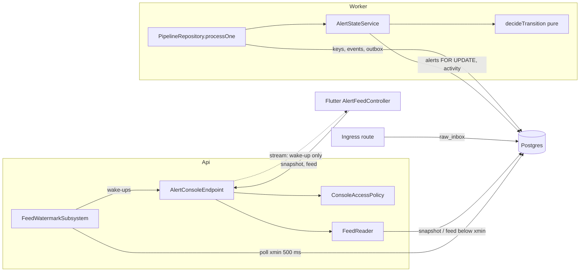
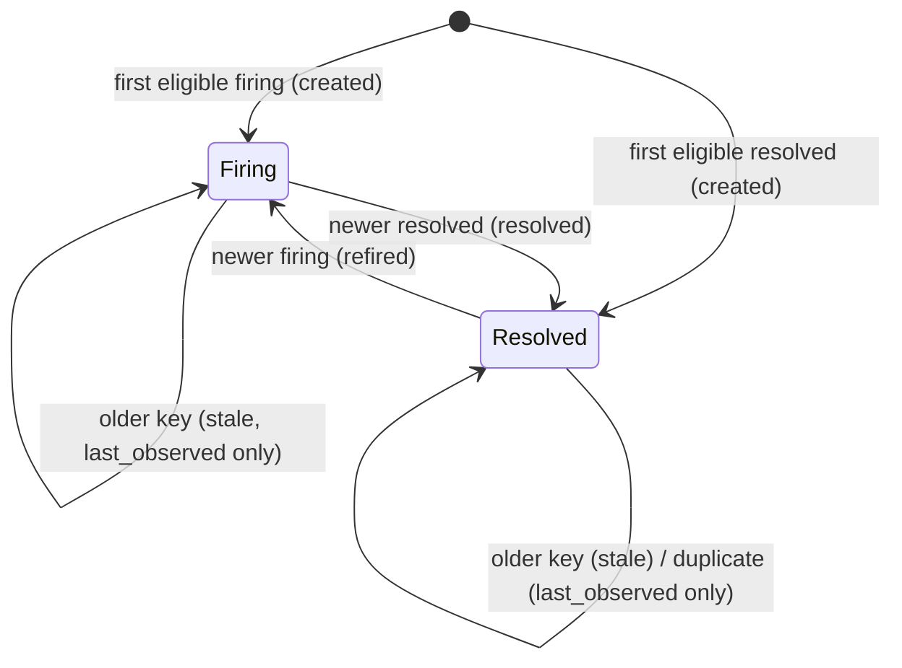
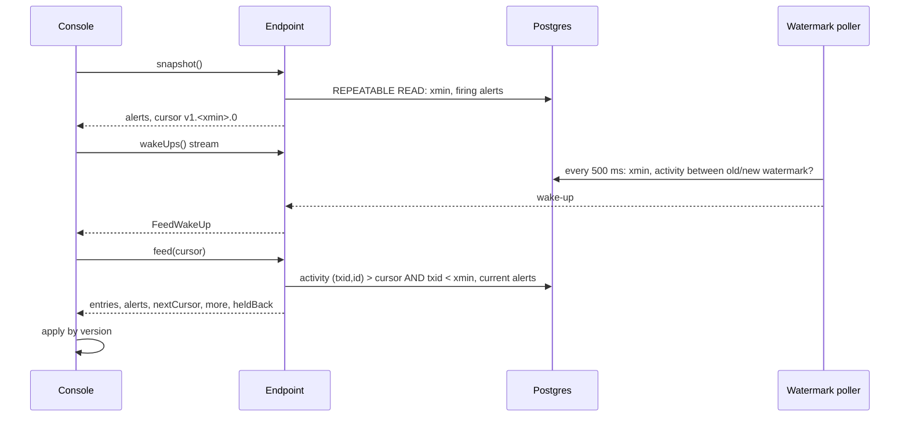

# Design

## Triage

| Trigger | Applies? | Evidence |
|---|---|---|
| T1 Components (new component, or 3+ with directed relationships) | yes | New state mutation service, feed reader, watermark poller subsystem, console endpoint and Flutter controller, between the pipeline, Postgres and the browser |
| T2 State (persistent state, caches, 3+ state machine) | yes | New authoritative `alerts` table, append-only `activity` ledger, new `events.state_outcome` column, and client view state keyed by version |
| T3 Concurrency (background work, workers/isolates, async, retries) | yes | Concurrent pipeline transactions lock alert rows. The feed must be lossless under interleaved commits. The watermark poller and the streams run in the background |
| T4 Boundaries (data format, migration, shared interface, IPC, external) | yes | Managed migration plus schema step `0002`. The first Serverpod endpoint, stream and client-visible models. The opaque cursor format |
| T5 Volume (grows without a fixed bound) | yes | `activity` grows without bound (retention is indefinite, per the architecture). Firing alerts can grow under a storm |
| T6 Risk (security, money, data loss, unrecoverable user data) | yes | An unauthenticated read API over alert text, which can contain secrets (D11). Alert state is authoritative and cannot be rebuilt |

TIER: FULL

## Context

`proposal.md` gives the scope. The current code:

- **Pipeline transaction.** `PipelineRepository.processOne` (`correlia_server/lib/src/pipeline/pipeline.dart:211`)
  claims one raw row (`FOR UPDATE SKIP LOCKED LIMIT 1`, :217) and decodes it (:286).
  - It sorts the events by `eventId` (:313) and runs them in one savepoint (:322).
  - For each non-future event it inserts `observation_keys` with `ON CONFLICT DO NOTHING RETURNING`
    (:342-356); no row returned means a duplicate.
  - It inserts `events` with a `disposition` of `ready`, `late` or `future_dated` (:363-380), and writes
    one `outbox` row per routed output for ready events (:411-434).
  - The raw outcome is `raw_inbox.outcome_json` (:443-457).
  - Transient errors retry and internal errors spend a 5-attempt budget (`_recordError`, :509).
  - Statement and lock timeouts come from `_limits` (:159) under a 10 s deadline (:113).
  - The archived design reserved exactly this transaction for state
    (`openspec/changes/archive/2026-11-12-alertmanager-ingest-pipeline/design.md:65`).
- **Evidence classification.** `classifyEvidence` (`pipeline.dart:23`) returns ready, late (more than
  7 days old) or future-dated (more than 24 h ahead). Both limits are code constants.
- **Schema steps.** `SchemaStep(version, sql)` is registered in `schemaSteps`
  (`lib/src/schema/schema_steps.dart:31`). The scripts are `schema/NNNN_*.sql` under advisory lock
  1129271885. `0001_ingest.sql` owns `raw_inbox`, `events` and `outbox`.
- **Managed models.** These are `serverOnly` `.spy.yaml` files with camelCase quoted columns, for example
  `lib/src/models/observation_key.spy.yaml`. There are no endpoints and no client-visible models
  (`lib/src/generated/endpoints.dart:17`), and no auth package.
- **Runtime.** The roles come from `ProcessRole` (`lib/src/runtime/process_options.dart:13`).
  Subsystems are listed in `lib/src/runtime/registry.dart:14`, and `ConsoleSubsystem` (api/all) is added
  in `lib/server.dart:63-79`. Clocks and intervals are injected as constructor parameters
  (`test/db/pipeline_test.dart:66`).
- **Serverpod 4.1 facts checked in the pub cache:**
  - A `MethodCallSession` and a `MethodStreamSession` carry the Relic `Request`
    (`serverpod-4.1.0/lib/src/server/session.dart:153,356`), and `Request.connectionInfo.remote` is the
    TCP peer (`relic_core-2.0.0-rc.2/lib/src/context/request.dart:66`).
  - `Request.remoteInfo` prefers the `Forwarded` and `X-Forwarded-For` headers
    (`serverpod-4.1.0/lib/src/util/request_extension.dart:12-28`), so it can be spoofed.
  - Without `authCookie`, Serverpod answers with a wildcard CORS origin (`server.dart:360`).
  - Test sessions from `serverpod_test` have `request: null` (`test_stream_manager.dart:43`).
- **Console.** It is a template placeholder (`correlia_flutter/lib/main.dart`). Its client URL comes
  from `assets/config.json` (`http://localhost:8080`). It is built into `correlia_server/web/app` by
  `mise run build:web`. There is no routing or state-management package.

## Decisions

### D1: The alert table is a managed Serverpod model, written through parameterized SQL

- **Choice:** `alerts` is a `serverOnly` `.spy.yaml` table with a scalar id and a unique index on
  (`tenant`, `fingerprint`). Its columns:
  - status and severity;
  - the display fields `summary`, `sourceInstance` and `firingSince`;
  - the fence, at full canonical precision: `fenceEffectiveSeconds` (bigint) and `fenceEffectiveNanos`
    (int, 0-999,999,999), `fenceObservedSeconds` and `fenceObservedNanos`, and `fenceEventId` (UUID
    text). These are kept as seconds plus nanos because the canonical `EventTimestamp`
    (`lib/src/event/event_timestamp.dart:6`) carries nanoseconds across years 1-9999. A `timestamptz`
    would truncate to microseconds, as the existing `_date` conversion in `pipeline.dart` does, and
    int64 epoch nanoseconds overflow before year 9999 (round 1, M2);
  - `lastObservedAt`, `version`, `createdAt` and `updatedAt`.

  `lastObservedAt`, `firingSince` and the timestamps are `timestamptz` (display and freshness only;
  never ordering inputs). The state service reads and writes it through `unsafeQuery`/`unsafeExecute`, using
  `INSERT … ON CONFLICT DO NOTHING` and `SELECT … FOR UPDATE`, as the pipeline already does for
  `observation_keys`. A client-visible `AlertView` model, separate from the table model, carries the
  fields the console shows.
- **Rejected:** A SQL-owned `alerts` table created by the schema step. It needs no composite key or
  expression default, the only grounds for an exception (`openspec/architecture.md`, Database), and it
  would add an unreviewed exception.
- **Reversal cost:** medium (a table move with data).
- **Important:** yes (binds future changes: M3 incidents reference alert ids).
- **Chosen by:** agent.

### D2: Schema step 0002 adds the `activity` table and `events.state_outcome`

- **Choice:** `schema/0002_activity.sql` creates `activity`. It also adds the nullable
  `events.state_outcome text CHECK (state_outcome IN ('applied','stale'))`, which is NULL for events that
  are not evaluated (late, future-dated, info). An applied observation with no visible change is still
  `applied`. This marks a stale event as ADR 0017
  requires, without changing the events primary key or the outbox reference columns.

  `activity` columns:
  - `id bigserial PRIMARY KEY`;
  - `txid xid8 NOT NULL DEFAULT pg_current_xact_id()`;
  - `occurred_at timestamptz`;
  - `entity_kind text`, `entity_id bigint`, `entity_version bigint`;
  - `change_kind text`;
  - `actor_kind text`, `actor_ref text`;
  - `cause_event_id uuid`, `cause_raw_id uuid`.

  An index on `(txid, id)` serves the feed. Nothing references it by foreign key.
- **Rejected:** Recording stale only in the raw `outcome_json` counts. That loses which event was stale,
  so ORD-1 could not be shown per event.
- **Reversal cost:** high once data exists (the ledger is append-only and indefinite).
- **Important:** yes (stored data format).
- **Chosen by:** agent.

### D3: Three phases inside `processOne`, with fixed lock order

- **Choice:** Restructure the per-event loop into three phases in the same transaction and savepoint:
  1. **Keys.** In `eventId` order, as now: classify, insert observation keys, and detect duplicates. For
     a duplicate, read the original key's `disposition`.
  2. **State.** Take the distinct fingerprints touched by eligible (ready) events and by duplicates of
     ready keys. In ascending fingerprint order, take each alert row's lock: for a fingerprint with an
     eligible non-info event, `INSERT … ON CONFLICT DO NOTHING` and then `SELECT … FOR UPDATE`;
     otherwise `SELECT … FOR UPDATE` only. Then evaluate each fingerprint's observations in
     ordering-key order through the pure transition function (D4), write the alert row and its
     activity entries, and apply `GREATEST` to `lastObservedAt`.
  3. **Effects.** In `eventId` order: insert events with `state_outcome`, then the outbox rows, exactly as
     today.

  A transaction in phase 2 never waits for a key lock, and phase 1 holds no alert locks. So the key
  locks and the alert locks cannot form a cycle, and alert rows are always locked in fingerprint order
  (ADR 0017's step 2). Evaluating a fingerprint's observations in ordering-key order gives the same final
  status, severity, display fields and fence as any other order. Classifications and the version count
  can differ between orders, as the `alert-state` spec states (round 1, M1).
- **Rejected:** Evaluating state inside today's per-event loop. Alert locks would follow `eventId` order,
  which allows deadlocks between deliveries that share fingerprints. Deadlocks are retried, but they
  would cost latency, and ADR 0017 fixes the order.
- **Reversal cost:** low (internal).
- **Important:** no.
- **Chosen by:** agent.

### D4: A pure ordering key and transition function

- **Choice:** `lib/src/state/` holds pure Dart:
  - `OrderingKey(effectiveAt, observedAt, eventId)` over `EventTimestamp` values (seconds plus nanos), where `effectiveAt = min(sourceTime,
    observedAt + skewAllowance)`. Event ids are compared as lowercase canonical UUID text, which matches
    byte order.
  - `decideTransition(AlertState?, Observation) → TransitionResult`, a sealed type with these cases:
    - `Created`, `Applied(visibleChange: bool)`, `Stale`, `Ignored` (info);
    - the new state;
    - the activity change kind (`created`, `resolved`, `refired`, `severity_changed`,
      `display_changed`).

  The version increases, and activity is written, only when `visibleChange` holds (status, severity or a
  display field changed). The DB layer only locks, loads, calls the function and persists.
- **Rejected:** Doing the comparison in SQL (`WHERE (fence) < (new)` in the `UPDATE`). It splits the
  rules between SQL and Dart and makes ORD-1/2/3 testable only against Postgres. AGENTS.md says state
  machines are tested as pure Dart.
- **Reversal cost:** low.
- **Important:** no.
- **Chosen by:** agent.

### D5: The skew allowance is a constant beside the existing lateness and future limits

- **Choice:** A 5-minute `skewAllowance` constant in the same file as `classifyEvidence`'s 7-day and
  24-hour constants. It is injectable through the repository constructor for tests only. No config key.
- **Rejected:** A server config key now. M2 owns configurable ingest policy, and a key binds the config
  contract.
- **Reversal cost:** low.
- **Important:** no.
- **Chosen by:** agent.

### D6: Feed API shape and opaque cursor

- **Choice:** One endpoint, `AlertConsoleEndpoint`:
  - `snapshot()` → `AlertSnapshot { alerts: List<AlertView>, omittedCount, cursor }`. It runs in one
    REPEATABLE READ transaction that first reads `pg_snapshot_xmin(pg_current_snapshot())` and then
    selects the firing alerts. These are capped at 500, ordered by severity rank (critical > error >
    warning > unknown > info, the D29 default) and then by `firingSince` descending.
  - `feed(String cursor, int limit)` → `FeedPage { entries, alerts, nextCursor, more, heldBack }`.
    - `entries` are activity summaries (kind, entity, version, time).
    - `alerts` are the current `AlertView` rows of the entities those entries name, read in the same
      transaction. They can be newer than the entry; the client applies them by version.
    - `limit` is clamped to [1, 1000].
  - `wakeUps()` → `Stream<FeedWakeUp>`.

  The cursor is the string `v1.<txid>.<id>`. 64-bit values are text because Dart web integers lose
  precision above 2^53. The snapshot cursor is `v1.<watermark>.0`, and a feed read returns rows with
  `(txid, id) > cursor` and `txid < watermark`. A cursor whose txid is at or below the current watermark
  is accepted, including a snapshot cursor on an empty ledger. A cursor whose txid is above the current
  watermark, or that does not parse, gets the serializable `InvalidCursorException` (round 1, M4).
  `pg_snapshot_xmin` of a new snapshot never decreases on one database, so an issued cursor stays valid
  across reads and api instances.

  `AlertView` carries the id, version, status, severity, summary, source instance, `firingSince`,
  `lastObservedAt` and the generator URL (from the event's links), all bounded as in the canonical event.
  The generator URL is a column on `alerts`, updated like the other display fields. There is no `cursor_expired` yet:
  feed retention is indefinite in M1.
- **Rejected:** Pushing entries over the stream. ADR 0017 makes streams wake-up only, so that a dropped
  socket can never lose data. Integer cursors were rejected for the web precision reason above.
- **Reversal cost:** medium (the client and server ship together, but M4's REST `/api/v1/` will reuse
  the cursor shape).
- **Important:** yes (shared interface).
- **Chosen by:** agent.

### D7: A per-instance watermark poller pushes wake-ups

- **Choice:** A new `FeedWatermarkSubsystem` (roles api and all) owns a broadcast controller.
  - While at least one wake-up stream is subscribed, it polls every 500 ms (injectable) on its own
    session: `SELECT pg_snapshot_xmin(pg_current_snapshot())` and whether any activity exists with
    `txid >= lastWatermark AND txid < newWatermark`.
  - When the watermark has advanced past such rows, or entries existed above the old watermark, it emits
    one `FeedWakeUp`.
  - It also emits when it sees new rows below the watermark. This covers a commit that never held the
    watermark.
  - Each `wakeUps()` call subscribes until its stream is cancelled.
  - The subsystem stops before the database closes, as the graceful-shutdown order requires.
- **Rejected:** Postgres `LISTEN/NOTIFY` or Serverpod server events alone. A notify fires at commit,
  while an older open transaction can still hold the watermark (UI-3b), so a poll is needed anyway, and
  the notify would only add a path.
- **Reversal cost:** low.
- **Important:** no.
- **Chosen by:** agent.

### D8: Access guard for the unauthenticated console API

- **Choice:** Every console endpoint method and the stream first call `ConsoleAccessPolicy.check(runMode,
  role, request)`. It refuses with the serializable `ConsoleAccessDeniedException` unless all of these
  hold:
  - the run mode is `development` or `test`;
  - the role is `api` or `all`;
  - `request.connectionInfo.remote` is a loopback address (the TCP peer, never `remoteInfo` or the
    forwarded headers);
  - the `Host` header names `localhost`, `127.0.0.1` or `[::1]` (against DNS rebinding);
  - any `Origin` header is an `http://localhost:*`, `http://127.0.0.1:*` or `http://[::1]:*` origin
    (against cross-site reads under the wildcard CORS).

  A `null` request, as in in-process test sessions, is refused. DB tests call the services under the
  endpoint directly, and the guard is tested with real Relic `Request` objects plus an e2e call. The
  guard lives in one file, which M4 replaces with authentication.
- **Rejected:**
  - Binding the API port to loopback. Serverpod serves the ingest webhooks and the endpoints on the
    same server, and a real Alertmanager on another host must reach the webhook.
  - Trusting `remoteInfo`: it takes `X-Forwarded-For`.
- **Reversal cost:** low.
- **Important:** yes (security; what users see).
- **Chosen by:** agent.

### D9: The console uses a plain controller and one new first-party package

- **Choice:**
  - `AlertFeedController extends ChangeNotifier` takes an injected `ConsoleApi` interface, implemented
    over the generated client and faked in widget tests, plus an injected clock and timer factory.
  - It holds `Map<int, AlertView>` keyed by alert id, its cursor and its connection status.
  - **Single flight and generations** (round 1, C1):
    - At most one snapshot or feed read is in flight. A wake-up or a safety tick during a read sets a
      `pullAgain` flag, and the read drains again when it finishes.
    - Every snapshot starts a new generation, and a response from an older generation is discarded.
    - So responses are applied strictly in request order. Each feed read sees current rows at least as
      new as the previous one.
  - **Version tombstones.** When an alert is removed on resolution, its id and last version move to a
    tombstone map, capped at 10,000 entries with the oldest evicted. An incoming alert is applied only
    when its version is greater than both the live and the tombstone version. A new snapshot clears the
    tombstones.
  - It drops resolved alerts, and pulls on each wake-up and on a 10 s safety timer.
  - **Partial snapshot** (round 1, M3; round 2, M1). The list needs reconciliation when the last
    snapshot's `omittedCount` is above 0, or when feed additions take the held firing alerts above the
    snapshot limit (500). Then it is marked partial and shows the count. Every safety tick takes a new
    snapshot, which is bounded, instead of a feed read, and the new snapshot's `omittedCount` decides
    whether reconciliation continues. So a list that starts complete also returns to the bound. That refills omitted alerts and refreshes the count. The
    view is a periodically reconciled top 500, not a continuously maintained one; feed additions between
    reconciliations can briefly exceed 500.
  - **ADR 0003 day-one features** (round 1, M5):
    - the page is wrapped in `SelectionArea`;
    - each row has `Semantics` with severity, summary and source;
    - a filter `TextField` filters the held alerts by case-insensitive substring over summary, source
      instance and severity. It is applied at render, so live changes keep respecting it;
    - a generator URL renders through `url_launcher`'s `Link` widget, so it opens in a new tab. This is
      the only new package: first-party flutter.dev, required by ADR 0003. There are no alert detail
      pages in M1, so rows themselves have no link target yet.
  - A failed stream or feed read marks the view disconnected, keeps the rows marked possibly stale, and
    retries with backoff (1, 2, 4, then a cap of 10 s).
  - An `InvalidCursorException` takes a new snapshot.

  The screen is one `AlertListPage` built with `ListenableBuilder`. `main.dart` calls `initializeClient()`.
- **Rejected:**
  - Adding go_router and a state-management package. M1 has one screen, and M4 designs the console
    architecture.
  - Concurrent pulls with version checks only. A resolved alert has no live version to compare, so a
    late older response would restore it (round 1, C1).
- **Reversal cost:** low.
- **Important:** no.
- **Chosen by:** agent.

### D10: Raw outcome counts gain `applied` and `stale`

- **Choice:** `outcome_json` adds `applied` and `stale` beside the existing counts. `duplicate_observation`
  keeps its meaning, and `committed` keeps counting ready events. The counts are written with the raw
  outcome in the same transaction.
- **Rejected:** A separate per-row state result table. It would duplicate `events.state_outcome`.
- **Reversal cost:** low.
- **Important:** no.
- **Chosen by:** agent.

### Decision summary

| # | Decision | Choice | Rejected | Reversal cost | Important | Chosen by |
|---|---|---|---|---|---|---|
| S1 | Scope | Alert state and activity only; incidents in M3 | Empty incident scaffolding now | low | yes | agent |
| S2 | Stale routing | Stale observations still routed | Suppress outputs for stale | medium | yes | agent |
| S3 | Console exposure | Unauthenticated, development/test, loopback, not worker | M4 auth now; open in every mode | low | yes | agent |
| S4 | UI-4 and actions | Deferred to M4 | Build the freshness pull now | low | no | agent |
| D1 | Alert table | Managed model, SQL writes, fence as seconds plus nanos | SQL-owned exception table; `timestamptz` fence | medium | yes | agent |
| D2 | Ledger and stale mark | Schema step 0002: `activity` and `events.state_outcome` | Counts only in `outcome_json` | high | yes | agent |
| D3 | Transaction shape | Keys → state (fingerprint order) → effects | State inside the eventId loop | low | no | agent |
| D4 | Transition logic | Pure Dart ordering key and sealed result | Fence comparison in SQL | low | no | agent |
| D5 | Skew allowance | Constant, test-injectable | Config key now | low | no | agent |
| D6 | Feed API | snapshot / feed / wake-up stream, text cursor `v1.<txid>.<id>`, accepted at or below the watermark | Entries over the stream; int cursor | medium | yes | agent |
| D7 | Wake-ups | Per-instance 500 ms watermark poll | LISTEN/NOTIFY or server events alone | low | no | agent |
| D8 | Access guard | Run mode, role, TCP-peer loopback, Host and Origin checks | Loopback bind; `remoteInfo` | low | yes | agent |
| D9 | Console architecture | Single-flight ChangeNotifier controller with generations, tombstones, partial re-snapshot and ADR 0003 features (adds `url_launcher`) | go_router plus a state package; concurrent pulls | low | no | agent |
| D10 | Outcome counts | `applied` and `stale` added to `outcome_json` | A separate result table | low | no | agent |

## Diagrams (FULL)

Components (T1):



Alert state per fingerprint (T2):



Raw row transaction (T3):

```mermaid
sequenceDiagram
  participant W as Worker tx
  participant K as observation_keys
  participant A as alerts
  participant L as activity
  participant E as events/outbox
  W->>K: phase 1, eventId order: INSERT ON CONFLICT DO NOTHING; dup → read original disposition
  W->>A: phase 2, fingerprint order: ensure row, SELECT FOR UPDATE
  W->>W: decideTransition per observation in ordering-key order
  W->>A: UPDATE state, fence, version, GREATEST(last_observed_at)
  W->>L: INSERT activity per visible change (txid default)
  W->>E: phase 3, eventId order: events(state_outcome), outbox
  W->>W: raw done + outcome_json, COMMIT (any failure: all roll back)
```

Feed handover and wake-up (T4):



## State & Ownership (FULL)

| State | Owner (sole writer) | Lifetime | Invalidation / rebuild | Authoritative copy |
|---|---|---|---|---|
| `alerts` rows | `AlertStateService` (called only from `processOne` in M1) | Firing: indefinite. Resolved tombstone: indefinite in M1 (at least the 7 d horizon; tombstone retention is M2) | Never rebuilt from events (ADR 0017) | Postgres |
| `activity` rows | `AlertStateService` (later: endpoints for actor actions) | Indefinite (M1) | Append-only; never updated | Postgres |
| `events.state_outcome` | `processOne` phase 3, at insert | The event's retention | Immutable with the event | Postgres |
| `outcome_json` `applied`/`stale` | `processOne` | The raw row's retention | Written once with done | Postgres |
| Watermark and subscriber set | `FeedWatermarkSubsystem` (per api instance) | Process lifetime | Re-read every poll | Memory; Postgres xmin is the truth |
| Console alert map, cursor, connection status | `AlertFeedController` | Browser session | New snapshot on start, on a rejected cursor or on reload | Server; the client copy is a version-ordered cache |

## Failure & Visibility (FULL)

| Component | Fails / dies mid-operation → | Recovery | Retry safe? | Who finds out |
|---|---|---|---|---|
| State phase in `processOne` | Lock timeout, deadlock or worker death: the transaction rolls back with keys, events and outbox | Existing transient retry; the raw row stays pending or claimable | Yes: no effect committed, the observation keys roll back too | Existing pipeline retry and failure records; DUR-1 test |
| Transition invariant violation (for example an update of 0 rows) | Treated as an internal error | 5-attempt budget, then `processing_exhausted` | Yes | `pipeline_failures` row with error class |
| Watermark poller query fails | No wake-ups this tick | Next tick; clients' 10 s safety pull still reads | Yes | Server log warning (rate-limited, one per failure episode) |
| Watermark held back (long transaction) | Feed pages report `heldBack: true`; nothing is skipped | The transaction ends (bounded by statement and lock timeouts and the 10 s pipeline deadline) | n/a | A log warning when held back for more than 30 s, once per episode; the feed's `heldBack` |
| Stream socket drops | No wake-ups for that client | The client reconnects with backoff and pulls from its cursor | Yes (pull is idempotent by version) | The console's disconnected banner |
| Feed or snapshot read fails | The client keeps its rows marked possibly stale | Backoff retry; a rejected cursor takes a new snapshot | Yes | The console banner |
| Guard refuses | No data | n/a | n/a | The caller (authorization error); server log at debug level |

## Resource Bounds (FULL)

| Queue / buffer / cache / transfer | Bound | At the bound | Timeout | At 10x / 100x |
|---|---|---|---|---|
| Alert locks per raw row | Distinct fingerprints in one delivery (bounded by the existing batch bound) | n/a | Existing `lock_timeout` and 10 s deadline | Larger batches serialize longer on hot fingerprints; retried as transient |
| Snapshot | 500 firing alerts plus `omittedCount` | Shows the first 500 by severity, then newest | Statement timeout | 50k firing: still 500 rows; the count is visible |
| Feed page | Client 200; server clamps to [1, 1000] | `more: true`; the client pulls again | Statement timeout | A storm at 10k changes/min: about 50 pages a minute per client; acceptable for M1 dev use |
| Feed `alerts` join | At most one row per entity in the page (≤ page limit) | n/a | Same | Same |
| Console alert map | The snapshot's 500 plus feed additions until the next reconciliation (at most 10 s after the limit is crossed, from a partial or a complete start) | Rendering is lazy (`ListView.builder`) | n/a | 50k firing: still about 500 plus 10 s of additions; M4 adds paging and server-side filters |
| Console tombstones | 10,000 ids | The oldest is evicted (a late response older than about 10,000 resolutions could re-add it until the next snapshot) | n/a | Constant |
| Partial re-snapshot | One bounded snapshot per 10 s per partial client | n/a | Statement timeout | 100 partial clients: 10 snapshot queries/s; acceptable for dev-only M1 |
| Wake-up broadcast | One pending event per subscriber (coalesced: a wake-up has no payload) | Extra wake-ups are dropped while one is pending | n/a | Unaffected |
| Watermark polling | 2 queries per 500 ms per api instance, only while subscribers exist | n/a | Statement timeout 2 s | Constant |
| `activity` table | Unbounded; retention is indefinite by architecture decision | n/a | n/a | The `(txid, id)` index keeps feed reads at index range scans; retention or partitioning is M2/M10 |

## Flow & State Gaps (FULL)

- **Partial completion.** Everything is in one transaction (D3). A crash before commit leaves no alert,
  activity, key, event or outbox effect.
- **Concurrent first observation.** `INSERT … ON CONFLICT DO NOTHING` followed by `FOR UPDATE` makes the
  second transaction wait. It then evaluates against the first one's fence.
- **Duplicate of an in-flight observation.** The key insert waits on the uncommitted unique entry. After
  commit it is a duplicate of a ready key, and the alert row then exists.
- **Duplicate of a ready info observation.** No alert row exists, so nothing advances.
- **Duplicate of a ready key now classified late.** It still advances `last_observed_at`, because the
  dedup record keeps the original's outcome (ADR 0017, Duplicates first).
- **Multiple observations of one fingerprint in one delivery.** They are evaluated in ordering-key order
  under one lock. The final status, severity and fence equal any one-at-a-time order; the version and
  classifications reflect the order actually committed.
- **Overlapping console reads.** Serialized by D9's single flight. A response from an older generation
  is dropped.
- **Out-of-order delivery.** Handled by the fence (ORD-1/2/3).
- **Observation key expiry.** There is no pruning job in M1. The ORD-5d test deletes the key as the
  retention job will (the job is M2).
- **Feed and snapshot race.** Covered by the REPEATABLE READ snapshot cursor at xmin. A repeated entry
  comes with the alert's current row, which is equal to or newer than the snapshot's: equal versions are
  ignored and newer ones applied (round 2, M2).
- **A client cursor ahead of the watermark** after a server database restore or a bug: rejected, and the
  client re-snapshots.
- **Worker role.** It serves the endpoint (Serverpod is a monolith there) and runs no poller. The guard
  refuses the calls.
- **Restart mid-stream.** The client keeps its cursor in memory and resumes. A browser reload takes a new
  snapshot.

## Mechanism Ledger (FULL)

| Mechanism | Built? | Why (harm nobody catches / expensive later) | Evidence that would change the call |
|---|---|---|---|
| Ordering fence and stale classification | yes | Without it, B1 silently corrupts authoritative state | n/a (ADR 0017) |
| Three-phase lock order | yes | Without it, cross-delivery deadlocks become routine under storms; the order is fixed by ADR | n/a |
| `events.state_outcome` | yes | Stored-format decision; adding it later cannot recover past stale marks | n/a |
| Watermark poller | yes | Without it, UI-3b strands a client until the 10 s safety pull | n/a |
| Host and Origin checks in the guard | yes | Wildcard CORS lets any web page the operator visits read loopback alert data; nobody would notice | n/a |
| Console version tombstones | yes | Defence beside single flight: without a removed alert's version, any response reordering (a bug, a future concurrent path) silently restores a resolved alert on screen; 10,000 ids cost little | Removed if M4's console architecture replaces the controller |
| `cursor_expired` | no | Feed retention is indefinite in M1, so it cannot occur | Feed retention lands (M2/M10) |
| Freshness pull (UI-4) | no | M4 scenario; the list still shows the snapshot or feed value | Owner wants live last-seen in M1 |
| Metrics export for feed lag | no | No metrics backend exists; log warnings plus `heldBack` make it visible | M10 OpenTelemetry |
| Tombstone pruning | no | Rows are kept indefinitely, which satisfies the horizon | Storage pressure (M2 retention) |
| LISTEN/NOTIFY fast path | no | The 500 ms poll meets the scenarios | A latency target under 500 ms |

## Risks / Trade-offs

- [Risk] The restructured `processOne` regresses existing ingest behaviour → the existing db and e2e
  tests run unchanged in the group that restructures it, before state is added.
- [Risk] Hot fingerprints under storms serialize on alert-row locks → the transaction stays short (no
  I/O beyond the database). COR-6 qualification is M3.
- [Risk] The development-only guard is mistaken for security → it refuses in every non-dev mode, and the
  docs say the console is not for production until M4.
- [Risk] Long transactions freeze the feed for every client → the existing statement and lock timeouts
  and the 10 s pipeline deadline bound them, and a log warning appears after 30 s.
- [Risk] Serverpod streaming on Flutter web behind wildcard CORS behaves differently from the VM → an e2e
  test exercises the real WebSocket from the Dart client, and widget tests use the fake API. The real
  browser path is seen by the owner at the milestone close.

## ADRs

- **In force, constraining this change:**
  - 0017 (state model, fence, ledger, feed);
  - 0016 (pipeline transactions, no processing order);
  - 0024 (dedup keeps the original outcome);
  - 0021 (canonical event fields);
  - 0002 and 0014 (embedded Postgres, Linux);
  - 0001 (roles, monolith);
  - 0003 (Flutter web console);
  - 0009 (auth comes in M4; the actor comes from authentication, here the pipeline system actor).
- **To record during apply:** none. The architecture file's Database section is updated: `activity` is
  created by schema step 0002 and is no longer future work, and `events.state_outcome` is noted.

## Open Questions

- D29 (where `unknown` sorts) is open with the owner. The snapshot uses the assumed default. A different
  answer changes only the sort constant.
