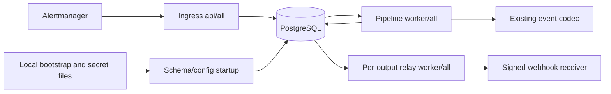
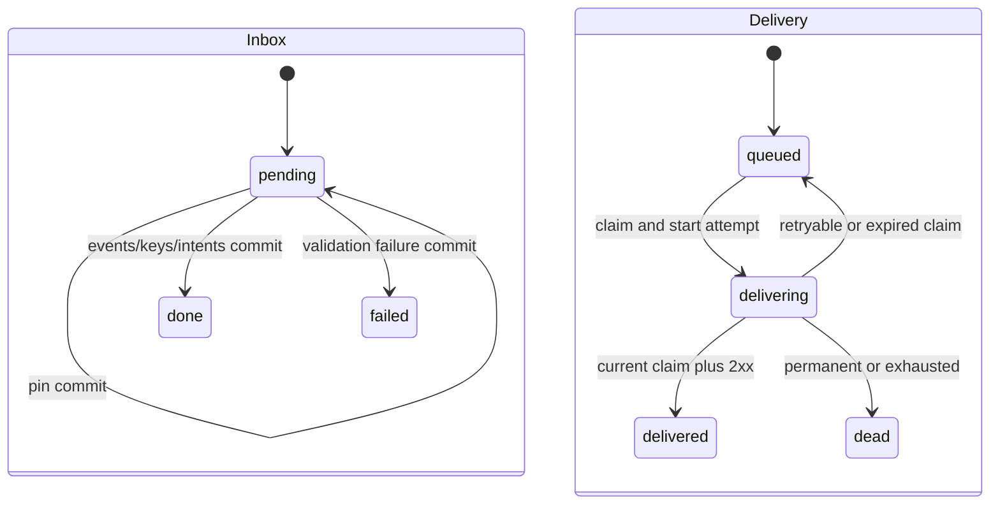
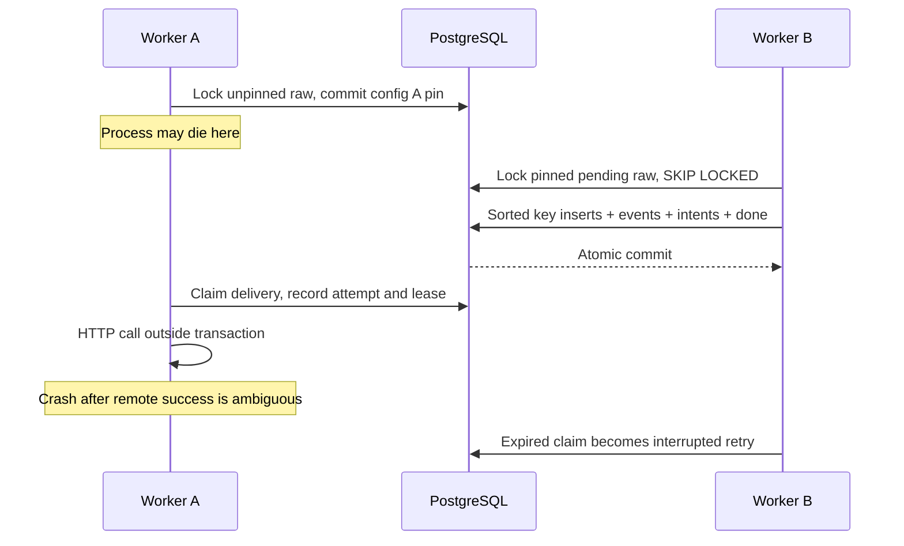
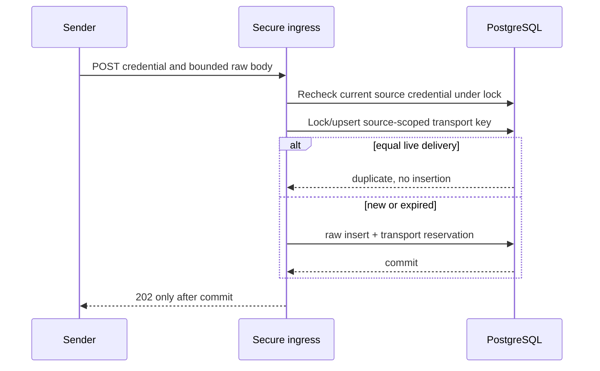

# Design

## Triage

| Trigger | Applies? | Evidence |
|---|---|---|
| T1 Components | yes | New ingress, pipeline and output components; runtime registry currently empty (`correlia_server/lib/src/runtime/registry.dart:8`). |
| T2 State | yes | New persistent inbox/config/dedup/events/outbox; baseline project migration has no application tables (`correlia_server/migrations/20261103184038320/definition_project.json:5`). |
| T3 Concurrency | yes | Concurrent HTTP admission, independent pipeline transactions and network relays with crash recovery. |
| T4 Boundaries | yes | Webhook v4, bootstrap files, SQL schema, shared output interface and signed CloudEvents HTTP. |
| T5 Volume | yes | Accepted raw data, observation keys, events and delivery attempts accumulate. |
| T6 Risk | yes | Credentials, raw payload privacy, accepted-work durability and duplicate external effects. |

TIER: FULL

## Context

Scope and milestone coverage: proposal.md. Existing code to reuse:

- `correlia_server/lib/event.dart:4-18` exports validated events, CloudEvents and identity operations; `src/event/canonical_event.dart:268-295` constructs typed events. `src/event/identity.dart:195-198,330-354,468-519` supplies original-label selection, Alertmanager observation keys, event ids and transport keys. Do not reimplement identity or time parsing.
- `src/runtime/subsystem.dart:15-33` supplies role ownership and mount/start/stop. `src/runtime/role_runtime.dart:108-132` mounts routes and starts Serverpod **before** starting subsystems. `src/runtime/serverpod_adapter.dart:27-31` starts listeners. Therefore a route must reject admission until bootstrap completes; readiness alone is not an admission gate.
- `lib/server.dart:62-73` builds the registry before the console catch-all. `src/runtime/console_subsystem.dart` owns that fallback; mount ingress before it.
- `test/db/database_smoke_test.dart:6-18` uses generated test tools with the db tag. `test/support/child_server.dart:13-27` supplies real test entry points, file-backed logs and stdin-EOF shutdown. Independent-connection tests must disable rollback and clean only their own rows.
- Pinned Serverpod 4.1 package source `package:serverpod/src/web_server/web_server.dart`: `_SessionMiddleware` defers a web session but captures the **original URL path**; `Route.call` initiates it. `_ReportExceptionMiddleware` includes original request context if an exception escapes. Post-hoc string filtering in handler logs cannot secure these paths.
- Canonical codec `src/event/canonical_event.dart:353-356` rejects `labels_origin` keys absent from labels. ADR 0019's upstream-fingerprint-evidence wording cannot be implemented there without inventing an identity label. The catalog's fingerprint-as-input sentence also conflicts with the stable identity spec.

References checked: [Alertmanager webhook format](https://prometheus.io/docs/alerting/latest/configuration/#webhook_config), including optional `notification_reason`; [Relic bounded stream reads](https://github.com/serverpod/relic/blob/main/packages/relic/skills/relic-request-response/SKILL.md), plus installed Serverpod source above. Current docs are not evidence of the pinned package's runtime size behavior: prove 512 KiB..1 MiB custom-route admission in the HTTP test.

## Decisions

### D1: One bootstrap publication service and versioned secret references

- **Choice:** Add typed config/repository code in `lib/src/ingest/`. `CORRELIA_INGEST_CONFIG` names an operator-owned JSON document with `format_version: 1`, required integer `revision` from 1 to 2147483647, sources and webhook outputs. `CORRELIA_INGEST_SECRETS` names a separate regular file owned by the process user, mode 0600 or stricter, mapping immutable secret-reference names to 32-byte values encoded as unpadded base64url (RFC 4648 section 5, exactly 43 characters). The same encoding is the bearer/path token representation; reject standard base64 alphabet, padding and malformed length. Without config, mount secure reject routes but start no processing loops; worker/all must fail startup with sanitized active-config/unfinished-work counts whenever an active ingest snapshot exists or pending raw or queued/delivering output work exists. When config is supplied both files are required. Config source fields: UUID `id`, optional namespace (defaults to UUID), `enabled`, `token_ref`, `path_token_enabled` (default false), body_limit_bytes, excluded_identity_labels and explicit output_ids. Output fields: UUID `id`, kind `webhook`, URL and signing_key_ref. Unknown config fields fail. Bootstrap/secret parsing and validation catch every parser, URI and IO exception and expose only an allowlisted error type containing file kind, bounded field path and error code; neither toString nor stack-associated messages may include input excerpts, secret values or URLs, since server.dart prints startup errors verbatim. No configurable pipeline language or matcher is invented.
- Publish source rows, token digests, immutable public config snapshot and singleton active-version pointer in one transaction guarded by a publication lock. Snapshot id is SHA-256 of deterministic public configuration including revision, credential digests and secret-reference names, never secret bytes. Input id equal to active id is a no-op. Otherwise activate only an unseen snapshot whose revision is greater than the active revision, or the first snapshot when none is active. Every other input fails startup naming only input/active ids and revisions, without changing source admission or the active pointer. A deliberate revert republishes earlier content with a higher revision, creating a new snapshot; simply restarting old files can never roll back credentials/routes. Missing output references fail even against an empty registry. Omitted sources become disabled for admission, not deleted; old config remains immutable. Authentication rechecks current enabled/digest state in the admission transaction, so publication/rotation linearizes before or after admission.
- Store SHA-256 digests of generated high-entropy source tokens and compare fixed-size digests in constant time. Signing keys remain outside Postgres. Persist a digest commitment for each signing-key reference; reject changed material under an existing name. Rotation uses a new reference. At startup workers require loaded matching keys for queued/delivering intents, not dead/delivered ones. Dead rows retain only their reference and commitment; M2 replay must revalidate availability. At runtime, check a process-local loaded key against the stored commitment before acquiring an intent: newly activated but unloaded references stay queued, consume no attempt and emit a rate-limited fixed missing-signing-reference diagnostic. Other outputs continue. Restart with the current bootstrap plus updated secret file to load new references. Removed outputs retain lanes while live work references them. A stale process can never reactivate a stored older snapshot merely by restarting.
- **Rejected:** Mutable DB config or per-request file reads: old retries would change mapping/destination or keys. An unauthenticated setup API is unsafe before M4.
- **Reversal cost:** medium; M2 provisioning invokes this publication service rather than creating another config store.
- **Important:** yes — stored format, environment keys and operator-visible setup.
- **Chosen by:** agent.

### D2: Secure ingress owns its session and error boundary

- **Choice:** Add an ingress `Route` overriding `call`, as the existing adapter's no-session 404 does, never invoking `request.session` or normal `Route.call`. Extract only the source UUID and credential, then use an explicitly owned internal Session with sanitized subsystem/source labels, no raw Request attached, and query-parameter logging disabled. Close it inside the same caught error boundary. Do not use `withSession` to automatically log exceptions containing untrusted values; convert failures to an allowlisted error class/field code and fixed response before logging. The framework's deferred web session remains uninitiated, so it cannot persist the original token path. No request or arbitrary exception is included in diagnostics. Catch decode/read/database/close failures and return a fixed response; nothing from this path escapes to `_ReportExceptionMiddleware`. Tests inspect console, session rows and captured diagnostic events, not just application log calls.
- Always register a secure `/hooks/**` fallback in api/all, even without bootstrap, before the console fallback. The no-config form returns fixed 503 without a web session; malformed paths/methods get fixed 400/401/405 as appropriate. With configuration, register exact delivery forms before this fallback. No hook reject path prints a URL or initiates a framework web session. Disallow query parameters (400, without echo), simultaneous credential forms (401) and unsupported Authorization schemes (401); transport-malformed Authorization is the framework's fixed 400. Credentials are URL-decoded once, never double-decoded. Path form uses the same current source token and only works when enabled. Store no headers initially except normalized Content-Type; Idempotency-Key is stored only as its canonical hash, not raw text. Admission counters are owned separately under D7, never on locked source rows.
- Read the body once as bounded byte chunks after authentication, checking actual bytes even without Content-Length. Capture observed_at once on admitted request receipt; raw SHA-256 is over the exact received bytes. Return 202 only after database commit. The actual route size and error-log tests are a mandatory first proof, not a permission to switch transports or skip SEC-5.
- **Rejected:** Default web sessions plus regex redaction after logging; the framework captures endpoint/context before application logging and can leak tokens.
- **Reversal cost:** medium.
- **Important:** yes — credentials and public HTTP behavior.
- **Chosen by:** agent.

### D3: Schema-step ownership now, partition maintenance in M2

- **Choice:** Add ordered forward-only `correlia_server/schema/*.sql` and a schema-version table bootstrapped under a transaction advisory lock. Recheck versions after the lock; each script and version insert share a transaction. Managed models/migrations own source/config/active pointer, secret commitments, transport_keys, observation_keys, pipeline_failures and delivery_attempts. Raw inbox, events and outbox models use `managedMigration: false`; schema scripts own those tables. Initially ordinary tables, with `(observed_at, raw_id)`, `(observed_at, event_id, disposition)` and `(created_at, delivery_id)` keys and time-qualified references; M2 converts to time partitions under the same owner. Managed tables reference unmanaged identities as scalar composite references, not managed foreign keys. Index pending work by eligibility/status, not processing order.
- All roles mount gated routes, start Serverpod (its managed migration path), then run schema/bootstrap before starting ingress/pipeline/relay subsystems. Schema runs even without bootstrap. A handwritten test-support helper runs schema initialization on an explicitly non-rollback session before each participating db group, outside its rolled-back test sessions; do not edit generated withServerpod tools. Test fresh initialization and populated upgrade from the baseline, a fixture next-step failure and concurrent starters. Never hand-edit definition SQL/JSON. Migrations are forward-only; repair guidance preserves unmanaged tables.
- **Rejected:** Hand-add SQL only to migration.sql (fresh installs skip it), or let generated migrations own the same tables (future repairs/partitioning would fight two owners).
- **Reversal cost:** high — persisted schema ownership; fresh/upgrade equivalence tests settle the main risk.
- **Important:** yes — stored data boundary and future partitioning.
- **Chosen by:** agent.

### D4: Two short claim phases preserve pins without leases for pipeline work

- **Choice:** Pin phase selects unpinned pending rows `FOR UPDATE SKIP LOCKED`, reads active config inside that transaction, writes the pin and commits **before decoding**. Rows remain pending. Processing phase selects pinned eligible pending rows `FOR UPDATE SKIP LOCKED` and holds that row lock through the complete raw-batch transaction. `processing` is a transaction-local transition, never a lease committed without results; a killed connection rolls it back to pinned pending. Pinning confers no ownership after commit: any worker can process the pinned row. No network I/O occurs in this transaction.
- Validate/normalize the complete bounded raw batch before effects, sort event ids before observation-key insertion to avoid reverse-order key deadlocks, then insert durable keys with `ON CONFLICT DO NOTHING`. For eligible new observations, write immutable event and one outbox row per unique output; mark raw done and committed outcome counts in the same transaction. Domain validation failures write only failed raw + pipeline_failures under the held row lock. An effect SQL error rolls back the full transaction, retaining the earlier pin. Serialization failures, deadlocks, lock timeouts and connection-unavailable errors retry indefinitely under capped backoff without consuming the internal-error budget. Only other internal errors (statement/transaction deadline exceeded, unexpected SQL or programming errors) consume the five-attempt budget. On exhaustion, commit raw failed with error class processing_exhausted and pipeline_failures, retaining pin and bytes, with no partial effects. A bounded follow-up error-recording transaction may change a row only if it remains pending at that pin; never overwrite another worker's done/failed result. Counters distinguish transient retries from consumed internal attempts.
- Classify source evidence before dedup: future_dated has no observation key; late evidence gets a durable key with disposition late and no outputs; ordinary keys retain first source/observed time and disposition ready for the next change's ordering writer. Keep keys without pruning in M1 (safe stronger dedup); M2 adds the accepted stable-evidence expiry formula. Duplicate eligible observations write only a raw outcome count here. There are no alert rows to advance yet: S1 explicitly assigns freshness/state and complete ORD-5c..f behavior to the next change, which extends this same transaction. Do not route quarantined/late evidence or build a no-op mutation service. Event evidence allows a repeated quarantined event id at a later observed time; global effect uniqueness is the unpartitioned observation key, not a time-partition-local event index.
- **Rejected:** Pin only inside the effect transaction (crash loses the pin), or commit a processing state without a lease/recovery protocol (work becomes stranded).
- **Reversal cost:** medium.
- **Important:** yes — durable retry and concurrency semantics.
- **Chosen by:** agent.

### D5: Durable relay lease, no database lock over HTTP

- **Choice:** Define a narrow typed in-process output interface over an immutable delivery value and sealed acknowledged/retryable/permanent outcomes in `lib/src/output/`; implement webhook-out now, external adapter later. The spike's in-memory delivery host is not a durable queue or production contract.
- Claim one due row for an output using `FOR UPDATE SKIP LOCKED`; transaction writes `delivering`, a random claim UUID, lease_until using DB time and the started attempt number before releasing the lock. Network I/O is outside the transaction. Completion updates both attempt and intent only under the still-current, unexpired claim UUID; otherwise discard the stale completion. Recover expired delivering rows by marking their unfinished attempt interrupted and scheduling a retry, or dead-lettering at the budget. Claim acquisition/recovery and finalization are all short transactions. Every started attempt consumes budget, including ambiguous network outcomes and process death. `delivered` and `dead` are terminal in this change; manual replay is M2.
- Output definitions and signing references are pinned via immutable config id, output id and stored CloudEvent bytes. Each output has one independent in-flight request and failure handling. One shared due-work discovery query per poll enumerates at most one eligible candidate lane per retained output id, excluding busy lanes and unavailable signing references; lanes then claim their work. No per-id idle polling storm, process-local cursor or task queue is authoritative. A missing-key diagnostic is deduplicated by output/reference and rate-limited; the candidate remains durable and unattempted. Stop cancels the shared timer and closes HTTP clients, drains bounded completions, and leaves interrupted claims for expiry.
- **Rejected:** Keep row locks during HTTP (pool starvation), or deliver first and record an attempt later (crash loops invisible/unbounded).
- **Reversal cost:** medium.
- **Important:** yes — shared output boundary and external delivery behavior.
- **Chosen by:** agent.

### D6: Restate identity ADR only for upstream evidence location

- **Choice:** During apply write ADR 0024, superseding 0019 by restating its decisions unchanged except that upstream Alertmanager fingerprints are raw evidence plus `extensions[correlia.io/alertmanager_fingerprint]`, not labels_origin. Keep labels_origin for actual label-origin evidence. Change neither fingerprint nor observation bytes, the UUID namespace nor v1 schema. Update architecture's in-force index/references, integration catalog and setup guide together. Scope is the observed mismatch, not a general identity redesign.
- **Rejected:** Add a synthetic label to satisfy the codec, or relax canonical codec constraints; either pollutes original labels or expands the established contract for metadata that already fits extensions.
- **Reversal cost:** medium; published evidence location binds later consumers, deterministic identity stays unchanged.
- **Important:** yes — external evidence mapping and an in-force ADR.
- **Chosen by:** agent.

### D7: Separate operational counters from authoritative outcome records

- **Choice:** A process-local `IngressCounters` service owns synchronous received/duplicate/rejected counts for the current snapshot's at most 64 registered source ids plus one unknown-source bucket. Config publication rekeys/prunes the operational map; omitted historical source rows are no longer registered admission sources. Counter snapshots are read directly through the service in in-process HTTP tests; no public diagnostics endpoint is added. Counters reset on process restart and are operational only; no completeness/durability claim relies on them. Increment rejected after the fixed reject outcome, received on first committed admission and duplicate only after its reservation transaction commits. Never update source rows or acquire publication/admission locks to increment a counter. Pipeline owns durable raw-result upstream_omitted/committed/duplicate_observation counts in its transaction; tests read those rows. No per-request durable rejection write is needed.
- **Rejected:** Updating source-row counter columns under authentication load; unauthenticated traffic would contend with the credential/admission lock and stall legitimate ingest.
- **Reversal cost:** low.
- **Important:** yes — defines observable counter lifetime and ownership.
- **Chosen by:** agent.

### Decision summary

| # | Decision | Choice | Rejected | Reversal cost | Important | Chosen by |
|---|---|---|---|---|---|---|
| S1 | Roadmap boundary | Ingest/events/webhook here; state and NATS next | Fold remaining M1 into this | medium | yes | agent |
| S2 | Configuration scope | Immutable explicit routes; M2 owns rules/retention | Mutable settings or full M2 now | medium | yes | agent |
| S3 | Setup secrets | Token digests and external signing secrets; no admin API | Plaintext DB config or open setup API | medium | yes | agent |
| D1 | Config publication | Monotonic-revision snapshots, explicit higher-revision reverts and loaded signing refs | Mutable settings or stale-file reactivation | medium | yes | agent |
| D2 | Ingress privacy | Always-mounted secure routes, internal sessions and caught errors | Framework session plus late redaction | medium | yes | agent |
| D3 | Schema ownership | Schema-step exception tables from first install | Migration-only SQL or dual ownership | high | yes | agent |
| D4 | Pipeline claims | Durable pin then locked atomic processing | Rollback-lost pins or stranded processing | medium | yes | agent |
| D5 | Relay claims | Fenced expiring lease outside network I/O | Network under DB lock/unrecorded attempts | medium | yes | agent |
| D6 | Upstream evidence | ADR 0024 restates 0019 with extension evidence | Synthetic labels or weakened codec | medium | yes | agent |
| D7 | Counter ownership | Process-local admission counters; durable pipeline outcomes | Source-row counters under admission locks | low | yes | agent |

## Diagrams (FULL)

T1 — components:

T2 — persisted work states:

T3 — concurrent/crash windows:

T4 — admission transaction:

## State & Ownership (FULL)

| State | Owner (sole writer) | Lifetime | Invalidation / rebuild | Authoritative copy |
|---|---|---|---|---|
| Schema versions | Schema runner | Indefinite | Never rewrite applied steps | Postgres |
| Config/source admission state, token digests, signing-key commitments | Publication repository | Snapshots/pins retained; current source row mutable only by publication | One active-pointer transaction; files are inputs, not a live cache | Postgres |
| Signing material and loaded-reference availability | Operator file owns bytes; each process owns read-only loaded set | Live queued/delivering intents require bytes; dead rows need commitment only | New reference on rotation; missing live runtime refs stay queued until restart with updated file | Secret file bytes; Postgres commitment |
| Transport reservation | Admission repository | Window eligibility; physically retained in M1 and overwritten on expiry | Atomic reservation with raw insert | Postgres |
| Raw bytes/metadata and processing state/pin | Ingest inserts; pipeline owns pin/outcome only (disjoint fields) | No pruning in M1; pending/failed must survive | Raw immutable; pin committed separately; no reconstruction from outputs | Postgres |
| Canonical event evidence, observation keys and committed outcome counts | Pipeline transaction | No pruning in M1 | Keys never extend first evidence; no event-state projection | Postgres |
| Pipeline failure | Pipeline failure commit | Retained, raw/config references kept | No replay API in this change | Postgres |
| Outbox immutable payload/target | Pipeline inserts only | Retained terminal and pending work | Never re-encode from current config | Postgres |
| Outbox status/claim and attempts | Relay repository | Claim expires; attempts/terminal outcomes retained | Token-fenced status changes; DB clock | Postgres |
| Admission counters | IngressCounters service only | Current process/current registered source set; reset at restart | Config publication prunes map; direct snapshot read in tests; never used as a durable ledger | Process memory |
| In-flight bytes/timers/internal sessions | Owning ingress/worker/relay | One bounded operation | Stop/cancel/close; never authoritative | Process memory |

## Failure & Visibility (FULL)

| Component | Fails / dies mid-operation → | Recovery | Retry safe? | Who finds out |
|---|---|---|---|---|
| Bootstrap/schema | No readiness or admission; no pipeline start | Fix config/step and restart; transaction rolls back | Idempotent version checks | Sanitized startup error and 503 readiness |
| Stale/equal-conflicting revision or absent worker config while ingest is active/work unfinished | Startup fails without changing active credentials/routes | Install current files or publish deliberate higher-revision revert | Never implicitly roll back | Sanitized active/input ids/revisions or active-config/unfinished counts; startup failure |
| No-config api/all hook request | Always-mounted secure fallback rejects without web session | Configure ingest before admission | No work accepted | Sender fixed 503; no path values in diagnostics |
| Live signing reference absent from running worker | Intent remains queued, no attempt consumed | Restart with current bootstrap and matching secret file | Yes, no unsigned fallback | Rate-limited missing-reference diagnostic; unaffected output lanes continue |
| Admission | Before commit: no acceptance; after commit before response: sender may retry | Source-scoped transport transaction | Yes, exact retries dedup | Sender status; source outcome counts |
| Decoder | Domain error fails entire raw delivery | Operator inspects SQL failure/raw references; replay later in M2 | No automatic retry of deterministic invalid input | Failure table plus bounded source/config log, no raw text |
| Pipeline effects | DB error rolls back event/key/outbox/done | Retry pinned pending row; finite processing failures become visible failed raw | Yes; observation key and atomic effects | Persisted attempts/error class and worker log |
| Relay | Claim/attempt survives death; remote result can be ambiguous | Expiry records interrupted and retries same payload | At-least-once, not exactly once | Attempt rows and terminal dead reason |
| Webhook receiver | Timeout/408/429/5xx retry; other non-2xx permanent | Backoff, then dead | Receiver must dedup Idempotency-Key | Output attempt rows; no response text logged |
| Shutdown | Cancel acquisition before DB closes | Transaction rollback or lease expiry | Yes under the same rules | Existing subsystem stop logs/failures |

## Resource Bounds (FULL)

These are the authoritative defaults/caps for this change; tests inject smaller clocks/durations. Runtime-configurable here only where D1 declares a source field; other values are validated internal policy constants, not undocumented operator knobs.

| Queue / buffer / cache / transfer | Bound | At the bound | Timeout | At 10x / 100x |
|---|---|---|---|---|
| Bootstrap/secret input and registry | Each file 64 KiB; required revision integer 1..2147483647; 64 sources, 64 outputs, 128 secret refs; at most 8 output ids/source; UUID ids; reference names 128 ASCII chars; URLs 2048 bytes | Fail startup with field error, no activation | Local regular-file reads | Reject, never grow registry from traffic |
| Source body and admitted buffers | Default/hard max 1 MiB in this slice; positive per-source lower cap; at most 16 body reads/process | 413 on oversize; 503 Retry-After on saturated reads | 10 s entire body deadline | Explicit rejection bounds memory; sender retries |
| Ingest metadata and counters | Idempotency-Key max 256 UTF-8 bytes; no query; one credential form; 43-character unpadded base64url token; at most 65 admission counter buckets | Fixed 400/401, no reflected value; no dynamic metric labels | Included in request deadline | Counter updates take no database source lock |
| HTTP persistence | One raw row per transaction; transport window default 10 min | DB failure gives 503 Retry-After 1 | 5 s statement, 10 s operation | Finite connection use; queued requests reject rather than buffer |
| Decode/batch | One raw row/transaction, at most 1000 alerts, JSON depth 32; canonical field caps; 16 MiB aggregate stored payload bytes counting each event plus every fanout intent copy | Raw failed with batch_bound/field code, no partial commit | 5 s statement/lock timeout; 10 s transaction deadline including CPU checkpoint checks | Fail explicitly at batch/fanout bound; use sender max_alerts |
| Pipeline workers and pins | One effect transaction/process; pin at most one row per acquisition; at most 5 non-transient internal-error attempts | Poll/retry without a memory queue; only internal-error exhaustion fails raw | 250 ms idle poll; capped 1..30 s retry backoff; serialization/deadlock/lock-timeout/connection-unavailable retries never consume budget | More processes scale claims, not batch sizes; transient outage cannot exhaust accepted work |
| Relay lanes | At most 64 retained output ids; one in-flight request/output; one shared due-output discovery query/poll | Reject activation adding id beyond retained lane capacity; old live lanes cannot be evicted | 250 ms shared due poll, stoppable; missing-key diagnostic at most once/60 s/output-ref | Idle query count does not scale with lane count; slow outputs stay isolated |
| Delivery transfer | Canonical 256 KiB event maximum, immutable bytes once per call; response body discarded up to 64 KiB then connection closed | Oversize response connection closes; status 2xx is still acknowledgement | 10 s end-to-end HTTP deadline including response headers; no redirects | At most lane count × bounded body buffers |
| Claims and attempts | 30 s DB-clock lease; at most 20 started attempts; delay min(300 s, 2^(n-1) s), about one hour total retry horizon | Interrupted attempts retry within budget; permanent/exhausted work becomes dead with reason | Claim/finalize DB operations bounded as HTTP persistence | At most 20 attempt rows/intent |
| Durable data | No automatic pruning/partitioning or disk-budget policy in M1; intentionally grows with accepted work | Storage/connection errors reject new admission; never discard accepted data to make room | Per-operation limits above | 10x/100x need provisioned disk and M2 retention/backpressure, not an M1 production-capacity claim |
| Diagnostic messages | Source/config/raw ids, allowlisted error class and field path (256 chars); no body, token, URL or arbitrary exception text | Truncate field path, never copy values | Synchronous bounded formatting | No attacker-defined metric keys or unbounded log payloads |

HTTP URLs: HTTPS required outside development/test; HTTP allowed only for explicit loopback destinations in development/test. Reject userinfo, query, fragment, non-HTTP schemes and malformed host/port. Destinations are trusted operator-configured endpoints, never selected from alert fields; redirects disabled. Body/transaction timeouts use total deadlines rather than idle timeouts. Permit a default 202 accepted body to fail later as invalid JSON: ingest authenticates and persists bytes; normalization failures belong to durable failure evidence.

## Field Mapping

| Alertmanager input | Canonical / durable result |
|---|---|
| version | Required string `4`, validated before processing; no custom payload support |
| receiver, groupKey, groupLabels, commonLabels, commonAnnotations, externalURL, notification_reason | Recognized, type-checked group metadata retained in raw only; never substituted for per-alert evidence; externalURL also becomes an Alertmanager link when nonempty and canonical-valid |
| group status | Validate firing/resolved; not used as each alert's status |
| alerts[].status | Canonical firing/resolved and exact observation-key status |
| alerts[].labels | Complete original values feed identity selection through the existing codec; label projections over the canonical value bound truncate with a marker; no synthetic fingerprint label; namespace defaults to source UUID |
| alerts[].annotations | Preserve map count/keys within bounds; truncate long display values with the canonical marker, retaining full originals in raw only; summary/description use these bounded projections then the spec's display fallback/bounds |
| labels.severity | Exact critical/error/warning/info else unknown; original value retained if present; no inferred numeric severity |
| startsAt / endsAt | Preserve supplied timestamp strings for ObservationKey; reject missing/zero startsAt, resolved requires nonzero endsAt; canonical ends_at absent for firing zero sentinel; source_time is startsAt for firing and endsAt for resolved |
| fingerprint | Optional bounded string evidence in correlia.io/alertmanager_fingerprint extension; never identity or labels_origin |
| generatorURL | Nonempty canonical HTTP(S) generator link; invalid nonempty URL fails, empty omitted |
| truncatedAlerts | Optional nonnegative integer default zero; raw-result count and committed source counter; missing upstream alerts are not fabricated |
| no matching field | Resource remains empty; observer is source UUID/kind alertmanager; kind alert; raw reference/digest/size from persisted row; pipeline version is snapshot id, generation 0, actual stages only; observed time from ingress, processed time from worker |

Recognized group fields above are optional except version/status/alerts; absent group metadata remains absent. Required alert fields: status, labels, annotations, startsAt; endsAt follows the status rule. All provided recognized fields are type checked and unknown fields fail. This strict source-edge policy follows the repository's explicit requirement to reject unmapped fields loudly; canonical future-minor tolerant reading applies to a different boundary, not an implicitly versioned upstream v4 payload. Additive sender changes therefore require a decoder update; retain failed raw bytes for M2 replay and document the upgrade risk. Empty identity after exclusions fails. Build identity from complete original labels before display projection; reject map counts/keys, annotation count/key and original-input bounds, not merely long identity labels or annotation display values. Truncate annotation display projections with a marker, keeping full originals only in raw. Canonical constructors enforce aggregate bytes. No placeholder stages.

## Flow & State Gaps (FULL)

- Transport reservation uses an unpartitioned unique key. Under one admission transaction, insert-on-conflict then lock/recheck the row; equal live body is duplicate, live changed-body explicit key is conflict, expired reservation is atomically replaced with the new raw reference and first-seen deadline. No reservation exists without a committed raw row.
- Admission source-row lock is shared for concurrent ingest and exclusive for publication, acquired before transport-key locks. A rotated token cannot authorize a commit that linearizes after publication. The lock is not held while reading the network body; authenticate once before reading and recheck in the admission transaction.
- Config changes between receipt and first pin intentionally use the version active at pin time. If that snapshot disabled/omitted the source, fail the raw row with source_not_configured and retain the raw body; never silently process with a new source identity. Config activation does not rewrite old pins.
- A row that was pinned before a crash is never re-pinned. Duplicate keys are sorted by event id, and duplicates within one batch are folded before inserts. A failed batch cannot suppress later valid work by leaving a key behind.
- D7 separates process-local admission counters from durable processing/delivery outcome records; no pre-commit count claims a committed effect. Upstream omission count commits on raw outcome. SQL failure/attempt rows supply M1 operator inspection without a public raw API; M4 provides console management.
- Quarantine and late outcomes retain original event bytes with disposition outside the canonical payload, because those are processing outcomes not event.status values. No state is rebuilt from event evidence when alert-state work is added.
- An expired relay owner may still cause a remote duplicate; fencing prevents only incorrect local completion. Exact stored bytes/ids make receiver dedup possible. Missing signing material leaves live work queued without attempts and emits a diagnostic; terminal dead rows do not require retaining signing bytes.
- New snapshots cannot introduce a 65th distinct retained live output id while queued/delivering work retains old ids. Dead records keep immutable metadata without a live lane or signing-material requirement. Editing a destination under the same id keeps old intent target/version intact. Delivered/dead data cleanup is M2, not an implicit deletion on removal.
- Listener startup precedes schema/bootstrap; secure ingress admission gate returns 503 until ready and during stopping. Worker routes return 404 without initiating sessions. Startup failure closes Serverpod through the existing entry point's error path. Schema runs before publication and both before processing. Test-mode fault gates must follow existing run-mode-only switch conventions; prefer DB constraints and receiver acknowledgements over new production hooks.

## Mechanism Ledger (FULL)

| Mechanism | Built? | Why (harm nobody catches / expensive later) | Evidence that would change the call |
|---|---|---|---|
| Atomic transport reservation | yes | Concurrent 202 deliveries otherwise create duplicate raw rows | Concurrent DB proof |
| Durable config pin phase | yes | Process death otherwise silently changes retry semantics | Crash-after-pin proof |
| Global observation key and sorted key locking | yes | Rebatching/concurrency otherwise doubles effects or deadlocks | Independent-worker tests |
| Schema step and single owner | yes | Fresh DB skips migration-only SQL; partition owner expensive to reverse | Fresh/populated equivalence |
| Owned session/error boundary and reject-route catch-all | yes | Pinned framework otherwise logs token paths | SEC-5 actual log/session/diagnostic proof |
| Persisted relay lease/fence/attempt start | yes | Death otherwise strands work or hides infinite crash retries | Stale-completion and crash tests |
| Generic plugin framework, credit streaming, supervisor | no | External plugin work has its own roadmap change | Production output-nats requirements |
| LISTEN/NOTIFY, caches and in-memory queues | no | Bounded periodic status claims are sufficient for M1 | Measured pickup latency fails a requirement |
| Matcher tree, replay APIs, partition/retention and budget policies | no | Assigned M2; no mutable substitutes or silent deletion here | M2 proposal |
| Early alert-state hook or no-op service | no | It cannot prove real state behavior and would be throwaway code | Next change installs real writer in current transaction |

## Risks / Trade-offs

- URL credentials remain riskier than headers even with app redaction: a reverse proxy may log them. Recommend bearer tokens; setup guide requires proxy path redaction and states that external proxy logs are outside this process's SEC-5 proof.
- Whole-raw-batch failure sacrifices valid siblings when one member is invalid; this matches one-transaction batch semantics and leaves complete evidence, rather than acknowledging partial outputs as complete.
- JSON bootstrap is deliberately not M2 YAML provisioning. Immutable publication service is the sole writer reusable by that loader; no parallel rule dialect is created.
- No retention/budget scheduler yet: demonstrate correctness with finite workloads; document required disk headroom and M2 follow-on before unattended production use.
- HMAC authenticates exact payload bytes, not freshness. Keep the requested body-signature contract rather than adding timestamp negotiation here; receivers requiring replay protection must retain event-id deduplication for their threat horizon. HTTPS protects capture in transit; at-least-once duplicates are explicitly allowed.
- Full state-related ORD/DUR acceptance is not claimed here: the next change adds authoritative state and freshness to this atomic processing path; output-nats completes remote dedup and burst proof.

## ADRs

- **In force, constraining this change:** 0001, 0002, 0004, 0008, 0009, 0014, 0016, 0017 (time/disposition and future state boundary), 0019, 0020 (built-in interface boundary), 0021. Existing external plugin spike/transport decisions remain unchanged.
- **To record during apply:** ADR 0024 restates/supersedes 0019 only for upstream fingerprint evidence location (D6), including an alternative and reversal cost. Keep accepted 0019 unchanged. Update architecture's in-force/superseded index and identity references, plus State ownership rows for sources/config/secrets (M1 publication and external local signing material), Boundaries configuration/bootstrap description and Resource bounds outbox retry/counter rows. D1–D5/D7 implement the accepted durability/security spine; document the M1 external-file-secret boundary explicitly rather than implying M2 encrypted database provisioning already exists.

## Open Questions

None that change scope, contracts, implementation approach or tasks. Actual source captures/screenshots may replace the marked documented-format fixtures without changing mapping semantics; do not manufacture an owner's live-system result.
