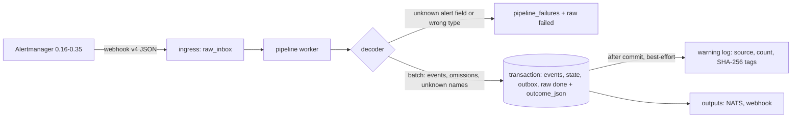

# Design

## Triage

| Trigger | Applies? | Evidence |
|---|---|---|
| T1 Components (new component, or 3+ with directed relationships) | no | Changes stay inside the decoder and the pipeline worker that calls it; no new component. |
| T2 State (persistent state, caches, 3+ state machine) | yes | Adds keys to the persisted `raw_inbox.outcome_json` document (`pipeline.dart:521-537`). |
| T3 Concurrency (background work, workers/isolates, async, retries) | no | Same worker, same transaction; the warning is emitted after the existing commit. No new async path. |
| T4 Boundaries (data format, migration, shared interface, IPC, external) | yes | The external Alertmanager webhook format, and the outcome JSON operators query by SQL (`docs/ingest-pipeline.md:120-130`). |
| T5 Volume (grows without a fixed bound) | no | Unknown names per delivery are capped (D3); one warning per delivery. |
| T6 Risk (security, money, data loss, unrecoverable user data) | yes | Field names come from the sender. A name can itself be a credential: ingress tokens are 43 characters of `[A-Za-z0-9_-]` (`ingress.dart:148`), so no name-shape filter makes a name safe to log (SEC-5). |

TIER: FULL

## Context

- The decoder rejects any key outside a fixed top-level set (`alertmanager_decoder.dart:44-56`, `_keys` at
  `:278-284`) and the per-alert set (`:137-145`). `notification_reason` is already accepted and type-checked
  (`:54`, `:61-68`), so 0.32 and 0.33 decode today. Only 0.34+'s `routeLabels` fails.
- Pipeline failure paths are filtered through `_safePath` (`pipeline.dart:50-87`): a segment outside its
  name list becomes `*`. That is why the 2026-11-12 failure showed `fieldPath *`.
- The decoder returns `AlertmanagerBatch(events, upstreamOmissions)` (`alertmanager_decoder.dart:8-18`); the
  worker writes the counts to `outcome_json` on the done row (`pipeline.dart:521-537`).
- Subsystems log through an injected `void Function(String) log` (`ingest_workers.dart:26`, `ingress.dart:81`).
  `PipelineSubsystem` and `PipelineRepository` take none today (`pipeline.dart:154-175`, `:669-690`).
- Real captures of every minor 0.16.2 to 0.35.0 are in `evidence/alertmanager-captures/` (see its README);
  the current decoder passes all of them except 0.34.2 and 0.35.0.
- Project rule: no integration-specific field leaks past normalization (`openspec/config.yaml` context). The one
  existing exception is kept: a nonempty `externalURL` becomes the event's Alertmanager link
  (`alertmanager_decoder.dart:100`, passed to `_decodeAlert`).
- Each event carries its own delivery's raw reference, size and digest (`EventRawReference`,
  `alertmanager_decoder.dart:94-98`), so two deliveries never produce byte-identical events; equality checks
  compare identity and alert content.
- See proposal.md for the why and S1-S3.

## Decisions

### D1: Unknown top-level names travel on the batch, not as an exception

- **Choice:** `_keys` keeps its strict behaviour for alert objects. The top-level check collects unknown names
  instead, and `AlertmanagerBatch` gains `unknownTopLevelFields` (the bounded list) and
  `unknownTopLevelOverflow` (the count of the rest). The pipeline writes both into `outcome_json` and logs.
- **Rejected:** A warning exception or callback raised from inside the decoder, because the decoder is a pure
  function today (`alertmanager_decoder.dart:25-36`) and a callback would log before the transaction commits,
  so a retried delivery would warn more than once.
- **Reversal cost:** low
- **Important:** no
- **Chosen by:** agent

### D2: Outcome keys `unknown_top_level_fields` and `unknown_top_level_overflow`

- **Choice:** Add `"unknown_top_level_fields": [names]` and `"unknown_top_level_overflow": <int>` to the done
  row's `outcome_json`, both always present (empty list and 0 when none), and document them next to the
  existing keys in `docs/ingest-pipeline.md`.
- **Rejected:** A new table or column with a migration, because the outcome document already carries the
  per-delivery counts operators query (`upstream_omitted`, `unrouted`), and per-source totals are one SQL
  aggregate over `raw_inbox` grouped by `source_id`.
- **Reversal cost:** medium (stored JSON shape that operator queries read)
- **Important:** yes: binds a stored data format operators query
- **Chosen by:** agent

### D3: Names stay with the raw row; the log gets tags

- **Choice:** `outcome_json` stores the real names, filtered by `^[A-Za-z0-9_.-]{1,64}$` (so the stored JSON never
  holds control or odd characters), at most the first 16 in sorted order, with every other unknown name counted in
  the overflow. `outcome_json` sits on the same `raw_inbox` row as the body, so it adds no new exposure: anyone who
  can read it can read the body. The warning log carries only the total count and, per listed name, a tag: the
  first 12 hex characters of SHA-256 over the name's UTF-8 bytes. An operator who sees a tag reads the names with
  the documented SQL query.
- **Rejected:** Real names in the log behind a stricter identifier shape, because a short secret can still look
  like an identifier and the 43-character tokens already fit any useful shape. Count only, because operators would
  have to parse raw bodies to learn what changed.
- **Reversal cost:** low
- **Important:** yes: changes what users see in logs and stored outcomes, and is a security boundary
- **Chosen by:** user (owner, 2026-11-12, after design review round 1 finding C1: "Names in DB, hashes in log")

### D4: Best-effort warning after commit through an injected log

- **Choice:** `PipelineSubsystem` and `PipelineRepository` take an optional `void Function(String) log`, wired by
  the role runtime like the other subsystems. After the done-row transaction commits, when the count is nonzero,
  the worker logs `pipeline source=<uuid> unknown_top_level_fields=<count> tags=<t1,t2>`. The warning is
  best-effort: `outcome_json` is the durable flag. A worker that dies between commit and log loses only the line.
- **Rejected:** Logging inside the transaction, because a rolled-back or retried attempt would log a field that
  was never recorded. A durable warning queue, because the outcome row already is the durable record.
- **Reversal cost:** low
- **Important:** no
- **Chosen by:** agent

### D5: `routeLabels` is a recognised group map

- **Choice:** Add `routeLabels` to the top-level set and to the group-map type check beside `groupLabels`
  (`alertmanager_decoder.dart:69-71`), and to `_safePath`'s names (`pipeline.dart:50-75`). It is not mapped into
  the canonical event (S2).
- **Rejected:** Let it fall through to the new tolerance rule as an unknown field, because 0.34+ would then warn
  on every notification, and a malformed value would go unchecked.
- **Reversal cost:** low
- **Important:** no
- **Chosen by:** agent

### D6: Fixtures are the change's captures, read by a version-matrix test

- **Choice:** Copy `evidence/alertmanager-captures/*.json` into
  `correlia_server/test/unit/ingest/fixtures/alertmanager/`. One unit test per file decodes it and checks
  status, zero unknown fields, and an identical canonical fingerprint for `CapTest` across every release.
  `tool/alertmanager_capture.sh` (bash, Docker) re-creates them; the runbook documents it and the
  real-Alertmanager end-to-end check.
- **Rejected:** Hand-written payloads per version, because the 2026-11-12 failure came from exactly that:
  fixtures written from the documentation rather than captured, which missed `routeLabels`.
- **Reversal cost:** low
- **Important:** no
- **Chosen by:** agent

### Decision summary

| # | Decision | Choice | Rejected | Reversal cost | Important | Chosen by |
|---|---|---|---|---|---|---|
| S1 | Unknown top-level fields | Process and flag; per-alert unknowns and wrong types still fail | Fail all unknowns; tolerate at every level | low | yes | user |
| S2 | `routeLabels` destination | Raw-only group metadata | Map into the canonical event | low | no | agent |
| S3 | Version handling | One decoder over the union, proven by fixtures | Per-source version setting; payload detection | low | yes | agent |
| D1 | Where unknown names travel | On `AlertmanagerBatch` | Exception or callback from the decoder | low | no | agent |
| D2 | Where they are stored | Two `outcome_json` keys | New table or column | medium | yes | agent |
| D3 | Name exposure | Names in `outcome_json`; count and SHA-256 tags in the log | Names in the log behind a shape filter; count only | low | yes | user |
| D4 | When the warning is logged | Best-effort after commit, injected log | Inside the transaction; durable warning queue | low | no | agent |
| D5 | `routeLabels` handling | Recognised, type-checked map | Fall through to tolerance | low | no | agent |
| D6 | Fixtures | Captured payloads plus a capture script | Hand-written payloads | low | no | agent |

## Diagrams (FULL)

Data flow (T2, T4, T6):

## State & Ownership (FULL)

| State | Owner (sole writer) | Lifetime | Invalidation / rebuild | Authoritative copy |
|---|---|---|---|---|
| `raw_inbox.outcome_json` unknown-field keys | pipeline worker, in the done-row update (`pipeline.dart:521`) | row's retention | never rewritten; a replay of the raw body recomputes the same names | the raw row |
| Raw body bytes | ingress | row's retention | immutable | the raw row; the only place field values live |

## Failure & Visibility (FULL)

| Component | Fails / dies mid-operation → | Recovery | Retry safe? | Who finds out |
|---|---|---|---|---|
| Decoder on a wrong-typed `routeLabels` | raw failed, failure path `routeLabels` | operator fixes sender; replay later (M2) | yes | operator via `pipeline_failures` with a named path |
| Worker dies after decode, before commit | nothing stored, no warning | lease expiry re-claims the raw row | yes: decode is pure, warning is post-commit | nobody needs to |
| Worker dies after commit, before the warning | outcome stored, warning missed; the row is done, so it is not re-run | none needed | n/a | operator via `outcome_json` (the durable record); the warning is best-effort |
| Unknown top-level field arrives | alerts processed; names recorded on the raw row; count and tags logged | none needed | n/a | operator via warning tags, then `outcome_json` |
| Credential-shaped unknown key | stored only on the raw row, beside the body that already holds it | n/a | n/a | nobody through logs, by design |

## Resource Bounds (FULL)

| Queue / buffer / cache / transfer | Bound | At the bound | Timeout | At 10x / 100x |
|---|---|---|---|---|
| Unknown names listed per delivery | 16 names x 64 chars; 16 tags x 12 hex in the log | rest counted in overflow | n/a | constant per delivery |
| Unknown keys scanned per delivery | the body bound (default 1 MiB, `bootstrap`) | ingress rejects larger bodies | n/a | linear in body size, already bounded |
| Warnings | one per delivery with unknowns | n/a | n/a | at 100x deliveries, 100x lines. Accepted: each is one line and the condition is rare (a new upstream release) |
| Fixtures | 40 files, about 1 KiB each | n/a | n/a | n/a |

## Flow & State Gaps (FULL)

- **Retry of a delivery:** decode is deterministic, so names and counts are identical; the warning is logged
  once, for the attempt that commits.
- **Delivery that both fails per-alert and has unknown top-level names:** the failure wins; no outcome or
  warning, because nothing commits (existing all-or-nothing rule).
- **Mixed releases behind one source** (an HA pair mid-upgrade): each delivery is judged alone; identity does
  not depend on the release (spec scenario "Every supported release decodes").
- **Raw rows failed before this change** with `routeLabels`: stay failed; replay arrives with M2's dead-letter
  replay. Not backfilled here.

## Mechanism Ledger (FULL)

| Mechanism | Built? | Why (harm nobody catches / expensive later) | Evidence that would change the call |
|---|---|---|---|
| Names kept off logs (tags only) | yes | a sender-controlled key can be a credential; no shape filter prevents it (SEC-5, review C1) | none |
| Charset filter on stored names | yes | keeps control characters out of operator-queried JSON | none |
| Post-commit warning | yes | in-transaction logging lies on rollback | none |
| Per-source unknown-field counter table | no | `raw_inbox` aggregate answers it; no metrics system exists yet | an operator dashboard or alerting on the count (M4/M10) |
| Per-version decoder profiles | no | payload carries no release; union is proven by fixtures | an Alertmanager release that changes the meaning or type of an existing field |
| Backfill of earlier failed rows | no | replay is M2 scope (dead-letter replay) | owner needs the 2026-11-12 demo rows replayed |

## Risks / Trade-offs

- [A future release changes the type of an existing field] → still fails loudly with a named path; the capture
  script and runbook make adding that release's fixture quick.
- [An operator never reads warnings] → the names stay queryable in `outcome_json`; the runbook gives the query.
- [Tags are not readable names] → the runbook's SQL lists names per source in one query; a tag can be matched by
  hashing a candidate name.
- [Relaxing a project rule invites drift to other integrations] → AGENTS.md names the exception as
  Alertmanager top-level fields only; other integrations stay strict until their own change decides.

## ADRs

- **In force, constraining this change:** 0004 (one canonical format, no integration fields past
  normalization), 0016 (durable staged pipeline, all-or-nothing raw processing), 0021 (canonical wire stays
  strict; this change does not touch it), 0024 (identity and upstream evidence: identity unchanged by group
  fields), 0009 (redaction).
- **To record during apply:** none. The tolerance rule is specific to one integration and recorded in its
  spec and AGENTS.md.

## Open Questions

None.
