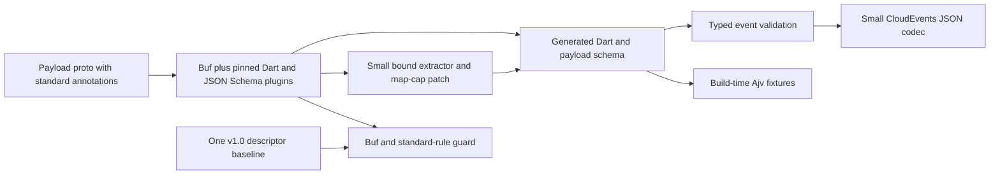
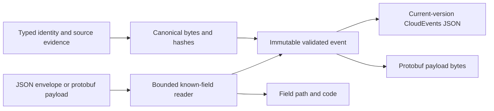

# Design

## Triage

| Trigger | Applies? | Evidence |
|---|---|---|
| T1 Components | yes | Event library, pinned code generators and existing tool runner. |
| T2 State | no | No persistence, cache or lifecycle machine; immutable values and generated files only. |
| T3 Concurrency | no | Pure event operations and finite tool subprocesses, no background service. |
| T4 Boundaries | yes | Protobuf payload, JSON Schema, CloudEvents JSON and identity bytes. |
| T5 Volume | yes | Strings, maps and wire input require caps. |
| T6 Risk | yes | Wrong identity merges unrelated alerts or defeats dedup. |

TIER: FULL

## Context

Scope: proposal.md; this is M1 change 2. Only workspace-tooling/process-roles currently exist in the spec inventory. No event library/proto/contracts tree exists yet. `pubspec.yaml:8-13` lists existing workspace packages; server dependencies are args and Serverpod (`correlia_server/pubspec.yaml:11-20`). Keep event code in the server, not another package.

`mise.toml:11-16` already pins Buf, Go and Node. `mise.toml:60-72` is the check gate. `tool/lib/src/generated_command.dart:125-178` provides the precedent: generate in disposable scratch, compare both directions, clean in finally. Its two-package Serverpod scratch workspace (`:100,188-218`) stays sufficient. `tool/lib/src/test_command.dart:105-113` targets server tests; untagged tests under test/unit/event enter the existing fast tier.

The owner approved Claude's supplemental review changes on 2026-11-10: “OK apply the changes.” `claude-review.md` remains the historical review, not an approval of this revision. The old review.md verdict is invalidated by these edits and must be replaced by a fresh review before implementation. All detailed implementation choices below are agent choices; the scope direction is the owner's approval, not a claim that the owner selected library versions or wire integer types.

## Decisions

### D1: Standard annotations and generators, not a schema compiler

- **Choice:** Event protobuf uses `buf.validate` rules. Pin `bufbuild/protoschema-plugins` v0.6.0 for the generated strict bundled payload schema. Extract only the used standard rules into Dart bound constants; handwritten typed validators reference them. Add map min/maxProperties from standard map rules as a narrow post-generation patch: the spike proved the generator omits these. No Correlia options.proto or generic validator/schema compiler.
- **Rejected:** Private options and a complete descriptor compiler (maintenance); independent handwritten bounds plus a copy-equality test (duplicated source of truth); remote generator invocation (unnecessary online dependency for each generation).
- **Reversal cost:** medium.
- **Important:** yes — shared contract and generation boundary.
- **Chosen by:** agent.

### D2: Validated immutable values in the existing server package

- **Choice:** Public lib/event.dart exports typed values, identity helpers and sealed validation results with field path/code. Internals live in lib/src/event; generated messages and bound constants live in lib/src/event_generated. Keep a frozen generated message as backing storage, with no mutable alias escape, so binary output retains its unknown fields. Exclude that generated directory from analysis like Serverpod's; format its Dart with the workspace formatter before write/compare. Runtime checks remain typed; no runtime schema engine.
- **Rejected:** Passing mutable generated messages everywhere (post-validation mutation); making JSON or a schema interpreter the domain model (untyped values and another framework).
- **Reversal cost:** medium.
- **Important:** yes — public API and observable errors.
- **Chosen by:** agent.

### D3: ProtoJSON profile with bounded uint32 raw size

- **Choice:** Explicit snake_case json_name, protobuf enum-name strings, Timestamp UTC strings with nanosecond precision, and numeric uint32 generation/raw.size. Raw metadata supports the full uint32 domain so configurable source-body limits are not frozen at their 1 MiB default; the field/work table defines the cap. This removes the unnecessary uint64/string mismatch with the strict generator. Use seconds/nanos and preserve reported text. Validate known-field enums, strict dates/offsets, aliases, numeric enums and nulls before protobuf parsing in both current and newer-minor paths.
- **Rejected:** Custom lowercase enum projection (another mapping in each language); DateTime-only source evidence (loses nanoseconds); uint64 raw size (unneeded for its cap; strict generator emits numbers, contrary to canonical uint64 ProtoJSON strings).
- **Reversal cost:** high after publication; no existing consumers or schema are being migrated. The generator/Ajv spike proves these representative shapes; apply must prove the full contract.
- **Important:** yes — external wire format.
- **Chosen by:** agent.

### D4: Keep exact identity bytes; use existing hash/UUID libraries

- **Choice:** Preserve the exact encoding below and fix the UUIDv5 namespace to `f36aac0f-16fa-46db-951b-bb578b323aed`. Use crypto 3.0.8 SHA-256 and uuid 4.6.0 Uuid.v5FromBytes; no handwritten RFC fallback. Commit independent byte/hash/UUID vectors for every identity domain.
- **Rejected:** Delimiter/JSON/body hashing or upstream fingerprints (wrong identity semantics); own UUID implementation (the library already accepts arbitrary binary names); retaining an example UUID whose namespace was never recorded.
- **Reversal cost:** high after publication; ADR 0019 fixes the semantics. Before publication, the owner authorized selecting a new namespace and recomputing example ids on 2026-11-10. The agent selected the UUID above; fingerprint and observation-key bytes remain unchanged.
- **Important:** yes — persistent/public identity.
- **Chosen by:** agent.

### D5: One v1.0 baseline and a small standard-rule guard

- **Choice:** Commit contracts/baselines/event-v1.0.binpb once. Run Buf FILE breaking against it, then compare existing v1.0 buf.validate rule objects and enum domains exactly; reject added required fields/oneofs too. This freezes existing accepted domains, including widening, without a semantic differ. Missing baseline fails. No manifest, historical-subset query, per-minor digest registry or publication subsystem in M1. Before v1.1 is published, its change must extend baseline coverage to that real published contract.
- **Rejected:** Buf alone (does not enforce validation-option compatibility); synthetic history/manifest machinery before a second version exists; rules snapshot tests that merely pin copied metadata. The production guard reads the baseline's actual rules instead.
- **Reversal cost:** medium.
- **Important:** yes — compatibility gate and explicit future publication prerequisite.
- **Chosen by:** agent.

### D6: Parse newer minors without promising transparent forwarding

- **Choice:** Exact-minor payload JSON is strict; newer v1 minors validate known fields, ignore unknown JSON fields and report known_core_only scope. For protobuf input, the wrapper's protobuf output re-emits unknown field data through its frozen generated-message backing; sourceDataschema is optional and omission yields unknown scope. JSON output is a current-v1.0 known-field projection. No opaque JSON tree, provenance forwarding object or general transcoding policy.
- **Rejected:** Rejecting all newer minors (violates UPG-3); adding preservation/forwarding machinery without a consumer. Ignoring unknown JSON data is an explicit documented limitation, not an undocumented lossless claim.
- **Reversal cost:** medium; a forwarding consumer may later add its own raw-wire ownership boundary.
- **Important:** yes — parsing behavior and scope boundary.
- **Chosen by:** agent.

### D7: Small CloudEvents codec, no protobuf envelope

- **Choice:** Handwrite a bounded structured-JSON envelope codec deriving standard attributes from the validated payload. Keep payload extensions in data.extensions. Validate and ignore well-formed unknown CloudEvents extension attributes, independent of payload minor; do not reject a broker's valid extension. Generate only the payload schema, not an envelope proto/schema. Use the published specification directly, not a FaaS SDK dependency.
- **Rejected:** A protobuf envelope/private fixed-value options (no binary envelope consumer); functions_framework CloudEvent (drops extension attributes and uses DateTime); google_cloudevents_dart (Google payload protos, no suitable envelope codec and protobuf ^3.1.0 conflict).
- **Reversal cost:** medium.
- **Important:** yes — external envelope interoperability.
- **Chosen by:** agent.

### D8: Build-time schema validation with Node/Ajv

- **Choice:** Pin Ajv 8.17.1 and ajv-formats 3.0.1 in tool/schema_validation/package.json plus package-lock.json. Use Ajv's draft-2020-12 class with formats and strict schema checking for payload fixtures only. The check/proto task dependency chain installs them automatically via npm ci with cache-first/no-audit/no-script flags; no manual prerequisite. Node is build-time only, not a Dart runtime schema engine.
- **Rejected:** Unverified Dart draft-2020-12 support; changing schema draft; another runtime validation framework. Node is already pinned.
- **Reversal cost:** low.
- **Important:** yes — build dependency and verifiable schema contract.
- **Chosen by:** agent.

### Decision summary

| # | Decision | Choice | Rejected | Reversal cost | Important | Chosen by |
|---|---|---|---|---|---|---|
| S1 | Scope | Contract library/tooling only | Runtime ingest/NATS | low | yes: contract | agent |
| S2 | Ownership | Standard annotations/generator; existing package | Private compiler, envelope proto, new package | medium | yes: boundary | agent |
| S3 | Identity | Exact bytes and portable vectors | Delimiter/body/arrival ids | high | yes: identity | agent |
| D1 | Schema | Standard generator plus narrow map-cap patch and bound extraction | Private options/compiler; duplicate bounds | medium | yes: contract | agent |
| D2 | Runtime | Frozen generated backing; format and exclude generated Dart | Mutable aliases or runtime schema engine | medium | yes: API | agent |
| D3 | Wire/time | Strict ProtoJSON; full-range uint32 raw metadata; seconds/nanos | Custom JSON enums; DateTime-only; uint64 raw size | high | yes: format | agent |
| D4 | UUID | crypto and uuid.v5FromBytes; fixed namespace f36aac0f-16fa-46db-951b-bb578b323aed | Own RFC implementation; untraceable old example id | high | yes: identity | agent |
| D5 | Compatibility | v1.0 image, Buf and exact standard-rule guard | Premature history manifest; Buf-only | medium | yes: gate | agent |
| D6 | Newer input | Known-core JSON projection; native binary unknown-field round trip; optional metadata | General lossless forwarding framework | medium | yes: behavior | agent |
| D7 | Envelope | Small codec, tolerate valid extensions | Proto envelope; unsuitable SDK dependencies | medium | yes: interoperability | agent |
| D8 | Schema validation | Build-time Ajv 2020 with automatic cached task setup | Manual clean-clone prerequisite; Dart runtime engine | low | yes: build dependency | agent |

## Review reconciliation and spike evidence

The user-approved simplification reopens previous agent decisions, not accepted ADRs. The earlier Codex M4 requirement is retained as the cheap v1.0 rule guard. M5's mandatory binary metadata arose from a lossless-provenance claim; that claim and requirement are removed together. Later-minor history protection is a prerequisite for actually publishing v1.1, not implemented speculatively now.

| Claude finding | Disposition |
|---|---|
| F1 custom compiler | Adopted: standard annotations/generator; narrow proven map-cap patch and bound extractor only. |
| F2 envelope proto | Adopted: small handwritten codec; no envelope schema generation. |
| F3 manifests | Adopted: single baseline plus production rule guard, no copied-metadata snapshot test. |
| F4 extension rejection | Fixed: tolerate valid unknown envelope extensions; punctuation remains invalid in envelope names. |
| F5 opaque forwarding | Adopted: explicitly ignore unknown newer JSON fields, optional binary schema metadata. |
| F6 validator gap | Fixed: actual Ajv2020 smoke passed. |
| F7 strict pre-pass | Retained: the protobuf runtime is not the strict field/timestamp validator. |
| F8 UUID fallback | Removed: verified v5FromBytes API. |
| F9 >64 KiB | Keep current cap; document transport-specific size support above CloudEvents' 64 KiB forwarding guarantee. |
| F10 aggregate cap | Clarify boundary: schema validation alone is insufficient; complete validation includes aggregate size before acceptance, so no accepted event fails downstream on length. |

Disposable spike, 2026-11-10 (no implementation code changed): installed github.com/bufbuild/protoschema-plugins/cmd/protoc-gen-jsonschema@v0.6.0 through mise's Go and generated a representative Buf v2 module. buf.lock resolved buf.build/bufbuild/protovalidate at commit 511051f7f4374c3ca873b53ae68a9288. Ajv2020 8.17.1 plus ajv-formats 3.0.1 ran on Node through mise.

- Confirmed explicit snake_case json_name, required presence, scalar/key/value limits, nanosecond Timestamp and base64 bytes.
- Found strict uint64 emits an integer and rejects its canonical decimal string. Selected bounded uint32 for raw.size; its strict output matches ProtoJSON and enforces the numeric cap.
- Found map.max_pairs missing from schema. Parsed buf build's JSON image, read options["[buf.validate.field]"].map.maxPairs, added maxProperties to that map's generated schema node and reran validation successfully.
- Ten smoke assertions passed: valid representative payload; alias, missing required field, long string, invalid date, oversize numeric value, long map key/value and excess pair count all had the expected result; raw-size decimal strings were rejected. This proves the representative tool path, not the complete event implementation.

References: [generator v0.6.0](https://github.com/bufbuild/protoschema-plugins/blob/v0.6.0/README.md), [standard annotations](https://github.com/bufbuild/protovalidate), [Ajv draft support](https://ajv.js.org/json-schema.html), [Uuid.v5FromBytes](https://pub.dev/documentation/uuid/4.6.0/uuid/Uuid/v5FromBytes.html), [CloudEvents 1.0.2](https://github.com/cloudevents/spec/blob/v1.0.2/cloudevents/spec.md), [CloudEvents JSON](https://github.com/cloudevents/spec/blob/v1.0.2/cloudevents/formats/json-format.md).

## Diagrams (FULL)

T1 build/runtime components:



T4 wire/identity flow:



## Contract details

The field layout, bounds and identity encoding remain the reviewed v1.0 contract except raw.size now uses uint32/numeric JSON. Bounds live in standard buf.validate annotations and generated Dart constants; no second handwritten bound table in implementation. Length means Unicode scalars unless bytes are explicit. Empty required strings fail, malformed Unicode fails, and no normalization/case folding occurs. Assign protobuf field numbers sequentially in the order below; never reuse them. Use optional scalar fields when presence matters; unspecified zero enums are invalid. Empty collections are allowed unless explicitly required.

### Payload and envelope

Event fields in number order:

| Fields | Type, presence and meaning |
|---|---|
| event_id, fingerprint, tenant, namespace | required UUIDv5, 64-lowerhex SHA-256, literal default tenant, namespace string |
| kind, status, severity, severity_number, severity_original | required enums: kind alert/state/ack/downtime/comment/heartbeat; status firing/resolved/info; severity critical/error/warning/info/unknown. Optional severity_number 1..24, optional original string. Unknown severity may omit number; no inferred number mapping in this library. |
| dedup_key, summary, description | optional source hint (not an identity override); required summary; optional description |
| resource, observer, labels, labels_origin, annotations, links | bounded maps; required Observer with source_instance UUID, source_kind and optional name/version; labels_origin maps each normalized label key to bounded origin evidence; links are typed href/relation/text |
| starts_at, ends_at, source_time, reported_source_time, observed_at, processed_at | optional normalized starts/ends/source timestamps; source_time and original reported_source_time present together and denote the same instant; required observed/processed timestamps |
| raw, pipeline, extensions, identity_fields | required RawReference(ref, sha256, size); required Pipeline(version config id, generation, stages_applied, enrichment_errors, optional original_event_id); extension string map; required nonempty map of IdentityComponent (oneof raw string or SHA-256 bytes) |

Raw size is uint32, 0..4294967295 bytes. It counts the referenced raw body, not bytes embedded in this event. The per-source webhook limit remains configurable with the architecture's 1 MiB default; v1 source configuration must not exceed this representational maximum, and ingress still enforces its actual configured limit. Pipeline generation is uint32; positive generation requires original_event_id, zero omits it. Namespace defaults to source_instance only in source-context construction. Recompute fingerprint/id from the specified identity evidence. Add required observation_key bytes after identity_fields, maximum 8192 decoded bytes, and validate its canonical domain/shape before hashing.

The envelope is JSON only, not a protobuf message. Attributes: specversion, id, source, type, datacontenttype, dataschema, subject, time, partitionkey, traceparent, correliatenant, data. Constants: specversion 1.0 and datacontenttype application/json. dataschema is urn:correlia:schema:event:1.<minor>, initially 1.0. Source is urn:correlia:source:<lowercase source UUID>; type is io.correlia.<lowercase kind>.v1. id, subject/partitionkey and correliatenant agree with event_id, fingerprint and tenant. time equals source_time or is omitted without it. data is an object; data_base64 fails. Validate optional traceparent as W3C version 00, lowercase hex, nonzero trace/span ids and two-hex flags.

Unknown envelope attributes follow CloudEvents names `[a-z0-9]+` (the specification recommends, but does not require, 20 characters). Apply the bounded profile below. Accept valid strings, booleans and signed-32-bit integers; null means omitted. Reject objects, arrays, fractional/out-of-range numbers and invalid CloudEvents strings (controls, noncharacters and malformed Unicode). Validate then ignore these unknown attributes. Payload namespaced extension keys such as example.org/context remain exclusively in data.extensions; their punctuation is invalid in envelope attribute names. No lossless intermediary behavior is promised.

Timestamps use RFC3339 with explicit Z or numeric offset; validate calendar dates, offsets, and seconds/nanos range, reject leap seconds, and emit UTC. Preserve original source text exactly, including offset and fractional spelling. Alertmanager helper preserves startsAt/endsAt original text independently inside its observation key; normalized payload starts_at/ends_at retain their instants. Do not require ends_at >= starts_at for firing events: Alertmanager can use its zero-time sentinel. No state lateness, skew clamp or far-future quarantine here; these belong to the pipeline/state changes.

Complete positive wire fixture; the fingerprint and observation key were independently recomputed. On 2026-11-10 the owner authorized a new namespace because the earlier draft omitted its value. Python SHA-1 over the new namespace's network-order bytes and the exact observation tuple yields the replacement event id below. The earlier review's example-id claim is historical, not evidence for this replacement; fresh review must verify it. Raw size remains numeric uint32.

```json
{
  "specversion": "1.0",
  "id": "86fe3b73-ec2d-5dd3-b104-11f2ec79469c",
  "source": "urn:correlia:source:11111111-1111-4111-8111-111111111111",
  "type": "io.correlia.alert.v1",
  "datacontenttype": "application/json",
  "dataschema": "urn:correlia:schema:event:1.0",
  "subject": "09fc69bd0646d8e356c57b6c9b46256eda741ef8924425df1c9cce8ce2137b7f",
  "time": "2026-11-10T00:00:00Z",
  "partitionkey": "09fc69bd0646d8e356c57b6c9b46256eda741ef8924425df1c9cce8ce2137b7f",
  "correliatenant": "default",
  "data": {
    "event_id": "86fe3b73-ec2d-5dd3-b104-11f2ec79469c",
    "fingerprint": "09fc69bd0646d8e356c57b6c9b46256eda741ef8924425df1c9cce8ce2137b7f",
    "tenant": "default",
    "namespace": "11111111-1111-4111-8111-111111111111",
    "kind": "EVENT_KIND_ALERT",
    "status": "EVENT_STATUS_FIRING",
    "severity": "EVENT_SEVERITY_WARNING",
    "summary": "Example alert",
    "observer": {"source_instance": "11111111-1111-4111-8111-111111111111", "source_kind": "alertmanager"},
    "labels": {"alertname": "Example", "severity": "warning"},
    "starts_at": "2026-11-10T00:00:00Z",
    "source_time": "2026-11-10T00:00:00Z",
    "reported_source_time": "2026-11-10T00:00:00Z",
    "observed_at": "2026-11-10T00:00:00Z",
    "processed_at": "2026-11-10T00:00:00Z",
    "raw": {"ref": "raw:example", "sha256": "0000000000000000000000000000000000000000000000000000000000000000", "size": 1},
    "pipeline": {"version": "example", "generation": 0},
    "extensions": {"example.org/context": "rack-7"},
    "identity_fields": {"alertname": {"raw": "Example"}, "severity": {"raw": "warning"}},
    "observation_key": "AAAABAAAAAZkb21haW4AAAAYY29ycmVsaWEuYWxlcnRtYW5hZ2VyLnYxAAAABnN0YXR1cwAAAAZmaXJpbmcAAAAJc3RhcnRzX2F0AAAAFQEyMDI2LTExLTEwVDAwOjAwOjAwWgAAAAdlbmRzX2F0AAAAAQA="
  }
}
```

A synthetic newer-minor fixture changes dataschema to urn:correlia:schema:event:1.1 and adds a bounded optional producer_note field in test descriptors. The current reader parses the known core and ignores producer_note in JSON. This fixture does not publish a real v1.1 contract.

### Reader scope

Parse the JSON dataschema before choosing exact-minor or newer-same-major behavior. Exact supported-minor payload JSON checks known keys/types and rejects undeclared fields; newer v1 minors check known fields and pass ignoreUnknownFields to protobuf conversion. Both paths enforce existing required fields, identity agreement, enums, strict timestamps and whole-input caps before usable values are returned. Unknown newer fields at any nesting level are ignored, not preserved as a private wire tree. Report known_core_only for future minors. Current-version serialization emits only supported fields with the supported dataschema; it is a projection, not a forwarding API.

Binary input accepts optional sourceDataschema. Supplied malformed metadata or another major fails. Future v1 metadata selects known_core_only; missing metadata yields unknown scope, never an inferred minor. Known fields are always validated. Keep the parsed generated message frozen as the wrapper's backing: its public protobuf encoder re-emits the unknown fields read from protobuf with the same field numbers/wire values, without promising byte-for-byte serialization order. JSON output omits those unknown fields. No separate preservation tree or transcoding framework. Supported-version binary metadata is not a claim that the binary payload passed JSON Schema.

### Field and work bounds

| Family | Bound | At overflow |
|---|---|---|
| Summary / description / link text | 256 / 4096 / 256 scalars | Normalization helper truncates with final U+2026 included in cap; wire reader rejects. Summary helper folds CR/LF to spaces. |
| raw.size | uint32: 0..4294967295 bytes | Reject outside the domain; source configuration cannot exceed it, default webhook limit stays 1 MiB. Raw bytes are referenced, not embedded. |
| Tenant / namespace / source kind | literal default / 256 / 64 scalars | Reject; source kind matches `^[a-z][a-z0-9_]*$`. |
| UUID / fingerprint / SHA-256 | canonical lowercase 36 / 64 / 64 chars | Reject malformed or wrong length; SHA-256 component bytes are exactly 32. |
| severity_original / dedup_key / observer name/version | 128 / 1024 / 256 each | Reject. |
| resource, labels, labels_origin, annotations | 128 entries each, keys 128, values 1024 scalars | Reject; origin keys must name existing labels. |
| identity_fields | 1..128 entries, names 128 scalars, raw component inline <=1024 UTF-8 bytes | Oversize original component becomes tagged SHA-256; never truncate. Reject original identity inputs over 1 MiB total before encoding/hashing. |
| links | 16 entries; href 2048, relation 64, text as above | Reject non-http(s) href or overflow. |
| raw.ref / pipeline.version | 256 / 128 scalars | Reject; ref is an opaque non-secret reference, never embedded raw payload. |
| stages_applied / enrichment_errors | 32 / 32 entries, stage/code 64, message 256 scalars | Reject; errors are typed stage/code/message, never exception dumps. |
| extensions | 32 entries, key 128, value 1024 scalars | Reject; key must match `^[a-z0-9][a-z0-9.-]*/[a-zA-Z0-9_.-]+$`. |
| reported_source_time and original observation timestamp strings | 64 ASCII chars each | Reject invalid time or overflow. |
| transport idempotency key / body digest | nonempty <=256 scalars / exactly 32 bytes | Reject invalid supplied key rather than silently falling back. |
| serialized structured event / protobuf input | 262144 bytes each | Reject before parse on byte input; structured encoder counts UTF-8 and returns event_too_large. |
| JSON nesting / validation errors | depth 16 / first error | Reject before recursive domain conversion; never recurse into unbounded arbitrary structures. |
| code-generation inputs | <=256 proto files, 16 MiB image, <=4 MiB per emitted file, 60s per subprocess | Nonzero failure naming stage; delete scratch in finally. |
| unknown CloudEvents extension attributes | 32 attributes; names 128 ASCII characters, string values 1024 scalars | Reject invalid names/scalars or overflow before ignoring the attribute. |

All byte limits apply before accepting an event. The generated schema captures field-level constraints; exact decoded-byte lengths, hash consistency and aggregate serialized bytes remain runtime boundary checks. Therefore an input passing JSON Schema may still be rejected at this boundary, but an accepted CanonicalEvent cannot fail later merely because a downstream component applies a different field-length limit. Raw references retain access to full source bytes in the later inbox change. Events above 64 KiB require transport support; the selected cap is not a promise that every generic CloudEvents intermediary forwards them.

Every standard string pattern is a whole-value `^...$` pattern using only ASCII literals/character classes and quantifiers common to RE2, ECMA-262 and Dart RegExp; no lookarounds, backreferences, dialect-specific escapes or flags. Use lowercase UUID/hex patterns rather than a broader well-known UUID rule. Validators count Unicode scalars with runes, not UTF-16 String.length. Add positive fixtures and negative valid-substring/invalid-whole-value fixtures to both runtime and Ajv checks.

### Exact identity encoding

The fixed Correlia observation UUIDv5 namespace is `f36aac0f-16fa-46db-951b-bb578b323aed` (16 network-order bytes `f36aac0f16fa46db951bbb578b323aed`). It is distinct from the operator's alert namespace string. Freeze it for v1; never regenerate it per source, process or checkout.

All lengths/counts use unsigned 32-bit big-endian. `E(pairs)` is pair-count, then for each ordered pair: name byte-length, UTF-8 name, value byte-length, opaque value bytes. Duplicate names fail. For maps, sort names by unsigned UTF-8 byte lexical order, not host locale or UTF-16 ordering. A value that is itself a tuple contains its complete E bytes. No terminators, BOMs, separators or platform newline rules.

IdentityComponent is `0x00 || UTF8(value)` for raw inline values, or `0x01 || SHA256(UTF8(original))` for over-threshold values. A literal string such as sha256:abc is still tag 0 and cannot equal a tag-1 component. The protobuf oneof stores which form was used. Field names are never truncated or hashed.

- Fingerprint preimage: E in order `domain=correlia.alert.v1`, `tenant`, `namespace`, `source_kind`, `identity_fields=E(sorted component pairs)`. The first four values are plain UTF-8; fingerprint is lowercase hex SHA-256 of the preimage.
- Native key: E(`domain=correlia.native.v1`, `key=<IdentityComponent>`).
- Alertmanager key: E(`domain=correlia.alertmanager.v1`, `status=<lowercase status>`, `starts_at=<presence>`, `ends_at=<presence>`). Presence is byte 0 for absent; byte 1 followed by original timestamp UTF-8 for present. At least one valid source timestamp is required. This helper is not the full decoder; selection of labels and exclusion list is a separate pure helper.
- Fallback key: E(`domain=correlia.fallback.v1`, `status`, `severity`, `reported_source_time`), values plain UTF-8. Require timestamp evidence, not observed_at.
- Observation UUID name: E(`domain=correlia.observation.v1`, `source_instance=<canonical UUID text>`, `fingerprint=<hex>`, `observation_key=<complete key bytes>`, `generation=<minimal unsigned decimal UTF-8>`). UUIDv5 uses the namespace's 16 network-order bytes followed by these name bytes; set standard version/variant bits and lowercase canonical text.
- Transport key: SHA-256 of E(`domain=correlia.transport.header.v1`, `source_instance`, `key=<UTF-8 header>`) or E(`domain=correlia.transport.body.v1`, `source_instance`, `body_sha256=<32 raw bytes>`). The caller supplies the digest; this library does not buffer raw bodies or store dedup windows.

Before exclusion, Alertmanager helper validates full label names and bounded collection size, and rejects an empty selected identity set. Default exclusions empty. Reject duplicate exclusion entries and invalid key types. Source-native `dedup_key` and upstream fingerprints never replace these rules.

### Generation, validation and compatibility

- `tool proto`, exposed as mise proto, runs pinned Dart codegen and local `go run github.com/bufbuild/protoschema-plugins/cmd/protoc-gen-jsonschema@v0.6.0`. Pin protoc_plugin 25.1.0 and protobuf 6.1.0 in the workspace. Buf v2 uses STANDARD lint, FILE breaking and the committed annotation dependency in buf.lock. Generate any Dart well-known-type dependencies required by the payload, never hand-edit generated code.
- Select the payload's .jsonschema.strict.bundle.json output. The small helper consumes buf build JSON descriptors, emits typed Dart constants for used bounds/required/pattern rules, and injects only missing map minProperties/maxProperties from map.minPairs/maxPairs into the standard generator output. No envelope schema, custom options, generic schema traversal/compiler, arbitrary CEL evaluation or runtime annotation interpreter. Runtime validators remain typed handwritten code using those generated constants. Fail with a field path if a newly used annotation rule is unsupported rather than silently dropping it. Standard decoded-byte rules still need runtime checks because base64 schema lengths are not exact decoded-length validation.
- Wire proto:setup as a dependency of check, proto and proto:check; it runs pinned `npm ci --prefix tool/schema_validation --prefer-offline --ignore-scripts --no-audit --no-fund`. A clean clone needs no separate manual validator step. First run can contact the npm registry, Go module proxy/checksum database, and BSR for locked annotation modules; normal Dart dependency setup also uses pub. After caches are populated, repeated checks require no network. Prove the warm-cache check with network access disabled during integration verification. Commit npm/Buf locks; no global activation or automatic dependency upgrades.
- Build all outputs in isolated scratch first, then write only event-owned generated directories or compare files in both directions in proto-check. Copy workspace analysis_options.yaml into scratch and run the pinned Dart formatter on generated messages and bound constants before writing/comparing; add lib/src/event_generated/** to analyzer exclusions, leaving handwritten event code analyzed. Delete obsolete files only within owned generated directories. Keep Serverpod generation verification unchanged. proto-check runs Ajv fixtures, never mutates checked generated outputs and removes scratch in finally; dependency setup may prepare ignored caches.
- Establish event-v1.0.binpb once after the contract is final. proto-check fails if absent and never automatically refreshes it. Run Buf FILE against this image. For each existing baseline field, compare the standard buf.validate.field object and explicit json_name/presence metadata; for existing oneofs/enums compare required rules and value domains. Reject changes in either direction, including summary cap 256→512, and reject newly required fields/oneofs. This is exact rule-object comparison, not a semantic constraint differ or source-text snapshot test. Existing structural compatibility remains Buf's responsibility.
- There is one baseline and no v1.1 publication workflow in this change. Before publishing any later minor, its change must extend compatibility coverage to the newly published contract and retain existing schemas. The first-baseline guard intentionally makes no claim to protect fields introduced in a not-yet-published later minor. Identity semantics and aggregate work limits are frozen within v1 independently of byte-format compatibility.

## State & Ownership (FULL)

| State | Owner (sole writer) | Lifetime | Invalidation / rebuild | Authoritative copy |
|---|---|---|---|---|
| Payload shape/bounds | Reviewed proto edits | major lifetime | New minor/major as allowed | proto and standard rules |
| Generated messages/schema/constants | tool proto | checkout lifetime | Regenerate; check compares both ways | proto, not manual output edits |
| v1.0 image | Initial contract finalization | permanent | Never refresh automatically | committed image |
| Valid event | Factory | value lifetime | Immutable; construct a new value | validated typed value |
| Scratch | One tool invocation | command lifetime | finally cleanup | none |

## Failure & Visibility (FULL)

| Component | Fails / dies mid-operation → | Recovery | Retry safe? | Who finds out |
|---|---|---|---|---|
| Event/identity reader | First field error; no usable event | Correct input; future caller rejects/dead-letters | yes | caller |
| Generator/extractor | Nonzero stage/field diagnostic; no successful publication of scratch | Fix proto/setup, rerun | yes | developer/gate |
| Buf/rule guard | Nonzero compatibility diagnostic | Preserve the contract, or plan a new major | yes | developer/gate |
| Ajv fixture check | File and validation failure | Fix generator/contract/fixture | yes | developer/gate |
| Drift check | Missing/extra/changed paths and proto repair command | Regenerate | yes | developer/gate |
| Interrupted copy | Later check detects partial output | Regenerate | yes | developer |
| SIGKILL | finally cannot run; invocation scratch may remain | New invocation uses fresh scratch; remove only identified owned leftovers | yes | interrupted shell |

## Resource Bounds (FULL)

Numeric caps live in the field/work table, not duplicated here.

| Queue / buffer / cache / transfer | Bound | At the bound | Timeout | At 10x / 100x |
|---|---|---|---|---|
| Event/wire collections | Field/work caps | Field error, no silent entry drops | finite synchronous work | One event at a time; no batch buffer |
| Identity preimage | Aggregate identity cap | Reject before hashing | finite synchronous work | No shared cache |
| Codegen image/output | Code-generation input row | Nonzero stage failure | Per-subprocess deadline in that row | Reject oversized input, no per-alert generators |
| In-flight tools | One subprocess chain per invocation | Independent invocation scratch; no concurrent write-mode promise | Same deadline | No background service or lock subsystem |
| Subprocess diagnostics | 1 MiB per subprocess | Bounded prefix plus truncation notice | Same deadline | No unbounded captured log |

## Flow & State Gaps (FULL)

- Generate every scratch output before copying. Interrupted multi-directory copies are caught by drift checks; no transactional filesystem framework.
- Concurrent events are pure operations over immutable values. Ordering, dedup effects, skew and generation allocation belong to later changes.
- Concurrent read-only checks use independent scratch. Only one developer write-generation command runs at a time; no lock/recovery service.
- Newer-minor input produces a known-core projection, not a transparent bridge. Native protobuf unknown fields are the runtime's responsibility.
- Missing binary version metadata is not missing identity evidence: parsing succeeds with unknown version scope; missing observation evidence still fails identity construction.

## Mechanism Ledger (FULL)

| Mechanism | Built? | Why | Evidence that would change the call |
|---|---|---|---|
| Length prefixes/domain tags and vectors | yes | Published identity is expensive to repair | none for v1 |
| Immutable validation | yes | A mutated checked event could acquire wrong identity/bounds | none |
| Standard schema generator | yes | Required exported contract without owning a schema compiler | Proven incompatible output beyond narrow patches |
| Bound extractor/map-cap patch | yes, narrow | No Dart standard runtime; observed omission of map caps | Upstream emits those exact constraints/constants |
| Buf plus baseline rule guard | yes | Structural/options changes otherwise evade compatibility | Actual second published version needs coverage then |
| Private options/schema compiler | no | Official generator covers structure; observed gaps are narrow | Spike demonstrates a fundamental unsupported contract |
| Protobuf envelope/envelope schema generator | no | No binary-envelope consumer or independent envelope dialect | A real consumer needs a generated binary envelope |
| Multi-minor manifest/publication system | no | No second published minor exists | v1.1 publication change must revisit |
| Opaque JSON preservation/transcoding framework | no | No M1 forwarding consumer | User explicitly needs lossless forwarding |
| Dedup database, retries, supervision | no | This library applies no durable effects | Later pipeline/plugin changes |

## Risks / Trade-offs

- Standard generator is not a full runtime validator → strict pre-pass plus typed boundary validation and full consumer-visible fixture tests during apply. No Dart schema engine.
- Standard rule guard freezes values syntactically → some harmless annotation rewrites are rejected; boring fail-closed behavior is cheaper than proving semantic equivalence.
- Unknown newer JSON fields/unknown envelope extensions are ignored → explicitly documented parse-only scope; do not advertise this as a lossless intermediary.
- Generic intermediaries only guarantee forwarding through 64 KiB → transport-specific larger events are documented, not universally portable.
- Fixed identity bytes and exact source time matter more than helper architecture → preserve independent vectors for native, fallback, transport and Alertmanager domains.
- Dependency APIs and representative generator behavior were checked, not workspace resolution → apply's dependency task must prove actual lock compatibility before implementation proceeds.

## ADRs

- **In force:** 0004 (CloudEvents/payload/bounds), 0019 (identity), 0014 (Linux). No state machine from 0016/0017 is implemented here.
- **During apply:** new additive ADR for exact identity bytes/namespace, standard schema tools, strict JSON profile, parse-only forward-minor scope and the single-baseline policy. Document full boundary validation (including aggregate wire size) before accepting an event, transport-specific support above 64 KiB, and mandatory compatibility re-planning before v1.1 publication. This clarifies when an event is accepted, not a promise that JSON Schema alone proves all bounds. Update the architecture index/contract summary; never edit accepted ADRs.

## Open Questions

None blocking. Full-message annotation/generator behavior and dependency resolution are explicit implementation checks, not a mandate for another compiler.
