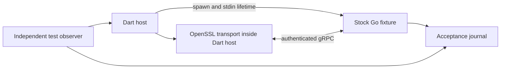
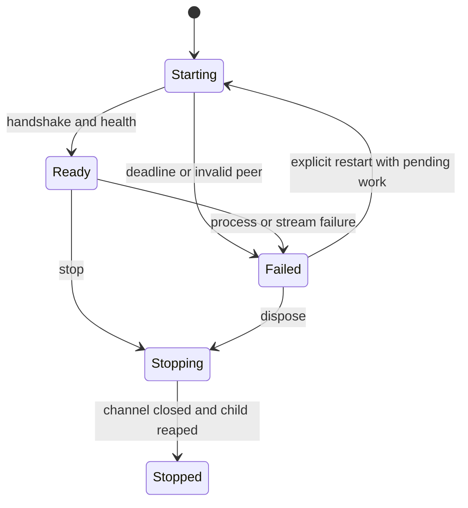
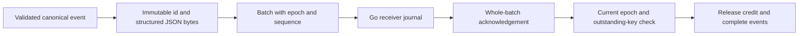

# Design

## Triage

| Trigger | Applies? | Evidence |
|---|---|---|
| T1 Components | yes | New Dart host, Go child and independent test observer |
| T2 State | yes | Starting, ready, failed, stopping and stopped lifecycle; outstanding batch map |
| T3 Concurrency | yes | Process streams, gRPC streams, deadlines and crash/restart |
| T4 Boundaries | yes | go-plugin wire protocol and experimental output protobuf |
| T5 Volume | yes | Delivery backlog, stderr and receiver evidence can grow |
| T6 Risk | yes | Certificate authentication and acknowledgement-loss semantics |

TIER: FULL

## Context

Scope and exclusions are in proposal.md. The foundation now supplies grpc-dart 5.2.0, http2 2.3.1 and protobuf 6.1.0 (`correlia_server/pubspec.yaml:13-17`), the isolated generated probe and stock Go fixtures. The in-progress host owns startup and cleanup (`correlia_server/lib/src/plugin/plugin_host.dart:101-408`); its connector still uses `SecureSocket` (`plugin_rpc_connection.dart:164-244`). Existing event generation and the frozen baseline remain isolated by `tool/lib/src/proto_command.dart`. Real-process host and transport tests exist under `correlia_server/test/plugin/`; their protected paths have not yet passed with the permanent connector.

The primary go-plugin documentation confirms the handshake and health service; v1.8.0 `mtls.go` confirms P-521, localhost SAN and client/server usages:
- https://github.com/hashicorp/go-plugin/blob/v1.8.0/mtls.go
- https://github.com/hashicorp/go-plugin/blob/main/docs/internals.md
- https://github.com/hashicorp/go-plugin/blob/main/docs/guide-plugin-write-non-go.md

The pinned Dart VM's native TLS ClientHello omits the P-521 signature scheme needed by stock Go's TLS 1.3 server; the failed runtime probe is retained in `evidence/handshake-and-mtls.md`. A separate original Dart/OpenSSL prototype completed a protected generated RPC over TLS 1.3 and rejected wrong pins, absent client identity and wrong client identity against the same ready stock fixture. This is feasibility evidence, not completion of the mapped host tests or the four-gate spike. Third-party source/proto templates are not copied into this repository.

## Decisions

### D1: Experimental output-only contract

- **Choice:** Define Correlia-owned `correlia.plugin.spike.v1` messages under `proto/correlia/plugin/spike/v1/`. One bidirectional `Deliver` RPC carries batches of `(event_id, canonical structured-JSON bytes)` and acknowledgements containing a connection epoch and batch sequence. Acks mean the entire batch has been accepted. No partial outcomes in this probe. Epochs change per connection, sequences increase without reuse within an epoch. Stale callbacks are ignored by epoch fencing; unknown or repeated current-epoch acknowledgements fail the connection. Freeze byte snapshots on admission and validate ids against canonical envelopes. Expose the small experimental host through `plugin.dart`, not Serverpod generated APIs.
- **Rejected:** Publish the complete `correlia.plugin.v1` protocol now; source/config/patch semantics are unnecessary for the four gates. Sending only counters would not prove real event interoperability.
- **Reversal cost:** low; deliberately separate experimental package prevents mistaking it for the eventual stable protocol.
- **Important:** yes — binds an IPC boundary.
- **Chosen by:** agent

### D2: Stock serving and real mutual TLS

- **Choice:** Pin go-plugin v1.8.0 in a fixture Go module with go.sum; no patches or fork. Use plain-stock and stdin-watched entry points sharing Correlia's generated application service. Generate ephemeral P-521 host credentials with an original Go standard-library test helper in owner-only scratch; the helper is not a production certificate dependency. D6's connector trusts only the handshake server certificate, verifies the certificate and `localhost`, compares peer DER exactly and requires ALPN `h2`; no accept-all callback or OS roots. Decode unpadded standard-base64 DER without substituting certificates. The spike's required minimum is TLS 1.3, so the authenticated test exercises the P-521 signature path that failed, not a TLS 1.2 workaround. Assert the observed P-521 group of both certificates and the actual negotiated protocol; evidence records protocol/backend/configuration selection. Pin protobuf-compatible grpc/generators without overrides. Criterion 1's mapped pass requires valid negotiation, socket checks, SERVING health and an RPC in default AutoMTLS. Its invalid-startup row also checks default-mode group/other-write rejection under an explicit permissive launch umask, an empty certificate field and a health stall behind TLS. TLS failure preserves partial evidence, not a startup pass. Plaintext diagnostics are explicitly selected only for criteria 3/4 and never count as criterion 1, automatic retry or adoption.
- **Rejected:** Go proxy client (would not prove Dart TLS), committed private keys, P-256 substitution, plaintext automatic fallback or modified stock server TLS.
- **Reversal cost:** medium; positive and negative real-process tests determine feasibility before adoption.
- **Important:** yes — security boundary and weak runtime evidence.
- **Chosen by:** agent

### D3: Small lifecycle owner, explicit restart

- **Choice:** One Dart host instance owns its process, channel, stdin and subscriptions. Select only explicit cookie, versions, host certificate and private socket directory for the child environment; fixture journal/control paths are explicit argv. In both default AutoMTLS and selected diagnostic mode, launch through `/bin/sh -c 'umask 0177; exec "$@"'` so the direct child PID is retained. Record the inherited parent umask, effective launch umask and actual socket mode; the hardened launch's mode is not claimed as stock's intrinsic permission policy. D24 evidence separately launches the unmodified stock fixture under the inherited umask and records that mode too. Parse a newline-terminated six-field handshake, accepting an optional seventh flag only when false; reject unsupported core/app/transport/protocol and a missing AutoMTLS certificate. Require a current-uid-owned 0700 attempt directory and a socket resolving inside it, owned by that uid with no group/other write bits. Implement health Check(`plugin`), controller Shutdown and stock GRPCStdio draining using original hand-coded Dart descriptors/minimal codecs, not copied upstream schemas. Restart is explicit, not a production supervisor.
- **Rejected:** A generic registry/supervisor or direct server-startup integration; both hide experimental failures and expand the spike.
- **Reversal cost:** low.
- **Important:** yes — process and security boundary.
- **Chosen by:** agent

### D4: Surviving-host authority and independent crash evidence

- **Choice:** The delivery owner alone mutates pending events and the in-flight map, deriving available credits from the window minus the current epoch's outstanding count. A stream generation holds only its epoch and next sequence and reports acks/terminal events to that owner. The owner removes validated acknowledged batches atomically; the first terminal event retires the epoch and returns its outstanding batches to pending once. Restart re-batches retained immutable bytes under a fresh epoch. Open `Deliver` only when nonempty work is available. The Go fixture journals id, SHA-256 payload digest, epoch and sequence before ack, flushes, then notifies the test Unix control socket and awaits release. A first-launch-only argv flag arms this barrier for its first nonempty batch; restarted launches omit it. The observer kills the exact plugin at the barrier. Reconciliation rejects torn records and compares every id/digest, including duplicates. For host-death proof launch the resolved Dart executable or AOT binary directly, assert plugin PPid equals that host PID, and observe exact PID/start identity without retaining stdin writers. Exit means absent `/proc/<pid>` or the same start identity in state `Z`. The watcher flushes a distinct EOF exit-cause marker before exit; nothing writes fd 1/2 after the handshake in this case.
- **Rejected:** Receiver-only memory evidence, sleep-triggered crashes, process-name kills and claims of host-crash delivery durability.
- **Reversal cost:** low.
- **Important:** yes — failure guarantee and evidence integrity.
- **Chosen by:** agent

### D5: Preserve event tooling isolation

- **Choice:** Add pinned plugin generation/check stages to existing proto tasks with isolated input selection and outputs. Correlia's `correlia.plugin.spike.v1` definitions pass STANDARD lint. Upstream interoperability uses D3's hand-coded Dart descriptors: no upstream schemas enter the linted `proto` Buf module or event generator. Keep the existing event proto:check behavior and frozen baseline unchanged; select event-only input for event schema/bounds generation before adding plugin services. Use scratch-regenerate-and-compare for plugin outputs. Structured JSON avoids Go event types. Record an additive experimental-protocol ADR during apply, leaving accepted ADRs unchanged; D24 confirmation remains owner-only.
- **Rejected:** A second independent manual codegen workflow or regeneration of the event-v1.0 baseline.
- **Reversal cost:** medium.
- **Important:** yes — generation boundary and future protocol expectations.
- **Chosen by:** agent

### D6: In-process OpenSSL transport with explicit ownership

- **Choice:** Replace the built-in TLS engine, not the authentication protocol: original, narrow Dart FFI bindings use the system OpenSSL 3 ABI with `ffi` 2.2.0. A native engine owns SSL context/session, bounded BIO pair and native staging; an event-driven `RawSocket` adapter owns I/O, pending ciphertext, plaintext admission and subscriptions. grpc-dart owns gRPC framing/calls through its custom connector and http2 `viaStreams`. The built-in `SecureSocket` path failed criterion 2 and remains recorded as failed; only the custom-connector/OpenSSL path can claim the new observed runtime result. Its interpretation of ADR 0020's "client certificate presented by grpc-dart", and the new runtime dependency, require the owner's 5.5 review before production adoption. D2's authentication precedes readiness; wait for peer HTTP/2 SETTINGS within startup's deadline, racing transport failure because TLS 1.3 can finish locally before server rejection. Missing/incompatible libraries fail startup and clean the attempt, never choose another backend. A new ADR restates all of 0022 except the TLS mechanism, supersedes it wholly, and carries its other probe rules forward unchanged; move 0022 to the superseded index and repoint the probe boundary. Neither this mechanism nor passing runtime tests grants D24 or owner interpretation approval.
- **Rejected:** An OpenSSL command-line bridge or Go proxy adds another process/credential lifetime and would not prove an in-process Dart-owned transport. Building or vendoring a complete OpenSSL distribution adds packaging scope unnecessary for the Linux spike. Weakening mutual authentication to retain the built-in engine would fail the security scenario.
- **Reversal cost:** medium; the connector isolates the native engine, but native ABI availability and correct nonblocking ownership need runtime proof.
- **Important:** yes — security boundary, runtime dependency and technology binding.
- **Chosen by:** agent

The exported `plugin.dart` surface has an explicit show-list and only authenticated constructors/configuration. Remove the current public `secure`, umask opt-out, trust-pin override and separate advertised-certificate controls: the normal host always uses D2/D3 and derives the advertised certificate from its required identity. A private host constructor and a separate internal test-harness factory, neither reachable through `plugin.dart` nor a public configuration or exported class member, select diagnostic mode, controlled negative umasks, omitted/wrong identities or pins, and resource-acquisition ports. Native socket/allocator/capability controls likewise stay in this internal harness, not on the exported host API. No compatibility shim retains the old switches.

The native loader's test control is failure-only: an enum requests an actual OS-load failure at a fixed non-loadable path or a missing ABI symbol in the genuine system library. It cannot accept a library object, arbitrary successful loader callback or replacement verification implementation. The normal backend always resolves its required symbols eagerly from the system OpenSSL 3 libraries before a raw connection or per-connection native allocation. Internal socket/allocator ports exercise resource ownership; an explicit capability profile can only narrow actual signature support to omit P-521, never disable verification or fabricate a peer result.

Use OpenSSL's default system/`OPENSSL_CONF` configuration rather than silently suppressing the host policy. Record that selection, the compiled default configuration directory and relevant `OPENSSL_CONF`, `OPENSSL_CONF_INCLUDE` and `OPENSSL_MODULES` settings with the runtime evidence. Apply D2's protocol/authentication profile explicitly after context construction: replace the trust store with a fresh pin-only store and clear inherited identity material before installing the caller's identity, so configuration cannot add trusted peers or an implicit client identity. A configuration that prevents the required profile fails visibly; it cannot produce a passing lower-protocol result.

Task 2.6 maps native/resource commitments to named executable checks. An original mutual-TLS byte-stream peer isolates inbound/outbound backpressure and partial writes; it never substitutes for stock acceptance. Partial-allocation verification runs in a separately spawned process, installs original OpenSSL allocation counters before initialization, warms caches and checks repeated real failures/disposal return to the same live-allocation baseline; a real tracking allocator also counts Dart-side native staging. The C compiler/development headers and allocation hooks are test-only, never installed in the production host.

### Decision summary

| # | Decision | Choice | Rejected | Reversal cost | Important | Chosen by |
|---|---|---|---|---|---|---|
| S1 | Scope | Four-gate output spike | Full SDK | low | yes: boundary | agent |
| S2 | Security/owner gates | Runtime evidence separate from owner D24/custom-connector interpretation/fallback approval | Silent downgrade or automatic adoption | medium | yes: security/evidence | agent |
| S3 | Durability scope | Surviving-host pending set | Database queue/host-crash delivery claims | low | yes: guarantee | agent |
| D1 | IPC | Experimental batch/epoch/ack protocol | Premature full v1 | low | yes: boundary | agent |
| D2 | TLS | Default AutoMTLS with minimum TLS 1.3, observed P-521/protocol/configuration and exact peer checks | TLS 1.2 workaround/diagnostic startup pass/proxy/downgrade/static keys | medium | yes: security/evidence | agent |
| D3 | Lifecycle | Single owner, explicit recorded launch umask plus inherited-mode control, exact socket checks and hand-coded descriptors | Production supervisor/implicit permission repair/upstream schemas in Buf | low | yes: boundary | agent |
| D4 | Recovery proof | Sole map writer, derived credits, one-shot first-launch barrier, journal and EOF-cause proof | Independent credit counter/sleep/receiver-memory-only proof | low | yes: guarantee | agent |
| D5 | Generation | Isolated plugin stages, existing tasks | Manual parallel pipeline | medium | yes: boundary | agent |
| D6 | Native transport | OpenSSL custom connector; authenticated-only export, internal failure-only harness, whole-ADR supersession and pending owner interpretation | Public test switches/replacement verifier/external bridge/bundled crypto/automatic adoption | medium | yes: security/technology | agent |

## Diagrams (FULL)

T1 — components:


T2 — lifecycle:


T3 — crash/ack race:
```mermaid
sequenceDiagram
  participant H as Host
  participant P as Plugin
  participant O as Observer
  H->>P: Batch(epoch, sequence, bytes)
  P->>O: Journal flushed; pre-ack barrier
  O->>P: SIGKILL exact process
  H->>H: Retain outstanding batch
  H->>P: Explicit restart and redelivery under new epoch
  P->>H: Ack new epoch and sequence
```

T4 — boundary:


## State & Ownership (FULL)

| State | Owner (sole writer) | Lifetime | Invalidation / rebuild | Authoritative copy |
|---|---|---|---|---|
| Process/channel/lifecycle | Dart host | One host instance | Dispose; explicit new attempt | Host memory |
| TLS context/session, BIO pair and native staging | Native TLS engine | One connection | Explicit idempotent disposal on failure or close, including partial initialization | Native state |
| Raw socket, queued plaintext, pending ciphertext and stream state | Socket adapter | One connection | Close/error cancels subscriptions, closes socket and disposes engine; late connect results are closed | Adapter memory |
| Pending immutable bytes | Delivery owner | Admission to valid ack | Retained on plugin crash; lost on host death | Host memory |
| Epoch and next sequence | Stream generation | Connection | Retired by delivery owner; credits derived from owner's current-epoch map | Generation memory |
| In-flight batch map | Delivery owner | Admission to ack or epoch retirement | Atomically return retired epoch's outstanding batches to pending once | Host memory |
| Accepted deliveries journal | Go fixture | One test run across restarts | Observer deletes after all processes exit | Test-owned file |
| Credentials/socket directory | Attempt owner | One attempt | Destroy after process/channel exit | Restricted scratch |
| Gate evidence | Implementer, committed by orchestrator | Change history | New evidence supersedes with explanation | Committed evidence file |

## Failure & Visibility (FULL)

| Component | Fails / dies mid-operation → | Recovery | Retry safe? | Who finds out |
|---|---|---|---|---|
| Credential helper | No usable credentials | Fail startup; clean scratch | New attempt | Named startup diagnostic/test |
| Host startup | Invalid handshake, socket ownership/mode, exit, timeout, TLS/health failure | Close channel, terminate/reap own child; record parsed-handshake evidence before TLS | Explicit restart only, never automatic plaintext retry | Typed error and bounded diagnostics |
| Native library/TLS/HTTP2 startup | ABI unavailable, certificate/name/pin/ALPN failure, late peer rejection or readiness timeout | Dispose all native/network state; fail the owning attempt | Explicit new authenticated attempt only | Original transport cause in startup diagnostic |
| Deliver stream/plugin | Uncertain acceptance | Preserve pending set; restart | At least once; consumer dedup required | Test result and receiver journal |
| Host SIGKILL | No graceful cleanup | Watched child exits on EOF | No delivery durability claim | Independent observer |
| Uncooperative shutdown | RPC blocked or child remains | Force own PID after grace | Stop is idempotent | Forced-stop diagnostic |
| Evidence/generation | Missing journal, mismatch or tool failure | Fail check, never report pass | Rerun after cause fixed | Command exits nonzero with stage/path |

## Resource Bounds (FULL)

All initial defaults below are injected policy, not stable operator settings. Validate positive values and reject oversize single events before admission. Existing canonical event bounds still apply.

| Queue / buffer / cache / transfer | Bound | At the bound | Timeout | At 10x / 100x |
|---|---|---|---|---|
| Host pending admission | 1,024 events and 16 MiB total | Await capacity; cancellation fails caller, no admission | Delivery run deadline below | Lazy producer never materializes entire source |
| Batch | 64 events, 1 MiB encoded message | Flush before next event exceeds cap; flush partial batch at source completion or end of currently available input turn, without waiting for a full batch | Ack progress deadline below | More batches, same memory |
| Outstanding batches | 4 | Stop sends until ack | 10 s ack progress deadline | Fixed memory, slower throughput |
| gRPC message/stream | 2 MiB send/receive cap | Reject over-bound message | Open only with pending work; 10 s response-header/ack-progress deadline after sending work, no whole-stream deadline or idle timeout with nothing outstanding | Fixed cap, healthy progressing streams can stay open |
| Handshake | 16 KiB including newline | Fail and clean child | 10 s total start including TLS/health | Fixed cap |
| TLS encrypted/staging buffers | BIO pair 32 KiB per direction; three 16 KiB native staging buffers and one 16 KiB Dart ciphertext buffer | Stop network reads at BIO capacity or incoming pause; preserve partial ciphertext writes and identical native buffers on TLS write retries | Startup deadline above; application progress deadline as applicable | Fixed adapter storage; OpenSSL's per-connection crypto overhead is not claimed as an exact heap cap |
| TLS plaintext admission | 256 KiB queued per connection | `addStream` pauses its producer for capacity; an oversized single chunk or overflowing direct `add` fails before admission | Transport close/error releases blocked producer | Backpressure instead of queue growth |
| TLS credential/certificate input | 16 KiB each peer DER/client PEM/key PEM and accepted certificate chain | Reject before parsing/allocation beyond the input cap | Startup deadline above | Fixed input limits; no arbitrary certificate-chain growth |
| stderr/stdio/stdout after handshake | 8 KiB per diagnostic chunk; 64 KiB retained tail | Drain/discard excess with truncation count | Entire process lifetime | Constant retained memory; no blocked child pipes |
| Stop | One shutdown RPC/child | Force terminate then await exit | 2 s grace, 5 s force/reap watchdog | One process per host |
| SIGKILL orphan observation | One PID/start identity | Fail assertion before teardown cleanup | 5 s | Independent observer; never name-match |
| Spike event source | 10,000 distinct events generated lazily | Exact set reconciliation | 120 s whole test | 100k/1M use same streaming bounds, not mandatory benchmark |
| Receiver journal/test logs/control | 32 MiB digest journal, 4 MiB diagnostics per test; control socket one 8 KiB frame in each direction per barrier | Fail test, stop children; no silent overwrite or unbounded control queue | Whole test deadline; journal-flush barrier explicitly released or child killed | Fail visibly rather than disk growth |
| Fixture builds | One module build per suite into owned scratch | Serialize build, reuse binaries for suite | 120 s build | No process per event |

## Flow & State Gaps (FULL)

- Admission assigns ownership only after immutable bytes fit the pending budget; cancellation before admission does not create pending work. Stop rejects new admissions and completes blocked callers with an explicit stopped error.
- Ack and stream-error callbacks report to the sole delivery owner, which validates epoch/key before mutating maps. Its first terminal event retires that epoch and returns all remaining in-flight batches to pending atomically once; late callbacks cannot mutate the new generation.
- All-or-nothing ack avoids ambiguous per-event credit accounting. A receiver records whole batches before ack. A crash after record/before ack creates intentional duplicates, reconciled by exact id and bytes.
- After restart, acknowledged events are absent from the pending set. Pending batches can change grouping, never identity/bytes. No alert ordering guarantee is introduced.
- EOF is held open until disposal. The independent observer directly launches the Dart host (no `dart run`/timeout wrapper), verifies the plugin's PPid is that exact host, and retains no plugin stdin writer. SIGKILL assertions require the EOF marker and exact-process exit state as defined in D4 before any teardown signal. A zombie counts as terminated, not as a running orphan; teardown handles reaping where possible.
- Shutdown races with start/delivery are serialized through the lifecycle owner. Any startup failure cleans even a partially initialized child/channel. Failure of the cleanup watchdog is a test failure, not a successful stop.
- Resource acquisition does not become unowned on timeout: late process/socket/directory results are disposed by their attempt's registered completion handler. Native allocation failures release every already-created object. Stop/failed startup never depend on a paused or absent plaintext listener to release resources.
- A synchronous plaintext stream emits no events from `onListen`; setup/resume pumping is deferred until the consumer has installed its HTTP/2 reader and writer. One reentrancy-guarded adapter drives all TLS calls, preserves buffers across WANT retries and partial socket writes, and pauses incoming/network or outgoing/source reads at the corresponding bound.
- Socket checks use D3's directory, uid, type and mode criteria. Record the explicit launch umask alongside the resulting stock socket mode, plus a separate inherited-umask stock launch for D24; never attribute the hardened launch's permissions to an unconditional stock default. No socket is chmodded or plugin repaired. Diagnostic plaintext additionally requires exact 0600 and is selected before launch, never entered after authentication failure.
- No arbitrary sleeps: barriers signal readiness, withheld acks, journal flush and pre-ack crash points. Process exit observation uses Linux identity-aware bounded polling only where the OS lacks a parent wait handle.

## Mechanism Ledger (FULL)

| Mechanism | Built? | Why (harm nobody catches / expensive later) | Evidence that would change the call |
|---|---|---|---|
| TLS pinning and negative checks | yes | Wrong trust/client setup can make a positive smoke test misleading | Owner-approved superseding security ADR |
| In-process OpenSSL engine and bounded adapter | yes | The observed native VM ClientHello cannot authenticate stock P-521 under TLS 1.3; external bridges add another lifetime boundary | A supported built-in engine passing all the same protected/negative cases |
| Epoch/ack validation | yes | Late ack can lose pending events or invent credits | Different reviewed connection-ownership proof |
| Bounded admission and log draining | yes | Slow receiver/noisy child exhausts memory or blocks pipes | None for this process boundary |
| Journal and explicit crash barriers | test only | Otherwise success can hide loss at ack uncertainty | Equivalent independent exact reconciliation |
| Stdin watcher | fixture only | Host SIGKILL cannot run cleanup | Owner-approved alternative with equivalent proof |
| Retry backoff/circuit breaker/status DB | no | Output-NATS change owns production supervision | Production integration scope begins |
| Full metadata/config/source/patch APIs | no | No gate needs them | First real consumer establishes requirements |
| Durable queue/registry/lockfile | no | Surviving-host experiment only | Production relay/distribution work |

## Risks / Trade-offs

- P-521 or client certificate support may fail → record criterion 2 as failed, retain criterion-1 handshake evidence and explicitly run criterion-3/4 diagnostic experiments only when selected by the test operator. Label each result's security mode. This gathers evidence without approving the plaintext fallback or unblocking dependent production work.
- The native ABI is a Linux runtime dependency and FFI has explicit pointer lifetimes → require OpenSSL major 3, fail closed on missing symbols/initialization errors, keep network I/O nonblocking, and exercise partial initialization, close/deadline and repeated real-process paths before recording completion.
- Minimal upstream interoperability descriptors can drift → pin upstream, link wire methods, prove against stock executables and keep those descriptors outside Buf input; Correlia-owned proto must pass STANDARD lint.
- Probe protocol is not full v1 → explicit experimental namespace and ADR keep downstream work from treating it as stable.
- The Go credential helper proves Dart TLS loading/transport but not production Dart certificate issuance → make no claim about production issuance; decide it in real plugin integration.
- Existing event generation scans `proto` → isolate event inputs before adding services; upstream declarations are hand-coded Dart descriptors, not module schemas. Preserve event-only schema/bounds generation, baseline and existing event-contract checks.
- Stock socket permissions may disagree with ADR 0020's exact 0600 wording → record actual mode and escalate the discrepancy to the owner; do not modify the stock plugin or treat diagnostic mode as transport adoption.

## ADRs

- **In force, constraining this change:** 0020 (all four gates and owner fallback/transport), 0018 (stdin EOF), 0014 (Linux), 0021 (canonical event boundary), 0022 (experimental probe and original security-context mechanism, until superseded).
- **To record during apply:** D5's experimental-protocol ADR is recorded as 0022. D6 records a whole superseding ADR restating all 0022 rules except the TLS mechanism, moves 0022 to the superseded index and repoints the architecture's probe boundary. The new ADR explicitly preserves the built-in TLS failure and routes the custom-connector interpretation of ADR 0020 criterion 2 to the owner in task 5.5; it is not production adoption. A security fallback still requires its separate owner-approved decision and superseding ADR.

## Open Questions

- D24 production Unix-socket confirmation, and acceptance of the custom-connector interpretation/runtime dependency for ADR 0020 criterion 2, remain owner-only in task 5.5. Automated runtime passes do not settle either.
- The remaining runtime gates, and the additional native-resource checks, require their named executions and evidence.
