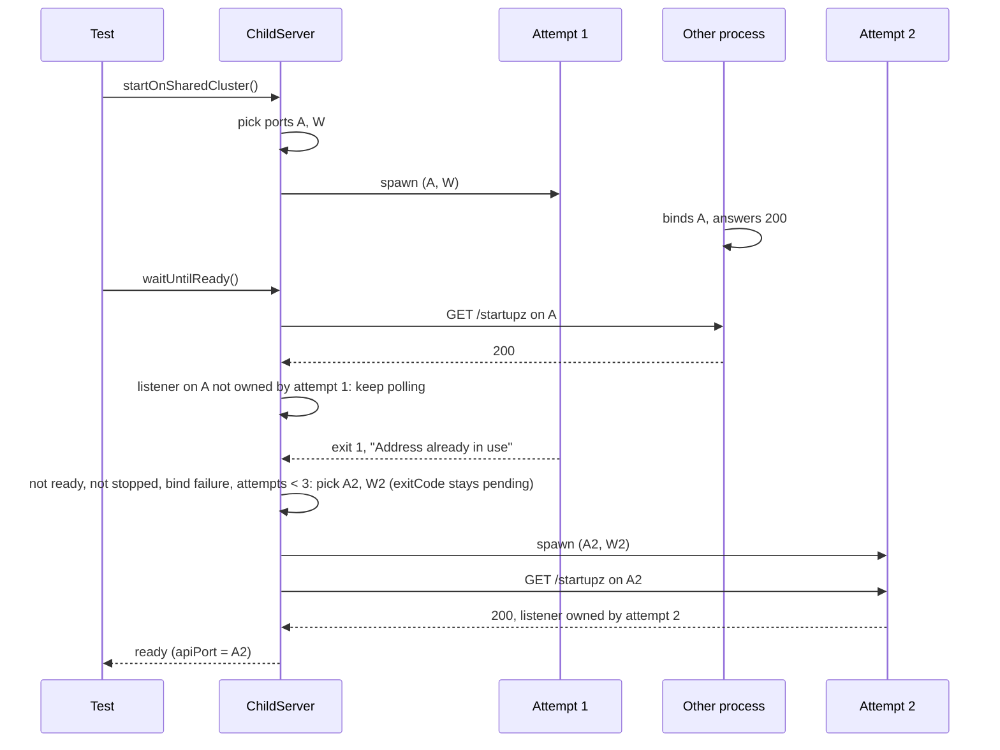
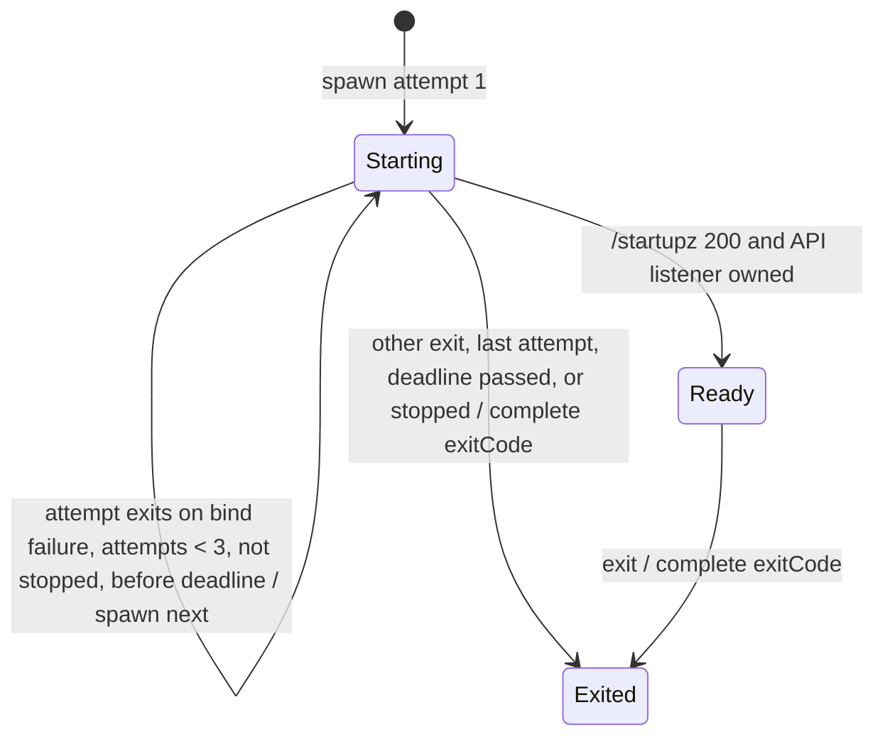

# Design

## Triage

| Trigger | Applies? | Evidence |
|---|---|---|
| T1 Components (new component, or 3+ with directed relationships) | no | Only the existing test harness `ChildServer` (`correlia_server/test/support/child_server.dart`) and one `tool` check change. |
| T2 State (persistent state, caches, 3+ state machine) | no | No persistent state. A child's attempt (process, ports, log tail) is replaced in memory on a retry; the child's lifecycle is starting, ready or exited. |
| T3 Concurrency (background work, workers/isolates, async, retries) | yes | A bounded startup retry is added. It races other processes for ports, callers that wait on exit and readiness at once, and teardown. The runner runs three files at once (`dart test` default concurrency, half the cores). |
| T4 Boundaries (data format, migration, shared interface, IPC, external) | yes | `ChildServer` is the shared interface of 14 test files and helpers. Its public surface (`start`, `startOnSharedCluster`, `waitUntilReady`, `apiPort`, `webPort`, `pid`, `exitCode`, `hasExited`, `output`, `closeStdin`, `stop`, `kill`) must keep working for all of them. |
| T5 Volume (grows without a fixed bound) | no | At most a fixed number of attempts per child. |
| T6 Risk (security, money, data loss, unrecoverable user data) | no | Test harness only. The ingress redaction assertions are kept unchanged, not weakened. |

TIER: FULL

## Context

See proposal.md for the two failures and the measurements.

- `ChildServer._spawn` (`child_server.dart:99-153`) picks the API, web and Insights ports with `_freePort`
  (`:156-161`: bind port 0, read the port, close), then starts `dart bin/main.dart` from source with those ports
  in `SERVERPOD_*_PORT`, through `/bin/sh -c 'exec ...'`, so `pid` is the server VM itself. The child compiles
  before it binds, so the gap between pick and bind is several seconds, longer under load.
- The comment above `_freePort` records why the harness picks ports instead of parsing the child's log: the API
  port is needed to poll `/startupz` before any log line exists. This design keeps that choice (D2).
- `waitUntilReady` (`:266-278`) polls `/startupz` until 200 or the deadline (default `readyTimeout`, 60 s), and
  fails with `exited with <code>` and the child's output when the child exits first. A lost port shows up as an
  exit: in the failing run the child logged `ERROR: Failed to bind socket, port 35585 may already be in use.` and
  `SocketException ... (OS Error: Address already in use, errno = 98), address = ::`, then exited 1. Serverpod
  binds `::`, so the listener appears in `/proc/net/tcp6`.
- `apiPort`, `webPort` (`:171-174`), `exitCode` (`:228`) and `_tail` (`:166`) are `final`/`late final`, set once
  in the constructor (`:28-46`).
- Callers start a child, then call `waitUntilReady`, and read ports only after it returns (for example
  `ingress_e2e_test.dart:63-75`, `test/support/output_process.dart:140-150`, `test/support/nats_process.dart:102-110`).
  Two callers race `child.exitCode` against `waitUntilReady()` with `Future.any` to prove a startup failure:
  `ingest_bootstrap_e2e_test.dart:67-73` and `pipeline_lifecycle_e2e_test.dart:36-39`. They capture the
  `exitCode` future before readiness.
- `tearDownChildren` (`:360-376`) closes stdin of every child with `!hasExited`, then awaits `exitCode`.
- Test timeouts: `ingress_e2e_test.dart` has nine tests and no timeout. Other e2e files set 3 to 6 minutes per
  test, but some are below what their sequential children can take: `pipeline_lifecycle_e2e_test.dart`'s
  three-child test has 3 minutes (`:104`), `ingest_bootstrap_e2e_test.dart` starts four children in 3 minutes
  (`:89`), `pipeline_recovery_e2e_test.dart` two children in 3 minutes (`:164`).
- The `tool` package already lints the server's test sources lexically: `untaggedWithServerpodCalls`
  (`tool/lib/src/server_test_tags.dart:14`), run over every server test file by
  `tool/test/server_test_tags_test.dart:131` inside `mise run check`. The new timeout check follows that pattern.

## Decisions

### D1: Budgeted per-test timeouts; a presence check in `mise run check`, adequacy by inventory

- **Choice:**
  - The budget rule: a test that starts `n` children in sequence has a timeout of at least
    `n × (readiness deadline + 30 s shutdown) + 60 s` for the test's own work. With the default 60 s readiness
    that is 2.5 minutes for one child, 4 minutes for two, 5.5 for three, 7 for four. Children started together
    (`Future.wait`) count once.
  - Each test in `ingress_e2e_test.dart` gets `Timeout(Duration(minutes: 3))`.
  - Every existing test that starts children is inventoried (file, test, children in sequence, readiness
    deadlines, required budget, current timeout). Any timeout below its budget is raised, including the
    `pipeline_lifecycle` and `ingest_bootstrap` tests above. The inventory is committed as evidence.
  - A lexical `tool` check beside `untaggedWithServerpodCalls` enforces presence only: in every server test file
    tagged `e2e` or naming `ChildServer`, each `test(` call has a direct `timeout:` argument, unless the file has
    a library `@Timeout(...)`. It names the file and line. It cannot judge adequacy; the budget rule and the
    inventory do, and the rule is written in the doc comment of `ChildServer.start` so new tests find it.
- **Rejected:** A tag-level default in `correlia_server/dart_test.yaml` (`tags: e2e: timeout: 3m`). It lost
  because it is silent: a test that starts several children needs more than any one default and nothing would
  say so; and `test/db/kill_recovery_test.dart` starts children under the `db` tag, which keeps the short default
  for its fast database tests. Also rejected: a lexical adequacy check counting children per test, because
  children are often started through helpers (`output_process.dart`, `nats_process.dart`) and in loops, which a
  lexical count gets wrong.
- **Reversal cost:** low
- **Important:** no
- **Chosen by:** agent

### D2: The retry belongs to the child's attempt exit; `exitCode` is the logical child's

- **Choice:**
  - `ChildServer` keeps everything needed to spawn again (server dir, args, VM args, environment without the port
    variables, log location, readiness deadline) and a sequence of attempts. Public `exitCode` is a single
    `Completer<int>` future created once, so a caller that captured it keeps a valid future.
  - When an attempt's process exits, its exit handler decides, in one place: if the child has not been declared
    ready, no stop or kill was requested, the attempt's output shows a bind failure (`Failed to bind socket` or
    `Address already in use`), fewer than 3 attempts have run and the readiness deadline has not passed, it picks
    three fresh ports and spawns the next attempt, and `exitCode` stays pending. Otherwise it completes `exitCode`
    with the attempt's code and sets `hasExited`.
  - On the final failure the child's `output` begins with one line naming the attempts made and the lost ports,
    so `waitUntilReady`'s existing error carries it.
  - `waitUntilReady` keeps one deadline for all attempts and polls the current attempt's API port (D4 decides
    readiness). `apiPort`, `webPort` and `pid` read the current attempt; their doc comments say they are final
    once `waitUntilReady` has returned.
  - `closeStdin`, `stop` and `kill` set a stop flag first, so no further attempt starts. If an attempt is being
    spawned, they wait for that spawn to return and then act on the new process. `exitCode` completes once, with
    the code of the attempt that was stopped.
  - The existing `Future.any([child.exitCode, child.waitUntilReady()...])` callers need no change: a non-bind
    startup failure is not retried, so they still see exit 1; a bind failure no longer completes `exitCode`
    early.
- **Rejected:** Retry inside `waitUntilReady` and replace `exitCode` per attempt. It lost because a caller that
  captured `exitCode` before readiness (the two `Future.any` callers) sees the failed attempt's exit and starts
  teardown while a retry spawns (review M2). Also rejected: let the child bind port 0 and report its ports, which
  needs the log-parsing coupling the `_freePort` comment rejected and a test-only server change; and a new
  `startReady` factory for all 14 callers, which adds no safety because the stable `exitCode` already covers them.
- **Reversal cost:** low (harness only)
- **Important:** no
- **Chosen by:** agent

### D3: The port picker is injectable for the retry's own tests

- **Choice:** `start` and `startOnSharedCluster` take an optional `@visibleForTesting` port picker, defaulting to
  `_freePort`. The retry tests (real processes, `e2e` tier) pass a picker whose first API port is one the test
  holds:
  - held by a plain socket, the first attempt fails with a real bind error and the second becomes ready;
  - held by a test `HttpServer` that answers every path with 200, the harness must not declare the child ready on
    it (D4) and must retry;
  - a stop requested from the picker's second call, before the second attempt spawns, proves teardown during a
    pending retry;
  - a child with an invalid ingest config proves a non-bind failure gets one attempt.

  The bind-failure matcher and the `/proc` socket-ownership parser are pure functions with fast unit tests over
  captured text.
- **Rejected:** Reproduce the race by load, which is the flakiness this change removes. Mock the process, which
  the project's no-mocking rule forbids and which would not prove the real Serverpod bind error text.
- **Reversal cost:** low
- **Important:** no
- **Chosen by:** agent

### D4: Readiness requires that the child owns its API listener

- **Choice:** A `/startupz` 200 counts only when the listening TCP socket on the attempt's API port belongs to
  the attempt's own process: the harness finds the listening entry (state `0A`) for the port in `/proc/net/tcp6`
  and `/proc/net/tcp`, takes its inode, and finds `socket:[<inode>]` among `/proc/<pid>/fd/*` links. A 200 from
  another owner is ignored and polling continues; the owned child then exits on its bind failure and D2 retries.
  The check runs once per 200, not per poll. Once the API listener is owned and `/startupz` is 200, Serverpod has
  started all its servers, so the web port is the child's too (a failed web bind would have ended startup).
- **Rejected:** A per-child nonce returned by the server on `/startupz`, which needs a test-only change to the
  product's health endpoint. Also rejected: trusting the 200 and checking the child is still running, which a
  child that has not yet exited passes while another server answers (review M3).
- **Reversal cost:** low. It relies on Linux `/proc`, which ADR 0014 makes the only platform.
- **Important:** no
- **Chosen by:** agent

### Decision summary

| # | Decision | Choice | Rejected | Reversal cost | Important | Chosen by |
|---|---|---|---|---|---|---|
| S1 | One change for both causes | Fix the ingress timeout and the port race together | Timeout only; two changes | low | no | agent |
| S2 | Fix the harness, not the tests | Sized timeouts and a lost-port retry; assertions unchanged | Test retries; lower concurrency | low | no | agent |
| S3 | M1-sized scope | Two causes plus a recurrence guard | Precompiled child server | low | no | agent |
| D1 | How tests get their timeout | Budget rule, inventory and raise, presence check in `mise run check` | Tag-level default; lexical adequacy check | low | no | agent |
| D2 | Where the retry lives | Attempt exit handler; one logical `exitCode`; stop suppresses retries | Retry in `waitUntilReady` with per-attempt `exitCode`; child binds port 0; `startReady` for all callers | low | no | agent |
| D3 | How the retry is tested | Injectable port picker, real processes, pure matcher and parser tests | Load reproduction; mocked process | low | no | agent |
| D4 | What counts as ready | `/startupz` 200 and the API listener owned by the attempt's pid (`/proc`) | Server-side nonce; trust any 200 | low | no | agent |

## Diagrams (FULL)

T3, the startup retry with a stolen API port:

T2/T3, the logical child's lifecycle:

T4: every caller keeps "start, then `waitUntilReady`"; `exitCode` is one stable future; only the values behind
`apiPort`, `webPort` and `pid` may change, and only before `waitUntilReady` returns.

## State & Ownership (FULL)

| State | Owner (sole writer) | Lifetime | Invalidation / rebuild | Authoritative copy |
|---|---|---|---|---|
| Current attempt (process, ports, log tail) | The attempt exit handler (D2); `_spawn` builds each | One attempt | Replaced when a lost-port attempt is retried | The latest attempt |
| `exitCode` completer, `hasExited` | The attempt exit handler | The `ChildServer` | Completed once | The completer |
| Ready flag | `waitUntilReady` | The `ChildServer` | Set once | The flag; the exit handler reads it |
| Stop flag | `closeStdin`, `stop`, `kill` | The `ChildServer` | Set once | The flag; the exit handler reads it |
| Attempt count | The attempt exit handler | The `ChildServer` | Never reset | `attempts` |
| Shared database / cluster root | The test (`SharedClusterDatabase`, `E2eRoot`) | The test | Not touched by a retry | The test's handle |

All state lives on one isolate's event loop; the flags are read and written between awaits, so there is one
writer at any time.

## Failure & Visibility (FULL)

| Component | Fails / dies mid-operation → | Recovery | Retry safe? | Who finds out |
|---|---|---|---|---|
| Attempt, lost port | Exits 1 during startup | Next attempt on fresh ports, up to 3, within the deadline | Yes: the attempt bound nothing it kept; migrations already applied are skipped; a root-owning child's `owner.lock` is released on exit | The test log (one line per retry, naming the lost port); the final error names all attempts |
| Attempt, any other startup error | Exits | None | No | The test fails at once with the output; `exitCode` completes |
| Another process answers on the API port | Returns 200 | Ignored (D4); the attempt then exits on its bind failure | n/a | The retry line in the log |
| Child never ready | Deadline passes | None | No | `not ready in <limit>` with the output, before the test timeout (D1) |
| Teardown during a pending retry | Stop requested | No further attempt; the spawning one is stopped | n/a | `exitCode` completes once |

## Resource Bounds (FULL)

| Queue / buffer / cache / transfer | Bound | At the bound | Timeout | At 10x / 100x |
|---|---|---|---|---|
| Startup attempts per child | 3 | Fail with the attempts line and the last output | The one readiness deadline (default 60 s) across all attempts | Unchanged: per child |
| Ownership checks | One per 200 response | n/a | Within the readiness deadline | `/proc/net/tcp*` grows with sockets on the machine; read once per check |
| Child log tail | Existing `_outputLines` cap | Oldest lines dropped | none | Unchanged |

## Flow & State Gaps (FULL)

- **Old attempt's log:** each attempt writes its own log file (the counter in the file name), left for the
  existing log-directory cleanup.
- **The first attempt answers 200 itself and then exits:** the child is declared ready only when it owns the
  listener; after that, any exit completes `exitCode` with no retry, as today.
- **A caller reads a port before `waitUntilReady` returns:** no current caller does (Context); the doc comments
  state it.
- **Exit arrives after the deadline passed:** no retry; `exitCode` completes and `waitUntilReady` has already
  failed with `not ready`.
- **The test closes stdin or kills the child during startup:** the stop flag is set first, so the exit is final.

## Mechanism Ledger (FULL)

| Mechanism | Built? | Why (harm nobody catches / expensive later) | Evidence that would change the call |
|---|---|---|---|
| Lost-port retry | yes | Observed failure of the M1 gate; nothing else catches it | — |
| Stable logical `exitCode` | yes | Without it the retry breaks the two `Future.any` callers (review M2) | — |
| API listener ownership check | yes | A 200 from a thief would point a test at another test's server (review M3) | — |
| `tool` timeout presence check | yes | The missing-timeout gap went unnoticed for three changes | — |
| Timeout inventory | yes | Existing multi-child tests are under budget today (Context) | — |
| Retry on any startup failure | no | Would hide real startup defects | — |
| Precompiled child snapshot | no | Speeds every e2e test, but no failure needs it now | Full-suite runs still near their timeouts after this change |
| Lower test concurrency | no | Slows every run; hides rather than removes both races | — |

## Risks / Trade-offs

- [The bind-failure text changes in a Serverpod or Dart upgrade] → Match on both Serverpod's line and the
  `SocketException` text; the matcher's unit tests use captured output, so a change fails a fast test.
- [Other e2e tests sit near their timeouts under load] → The evidence runs record the slowest e2e tests; any test
  within 25% of its timeout is named in the evidence.
- [`/proc` reading races a socket closing] → A failed read counts as not owned, and polling continues within the
  deadline.

## ADRs

- **In force, constraining this change:** 0002 (embedded Postgres for tests), 0010 (testing strategy), 0014
  (Linux-first, tiers, never touch another Postgres; makes `/proc` available).
- **To record during apply:** none.

## Open Questions

None.
