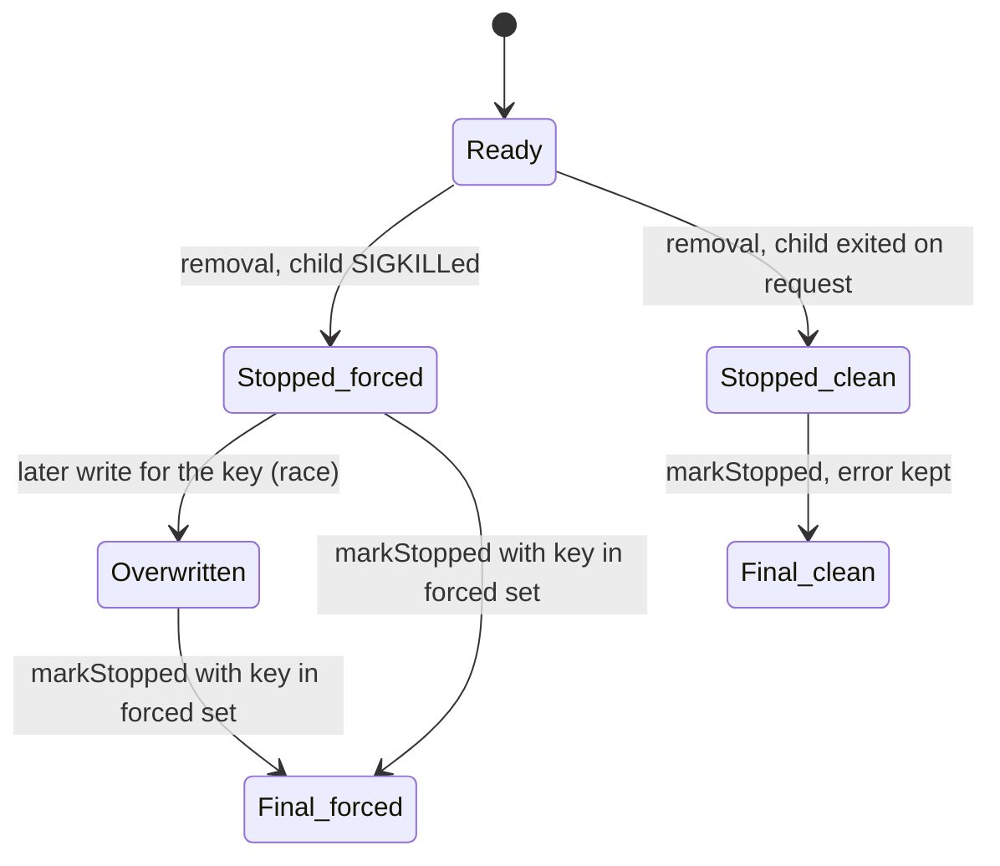

# Design

## Triage

| Trigger | Applies? | Evidence |
|---|---|---|
| T1 Components (new component, or 3+ with directed relationships) | no | Existing `PluginSupervisor`, `PluginStatusRepository`, `PipelineSubsystem` and `IngestWorkers` only. |
| T2 State (persistent state, caches, 3+ state machine) | yes | The persisted `plugin_instance_status` row (one upserted row per host, output and definition) and its last error class. A new in-memory set of force-terminated keys. |
| T3 Concurrency (background work, workers/isolates, async, retries) | yes | Several tasks can write one key's status during shutdown: the sweep's tracked removals, a launch, the stop-time removal and `markStopped`. Each instance has its own `statusTail`. Concurrent `stop` calls. |
| T4 Boundaries (data format, migration, shared interface, IPC, external) | no | No schema, protocol or model change. `markStopped` gains a parameter; its only caller is the supervisor. |
| T5 Volume (grows without a fixed bound) | no | The forced-key set is bounded by the keys present at shutdown; the unsettled-write set holds only in-flight writes (D1). |
| T6 Risk (security, money, data loss, unrecoverable user data) | no | The reap log line carries identifiers only (output id, digest, pid), never config or secrets. |

TIER: FULL

## Context

See proposal.md for the failure and the reproduction attempts.

The following describes the pre-change implementation.

- `PluginSupervisor._remove` runs as follows:
  1. It stops the connection and computes `forcedError` from `connection.forcedStop`.
  2. It sets `removalPrepared`.
  3. It persists through `_persist`, which chains the write on that instance's own `statusTail`.
  4. It removes the instance from `_instances`.
- `_persist` writes `lastErrorClass: forcedError ?? policy.lastError`. Any later write for the same key, from any
  instance, replaces it.
- `PluginSupervisor.stop` runs as follows:
  1. It completes `_stopped` and awaits the sweep loop.
  2. It awaits `_operations`, which holds the tracked removals, launches and health checks.
  3. It removes each remaining instance.
  4. It calls `PluginStatusRepository.markStopped`, which sets `state='stopped'` on every row of the host and
     leaves `lastErrorClass` unchanged.
- The ordering is not structurally guaranteed. Keys that are removed and relaunched get separate `_Instance`
  objects with separate tails, and removals can come from the sweep (failure, idle release, rotation) as well
  as from `stop`.
- `OutputPluginConnection.forcedStop` reads `PluginLaunchCore.forcedStop`. That flag is set only when the child
  had not exited within the grace period and was SIGKILLed by `PluginLaunchCore._cleanup`.
- `PipelineSubsystem.stop` calls `_stopping!.complete()` without a check:
  - a second call throws `Bad state: Future already completed`;
  - a call before `start` throws on the null `_stopping`.

  `RelaySubsystem.stop` and `PluginSupervisor.stop` already guard their completers.
- `IngestWorkers.stop` guards its own `_stopping` completer. It then stops the
  relay, the pipeline and the supervisor on every call.
- The supervisor already takes a `log` callback. The test passes `log: (_) {}`.

## Decisions

### D1: The forced reason is written by the shutdown's final status statement

- **Choice:**
  - **Forced-key set.** The supervisor holds a set of plugin keys whose child was force-terminated after
    `_stopped` completed. It is filled from every place a child is reaped, independently of whether the status
    write or the rest of the cleanup succeeds:
    - in `_remove`, `connection.forcedStop` is read in a `finally` around `connection.stop(...)`, so a cleanup
      error after the SIGKILL still records the key; the error is then rethrown as today;
    - in `_launch`, a startup that fails after the child was spawned reports how its child was reaped (below);
      when that child was force-terminated and shutdown has begun, the key is recorded.

    The set only grows after shutdown begins and holds at most one entry per key present at shutdown, so it is
    bounded by the supervisor's instance limit.
  - **Startup failures carry the reap outcome.** `OutputPluginConnection.start` already stops its
    `PluginLaunchCore` when startup fails. It now reads the core's `pid` and `forcedStop` in a `finally` around
    that stop, and the exception it throws (the existing `OutputPluginException`, or a wrapper for other errors)
    carries them as two optional, internal fields (`reapedPid`, `reapedForcibly`). The startup error and its
    class are unchanged; a stop error during that cleanup does not replace the startup error.
    Any cleanup failure is carried separately with its stack, including one caught inside `PluginLaunchCore.start`.
    If shutdown has begun, the supervisor retains it for shutdown reporting without changing the startup class.
    The original `core.start()` future is retained and observed after serialized cleanup even when its outer
    timeout wins; otherwise a handshake-phase cleanup failure carried by that future would be discarded.
  - **Cleanup errors are reported once.** Connection stops retain the cleanup future but report its error only
    to the first awaiting stop. Later calls await reaping without replaying that error, so a failed-removal
    retry can finish removal, release its slot and restart the output. Tracked operation failures during shutdown are
    retained by the supervisor (first error and stack only) and reported after the final status write.
  - **Bounded status-write tracking and a fence.** `_persist` adds each write's future to a set of unsettled
    writes and removes it when the write settles, so the set holds only in-flight writes (at most one chain per
    live instance) and nothing is kept for removed instances. `stop` then runs, in order:
    1. complete `_stopped` and await the sweep loop and `_operations` (as today);
       `writeWaiting` and `prune` bypass `_persist`; both are awaited by that loop and cannot outlive it.
    2. remove the remaining instances (as today);
    3. close the fence: from here `_persist` throws a `StateError` instead of writing, so an incorrect late caller
       fails loudly in tests;
    4. await the unsettled-write set until it is empty;
    5. call `markStopped` with the forced-key set.
  - **Final statement.** `markStopped` takes the forced keys. In the same `UPDATE` that marks the host's rows
    `stopped`, it sets `lastErrorClass='plugin_forced_stop'` on those keys' rows. Other rows keep their
    `lastErrorClass`.
  - The per-removal `_persist` keeps writing `forcedError` as today, so the row is already right during the
    shutdown, before the final write. `stop` attempts every removal and the final write, then rethrows the
    first shutdown error, including cleanup errors from tracked removals and failed startups.
- **Rejected:**
  - Order the writes alone (await every tail, then the existing `markStopped`). It closes the races we can name,
    not the one we have not seen.
  - Retain every instance's `statusTail` until shutdown. It grows with slot turnover over a worker's life,
    which ADR 0025 rules out for evicted in-memory state (review M1).
  - Make `lastErrorClass` sticky in the upsert (`COALESCE`). It would stop a recovered plugin's row from ever
    clearing its old error, which the "Persisted plugin status" requirement relies on.
  - Add a status history table. It needs a schema change and migration for a diagnostic.
- **Reversal cost:** low
- **Important:** no
- **Chosen by:** agent

### D2: Diagnose recurrences: one log line per reaped child, and a test that reports what it saw

- **Choice:**
  - `_remove` logs one line through the existing `log` callback after the child is reaped:
    `plugin-reaped output=<id> digest=<12-char prefix> pid=<pid|none> failed=<bool> forced=<bool> shutdown=<bool>`.
    The line holds no config and no secret.
  - `plugin_ignores_shutdown` collects the supervisor's log lines and every distinct status row it polls (state,
    pid, `lastErrorClass`, `version`). Its assertions get a `reason:` with both.
  - The assertions themselves are unchanged.
- **Rejected:** Leave the test as is and rely on D1, which would make any remaining cause (for example a child
  that was not force-terminated at all) undiagnosable. Persist a debug trail in the database, which is a
  schema change.
- **Reversal cost:** low
- **Important:** no
- **Chosen by:** agent

### D3: Look for the path before fixing

- **Choice:** The first task group adds D2's diagnostics and then tries to reproduce:
  - run `plugin_supervision_test.dart` repeatedly, concurrently with the `e2e` tier, which is the load profile
    of the failing run;
  - then up to five full `mise run test:all` runs.

  If it reproduces, the diagnostics name the path. That path then gets a deterministic regression test,
  injected through existing seams (`beforeLaunch`, injected clocks and durations, fixture plugin behaviour, no
  sleeps), and a fix at its source in addition to D1. Either outcome is recorded as evidence.
- **Rejected:** Skip the attempt. D1 makes the requirement hold for the paths that rewrite the row. It does not
  cover a child that was not force-terminated even though it ignored the shutdown request.
- **Reversal cost:** low
- **Important:** no
- **Chosen by:** agent

### D4: Stops are idempotent at each layer

- **Choice:**
  - `PipelineSubsystem.stop` returns at once when `_stopping` is null, which means the pipeline was never
    started. It completes `_stopping` only if it is not completed, then awaits `_run`.
  - `IngestWorkers.stop` stores the future of its first run. The first run keeps today's body: it stops the
    relay, the pipeline and the supervisor in nested `finally` blocks and raises the first error to the first
    caller. Every later call, concurrent or after, awaits that stored future, ignores its error (the first caller
    already received it) and returns. So a second call never stops a component again.
  - Failure cases are tested through a `@visibleForTesting` constructor hook on `IngestWorkers`, called as each
    component's stop begins (named relay, pipeline, supervisor), which can count calls and throw. It follows
    the existing `beforeLaunch` and test-gate pattern; production passes nothing.
- **Rejected:** Guard only the pipeline. The relay and supervisor would still run their stop bodies twice;
  they tolerate it today, but nothing requires them to. Rethrow the first error to later callers. A teardown
  after a failed stop would then fail again with an error already reported.
- **Reversal cost:** low
- **Important:** no
- **Chosen by:** agent

### Decision summary

| # | Decision | Choice | Rejected | Reversal cost | Important | Chosen by |
|---|---|---|---|---|---|---|
| S1 | Approach | Invariant by construction, plus a reproduction attempt | Wait for a reproduction; loosen the test | low | no | agent |
| S2 | Second-stop throw | Fix in product code, same change | Test-only teardown fix | low | no | agent |
| D1 | Where the forced reason is written | The final `markStopped` statement, from a forced-key set filled at every reap (removal, failed startup, failing cleanup); bounded write tracking and a fence; no write after it | Ordering only; retained tails; sticky `COALESCE`; history table | low | no | agent |
| D2 | Diagnostics | A reap log line and test failure reasons | None; database debug trail | low | no | agent |
| D3 | Root cause | A bounded reproduction attempt first; a deterministic regression test if found | Skip it | low | no | agent |
| D4 | Idempotent stop | Guarded pipeline stop; memoized worker stop; first caller gets the error; test hook for failing stops | Pipeline only; rethrow to later callers | low | no | agent |

## Diagrams (FULL)

T3: the status writes for one key during shutdown, and the final statement that settles them.

```mermaid
sequenceDiagram
    participant W as IngestWorkers.stop
    participant S as PluginSupervisor
    participant R as _remove (any origin)
    participant DB as plugin_instance_status
    W->>S: stop()
    S->>S: complete _stopped, await sweep loop
    Note over S,DB: awaiting the loop also settles writeWaiting and prune
    S->>S: await _operations (in-flight removals and launches)
    R->>R: connection.stop(grace): child SIGKILLed after grace
    R->>S: record key in forced set (in a finally, even if cleanup throws); log plugin-reaped forced=true
    Note over R,S: a failed startup during shutdown records its forced reap the same way
    alt cleanup fails
        S->>S: retain first shutdown error; retry removal without replaying the connection error
    else cleanup succeeds
        R->>DB: upsert row (stopped, plugin_forced_stop)
    end
    Note over DB: any other write for the key may land here
    S->>S: remove remaining instances (same path as R)
    S->>S: close the write fence (late _persist throws)
    S->>S: await unsettled status writes until none remain
    S->>DB: markStopped(forced set): state=stopped for the host; lastErrorClass=plugin_forced_stop for forced keys
    S->>S: no further status write
    opt a shutdown error was retained
        S-->>W: rethrow first error after final status write
    end
```

T2: a key's row during shutdown.



## State & Ownership (FULL)

| State | Owner (sole writer) | Lifetime | Invalidation / rebuild | Authoritative copy |
|---|---|---|---|---|
| Forced-key set | The supervisor's reap points (`_remove`, `_launch` on a failed startup), after shutdown began | One supervisor; at most one entry per key present at shutdown | None; read once by `stop` | The set |
| Unsettled status writes | `_persist` (adds), each write's completion (removes) | Each write | Entry removed when the write settles | The set |
| Write fence | `PluginSupervisor.stop` | One supervisor | Closed once, after the last removal and before the drain | The flag; `_persist` reads it |
| `plugin_instance_status` row | `PluginStatusRepository` via the supervisor of that host | Until pruned | Upserted per write | The database row; after shutdown, the `markStopped` statement |
| Worker stop future | `IngestWorkers.stop` (first call) | One `IngestWorkers` | Set once | The future |
| First shutdown error | Supervisor's tracked-operation handler and failed-start cleanup observer | One supervisor shutdown; one error and stack | Set only after shutdown begins | Supervisor fields; `stop` reports it after the final write |
| Connection cleanup outcome | `OutputPluginConnection` | One connection; one future and one error-reported flag | Released with the evicted instance | The original cleanup future; its error is reported once |

## Failure Modes

| Failure | Effect | Handling |
|---|---|---|
| `markStopped` fails (database error or timeout) | Rows may read `ready` and lose the forced reason | As today: `stop` rethrows the first error after attempting every removal; the row goes stale after 60 s as the "Worker killed" scenario defines |
| A removal's cleanup throws after the SIGKILL | The forced reap must still count | The key is recorded in a `finally` (D1); the reap line is logged; the error is collected and rethrown as today |
| A startup fails during shutdown and its child was force-terminated | No connection exists for `_remove` | The startup exception carries the reap outcome; `_launch` records the key and logs the reap (D1) |
| Handshake outer timeout wins and failed-start cleanup throws | The inner startup exception could be dropped | Retain and observe the core-start future after serialized cleanup; carry its cleanup failure without replacing `plugin_start_timeout` |
| Tracked removal, health or recovery operation fails during shutdown | Its error would otherwise be consumed by background tracking | Retain the first error and stack, then report it after every removal and the final write |
| Startup cleanup fails before shutdown | Shutdown reporting is not active | Preserve the startup class and emit the bounded `plugin supervisor startup cleanup failed` line |
| A late `_persist` after the fence | Would overwrite the final row | It throws `StateError`; tests that assert no write after the final one catch it |
| A child is not force-terminated although it ignored shutdown | D1 cannot record a reason | D2's log line shows `forced=false` for it; D3 owns the investigation |
| Second `stop` while the first is failing | The second call returns normally | By D4; the first caller gets the error |

## Testing Strategy

- The `db` tier proves the repository rule (D1) against real Postgres:
  1. write a forced row;
  2. overwrite it with a clean write;
  3. call `markStopped` with that key in the forced set.

  The row must read `stopped` with `plugin_forced_stop`. Another key, not in the set, keeps its own error.
- The `plugin` tier proves the supervisor's shutdown fence deterministically, with real fixture processes:
  - The tests construct `PluginSupervisor` directly, as the existing supervisor tests' seams allow, with
    injected short durations (start timeout, shutdown grace, health interval and deadline), so each step is
    driven by the test, not by production timings.
  - `@visibleForTesting` constructor hooks on `PluginSupervisor`, in the style of `beforeLaunch`:
    - one called in `_remove` before the connection is stopped, which means before the reap; a test can hold
      it with a completer;
    - one observing each status write and the final write, in order.
    - one holding failed-start cleanup at both the core and output-wrapper layers; it waits for the
      supervisor's stop signal, so timeout may occur first but reaping cannot occur before shutdown;
    - test-only fixture arguments for the pre-handshake stall mode.
  - A `@visibleForTesting` cleanup-failure injection on `PluginLaunchCore`, raised after the SIGKILL. It is
    internal to the launch core and never set in production.
  - The output fixture gets a config mode that, on configure, creates a marker file named in its config, then
    blocks and ignores the shutdown request.
    A CLI fixture mode writes the same kind of marker and SIGSTOPs before printing its handshake.
  - The tests:
    - **Removal in flight.**
      1. SIGSTOP a ready plugin.
      2. Let a sweep removal start, through failed health checks under the short durations.
      3. Hold the removal at the pre-stop hook, before its reap.
      4. Call `stop()` without awaiting it, so `_stopped` is complete.
      5. Release the hook. The forced reap now happens after shutdown began.
      6. The status-write observer erases the per-removal forced reason directly in the test database,
         simulating an earlier status operation overwriting it. The final statement must restore it.
    - **Launch overlapping shutdown.**
      1. Start a launch with the stalling fixture mode.
      2. Wait for the marker file, so the child is spawned and inside configure.
      3. Wait for the failed-start cleanup barrier to be entered, proving the deadline already elapsed.
      4. Call `stop()`. Both cleanup layers wait for this stop signal before they can reap the child.
    - **Cleanup failure.** SIGSTOP a ready plugin and inject the cleanup failure. Hold its health-failure
      removal at the pre-stop hook, call `stop()`, then release the hook. The child is force-reaped after
      shutdown begins regardless of test scheduling. Its tracked error is retained for the shutdown result,
      while a retry can finish the already-reaped connection without replaying that error.
    - **Cleanup failure before shutdown.** Release the held removal while the supervisor is still running,
      then observe a new ready PID for the same key. A later clean shutdown preserves that recovered row's
      error rather than making the old forced reap sticky.
    - **Startup cleanup failure.** Inject the cleanup failure while the configure-stalled startup is abandoned
      during shutdown. Shutdown reports that cleanup error; durable startup health still records the original
      `plugin_start_timeout` class and the final status records `plugin_forced_stop`.
    - **Handshake cleanup failure.** Repeat the startup-cleanup case with the child stopped before its
      handshake. The outer timeout wins; the retained inner startup future still supplies the cleanup error.

    Each shutdown-time reap test asserts the final forced row, its reap log and that the final write was last.
- The existing `plugin_ignores_shutdown` covers the ordinary case, plus the reap log line.
- The `db` tier proves stop idempotence on real subsystems through D4's hook:
  - success, sequential and concurrent;
  - failure, sequential and concurrent;
  - a pipeline stopped before start and twice.
- No sleeps. Waits use completers, the existing status polling and the fixture's process state.
