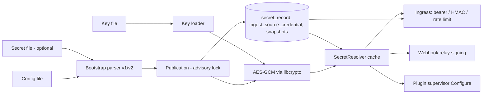

# Design

## Triage

| Trigger | Applies? | Evidence |
|---|---|---|
| T1 Components (new component, or 3+ with directed relationships) | yes | New secret store (key loader, AEAD, record repository) used by publication, ingress, webhook relay and plugin supervisor |
| T2 State (persistent state, caches, 3+ state machine) | yes | New `secret_record` and `ingest_source_credential` tables; process-local secret cache and rate-limit buckets |
| T3 Concurrency (background work, workers/isolates, async, retries) | yes | Concurrent publications from several processes; concurrent admission against shared buckets and cache |
| T4 Boundaries (data format, migration, shared interface, IPC, external) | yes | Bootstrap format version 2, key file, HMAC header contract for senders, managed migration |
| T5 Volume (grows without a fixed bound) | yes | Secret records accumulate across rotations |
| T6 Risk (security, money, data loss, unrecoverable user data) | yes | Credentials, encryption at rest, key loss makes stored secrets unusable |

TIER: FULL

## Context

Scope and motivation are in `proposal.md`. Current state the approach builds on:

- **Bootstrap parsing** (`correlia_server/lib/src/ingest/bootstrap.dart`): one `token_ref` per source
  (`:351-354`), namespace a free string defaulting to the source id (`:355-357`), body limit per source
  (`:389-394`). Secrets come only from the paired secret file, which `load` requires whenever the config file
  is set (`:416-421`). Secret bytes stay in process memory (`_secrets`, `:183-190`); public JSON holds only
  references and SHA-256 commitments (`:52-62`, `:95-146`).
- **Publication** (`lib/src/ingest/config_repository.dart:47-154`): one transaction under advisory lock
  `1129271884`, monotonic revisions, commitments in `ingest_secret_commitment` with rebinding refused
  (`:157-173`, code `reference_rebound`), source token digests upserted into `ingest_source` (`:129-145`).
  Workers require the secret file to still hold every key that live webhook intents were signed under
  (`validateLiveSecrets`, `:176-195`).
- **Ingress** (`lib/src/ingest/ingress.dart`): route only `/hooks/alertmanager/<id>[/<token>]` (`:178-185`);
  a single digest comparison (`:219-237`, `constantTimeDigestEquals`); bounded read with 10 s deadline
  (`:258-282`); in-flight cap 16 (`:189`); four concurrent auth lookups (`:88-112`). No rate limit, no kind
  check, no HMAC.
- **Secret consumers:** plugin Configure resolves bytes with `bootstrap.secret(ref)` and checks
  `sha256(bytes) == commitment` (`lib/src/plugin/plugin_supervisor.dart:337-346`); webhook relays receive
  the loaded commitments (`lib/src/output/output_relay.dart:120-125`, `relay_subsystem.dart:69,117`).
- **Identity:** namespace defaults to the source instance (`lib/src/event/identity.dart:33-55`); the
  pipeline reads it from the pinned snapshot (`lib/src/pipeline/pipeline.dart:334`). Display truncation with a
  marker already exists (`lib/src/event/canonical_event.dart:693-702`).
- **OpenSSL:** `libcrypto.so.3` is already loaded through FFI for plugin TLS
  (`lib/src/plugin/openssl_engine.dart:15-17`), accepted by the owner as a runtime dependency (D24).
- Operator documentation of the M1 format: `docs/ingest-pipeline.md` ("Bootstrap and rotation").

## Decisions

Scope decisions S1–S5 are in `proposal.md`.

### D1: AES-256-GCM through OpenSSL EVP over FFI

- **Choice:** Seal records with AES-256-GCM (12-byte random nonce from `RAND_bytes`, 16-byte tag) through
  `libcrypto.so.3`'s EVP interface, in a small FFI module under `lib/src/secrets/` that zeroes native buffers
  after use. Proven against NIST GCM test vectors.
- **Rejected:** a pure-Dart AES package (pointycastle or `package:cryptography`) because table-based AES in
  Dart is not constant-time and adds a dependency for security-critical code; libsodium because it adds a
  second native library when libcrypto is already required.
- **Reversal cost:** medium (records carry an algorithm id; a later algorithm re-seals in batches).
- **Important:** yes — binds future changes (stored data format).
- **Chosen by:** agent

### D2: Record format and authenticated data

- **Choice:** Table `secret_record` (managed model): `reference` (unique), `algorithm` (`aes-256-gcm-v1`),
  `nonce`, `ciphertext` (ciphertext and tag), `commitment`, `keyCommitment`, `createdAt`. Additional
  authenticated data is the length-prefixed tuple `("correlia-secret-v1", reference, commitment,
  keyCommitment)`, so a record copied to another reference or commitment fails authentication.
  `keyCommitment` is `SHA-256("correlia-kek-commitment-v1" ‖ key)`.
- **Rejected:** one encrypted blob holding all secrets because one corrupt write loses everything and every
  rotation rewrites every secret; per-record data keys wrapped by the key (envelope per record) because with
  one key and small records it adds a second ciphertext without a security gain before key rotation exists.
- **Reversal cost:** medium (stored format).
- **Important:** yes — binds future changes (stored data format).
- **Chosen by:** agent

### D3: Algorithm-tagged commitments; keyed for variable-length plugin secrets

- **Choice:** A commitment names its scheme. A bare 64-hex value is `SHA-256(bytes)`, the M1 form, kept for
  source credentials and webhook signing keys (exactly 32 random bytes) and for every commitment already
  stored in M1 snapshots, outbox rows and `ingest_secret_commitment`. New plugin-secret commitments are
  `hmac-sha256:<hex>` = `HMAC-SHA256(K_c, "correlia-plugin-secret-v1" ‖ reference ‖ bytes)`, `K_c` derived
  from the key with HKDF-SHA256 (info `correlia-commitment-key-v1`). A secret record holds the bytes once;
  `SecretResolver.resolve(reference, commitment)` decrypts the record and verifies the requested commitment
  by its scheme, so a pinned M1 plugin definition (bare SHA-256) and a new definition (keyed) both resolve
  from the same record without rewriting any pinned digest. The record's own `commitment` column, which is
  also bound into the AAD, uses the keyed form for plugin secrets and SHA-256 for 32-byte secrets.
  Rebinding is detected by decrypting the stored record and comparing bytes in constant time with the
  supplied bytes, independent of commitment schemes; M1 `ingest_secret_commitment` rows are still compared
  as before for references not yet stored. No new unkeyed plugin-secret hash is written after this change.
- **Residual exposure:** unkeyed SHA-256 hashes of plugin secrets already stored by M1 (immutable snapshots,
  `ingest_secret_commitment`) remain. `docs/ingest-pipeline.md` tells operators to rotate M1 plugin secrets
  under new references after upgrading if those secrets are low-entropy; the old hashes then guard a
  retired value.
- **Rejected:** plain SHA-256 for every new secret because a stored unkeyed hash of a weak password lets
  anyone holding a database backup guess it offline, which defeats encryption at rest; converting stored M1
  commitments in place because pinned definition digests and immutable snapshots must not change (ADR
  0025); keyed commitments for 32-byte secrets because they would change live outbox commitments and token
  digests with no security gain for 256-bit random values.
- **Reversal cost:** medium (commitment format in snapshots; a future key rotation changes keyed plugin
  commitments and so their definition digests, which restarts those plugins once).
- **Important:** yes — binds future changes (stored format) and high security impact.
- **Chosen by:** agent

### D4: Key file as the only key source

- **Choice:** `CORRELIA_SECRET_KEY_FILE` names a regular file, not a symlink, owned by the process user, mode
  0600 or stricter, holding exactly 43 unpadded base64url characters (32 bytes) with an optional trailing
  newline. The checks reuse the secret-file checks (`bootstrap.dart:556-592`). Required whenever ingest
  configuration is present; absent configuration needs no key.
- **Rejected:** an environment variable holding the key because environments leak into child processes
  (plugins), `/proc/<pid>/environ` and crash reports; deriving the key from a passphrase because it needs an
  interactive or stored passphrase and adds a KDF parameter set to maintain.
- **Reversal cost:** low (another source can be added beside the file).
- **Important:** yes — binds future changes (config key) and changes what operators set.
- **Chosen by:** agent

### D5: Publication imports, processes resolve from the store

- **Choice:** Parsing yields the structure and references; a resolution step takes bytes from the secret file
  when present, else from the store, and computes commitments. Publication (same transaction and advisory lock
  as today) seals unstored references in the new configuration and imports historical references still
  pinned by live outbox work. Webhook references are verified against the pinned `signing_key_commitment`;
  plugin references are verified by scheme against their pinned definition. Historical imports consider
  only the bounded set of supplied file references, never an unbounded materialization of the outbox.
  The same checks refuse rebinding (`reference_rebound`) and a record sealed under another key
  (`key_mismatch`). `validateLiveSecrets` accepts a matching webhook record already stored or imported in
  that transaction; a missing historical plugin secret still blocks only its definition. At runtime all
  consumers use `SecretResolver.resolve(reference, commitment)` and verify their own pinned commitments.

  **Runtime cutover (Chosen by: user):** Make the import file optional in the same group that switches
  webhook signing and plugin Configure to the store. Verify a fileless worker delivers both before
  committing that group. The next group enables keyed plugin snapshot commitments after both schemes
  already resolve and proves historical upgrade behavior. Rejected: delaying fileless startup or
  letting a worker report ready before its output consumers can resolve stored keys.

  **M1 history (Chosen by: user):** Preserve live work even when the new configuration omits its
  references. Rejected: importing only the active configuration, which strands work whose keys are still
  present in the operator file. Reversal cost: medium (queued deliveries would need operator recovery).
- **Rejected:** keep the secret file as the runtime source and store ciphertext only as a backup copy, because
  every host would still hold plaintext and api processes would still need the file to verify HMAC; a store
  that processes read on every request, because ingress would decrypt per request.
- **Reversal cost:** medium.
- **Important:** yes — binds future changes (startup contract) and changes what operators deploy.
- **Chosen by:** agent

### D6: Credentials in their own table

- **Choice:** Managed table `ingest_source_credential` (`sourceId`, `reference`, `type` bearer|hmac,
  `digest`, `notBefore`, `notAfter`), unique `(sourceId, reference)`, rewritten for the sources of each
  publication in the publication transaction. The managed migration deliberately drops
  `ingest_source.tokenDigest` and adds a non-null `kind` with the persisted default `alertmanager` for
  existing M1 rows. Ingress loads at most four credential rows and compares every valid bearer digest
  with no early exit; the result is the OR of all comparisons. The admission transaction keeps M1's
  fence (`admission.dart:65-75`): it locks the source row
  `FOR SHARE` and re-reads the matched credential row `(sourceId, reference)` with its digest, type and
  window, and the source's `enabled`, `kind` and `allowPathToken`, rejecting with 401 unless they still
  match; the window is evaluated at the receipt instant `observedAt`, not the commit time. Publication's
  `UPDATE ingest_source` takes the conflicting row locks before rewriting credentials, so a request that
  authenticated under revision B and commits after C removed its credential is refused.
- **Rejected:** credentials only inside the snapshot JSON because ingress would parse the whole snapshot to
  authenticate (it already does for the body limit, but authentication should not depend on it); a list
  column on `ingest_source` because typed rows with windows keep the comparison query simple.
- **Reversal cost:** low.
- **Important:** yes — binds future changes (schema).
- **Chosen by:** agent

**Apply cutover (Chosen by: user):** Group 3 drops `ingest_source.tokenDigest` in the single managed
migration and moves the existing bearer/path lookup and transactional admission fence to credential
rows in the same task group. Update the affected database tests there so no verified group boundary
depends on the removed column. Group 6 adds HMAC and rate limiting and completes route-kind and
credential-window behavior. The final credential and admission contracts do not change.

### D7: HMAC verification after a bounded read

- **Choice:** Headers `X-Correlia-Timestamp` (decimal Unix seconds, at most 10 digits) and
  `X-Correlia-Signature: sha256=<64 lowercase hex>` over the exact bytes
  `ASCII(timestamp) ‖ "." ‖ K ‖ "." ‖ body`, where `timestamp` is the header's decimal digits as sent and
  `K` is `-` when no `Idempotency-Key` header is present, else the 64 lowercase hex characters of
  SHA-256 over the key's UTF-8 bytes. Every field before the body has a fixed alphabet (digits; `-` or exactly
  64 hex) and ends at its own `.`, so no bytes can move between the key and the body. Signing the key means a
  captured request cannot be replayed under a new key: a replay within the transport window carries the same
  key (or none, so the body hash) and is a duplicate. The request is rejected
  before reading the body when the source has no valid HMAC credential, a header is missing or duplicated, or
  the timestamp is outside ±300 s. After the bounded read, every valid HMAC key of the source is tried; any
  match admits. Keys come from the resolver cache (D8). HMAC uses `package:crypto` (already a dependency).
- **Rejected:** verifying a signature over a digest the sender places in a header before reading, because the
  body must still be read to check that digest, so it saves nothing; signing without a timestamp, because a
  captured request could be replayed after the transport dedup window; leaving the idempotency key unsigned,
  because a replay with a fresh key would create a new raw row.
- **Reversal cost:** low before senders adopt it, medium after (sender contract).
- **Important:** yes — binds future changes (sender-facing contract).
- **Chosen by:** agent

### D8: Process-local LRU over the store

- **Choice:** Each process keeps decrypted secrets in an LRU keyed by reference, bounded at 1024 entries and
  16 MiB of plaintext (the largest accepted active configuration is 4 × 64 source credentials + 64 × 8
  plugin secrets + 64 webhook keys = 832 references). Nothing is pinned: every consumer calls
  `resolve(reference, commitment)`, which on a miss reads the one `secret_record` row (5 s query timeout,
  through the same four-lookup gate as ingress) and decrypts it, then evicts the least recently used entry.
  Capacity therefore never rejects a valid credential; at worst it costs a read and an AEAD call. Startup
  prefills the references of the active snapshot and of live outbox rows, up to the bound. Historical
  plugin definitions and webhook keys resolve the same way, with no dependence on active-snapshot
  membership. Webhook discovery and claim select candidates by `secret_record.reference`, not by the
  record's commitment. Before starting a delivery attempt, the relay resolves the reference with the pinned
  webhook commitment; a candidate is not authorization to sign.

  **Shared references (Chosen by: user):** Preserve M1's ability to use identical bytes under one reference
  for a webhook and a plugin. The resolver verifies the pinned scheme for each consumer even when it differs
  from the record's scheme. Rejected: requiring separate references, which breaks valid upgrades. Reversal
  cost: medium (operators would have to publish new references).
- **Rejected:** decrypting per use, because HMAC verification would add a database read and an AEAD call to
  every request; a cache that only holds the active snapshot, because historical work and later
  publications would need restarts or be stranded.
- **Reversal cost:** low.
- **Important:** no.
- **Chosen by:** agent

### D9: Token bucket per source per process

- **Choice:** An in-memory bucket per source id, refilled continuously at `per_second` up to `burst`, consulted
  after authentication and before body reading for bearer requests, after signature verification for HMAC
  requests (HMAC needs the body first; the in-flight cap of 16 still bounds that work). Bucket parameters
  follow the source's active snapshot; buckets are rekeyed on revision change like `IngressCounters._rekey`
  (`ingress.dart:35-45`). `Retry-After` = ceil((1 − tokens) / per_second), at least 1. Uses an injected clock.
- **Rejected:** a fixed window counter, because bursts at a window edge double the allowed rate; see S4 for
  the shared-budget alternative.
- **Reversal cost:** low.
- **Important:** yes — changes behaviour users see (429).
- **Chosen by:** agent

### D10: Declared namespaces validated at parse time

- **Choice:** Root `namespaces: [<name>, …]` (at most 64 names, 1–128 bytes, not UUID form, unique). A source's
  `namespace` must be absent (its id) or listed. The resolved namespace is written to the snapshot as today,
  so the pipeline and identity code do not change.
- **Rejected:** a `namespaces` map from name to member sources, because it states membership twice (also in
  each source) and can disagree; keeping free-form names, because a typo or copied block silently merges two
  sources' alerts (ID-2).
- **Reversal cost:** low.
- **Important:** yes — binds future changes (config format).
- **Chosen by:** agent

### D11: Format version 2 beside version 1

- **Choice:** `format_version: 2` adds `kind`, `credentials`, `rate_limit` and root `namespaces`; version 1 is
  read into the same model (one bearer credential from `token_ref`, kind `alertmanager`, default rate limit,
  its namespace accepted as declared, since M1 allowed any). Snapshots always store the version 2 shape, so
  an already-active revision conflicts with its M1 snapshot id. Operators bump the revision once during
  upgrade. Stored references are immutable for all secret kinds: rotate source tokens by publishing a new
  `token_ref` (v1) or credential reference (v2), not by replacing bytes under the old name.

  **V2 activation cutover (Chosen by: user):** Group 5 implements and proves the v2 parser and public
  snapshot shape, including v1 mapping, but configured publication rejects v2 input until group 6.
  Group 6 enables publication together with multiple-credential, HMAC and rate-limit behavior. Rejected:
  advertising v2 readiness before ingress can authenticate every supported credential.
- **Rejected:** dropping version 1 because the owner's dev instance uses it and the cost of reading it is a
  small mapping function; storing version 1 snapshots as they were, because every reader would then handle two
  shapes forever.
- **Reversal cost:** low.
- **Important:** yes — changes what operators set (upgrade step).
- **Chosen by:** agent

### D12: One ADR per binding contract

- **Choice:** Record ADR 0028 (encrypted secret store under an external key: D1–D5) and ADR 0029 (source
  credentials, HMAC contract, rate limits and declared namespaces: D6, D7, D9, D10) during apply, after review.
  Neither supersedes an ADR; ADR 0009 and 0024 already allow both. Update the architecture's state table row
  "Plugin configs and secrets" and the M1 ingest configuration paragraph.
- **Rejected:** one combined ADR, because the secret store is reused by M4 write-only secrets independently of
  ingest credentials.
- **Reversal cost:** low.
- **Important:** no.
- **Chosen by:** agent

### Decision summary

| # | Decision | Choice | Rejected | Reversal cost | Important | Chosen by |
|---|---|---|---|---|---|---|
| S1 | Configuration input | Bootstrap files, format 2; no admin endpoint | Admin endpoint now; YAML source loader | low | yes | agent |
| S2 | Secret storage | Encrypted in Postgres under external key (D31 default) | Plaintext file only; key in DB; KMS | medium | yes | agent |
| S3 | ID-2/ID-3 scope | Proven on the Alertmanager path now | Wait for Icinga2 | low | no | agent |
| S4 | Rate limit placement | Per process, after authentication | Postgres-shared budget; before auth | low | yes | agent |
| S5 | HMAC role | Optional beside bearer | HMAC only; mTLS | low | yes | agent |
| D1 | Cipher implementation | AES-256-GCM via OpenSSL EVP FFI | Pure-Dart AES; libsodium | medium | yes | agent |
| D2 | Record format | One record per reference, AAD binds reference and commitments | Single blob; per-record data keys | medium | yes | agent |
| D3 | Commitments | Scheme-tagged; keyed for new plugin secrets, SHA-256 kept for M1 and 32-byte secrets | Plain SHA-256 for all; convert M1 in place; keyed for all | medium | yes | agent |
| D4 | Key source | 0600 key file named by `CORRELIA_SECRET_KEY_FILE` | Env var; passphrase KDF | low | yes | agent |
| D5 | Secret flow | Import at publication, resolve from store | File at runtime; per-request decrypt | medium | yes | agent |
| D5 upgrade | Historical imports | Import and verify file references pinned by live work in the publication transaction | Import only active references | medium | yes | user |
| D5 runtime cutover | Apply order | Enable fileless startup with store-backed output consumers in group 3 | Delay fileless startup until group 4 | low | yes | user |
| D6 | Credential storage | `ingest_source_credential`, admission fence and persisted `alertmanager` kind default | Snapshot JSON only; list column | low | yes | agent |
| D6 cutover | Apply order | Drop the old column and switch its bearer callers in group 3 | Separate drop migration in group 6 | low | yes | user |
| D7 | HMAC verification | Signature over timestamp, idempotency key and body, verified after bounded read | Pre-read digest header; no timestamp; unsigned key | low | yes | agent |
| D8 | Secret cache | Process-local LRU (1024 / 16 MiB) with store fallback for every consumer | Per-use decrypt; active-snapshot-only cache | low | no | agent |
| D8 sharing | Cross-consumer references | Discover by reference; verify the consumer's pinned commitment before delivery | Require separate references | medium | yes | user |
| D9 | Rate algorithm | Token bucket per source per process | Fixed window | low | yes | agent |
| D10 | Namespaces | Declared name list, validated at parse | Membership map; free-form | low | yes | agent |
| D11 | Format versions | Read 1 and 2, store 2; existing M1 installations bump revision and rotate under new references | Drop 1; store both shapes | low | yes | agent |
| D12 | ADRs | 0028 secret store, 0029 source credentials | One combined ADR | low | no | agent |

## Diagrams (FULL)

Components (T1):



Startup and publication (T2, T4):

```mermaid
sequenceDiagram
  participant P as Process start
  participant K as Key loader
  participant B as Bootstrap parser
  participant D as Postgres
  P->>K: load key file (checks, 32 bytes)
  P->>B: parse config (v1 or v2), secret file if present
  P->>D: BEGIN; advisory lock
  D-->>P: active snapshot, stored records for referenced names
  P->>P: resolve each reference (file bytes or stored record), key commitment must match
  P->>D: INSERT new secret_record rows; refuse rebinding
  P->>D: snapshot, credentials, sources, active pointer
  P->>D: COMMIT
  P->>P: prefill LRU from store (active snapshot + live outbox keys, up to the bound)
```

Request admission (T3):

```mermaid
sequenceDiagram
  participant S as Sender
  participant I as Ingress
  participant D as Postgres
  participant R as Resolver / buckets
  S->>I: POST /hooks/<kind>/<id>
  I->>D: active snapshot + credentials of source
  alt bearer or path token
    I->>I: compare all digests in window (no early exit)
    I->>R: take token (429 if empty)
    I->>I: bounded read
  else HMAC headers
    I->>I: timestamp within 300 s, source has valid HMAC credential
    I->>I: bounded read
    I->>R: resolve(reference, commitment); store read on miss
    I->>I: verify signature, then take token (429 if empty)
  end
  I->>D: admit: lock source FOR SHARE, recheck credential/kind/policy, raw row, transport dedup
  I-->>S: 202 / 401 / 409 / 413 / 415 / 429 / 503
```

## State & Ownership (FULL)

| State | Owner (sole writer) | Lifetime | Invalidation / rebuild | Authoritative copy |
|---|---|---|---|---|
| Key-encryption key | Operator (file) | Until rotated (M10) | Never stored by Correlia; process reads at start | Key file |
| `secret_record` rows | Publication transaction (`IngestConfigRepository.publish`) | Forever in M2 (no deletion) | Immutable; never rebound or re-sealed in M2 | Postgres |
| `ingest_source_credential` rows | Publication transaction | Until the next publication rewrites the source's rows | Rewritten atomically with the active pointer | Postgres |
| `ingest_source` (enabled, path-token flag) | Publication transaction | As today | As today | Postgres |
| Config snapshots (v2 shape) | Publication transaction | Forever | Immutable | Postgres |
| Resolver cache | Each process's `SecretResolver` | Process lifetime | Prefilled at start; filled on miss from the store; LRU eviction | Postgres records (cache is a decrypted copy) |
| Rate-limit buckets | Each api/all process's ingress | Process lifetime | Rekeyed on revision change | In memory (per process by design, S4) |
| Operator secret file | Operator | Until operator deletes it | Needed only for references not yet stored | Postgres once imported |

## Failure & Visibility (FULL)

| Component | Fails / dies mid-operation → | Recovery | Retry safe? | Who finds out |
|---|---|---|---|---|
| Key loader | Missing/bad key file | Fix file, restart | yes | Operator: startup fails with `secret_key` code |
| Publication | Dies before commit | Transaction rolls back; next start publishes again | yes (idempotent: same snapshot id accepted, existing records with equal commitment kept) | Operator: process exits non-zero |
| Publication | Rebinding or key mismatch | Fix input or key | yes | Operator: `reference_rebound` / `key_mismatch` |
| AEAD open | Tampered record | Re-publish under a new reference | n/a | Operator: the dependent source returns 401 for every request and the output shows `plugin_secret_unavailable` / dead letters with `secret_integrity`; a log line with reference and code |
| Resolver miss | DB error during a store read | Ingress: 503 with `Retry-After`; relay or plugin: the attempt is not started and the lane is retried at the next discovery | yes | Sender retries; log line with reference and code |
| Rate limiter | Process restart | Buckets start full | yes | Nobody needs to: a restart grants at most one extra burst |
| libcrypto | Library missing | Install OpenSSL 3 | yes | Operator: startup fails with `secret_key crypto_unavailable` |

## Resource Bounds (FULL)

| Queue / buffer / cache / transfer | Bound | At the bound | Timeout | At 10x / 100x |
|---|---|---|---|---|
| Credentials per source | 4 | Activation fails | n/a | Fixed by contract |
| Declared namespaces | 64 | Activation fails | n/a | Fixed |
| Secret file | Existing 512 KiB / 128 entries / 256 KiB decoded | Startup fails | n/a | Unchanged |
| `secret_record` rows | Grows with each new reference (rotation adds one) | No bound in M2; the expected scale is tens of references per year | n/a | 10x: hundreds of rows (KiB); 100x: still under 10 MiB; pruning of unreferenced records is not built (ledger) |
| Resolver cache | 1024 entries and 16 MiB plaintext | LRU eviction; a miss reads the store | 5 s store read, four concurrent lookups | 10x/100x stored references: misses cost one indexed read each; the active set (≤ 832) still fits |
| Rate-limit buckets | 64 (source registry bound) | Rekey drops removed sources | n/a | Fixed |
| HMAC body read | Source body limit (≤ 1 MiB) | 413 | Existing 10 s total read | Same as bearer |
| Credential lookup per request | ≤ 4 rows, one query | n/a | Existing 5 s query timeout, 4 concurrent lookups | Unchanged |

## Flow & State Gaps (FULL)

- **Two processes publish different revisions at once:** the advisory lock serializes them; the second sees
  the first's records and either finds equal commitments (kept) or a rebinding (fails). Unchanged revision rules
  apply.
- **A credential's window opens or closes between auth lookup and admission:** evaluated once at receipt time
  (`observedAt`), the same instant used for the raw row.
- **Process started before a rotation:** bearer digests are read per request from Postgres, so the new
  credential works at once; HMAC keys resolve from the store on a miss (D8).
- **Rotation while a body is being read:** the admission transaction rechecks the matched credential under
  the source row lock (D6); a credential removed by a publication that committed first yields 401 and no
  raw row.
- **Upgrade with queued M1 work:** a higher revision imports file material for live pinned webhook and
  plugin intents even if their references are absent from the new configuration. Existing pinned
  commitments remain unchanged, so verified work drains after a restart without the plaintext file.
- **Secret file removed after import, then a new reference added:** startup fails `missing_secret`; prior
  snapshot stays active (spec).
- **Restore with a different key:** startup fails `key_mismatch`; nothing is re-sealed.
- **Clock skew between sender and server for HMAC:** ±300 s tolerance; outside it the sender sees 401. The
  same window as the canonical source-time skew clamp (D5 in open decisions).
- **Upgrade from M1:** the managed migration creates the new tables, initializes existing source rows as
  `alertmanager`, and drops the obsolete token digest column. It does not copy credentials: the first
  publication with the key file, the M1 secret file and a higher revision imports the referenced secrets
  and writes credential rows. Admission returns 503 until the upgraded process is ready.

## Mechanism Ledger (FULL)

| Mechanism | Built? | Why (harm nobody catches / expensive later) | Evidence that would change the call |
|---|---|---|---|
| AAD binding reference and commitments | yes | A swapped record would silently feed one plugin another's secret | — |
| Key commitment on each record | yes | Restore with the wrong key would otherwise surface as integrity failures everywhere, indistinguishable from tampering | — |
| Keyed commitments for new plugin secrets | yes | Offline guessing of weak passwords from backups; changing later rewrites stored format | — |
| Scheme-tagged commitments | yes | Without them M1 pinned plugin definitions could not resolve after upgrade (stranded work nobody sees until dead letters) | — |
| Credential recheck in the admission transaction | yes | A credential revoked during a body read would still insert | — |
| Key rotation / re-seal in batches | no | M10 (UPG-2); records carry key commitment and algorithm so it can be added | Owner asks for rotation before M10 |
| Pruning unreferenced `secret_record` rows | no | Growth is tiny (see bounds); deletion conflicts with dead/live outbox rows needing historical keys | Rows exceed thousands, or an owner retention policy for secrets |
| Shared (cross-process) rate limit | no | S4 | HA deployments where per-process limits mislead operators |
| Rate limit before authentication | no | Lets strangers lock out a source | — |
| Nonce-reuse protection beyond random 96-bit nonces | no | Each record is sealed once; at most thousands of nonces per key, far below the 2^32 random-nonce limit | Re-sealing in bulk (rotation) |
| Zeroing Dart-heap copies of secrets | no | Dart offers no reliable zeroization of managed memory; native buffers are zeroed | A supported zeroization primitive in Dart |
| HMAC replay cache beyond transport dedup | no | The idempotency key is signed (D7), so a replay within the 300 s window has the same transport key as the original, which the 10 min dedup window covers | — |

## Risks / Trade-offs

- [Lost key file makes every stored secret unusable] → Documented in `docs/ingest-pipeline.md` beside backup
  guidance; the secret file remains a valid way to re-import under new references; the restore drill is M10.
- [libcrypto now loaded by api processes] → Already required on worker hosts (D24); startup reports
  `crypto_unavailable` clearly.
- [Per-process rate limits multiply with replicas] → Documented (S4).
- [Snapshot ids change on first v2 publication] → Documented upgrade step: bump the revision once.
- [FFI memory errors in crypto code] → Small surface (EVP init/update/final, RAND_bytes), NIST vectors,
  tamper tests, and buffers freed in `finally`.

## ADRs

- **In force, constraining this change:** 0009 (scoped machine credentials, write-only plugin secrets,
  redaction), 0024 (namespace in identity, defaulting to the instance), 0016 (raw inbox stores no credentials),
  0025 D18 (kind-aware secret commitments; plugin secret problems block only that definition), 0027 (intent
  byte limits, unaffected), 0014 (Linux only).
- **To record during apply:** ADR 0028 "Encrypted secret store under an external key", ADR 0029 "Source
  credentials, HMAC signing and admission limits". Neither supersedes an existing ADR.

## Open Questions

- D31 stays open for the owner; this change implements its assumed default. If the owner chooses differently
  (for example a KMS), only the key loader changes.
