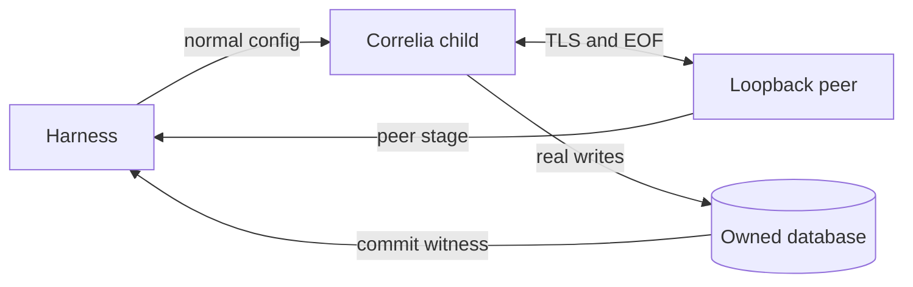
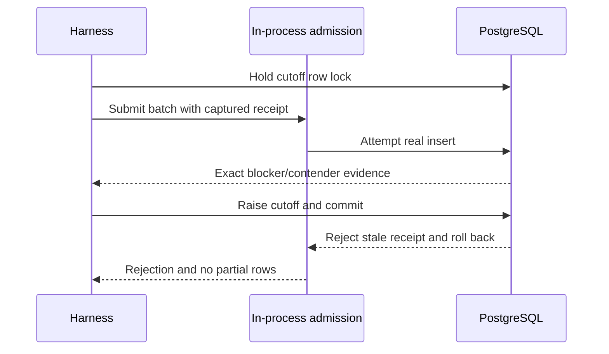
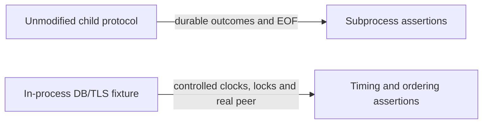

# Design

## Triage

| Trigger | Applies? | Evidence |
|---|---|---|
| T1 Components | Yes | A harness, a real child, PostgreSQL and a TLS peer participate in the combined case (`correlia_server/test/support/icinga2_stream_child.dart:26-49,84-99`; `correlia_server/test/e2e/icinga2_stream_consumer_e2e_test.dart:349-391`). |
| T2 State | No | No production state or state transition changes. |
| T3 Concurrency | Yes | The cutoff test stages a concurrent insert against a held row (`correlia_server/test/e2e/icinga2_stream_consumer_e2e_test.dart:280-315`). |
| T4 Boundaries | Yes | The harness observes the existing child process, peer TLS and committed database boundaries. No new child control interface. |
| T5 Volume | No | Test-only witnesses follow a bounded set of actors and discard unrelated events. |
| T6 Risk | No | Only isolated test databases and local fixtures; no production gate or transport policy changes. |

TIER: FULL

## Context

See [proposal.md](proposal.md). The combined E2E test observes two HTTP outcomes and then polls for exactly two events without identifying the two raw deliveries (`correlia_server/test/e2e/icinga2_stream_consumer_e2e_test.dart:388-391`). The event schema records both raw ID and source ID (`correlia_server/schema/0001_ingest.sql:17-26`). The child fixture also polls for status (`correlia_server/test/support/icinga2_stream_child.dart:112-127`) although the DB suites already have a check-and-wake listener on committed table changes (`correlia_server/test/support/icinga2_test_db_changes.dart:38-54,67-74`). PostgreSQL's real admission cutoff trigger fences the incoming receipt under a shared lock (`correlia_server/schema/0007_icinga2_reconcile.sql:38-54`); stream SQL writes have short production timeouts (`correlia_server/lib/src/ingest/icinga2/stream/database.dart:97-109`). The TLS client arms one timer before it starts the asynchronous request (`correlia_server/lib/src/ingest/icinga2/stream/https_client.dart:94-110`).

## Decisions

### D1: Committed receipts, not counts or periodic reads

- **Choice:** Extend the existing test-only commit listener to accept an owned connection as well as a Serverpod pool endpoint. Install triggers after first schema startup, before the first test action that depends on them; keep the initial read for state already written. For the combined-source case use distinct raw fixture identities (source UUID and unique host/check marker; an `Idempotency-Key` on the webhook). Bind each matched row to `(observed_at, raw_id, source_id)`; join events on `(raw_observed_at, raw_id, source_id)` (`correlia_server/schema/0001_ingest.sql:1-27`). Wait for the two raw admissions and each row's `done` or `failed`; `done` is terminal even when the pipeline emits no event (`correlia_server/lib/src/pipeline/pipeline.dart:781-787,916-925`). The first terminal row with failure, zero events, or multiple matching events fails with its outcome, not another wait. Preserve unauthorized-path and exact successful-delivery assertions. Use the same notification path for committed status/gaps and sync progress; independently observe real peer receipts and EOF.
- **Transition journal:** Bootstrap the test DB with the source absent or disabled, then install a test-owned row trigger on `icinga2_stream_status` before publishing the enabled fixture config. On insert or relevant state/error/gap change, append a sequence, source ID, connection ID/sequence, and state/error/gap fields in the same transaction; notify only as a wake. Journal rows survive reconnect overwrites, not rollbacks. Read from the pre-action sequence cursor and match the source and attempt. For the unnumbered header attempt, select the fresh source's first terminal transition after the activation cursor **before** inspecting its error. Require `backoff` with `timeout`; any other first terminal outcome fails without considering later attempts. Retain no credentials or payloads. Drop with the ephemeral database after all actors stop.
- **Rejected:** Child output as evidence of durable completion; logs are useful diagnostics but not the commit record.
- **Reversal cost:** Low. **Important:** No, private fixture implementation. **Chosen by:** agent.

### D2: Real SQL contention with positive wait evidence

- **Choice:** Observe real SQL contention. Enable `log_lock_waits` only on the fixture's exact dedicated connection or in the pooled contender transaction, with `deadlock_timeout=1ms` used only to emit an alert, never asserted. Capture each actor's backend identity inside its transaction before the contending statement (PID, `backend_start`, database, and a scoped `application_name`). Before dispatch, bind the watcher to the fixture's owned embedded socket and ephemeral DB, and the canonical `postgres.log` beside its `SHOW data_directory` (not an arbitrary filesystem path). Subscribe before reading the log cursor; follow only newly appended complete records in that generation, correlate the waiter PID and expected lock class; one subsequent query matches the exact waiter's and blocker's database/identities and `pg_blocking_pids`. Fail if the waiter completes early, identities disagree, the log is replaced/truncated, or the watch closes. In teardown release or abort the exact actors, join both, then close the watcher. Use transaction preambles on pooled publication, schema cutover, backfill, and pipeline actors only where no existing hook or fixture SQL can announce the same named stage. Test-trigger barriers may use a distinct advisory entry witness released inside the SQL. No cluster-wide setting.
- **Lease clock:** Put a SQL `VOLATILE` fixture `clock_timestamp()` in a test schema over a one-row committed clock table. Use explicit `search_path = <fixture schema>, pg_catalog, public` on both participating dedicated actor sessions, and verify unqualified and qualified resolutions return the fixture value before staging. For expiry after a fenced write starts, acquire and enter generation A while live, advance past expiry before dispatching takeover B, witness B really blocked, then release A and check B's new generation. For renew/fenced expiration, dispatch while live, witness the exact waiter while still live, advance past expiry, release, and check rejection. Neither sequence changes the lease row to make it expire, so locking semantics still determine the outcome.
- **Waits held until harness release:** Only when the assertion requires the exact waiter to stay blocked, verify its ordinary timeout settings and then disable its database `statement_timeout` and `lock_timeout` locally; suppress its dedicated driver watchdog or override the exact pooled statement's driver bound to the whole-test guard. Lift `idle_in_transaction_session_timeout` for each deliberately held transaction, including the blocker. Freeze any enclosing testable repository deadline while waiting. Do not alter shared defaults. For D4's retry case, keep the ordinary PostgreSQL `lock_timeout` on the exact admission statement and disable its competing `statement_timeout` and client watchdog only in that fixture.
- **Cutoff ordering:** Add `stream_insert_waits_for_a_concurrent_cutoff_update` in `correlia_server/test/db/icinga2_stream_admission_test.dart`. Hold the cutoff row exclusively, submit the exact stream batch with its already captured receipt, witness the data-modifying CTE containing `INSERT INTO raw_inbox` blocked on that transaction, raise the cutoff above the receipt and commit, then require `receiptBehindCutoff` and no batch receipt, raw or origin rows. Identify the CTE in `_insertRow` (`correlia_server/lib/src/ingest/icinga2/stream/admission.dart:278-289`) and the cutoff trigger (`correlia_server/schema/0007_icinga2_reconcile.sql:38-54`). Use a narrowly injected transaction preamble where needed. This DB test owns the concurrency proof; the real-child test checks the outcome separately.
- **Rejected:** Repeated `pg_stat_activity`/`pg_locks` reads, and a Dart callback immediately before submitting SQL as the sole evidence of a contested database lock. They respectively depend on polling and can pass without contention.
- **Reversal cost:** Low. **Important:** No, only isolated test instrumentation; feasibility and dependencies are recorded under Assumptions. **Chosen by:** agent.

### D3: Observe the real child; inject timing controls only in-process

- **Choice:** Add no test mode switch, environment variable, readiness file or fault IPC. For the cutoff E2E case, publish a rejecting cutoff before sending the matching stream event. Assert the original socket EOF, the `receipt_behind_cutoff` gap, exactly one gap, the replacement connection and completed sync, and no partial admission rows. The D2 DB companion proves the original concurrent ordering with a held real cutoff lock.
- Set the fixture cutoff to PostgreSQL `infinity` before sending the single event and keep it fixed through assertions. Both sync projections return empty results, so recovery does not need to admit a synthetic receipt; no race to reset the cutoff before reconnect.
- **Header outcome and lifecycle:** The real-child stalled-header case waits on committed `backoff`/`timeout`, without asserting elapsed time or assuming the peer reached any specific handshake stage before the normal deadline. Move the ordering and exact peer EOF proof to `icinga2_stream_tls_e2e_test.dart`'s in-process transport cases: control its header timer, arm the EOF listener, witness the matched handshake or complete request with no response, then fire the captured timer and assert EOF and the timeout classification. Where the real child needs event-driven startup, use its existing file-backed output observer with an ordinary post-start lifecycle log emitted only after ready state is set (`correlia_server/lib/src/runtime/role_runtime.dart:120-133`). Tie it to the current spawn attempt, then make a one-shot `/startupz` and owned-listener check without per-step deadlines. Final exit fails pending waits; stop and join exact children before disposing of files or dropping the database. Unrelated callers keep their current readiness contract.
- **Rejected:** Add a cross-process test control switch, or drop the timing-order tests. The former increases production wiring and child IPC; the latter removes the regression evidence.
- **Reversal cost:** Low. **Important:** Yes, determines the child boundary. **Chosen by:** user (option B).

### D4: Controlled time in the in-process cases

- **Choice:** Drive stream reader, lease, backoff and TLS timers on stage receipts. For live backpressure, hold a real conflicting lock below the retained-work cap, lifting the blocker's idle timeout. Keep the admission statement's real PostgreSQL `lock_timeout` armed but disable its competing SQL `statement_timeout` and client watchdog in this fixture alone. Assert the unchanged ordinary configuration separately. Use the named blocked insert's own server `55P03` with the lock-timeout error (not any `55P03`, `57014`, or cached log) as evidence: capture its result at that statement before the reader handles the error, match batch ID and attempt, and hold the same fixture lock throughout. Establish that the staged insert conflicts with the named fixture relation/lock; no concurrent writers or other intentional locks for the statement. Neither a live lock probe nor an early log line is required for this case. Wait for its first failure's one-second retry schedule, advance only to that timer, then observe the same batch's second lock-timeout under the same lock. Advance to the recorded blocked deadline (blocked entry plus 30 seconds), verify one gap and original socket EOF before releasing, then verify at-most-once raw and receipt bounds. Assert shutdown by EOF, actual exit/lock outcomes and subsystem order, with no separate test timer.
- **Plugin health:** The test-only call collaborator disables both real `grpc-timeout` and the operation's Dart `Future.timeout` only for the staged call. It captures the real unary RPC result/error immediately in an owned future with an error listener, but supplies a gated proxy to the shared health classifier. For the timeout case await a matching entered-RPC receipt from the real Go fixture, assert the RPC is still pending and the transport has not failed, then complete the manual watchdog with `TimeoutException`. For disconnect precedence, keep actual unary completion out of the proxy, await the matching Go handler receipt, kill the exact peer and await `connection.failure`, then complete the same manual watchdog. Assert the watchdog's `TimeoutException` was the classifier input and the result is `plugin_connection_lost`; a native `GrpcError` must never satisfy that case. For both, cancel or join the real unary RPC, release/close its proxy as appropriate, and join the stage observer before the next occurrence. The normal path's shared deadline and cap remain separately verified with controlled time.
- **Rejected:** Drive coincident asynchronous stages by choosing shorter real test timers, or catch unrelated disconnection as success. Neither isolates the event being tested.
- **Reversal cost:** Low. **Important:** No, privately driven tests preserve production scheduling. **Chosen by:** agent.

### Decision summary

| # | Decision | Choice | Rejected | Reversal cost | Important | Chosen by |
|---|---|---|---|---|---|---|
| S1 | Scope and evidence | Audited suites and health stress; no contract change | Extend/retry wall-clock checks | low | no | user |
| D1 | Commit witnesses | Owned listener and exact receipts | Log/aggregate inference | low | no | agent |
| D2 | SQL contention | Scoped blocking evidence then one lock query | Busy poll or pre-call alone | low | no | agent |
| D3 | Timing boundary | Real-child outcomes; ordering in DB/TLS | Child fault IPC or dropping ordering proof | low | yes | user |
| D4 | In-process timing | Fire on stage events | Short real timers | low | no | agent |

## Assumptions

- **A1:** The embedded cluster keeps a compatible `postgres.log` sibling and emits a `still waiting` record usable as a wake, not as lock truth. A local isolated probe observed both actor PIDs and matched a live blocker query, but the probe was not committed and did not verify rotation or pooled ownership. D2 relies on pinned Serverpod/PostgreSQL, tests the correlation in the real lock cases, and fails on loss of continuity.
- Run 45367825034 proves the aggregate poll expired, not why the second event was absent; D1 diagnoses a terminal failure instead of accepting it.

## Carried constraints

- **C1:** The real child has no test fault switch or timer override. Observe outcomes across the child boundary; keep controlled timing-order tests in-process. Kind: invariant. Destination: `doc comment: correlia_server/test/support/icinga2_stream_child.dart Icinga2StreamChild`.
- **C2:** Observe a committed transition or a named blocked actor before releasing any gate; do not reintroduce per-step clocks or test retries. Kind: invariant. Destination: `doc comment: correlia_server/test/support/icinga2_test_db_changes.dart IcingaTestDbChanges`.
- **C3:** Observe and terminate only the worktree-owned embedded database and exact fixture children, per immutable [ADR 0014](../../../docs/adr/0014-linux-first-platform.md). Kind: invariant. Destination: `doc comment: correlia_server/test/support/icinga2_stream_child.dart Icinga2StreamChild`.
- **C4:** This change uses Specwright ship and a **read-only** PR watch (snapshots/checks, plus normal feedback handling). Stop before the automatic archive-and-merge step; never execute `sw pr merge`, `gh pr merge` or enable auto-merge. Do not alter the repository's `pr.merge` setting. Hand off only after the required check is green, required review covers the unchanged current head, and all 3–5 independent first-attempt CI runs of each affected tier have completed and been reported at that head without retries. A changed head invalidates earlier readiness evidence. The owner alone merges. Kind: invariant for this release. Destination: `doc comment: openspec/changes/fix-icinga2-stream-test-timing/tasks.md Workflow follow-up` (markdown workflow note).

## Diagrams (FULL)

## State & Ownership (FULL)

| State | Owner | Lifetime | Invalidation / rebuild | Authoritative copy |
|---|---|---|---|---|
| Fault gates and arrivals | In-process fixture and selected operation respectively | One fault per case or one receipt per attempt | Cancel/release and join in teardown | Named completer or committed lock witness |
| Raw, event, status, locks | PostgreSQL | Real transaction/session lifetime | Commit, rollback or backend exit | Owned test database |
| Pending notification/check | Test listener | Until assertion or teardown | Check after install and on notification; close cancels | DB state, not notification history |
| Manual timer | Fixture | One operation | Fires once or is cancelled | Injected scheduler |
| Committed transition journal | Fixture PostgreSQL trigger | From before source activation through teardown | Rolls back with transition; drop with fixture DB | Rows keyed by source and attempt with monotonic sequence |

## Failure & Visibility (FULL)

| Component | Failure | Recovery | Retry safe? | Visibility |
|---|---|---|---|---|
| Test observer | Connection, unexpected actor completion or file watch closes | Fail waiter; release gates and stop actors in teardown | No | Test prints stage and identifying data |
| Real child | Unexpected exit, failed startup, or missing expected commit | Exit/readiness/terminal row fails the case; retain bounded diagnostics | No test retry | Test sees exit status and child output |
| Real peer | Unexpected disconnect outside armed fault | Fail fixture operation; do not wildcard-ignore socket errors | No | Test sees peer failure |
| PG fault | Wrong lock/unknown backend | Fail rather than infer contention from a stale log | No | Name actor and operation |

## Resource Bounds (FULL)

| Resource | Bound | At bound | Timeout | At 10x / 100x |
|---|---|---|---|---|
| Commit notifications | One outstanding wake per fixture; no history queue | Coalesce and requery relevant state | One generous whole-test guard | Constant extra memory |
| Lock evidence | Read appended bytes, keep only an incomplete line and bounded unmatched diagnostic context | Discard irrelevant actor records; error on watcher close | Outer test guard | Test scope is bounded; avoid rereading the whole shared log |
| Fault receipts / sockets | One active arm per selected stage, sockets only for active fixture peers | Cancel on release/stop | Outer test guard | Per-test resource count, no cluster-wide state |

## Flow & State Gaps (FULL)

- Install listeners before fault injection and snapshot the wake before querying authoritative state. A commit before registration is caught by the initial query; rollback causes no committed notification. Early terminal failure or worker exit must not look like a missing success event.
- For fencing cases keep blockers held until positive evidence, tie expiry/ordering to the same contender, and register release in teardown before launching it. Check the real lock once; a terminal actor failure cannot satisfy a blocker wait.
- Keep fault controls out of the child; in-process observers and timers cancel on error, lease loss or scope cleanup.

## Mechanism Ledger (FULL)

| Mechanism | Built? | Why | Evidence that would change the call |
|---|---|---|---|
| Reuse commit watcher | Yes | #80 already failed on missing aggregate state; improve diagnostics and remove repeated queries | Applicable native event carries the exact committed receipt |
| Per-operation barriers and embedded lock observation | Yes | Test must distinguish actually held/waiting DB work from not-yet-started work | Existing hook already supplies the same positive evidence |
| Test-only child switch or fault IPC | No | Owner selected real-child outcomes plus in-process timing-order coverage | A new owner decision |
| Cluster-wide settings, periodic SQL poll, real-time retry, mock-only coverage | No | Cross-test interference or weak evidence | None under this scope |

## Risks / Trade-offs

- Embedded PostgreSQL log format is not a production contract. Limit matching to one fixture, require a matching owned-database blocker check and keep the normal code path untouched.
- Moving tests from timing to causality can expose latent product failures. Diagnose from terminal raw outcome/request/lock, do not loosen test expectations.
- Outcome-only child tests do not establish the lock or TLS scheduling order; require the in-process companion tests before replacing the E2E timing evidence.

## ADRs

- **In force:** [0014](../../../docs/adr/0014-linux-first-platform.md), [0024](../../../docs/adr/0024-identities-and-upstream-evidence.md), [0030](../../../docs/adr/0030-pull-sources-leased-consumers.md).
- **To record during apply:** None; no product boundary change.
