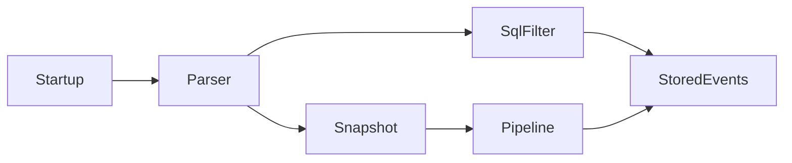
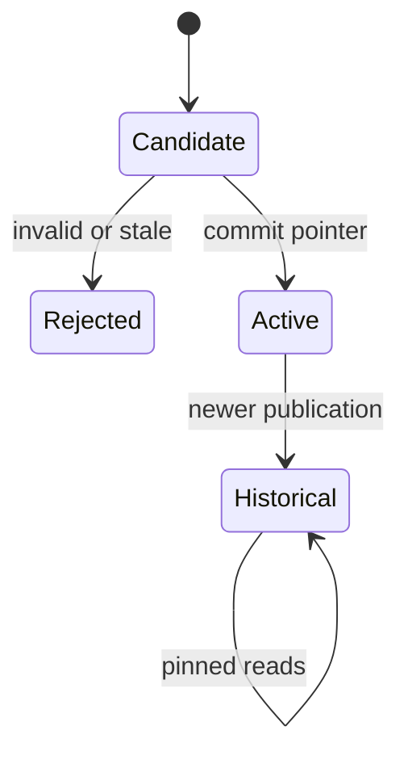
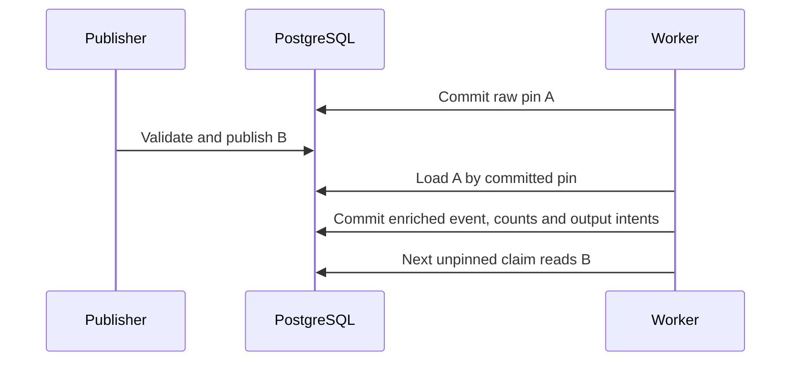
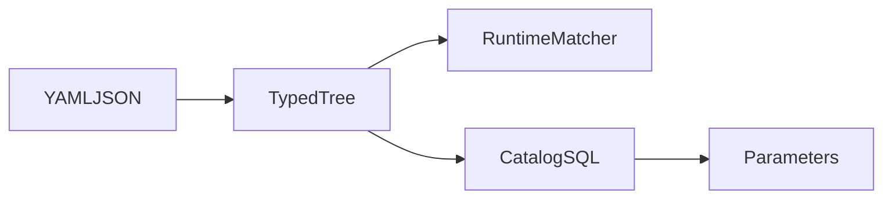

# Design

## Triage

| Trigger | Applies? | Evidence |
|---|---|---|
| T1 Components | Yes | Publication, typed rules, pipeline and SQL filtering. |
| T2 State | Yes | Immutable matcher content and aggregate failure rows. |
| T3 Concurrency | Yes | Bounded regex isolation and competing workers recording failures. |
| T4 Boundaries | Yes | New provisioning fields, persisted matcher data and feed entry. |
| T5 Volume | Yes | Historical configurations and stored-event scans. |
| T6 Risk | Yes | Operator regex and SQL inputs, source routing and pin integrity. |

TIER: FULL

## Context

- Startup publishes through `IngestConfigRepository.publishConfig` using the existing separate key/input boundary (`correlia_server/lib/src/ingest/ingest_startup.dart:45-75`). The repository serializes publication and rejects stale/conflicting revisions (`correlia_server/lib/src/ingest/config_repository.dart:129-171`). Public snapshot bytes are hashed with the revision and omit empty mappings (`correlia_server/lib/src/ingest/bootstrap.dart:175-188`).
- `pinOne` commits one row's active snapshot before decode; `processOne` reads by that pin (`correlia_server/lib/src/pipeline/pipeline.dart:336-371,403-421`). Current routes resolve from the pinned source/output registry before decode, and CloudEvents serialize after decode (`correlia_server/lib/src/pipeline/pipeline.dart:431-453,477-512`). Observation reservation precedes state application (`correlia_server/lib/src/pipeline/pipeline.dart:595-650`).
- The event format already carries labels/origins, annotations, links and enrichment errors (`correlia_server/lib/src/event/canonical_event.dart:180-205,280-289,425-454`). The activity ledger accepts typed text kinds, numeric entity IDs and raw/event causes (`correlia_server/schema/0002_activity.sql:1-14`).

## Decisions

### D1: Provision at the existing path

- Choice: Owner: “A: YAML in the existing config file”. `CORRELIA_INGEST_CONFIG` accepts YAML alongside JSON, with an optional versioned `matcher` section. Secrets remain separate. Rollback is a guarded, ordinary publication (D8).
- Rejected: Separate operator CLI and live publication boundary; unnecessary duplication of validation and deployment surface.
- Reversal cost: medium.
- Important: yes (provisioning format).
- Chosen by: user.

### D2: Portable regex

- Choice: Owner: “A: small shared syntax, no extension”. Parse restricted case-sensitive regex once into a grammar shared by both engines; allow literals, explicit ASCII classes/ranges, grouping, alternation and quantifiers. No backreferences, lookaround, inline flags or engine-specific escapes. Dart runs cancellably outside the processing isolate; SQL uses transaction-local statement budget and explicit deterministic collation. Use an identical match corpus; extraction is Dart-only and has the same grammar.
- Rejected: Shared extension deployment or a broader incompatible dialect.
- Reversal cost: medium.
- Important: yes (persisted language and runtime behavior).
- Chosen by: user.

### D3: Severity order (D29)

- Choice: Owner: “A: critical > error > warning > unknown > info”. Field rank is explicit rather than enum position. Severity comparisons are typed; other text fields do not gain ordering operators.
- Rejected: Wire declaration order, which ranks unknown below info.
- Reversal cost: medium.
- Important: yes (operator-visible semantics).
- Chosen by: user.

### D4: Durable activity notice

- Choice: Owner: “A: notice in the activity feed only”. Use a persistent unique `(snapshot, rule)` failure aggregate as entity identity and emit one notice on first committed failure. No synthetic ingest alert or external output. Persist/emit only validated identifiers and bounded error codes, not match inputs.
- Rejected: Synthetic event through ordinary alert and output delivery, which adds provenance and recursion concerns.
- Reversal cost: medium.
- Important: yes (operator-visible contract).
- Chosen by: user.

### D6: No chaining

- Choice: Owner: “A: no, each rule reads the original event”. Evaluate all predicates and extraction inputs on the normalized original. Stage one rule's patch, validate it, and merge only on success; later successful writes win per key, links append.
- Rejected: Matching on preceding rule output; introduces accidental dependencies and reorder hazards.
- Reversal cost: medium.
- Important: yes (observable rule behavior).
- Chosen by: user.

### D7: Additive routing

- Choice: Owner: “A: add that output to the event's routes”. Successful rules add to the source's routes without replacement or removal, deduplicated by ID and resolved only against the raw pin.
- Rejected: Enrichment-only rules with separate output semantics deferred; DUR-5 would not exercise a matcher output reference.
- Reversal cost: medium.
- Important: yes (delivery behavior).
- Chosen by: user.

### D8: Guard normal matcher publication against concurrent changes

- Choice: Owner: “C: cut restore-by-version, roll back by normal publish”. Use `expected_active_snapshot` on an ordinary full document changing matcher content, with explicit null for first publication without an active snapshot. The publisher compares it to the locked active snapshot before writes. The operator puts only earlier matcher content into the current file and advances the revision. If the candidate is already active, preserve ordinary identical restart, without changing the active pointer. The expectation is input-only and is not hashed.
- Rejected: The previously approved historical snapshot reference and resume-only startup mode; separate publication and restart inputs were more complex and could exceed the restart limit.
- Reversal cost: medium.
- Important: yes (operator input and publication contract).
- Chosen by: user.

### D9: Preserve the existing batch bound

- Choice: Owner: “A: skip and count that rule's additions”. Reserve base costs for eligible event effects and existing routes; apply whole patches in stable event/document order only when their exact cost fits. Skip and count an over-budget patch; keep later fitting patches and the source routes. An oversized baseline retains its existing outcome.
- Rejected: Reject the raw row if a matcher alone exceeds the bound; accepted source work would be lost to an optional enrichment.
- Reversal cost: medium.
- Important: yes (ingest and delivery outcomes).
- Chosen by: user.

### D11: Count pending routes in the existing output limit

- Choice: Owner: “A: count pending rule outputs in the 64 limit”. Include all delivery-capable outputs of pending pins, queued/delivering intents and candidate outputs in the existing 64-ID union. Serialize first pins with publication through the existing active-snapshot row.
- Rejected: Count only live intents; a pinned event can enqueue a removed output after publication and break identical restart.
- Reversal cost: medium.
- Important: yes (publication and restart behavior).
- Chosen by: user.

### D12: Reject over-capacity upgrades before fencing old workers (superseded by D17)

- Choice: Owner: “A: upgrade refuses until old work drains”. Stop older workers before attempting cutover. Under the publication lock, run the same capacity inventory for the active registry before installing either fence; an over-capacity result rolls back the schema step. Restart the old workers to drain pinned work and live intents without rewriting them, stop them again and retry cutover.
- Rejected: Install fences then reject startup; neither worker generation could drain the row.
- Reversal cost: medium.
- Important: yes (upgrade availability).
- Chosen by: user.

### D13: Limit expanded regex complexity during parsing

- Choice: The owner approved a deterministic, conservative parse-time limit on expanded regex complexity. Count the PostgreSQL token lowering, including added alternatives and grouping, and charge counted repetitions for the copies PostgreSQL would expand. Reject over-limit patterns before either evaluator compiles them, including extraction patterns. Retain simple `{255}` repeats and prove the boundary against embedded PostgreSQL.
- Evidence: In the first parity probe, Dart matched `b` against `((a{255}){255}){255}|b`. PostgreSQL rejected the counted-repeat corpus with SQLSTATE `2201B` (`regular expression is too complex`), even though the pattern meets the byte and per-repeat limits.
- Rejected: Ask PostgreSQL to validate each pattern at publication, which requires a database round trip and ties acceptance to that server's compiler. A blanket ban on nested counted repeats would also reject small expansions.
- Reversal cost: medium.
- Important: yes (which documents the matcher language accepts).
- Chosen by: user.

### D14: Use ordered, discriminated v1 rules

- Choice: The owner chose an ordered `matcher.rules` list. Each rule is `{id, when, actions}`. A condition is `{field, op, value}` (without `value` for `exists`) or exactly one of `all`, `any`, or `not`. Actions are ordered objects discriminated by `type`.
- Rejected: Map keys that vary with the condition operator or action type.
- Reversal cost: medium.
- Important: yes (persisted operator input format).
- Chosen by: user.

### D15: Treat null and missing canonical values as absent

- Choice: The owner chose non-null canonical values for `exists`. Empty strings are present. Missing keys and JSON null are both absent, matching the Dart canonical event model.
- Rejected: Carry explicit null presence alongside the event model.
- Reversal cost: medium.
- Important: yes (matching behavior).
- Chosen by: user.

### D16: Prove the legacy drain at the database boundary (superseded by D17)

- Choice: The owner chose a database-level test only. Seed a valid legacy pin, drain it through the legacy database protocol, then prove the unchanged active file starts and the original pin remains.
- Rejected: Build and run a pre-change worker binary in the cutover fixture.
- Reversal cost: low.
- Important: yes (upgrade verification scope).
- Chosen by: user.

### D17: Require an offline matcher upgrade

- Choice: The owner dropped live upgrade support because no installation needs an in-place upgrade. Stop admission and manually drain pending inbox work and the outbox on the old release. Stop all old processes and their supervisors before applying the upgrade.
- Rejected: Support mixed-version operation, including a schema startup preflight and matcher-specific publisher and worker fences.
- Reversal cost: medium.
- Important: yes (supported upgrade path).
- Chosen by: user.

### Decision summary

| # | Decision | Choice | Rejected | Reversal cost | Important | Chosen by |
|---|---|---|---|---|---|---|
| S1 | Rollback | Restore rules at a higher revision | Reactivate historical full snapshot | high | yes | user |
| S2 (D5) | Recovery | Operator-only publication | Automatic replacement | medium | yes | user |
| S3 | State boundary | Original evidence for state, matcher effects only on retained events/deliveries | Re-plan alert-state and reconciliation | high | yes | user |
| D1 | Provisioning | YAML/JSON at existing path | Separate CLI | medium | yes | user |
| D2 | Regex dialect | Portable restricted subset | Broader extension-backed dialect | medium | yes | user |
| D3 | Severity | unknown above info | Wire order | medium | yes | user |
| D4 | Self-alert | Activity notice only | Synthetic alert and output | medium | yes | user |
| D6 | Rule order | Original input, ordered patches | Chained input | medium | yes | user |
| D7 | Output selection | Additive deduplicated union | Defer matcher output references | medium | yes | user |
| D8 | Publication fence | Expected active ID on ordinary matcher changes | Historical references and resume-only mode | medium | yes | user |
| D9 | Fanout capacity | Preserve baseline, skip oversized patch | Fail admissible row | medium | yes | user |
| D11 | Output capacity | Count pending pins and live intents in existing 64-ID bound | Count live intents only | medium | yes | user |
| D12 | Legacy upgrade | Refuse cutover before either fence; drain using old workers | Fence before checking capacity | medium | yes | user |
| D13 | Expanded regex complexity | Shared parse-time bound that includes SQL lowering and preserves simple `{255}` | PostgreSQL compile probes or blanket nesting ban | medium | yes | user |
| D14 | Matcher v1 shape | Ordered rules and typed actions, flat condition leaves | Operator-keyed leaf and action maps | medium | yes | user |
| D15 | Presence | Non-null values, including empty strings | Distinguish explicit null from missing | medium | yes | user |
| D16 | Legacy drain proof | Database protocol fixture | Pre-change worker binary | low | yes | user |
| D17 | Offline upgrade | Manual drain and shutdown before upgrade | Live upgrade, startup preflight, and mixed-version fences | medium | yes | user |

## Assumptions

- **A1:** The portable grammar within D13's expanded limit can be projected without semantic divergence for admitted UTF-8 text. The original per-repeat limit was insufficient. The first implementation group must still prove the revised boundary and parity for admitted constructs, including newline, Unicode and escaped punctuation, before integrating it. Depends on D2 and D13.

## Carried constraints

- **C1:** Existing raw pins never move on activation or restore. Kind: invariant. Destination: spec: specs/matcher-rules/spec.md → Requirement: Atomic matcher publication and restore.
- **C2:** Runtime rule failures never publish configuration. Kind: invariant. Destination: spec: specs/matcher-rules/spec.md → Requirement: Isolated runtime rule failure.
- **C3:** A rule patch cannot change original identity evidence. Kind: invariant. Destination: spec: specs/matcher-rules/spec.md → Requirement: Declarative matcher enrichment.
- **C4:** All rule inputs, including extraction, read the original event and may only add routes. Kind: invariant. Destination: spec: specs/matcher-rules/spec.md → Requirement: Declarative matcher enrichment.
- **C5:** The self-alert is visible only as a deduplicated activity notice. Kind: deliberate gap. Destination: spec: specs/matcher-rules/spec.md → Requirement: Isolated runtime rule failure.
- **C6:** A matcher-changing publication compares its expected active ID under the publisher lock; rollback uses the same normal bounded file for publication and restart. Kind: invariant. Destination: spec: specs/matcher-rules/spec.md → Requirement: Atomic matcher publication and restore.
- **C7:** Matchers do not cause a previously admissible baseline to fail the batch fanout limit. Kind: invariant. Destination: spec: specs/matcher-rules/spec.md → Requirement: Isolated runtime rule failure.
- **C8:** The matcher dialect and explicit severity order apply equally across evaluators. Kind: invariant. Destination: spec: specs/matcher-rules/spec.md → Requirement: Stored and in-memory condition parity.
- **C9:** Matcher effects must not change alert-state or reconciliation decisions. Kind: invariant. Destination: spec: specs/matcher-rules/spec.md → Requirement: Declarative matcher enrichment.
- **C10:** An incompatible worker must not commit work under a matcher-bearing pin. Kind: invariant. Destination: spec: specs/matcher-rules/spec.md → Requirement: Atomic matcher publication and restore.
- **C11:** Publication includes pending-pin output routes in the existing output capacity invariant and serializes first pin selection with activation. Kind: invariant. Destination: spec: specs/matcher-rules/spec.md → Requirement: Atomic matcher publication and restore.
- **C12:** Each persisted matcher section names its language and format version. Kind: invariant. Destination: spec: specs/matcher-rules/spec.md → Requirement: Declarative matcher enrichment.
- **C13:** One parse-time limit counts expanded PostgreSQL regex complexity for both evaluators. Kind: invariant. Destination: spec: specs/matcher-rules/spec.md → Scenario: Reject nonportable regex syntax.

## Diagrams (FULL)

### T1 — Components

### T2 — Snapshot and failure state

### T3 — Claim and activation

### T4 — Typed condition boundary

## State & Ownership (FULL)

| State | Owner (sole writer) | Lifetime | Invalidation / rebuild | Authoritative copy |
|---|---|---|---|---|
| Matcher document and active pointer | Existing publication repository | Same as snapshot | New revision; never edit historical bytes | PostgreSQL |
| Raw pin | Existing first-claim transaction | Raw row lifetime | Unchanged on activation | PostgreSQL |
| Per-event staged patch | Evaluator | One event | Discard on failure; no partial route or write | Normalized event plus committed patch |
| Failure aggregate and first notice | Pipeline transaction through matcher failure repository | Configuration history | Unique pair upsert, first insert emits notice in same transaction | PostgreSQL |
| Regex worker | Pipeline subsystem | Until exit/replacement | Kill on actual timeout; replace only on next demand | None; no persistent state |

## Failure & Visibility (FULL)

| Component | Fails / dies mid-operation → | Recovery | Retry safe? | Who finds out |
|---|---|---|---|---|
| YAML/parser/registry | Reject candidate before activation | Operator fixes field at valid revision | Yes | Startup field error, no secrets or match values |
| Regex/action | Discard this rule's patch; continue | Normal publication by operator | Committed event counts once | Activity notice and per-version count |
| Pipeline/DB | Roll back effects, notices and counts together | Existing pinned retry | Yes | Existing pipeline failure reporting |
| SQL filter | Statement failure, no partial matching page | Caller corrects filter or narrows scan | Yes | Caller receives filter error |

## Resource Bounds (FULL)

| Queue / buffer / cache / transfer | Bound | At the bound | Timeout | At 10x / 100x |
|---|---|---|---|---|
| Input and rule shape | Existing 64 KiB file cap (`correlia_server/lib/src/ingest/bootstrap.dart:641-652`) before YAML/JSON decoding; maximum depth 16, 1,024 nodes per matcher document, 256 UTF-8 bytes per regex | Reject invalid document | None | No growth per accepted document |
| Optional matcher work | Shared cutoff at existing raw-row deadline minus 2 s reserved for writes; bounded parser, conditions, actions, projection, and diagnostic serialization | Discard the in-flight patch, count that attempted rule if it crosses the cutoff, and skip the rest. Record one raw outcome count of unattempted evaluations; never mark them as rule failures | Check before and after bounded work units; do not start optional work inside reserve | No extra queue or per-rule writes for unattempted work |
| Regex work | One in-flight request per evaluator, total 100 ms per raw row, 20 ms per match after readiness, readiness counted inside total | On regex budget expiry skip regex-dependent rules only while the shared cutoff still permits other rules | Earliest of phase deadline, regex total and shared matcher cutoff | No growing queues or extra workers per event |
| Retained output lanes | Existing maximum 64 distinct IDs across candidate outputs, pending pins and live intents | Reject candidate without advancing active pointer | Existing publication deadline | Deduplicate by output ID before counting; no new queue |
| Stored filters | Internal keyset scan: half-open observed-time interval at most 24 h and at most 1,000 candidate rows per call, ordered by `(observed_at,event_id,disposition)` | Use last scanned key to continue, even if the page has no matches; no new public search API | Transaction-local statement deadline; timeout returns an error, never an empty or partial result | Work per call bounded independent of hit rate |
| Fault aggregates | At most one row and one notice per immutable snapshot/rule | Update count, do not emit per-event notices | Existing transaction deadline | Growth follows historical snapshots, not traffic |

## Flow & State Gaps (FULL)

- Parse provisioned YAML with safe data-only decoding and map it into the existing strict typed input path. A matcher section declares `language: matcher` and `version: 1`; persist both unchanged, reject missing or unsupported values. An empty/absent section has no rules; omit it from canonical snapshots so pre-change input retains its ID. No runtime YAML parsing. An invalid output reference fails even for an empty output registry.
- Preserve the matcher structure in `publicJson` with SQL-safe rule IDs and output UUIDs. Encode free-form matcher strings by schema position with the reversible alphabet below, including literal operands and regex source; decode on pinned reads. Structural keys and output references stay unchanged. Malformed encoded content fails closed, rather than dropping a rule. Whole-snapshot JSONB readers for Icinga admission and secret inventory still parse it (`correlia_server/lib/src/ingest/icinga2/stream/admission.dart:172-177`, `correlia_server/lib/src/ingest/config_repository.dart:375-392`).
- After reading active under the lock, compare any supplied expected active ID on every new snapshot, even if the rules now happen to match. Require an expectation when typed matcher content changes, including removal. Reject before publication writes. Legacy inputs without matcher changes or an expectation keep existing semantics. Exact identity with the already-active snapshot is an identical restart, not another activation; normal secret and startup validation still runs. Rollback is an operator-authored current full file containing earlier rules, not an alternate input or startup path.
- Add a typed matcher catalog over canonical fields and one stored projection: accept named scalar fields and validated resource/label/annotation keys; bind keys and values rather than inserting text into SQL. Missing and null fields do not satisfy any leaf. `exists` matches non-null values, including empty strings. Normalize SQL leaf nulls before boolean composition. Text predicates are case-sensitive. Glob translates only documented glob wildcards; escape SQL metacharacters. SQL filtering sees stored values, not a reconstruction of pre-enrichment data; conformance compares identical projections.
- Stored payloads are CloudEvent bytes (`correlia_server/schema/0001_ingest.sql:17-27`, `correlia_server/lib/src/pipeline/pipeline.dart:701-725`). PostgreSQL JSONB cannot represent NUL; the subject-only projection mutates it (`correlia_server/schema/0011_event_subject_text.sql:1-18`) and cannot read matcher fields. Project query values into the reversible alphabet without changing stored or delivered event bytes. Reserve three ASCII characters: lead `~`, tails `!` and `^`. Encode the three reserved scalars and U+0000 as four distinct `~` plus two-tail tokens; emit other scalars unchanged. Rewrite the reserved characters and their actual JSON Unicode escapes before the JSONB cast while preserving escaped backslashes; bind the same encoding for keys and literal operands. Lower glob and regex atoms to complete tokens: a one-scalar wildcard matches one token or one unreserved scalar, and a class matches its unreserved members or whole encodings of its reserved members. Group lowered atoms before repetition. A nonempty match cannot start inside a token because no atom matches a naked tail. Restrict CIDR to its validated address alphabet. A1 proves NUL/U+0001/literal-escape and punctuation parity over existing stored rows.
- Counted quantifiers admit `{n}`, `{n,}`, `{n,m}` with decimal bounds 0–255 and lower ≤ upper. Also allow `?`, `*`, `+`; reject lazy or stacked quantifiers. A1 explicitly covers counted-repeat limits, escaped punctuation, and cross-engine behavior on newline and Unicode.
- Compute the expanded cost without materializing repeat copies. Use saturating arithmetic that stops at the limit, and include all alternatives and grouping introduced by the PostgreSQL projection. The parser uses the same limit for conditions and extraction. This limit is separate from statement and isolate deadlines.
- Use existing canonical metadata: tags/owner/team/site/environment map to documented label keys, links to typed links, extraction to a declared label. Preserve original source severity evidence and observation key while changing normalized severity. Deterministic hostname and CIDR lookup uses ordered table entries; malformed addresses cannot throw from SQL. Validate every staged result against canonical bounds before applying it.
- For every pending pin, include matcher-reachable outputs in historical secret inventory (`correlia_server/lib/src/ingest/config_repository.dart:371-423`). Resolve definitions from that pin and prove that a supplied import used solely by the pending matcher output is checked against its historical commitment before any intent exists.
- Publication already counts candidate outputs plus live intentions before returning identical input (`correlia_server/lib/src/ingest/config_repository.dart:186-201`). Extend the same check with pending-pin output IDs (both pinned enabled-source routes and matcher-addable routes), reading pending and live intents in one SQL statement after locking the active row exclusively. In `pinOne`, lock the active singleton row `FOR SHARE` before assigning its selected ID and hold the lock through pin commit (`correlia_server/lib/src/pipeline/pipeline.dart:337-369`). If a pin wins, publication's next READ COMMITTED statement must see its pending routes or committed live intents; if publication wins, the next pin reads the new row version. A worker moving pending work to an intent does so atomically, so either side is visible in the inventory. Before the first active row exists pinning returns no work. Matchers add only routes explicitly present in their pinned registry, so converting pending reservations into intents cannot increase this union. Retain the existing limit and activation rejection.
- Run alert-state and reconciliation on original events in unchanged `AlertStateService` order (`correlia_server/lib/src/state/alert_state_service.dart:76-94,188-205`). No matcher state plan, no replay and no state mutation from an enriched severity. Use those existing decisions to identify retained stored events and permitted deliveries before evaluating their matcher patches. Write the enriched event once for storage and delivery. Only committed retained events contribute faults. Upsert aggregate keys in stable order; one concurrent first failure emits the notice, and a rolled-back writer cannot consume that first insert.
- The existing feed returns all typed ledger entries but only attaches alert views (`correlia_server/lib/src/feed/feed_reader.dart:76-101,123-136`). Add optional matcher-failure detail to the existing feed entry for the matcher notice, joining its aggregate by entity ID to expose the snapshot ID, rule ID and count. Existing entries and alert views stay unchanged; no new endpoint.
- Reserve the original payload charges for retained events and current source routes using the existing sum at `correlia_server/lib/src/pipeline/pipeline.dart:726-735`; evaluate in existing stable event-ID order (`:533`) and document order. Additive routes cannot bypass stale, late, quarantined or reconciliation delivery gates. Skip a whole patch if its exact incremental charge cannot fit. Add sanitized per-event `pipeline.enrichment_errors` to the same stored and delivered bytes only when they fit both canonical bounds (count and serialized size) and remaining batch capacity. Aggregate failures even if no diagnostic fits. Never drop a base event or diagnostic to fit enrichment.
- Matcher routes use exactly the source delivery eligibility: a stale webhook still gets both kinds of routes; a stale stream observation gets neither. Neither matcher nor source routes deliver late or quarantined evidence.
- Existing future-dated inserts charge only after an actual `INSERT … ON CONFLICT … RETURNING` win (`correlia_server/lib/src/pipeline/pipeline.dart:701-744`). Before reserving the batch baseline, perform those quarantine inserts with original bytes in stable event order inside the same savepoint. Omit conflicts from admission and matcher evaluation. A winner contributes its baseline once and updates its bytes within that transaction only if enrichment or a diagnostic changes them; the existing quarantine path still never routes or fences late valid evidence. Other retained events still insert final bytes once.
- Observe isolate exit/error before readiness; timeout kills it, including late spawn resolution, and drops stale results. Guard all optional matcher evaluation, lookup, patch sizing and diagnostic serialization with the shared cutoff from Resource Bounds. Check before and after each bounded unit; if a rule crosses the cutoff, discard its entire pending patch and count its cutoff failure, then stop optional work for the remaining row. Record the number of unattempted evaluations by arithmetic from remaining rules/events in the raw outcome; do not add per-rule faults or diagnostics for them. Already-admitted patches remain. The raw deadline still applies to ordinary SQL writes (`correlia_server/lib/src/pipeline/pipeline.dart:34-36`). Test both an awaited regex and an ordinary condition/action hitting the cutoff with an injected clock.
- Worker observes activation at its next unpinned claim, not between events within the same raw row; pinned retries read pinned matcher content. Reject stale startup files as before. No recovery scheduler, threshold, replacement, or runtime config mutation.
- Upgrade offline. Stop admission, manually drain pending inbox work and the outbox, and stop every old process and supervisor before starting the new release. Keep the 64-output capacity check on normal publication. Do not add a matcher-specific publisher fence, worker fence, or upgrade preflight.

## Mechanism Ledger (FULL)

| Mechanism | Built? | Why | Evidence that would change the call |
|---|---|---|---|
| Typed parser/catalog reused by SQL | Yes | Prevent semantic drift and executable rule-supplied SQL | None within scope |
| Killable regex isolation | Yes | Timing out a Future alone does not cancel synchronous regex | Measured bounded engine with equivalent syntax |
| Transactional failure aggregate | Yes | Per-process counters lose cross-worker and crash semantics | None within scope |
| Historical snapshot or rule cache | No | Existing pin lookup is authoritative; no additional invalidation path | Measured parse bottleneck |
| Automatic recovery, synthetic alerts, new admin surface | No | Owner decisions S2, D4 and D1 | New owner-approved scope |
| State staging or reconciliation replay | No | Owner cut S3; existing decisions are authoritative before enrichment | New owner-approved scope |

## Risks / Trade-offs

- Backtracking and engine mismatch → shared grammar allowlist, SQL/VM conformance including negation and missing values, killable isolated regex, and deterministic deadline tests.
- Mapped severity differs from live alert severity by design → verify that state and reconciliation use original evidence and stored/delivered bytes use the same mapped event.
- Additive routing can duplicate a source route → deduplicate before intents and resolve against exact pinned registry.
- Concurrent failure aggregation can contend → aggregate by committed event effects and sort lock keys; exercise simultaneous first failure in PostgreSQL.

## ADRs

- **In force before this change:** 0008 (rule language), 0016 (durable staged pipeline), 0017 (state and activity), 0021 (canonical event contract) and 0028/0029 (configuration material and source boundary).
- **Recorded during apply:** ADR 0032 supersedes ADR 0008. ADR 0033 supersedes only the rollout procedure in ADR 0032. The architecture index records both decisions; D29 is settled for matchers only, and RUL-7 requires operator-only corrective publication.

## Review authorization

After round 5 the owner authorized “Yes, round 6” for D11 and the three review clarifications. This authorization does not cover apply.

After round 6 the owner approved D12 and the delivery-eligibility clarification, and directed “No, go to tasks”. No seventh round or apply was authorized.

During the build, the owner authorized exactly one additional pre-ship review after round 4. The extra round follows the regex reply deadline fix and proofs for PostgreSQL statement timeout and pinned rule behavior after rollback. If round 5 still blocks, return to the owner before further work.

After approving D17, the owner chose to open the pull request without a sixth pre-ship review. Linux verification and pull request review still apply.
