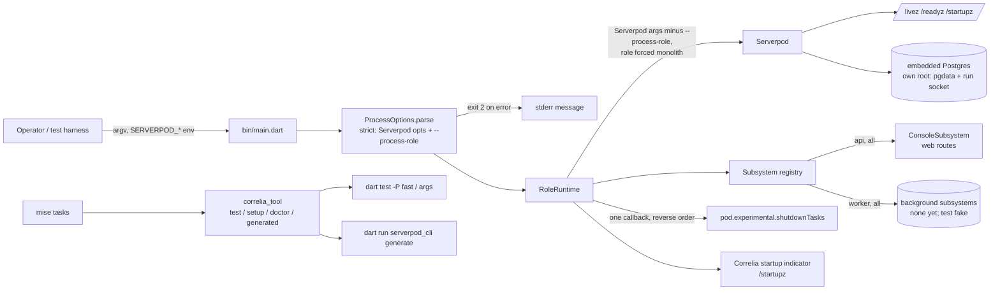
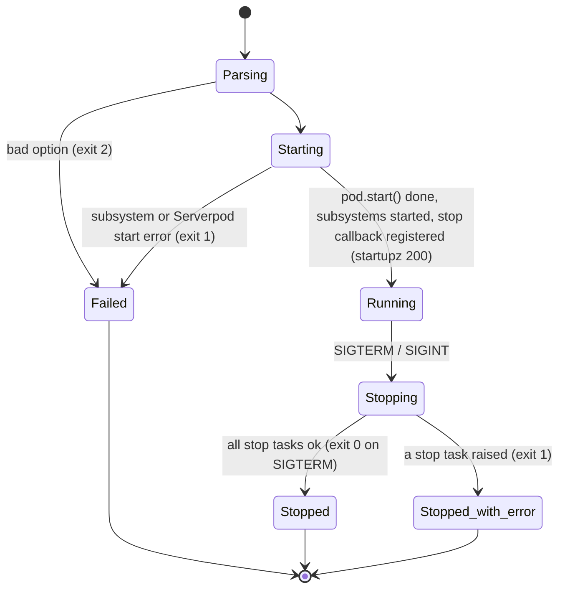
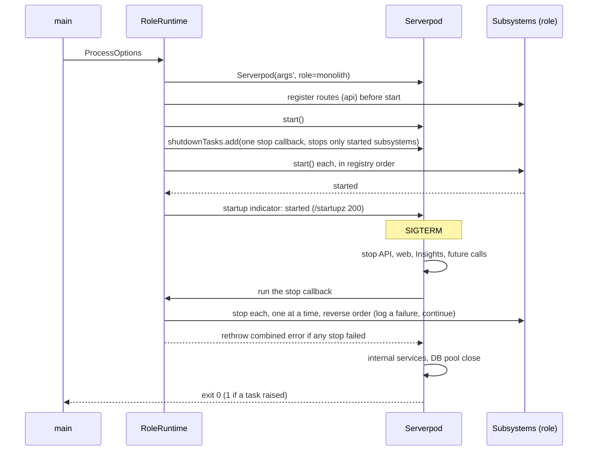

# Design

## Triage

| Trigger | Applies? | Evidence |
|---|---|---|
| T1 Components (new component, or 3+ with directed relationships) | yes | New packages `correlia_server`, `correlia_client`, `correlia_flutter`, `tool`; inside the server: entry point → options parser → role runtime → subsystems → Serverpod |
| T2 State (persistent state, caches, 3+ state machine) | yes | Server lifecycle (starting → running → stopping → stopped/failed); the per-clone `config/passwords.yaml`; embedded Postgres data directories |
| T3 Concurrency (background work, workers/isolates, async, retries) | yes | Subsystems start and stop asynchronously; SIGTERM shutdown ordering against Serverpod's own handler; tests in parallel against embedded clusters |
| T4 Boundaries (data format, migration, shared interface, IPC, external) | yes | Operator command line (`--process-role`), the `Subsystem` interface every later change implements, mise task interface, generated client protocol, the initial Serverpod migration |
| T5 Volume (grows without a fixed bound) | no | No ingest or queues yet; test data directories are bounded per run (see Resource Bounds) |
| T6 Risk (security, money, data loss, unrecoverable user data) | yes | Local database passwords; the rule never to touch another Postgres (Hindsight's on 127.0.0.1:5432) |

TIER: FULL

## Context

The scope decisions are in `proposal.md` (S1-S8). Current state:

- No Dart package exists yet. `mise.toml:10-25` pins Flutter 3.47.9 (Dart 3.13.7), Node and OpenSpec 1.16.0
  and has only the planning tasks (`check` is OpenSpec validation alone, `mise.toml:15-17`).
- `.mcp.json:1-17` and `.codex/config.toml:7-10` start the Dart MCP through `mise exec -- bash -c …` with
  `DART_DATA_HOME` under `.dart_tool`; the Serverpod MCP is to be added beside it (`.codex/config.toml:4-5`).
- `.gitignore` is the repository's own; the template's root `.gitignore` ignores `.claude/`, `.agents/`,
  `.codex/` and `.mcp.json`, which this repository commits.

Facts read from the Serverpod 4.1.0 sources and a scratch `serverpod create` (not committed):

- `serverpod/lib/src/server/command_line_args.dart:48-123`: Serverpod parses `--mode`, `--server-id`,
  `--logging`, `--role` (`monolith|serverless|maintenance`), `--apply-migrations` and
  `--apply-repair-migration`; on **any** parse error it logs a warning and falls back to defaults for every
  option. An extra `--process-role=api` would silently drop `--mode=production`.
- `serverpod/lib/src/server/serverpod.dart:870-884`: in `monolith`/`serverless` it watches SIGINT and SIGTERM;
  `:1106-1112` the handler calls `shutdown(exitProcess: true)`.
- `serverpod/lib/src/server/serverpod.dart:1331-1440`: shutdown runs request-receiving tasks (API, web and
  Insights servers, future calls), then `experimental.shutdownTasks`, then internal services, then the
  database pool, then exits 0 on SIGTERM, 1 if any task raised.
- `serverpod_embedded_postgres/lib/src/cluster/postgres_conf_builder.dart:83-113`: an embedded cluster lives
  under one root: `<root>/pgdata` is PGDATA (what `dataPath` names) and its sibling `<root>/run` holds the Unix
  socket. Two clusters are isolated only when their roots differ, not merely their `pgdata` leaves.
  `serverpod_embedded_postgres/lib/src/supervisor/stale_lock_repair.dart:1-30`:
  on start, stale pidfiles in the data directory are removed and an orphan postmaster of that data directory
  is stopped (`pg_ctl stop`, else SIGTERM/SIGKILL on the PID read from that directory's `postmaster.pid`).
- `serverpod/lib/src/server/tasks/task_manager.dart:59-77`: `executeTasks` starts every registered shutdown
  callback and awaits them together, so callbacks registered separately run concurrently, in no order.
- `serverpod/lib/src/server/serverpod.dart:74,773`: `isStartupComplete` is `_startedTime != null`, and `start()`
  sets `_startedTime` on entry, so Serverpod's own `/startupz` indicator passes before startup has finished.
  `health/health_config.dart:22-60`: `HealthConfig.additionalStartupIndicators` adds indicators to `/startupz`
  (results cached for `cacheTtl`, default 1 s).
- `serverpod_shared` reads `SERVERPOD_DATABASE_DATA_PATH`, `SERVERPOD_API_SERVER_PORT`,
  `SERVERPOD_WEB_SERVER_PORT` and `SERVERPOD_INSIGHTS_SERVER_PORT` (env overrides of the YAML config).
- The template `config/test.yaml` uses port 0 for every server and the database, `dataPath:
  .serverpod/test/pgdata`. Without `config/passwords.yaml` the template's db test run exits 1 with no message
  (tried in the scratch copy); with it, the run passes.
- `dart test` exits 79 when a tag selection matches no test (tried).
- `serverpod_cli: 4.1.0` resolves as a dev dependency in the workspace, and `dart run serverpod_cli version`
  prints 4.1.0 (tried).

## Decisions

### D1: Role input and argument handling

- **Choice:** An operator option `--process-role=api|worker|all` (default `all`). Correlia parses the whole
  command line first with a parser that knows Serverpod's options and its own; an unknown option, or a
  Serverpod `--role` other than `monolith`, stops startup with exit 2 and a message. Correlia removes its own
  option and hands the rest to Serverpod unchanged.
- **Rejected:** Role from an environment variable only, because the command line would still need the strict
  pre-check and two inputs differ in how they are logged and documented; both inputs, because it doubles the
  surface to test.
- **Reversal cost:** medium (operators and later packaging use the option).
- **Important:** yes (binds future changes: an operator-visible option).
- **Chosen by:** user

### D2: Serverpod CLI pin

- **Choice:** `serverpod_cli: 4.1.0` as a dev dependency of `correlia_server`, run as `dart run serverpod_cli`
  by the mise tasks and the MCP entries. The lock file pins it with `serverpod` itself.
- **Rejected:** A repo-local `dart pub global activate` into `.dart_tool` (an install step per clone and a
  second resolution); a global `dart install` (shared with other projects, not pinned per repository).
- **Reversal cost:** low
- **Important:** yes (binds future changes: how every later change runs the generator).
- **Chosen by:** user

### D3: Task logic in a Dart tool package

- **Choice:** A workspace package `tool` (`correlia_tool`, `package:args`, unit tested) with commands `test`
  (tier dispatch), `setup` (local passwords), `doctor` (tool paths and versions) and `generated` (staleness
  check). mise `run` strings stay one line.
- **Rejected:** Shell logic in `mise.toml`, the approach whose tier selection broke in the first attempt.
- **Reversal cost:** low
- **Important:** no.
- **Chosen by:** user

### D4: Fast tier selection

- **Choice:** `correlia_server/dart_test.yaml` declares the tags `db`, `e2e`, `plugin`, `load` and a preset
  `fast` that excludes all four. `tool test` with no arguments runs `dart test -P fast`. With arguments it
  passes them to `dart test` and adds only two things: `-x load` unless the arguments select `load`
  (`--tags`/`-t` naming `load`), and `-P fast` when the arguments select no tag at all. So
  `-- --reporter expanded` runs the fast tests, `-- --tags db` runs exactly the db tests, and `-- --tags load`
  runs the load tests. `test:all` runs `dart test -x load`. Amended after review round 1 (M4) by the owner:
  arguments no longer pass through with nothing added.
  **Amended during apply (owner, 2026-11-03):** `serverpod_test`'s `withServerpod` tags its group
  `integration` unless `testGroupTagsOverride` names a tier, so `dart_test.yaml` also declares `integration`
  and the `fast` preset excludes it; a fast test asserts that every `withServerpod` call under
  `correlia_server/test/` passes a tier tag.
  **Shared test cluster owned by `tool test`** (amended during apply by the owner, 2026-11-03, after review
  round 6, C1): `serverpod_test` caches the shared cluster's postmaster for the test process and never stops
  it, and stopping it later by its `postmaster.pid` (`pg_ctl stop -D`) would signal an unverified PID. So
  `tool test` owns the shared cluster `.serverpod/test/` for the whole run, but only when the run selects a
  tier that uses it (`db`, `e2e`, `plugin`, or `test:all`); a fast-only run never touches the cluster or its
  root. Such a run: (1) takes `<root>/owner.lock` with `FileLock.blockingExclusive` against a deadline, so an
  overlapping run waits, and at the deadline fails naming the root before touching the cluster; (2) starts the
  cluster as its own child process through `serverpod_embedded_postgres` (`detach: false`, Serverpod's own
  identity-checked stale-lock repair on, which handles a leftover from a killed run, S8); (3) runs `dart test`,
  whose `withServerpod` attaches to that live postmaster; (4) stops the cluster through the handle of the child
  it spawned (Serverpod's supervisor signals its own unreaped child process, so no PID is looked up and a
  recycled PID cannot be hit), then releases the lock. If the cluster is already live when the run starts
  (another tool, or a run that was killed while its postmaster lived on), `tool test` does not stop it: it
  fails naming the root, before running tests, and signals nothing. The test run's exit status is kept; a
  failed stop also fails the run, naming the root. No path signals a process found through a pidfile.
- **Rejected:** Selecting fast tests by directory (`test/unit/`): the tier would depend on a file's location
  instead of its tag. Passing arguments through with nothing added: `-- --reporter expanded` would run every tier, `load`
  included.
- **Reversal cost:** low
- **Important:** yes (binds future changes: the tier contract).
- **Chosen by:** user

### D5: Generated code committed

- **Choice:** Commit Serverpod's generated code. `tool generated` builds a self-contained temporary workspace:
  a root `pubspec.yaml` whose `workspace:` lists only `correlia_server` and `correlia_client`, a copy of the
  committed `pubspec.lock`, and the generator inputs of both packages (pubspecs, `lib/`, `config/generator.yaml`
  and the other `config/` files the generator reads), never `.dart_tool/`, `build/` or
  `.dart_tool/package_config.json`. It runs `dart pub get --offline` there, then the pinned
  `dart run serverpod_cli generate`, and fails listing every generated file that differs from the checkout. The
  checkout is never written. Tests on a clean clone: unchanged code passes, a stale file fails naming it, and
  `git status` of the checkout is unchanged afterwards. Amended after review round 1 (M5) by the owner.
- **Rejected:** Gitignoring generated code: a fresh clone could not analyze or test without generating, and
  every task would need a generate step. Generating in place and diffing with git: `check` would rewrite files
  in the developer's tree.
- **Reversal cost:** low
- **Important:** yes (binds future changes).
- **Chosen by:** user

### D6: Contents of `check`

- **Choice:** In order: `openspec validate --all --strict`; `tool doctor`; `dart analyze --fatal-infos` over the
  workspace and `flutter analyze` for the console; `dart format --output=none --set-exit-if-changed`; `tool
  generated`; the fast tests of server and tool; `flutter test` for the console. No `db` or `e2e`.
- **Rejected:** Adding the db tier (boots Postgres on every check); static checks only.
- **Reversal cost:** low
- **Important:** yes (changes what users see: the pre-push gate).
- **Chosen by:** user

### D7: Shutdown ordering

- **Choice:** `RoleRuntime` registers **one** callback with `pod.experimental.shutdownTasks`, so it runs after
  request intake stops and before the database pool closes. Serverpod runs separate callbacks concurrently
  (Context), so the callback, registered before the first subsystem starts, itself stops the subsystems that
  have started, one at a time, in reverse start order, awaiting each. A subsystem whose `stop` throws is logged with its name and the rest still stop; after the
  last one the callback rethrows a combined error naming every failed subsystem, so Serverpod exits 1. A fast
  test with two fake subsystems pins completion order and continuation after a failure; a db/e2e test pins
  that the stop runs before the pool closes, since the API is marked experimental. Mechanism corrected after
  review round 1 (M1); the owner's choice of `shutdownTasks` stands.
- **Rejected:** An own SIGTERM handler that stops subsystems and then calls `pod.shutdown()`: it races
  Serverpod's handler, which exits the process itself.
- **Reversal cost:** low
- **Important:** yes (binds future changes: how worker loops stop).
- **Chosen by:** user

### D8: Kill-recovery test data directory

- **Choice:** The SIGKILL test (tag `db`) owns the cluster root `correlia_server/.serverpod/test-kill/` and runs
  its child servers with `SERVERPOD_DATABASE_DATA_PATH` set to `<that root>/pgdata`, so its socket is in
  `<that root>/run`; never the shared test cluster. Every cluster gets its own root, and a root is **stable**:
  `.serverpod/test/` for the shared cluster, `.serverpod/test-e2e/<test-id>/` for each e2e test (a fixed id per
  test, never per run). A run killed before teardown leaves its root. Its child server exits on its own when
  the harness dies (D16), and the next run of that test starts in the same root, so Serverpod's
  data-directory recovery (S8) repairs anything left; no own sweep exists. A replacement child waits for the
  previous child's root lock before using the root (D16), so it never attaches to a cluster that is being
  shut down. Teardown deletes a
  root only after the child process has exited and the root's `pgdata/postmaster.pid` is gone; otherwise it
  leaves the root for the next run's recovery and fails the test. The db identity test asserts both
  `data_directory` and `unix_socket_directories` lie inside the root. Layout corrected after review round 1
  (M2); stable e2e roots chosen by the owner after review round 2 (M6).
- **Rejected:** Using the shared `.serverpod/test/pgdata`, which would break db tests running in parallel.
  Per-run e2e roots with a sweep of abandoned roots: an own cleanup mechanism, which S8 rejected.
- **Reversal cost:** low
- **Important:** no.
- **Chosen by:** user

### D9: OMP's Serverpod MCP

- **Choice:** One entry in `.mcp.json`, which OMP also reads. Apply checks that OMP lists the server; only if
  it does not is `.omp/mcp.json` written.
- **Rejected:** A duplicate `.omp/mcp.json` from the start.
- **Reversal cost:** low
- **Important:** no.
- **Chosen by:** user

### D10: Console route under test

- **Choice:** The console subsystem serves an app directory, `web/app` by default. e2e tests point it at a
  fixture `index.html` through the test-only environment variable `CORRELIA_TEST_CONSOLE_DIR`, read only in
  run mode `test`. A `build:web` mise task builds the real app into `correlia_server/web/app`.
- **Rejected:** Building Flutter web in every e2e run (about a minute each).
- **Reversal cost:** low
- **Important:** no.
- **Chosen by:** user

### D11: What listens in the worker role

- **Choice:** Serverpod always runs as `monolith`, so the API port is up in every role for the health
  endpoints. The worker role mounts no console or ingress routes; the web port answers 404.
- **Rejected:** A separate health-only listener for workers, outside Serverpod's health checks.
- **Reversal cost:** low
- **Important:** yes (changes what users see: ports per role).
- **Chosen by:** user

### D12: Lints

- **Choice:** `package:lints/recommended.yaml` plus `strict-casts`, `strict-inference`, `strict-raw-types`
  and the rules `unawaited_futures`, `avoid_print`, `avoid_dynamic_calls`; analysis runs with `--fatal-infos`;
  generated code is excluded. One shared `analysis_options.yaml` at the workspace root, which the packages
  include.
- **Rejected:** `very_good_analysis` (a large third-party set, more churn); the template default (no strict
  modes).
- **Reversal cost:** low
- **Important:** yes (binds future changes).
- **Chosen by:** user

### D13: Local passwords

- **Choice:** `config/passwords.yaml` stays gitignored. `tool setup` writes random `development` and `test`
  database passwords when the file is missing, never overwrites it, and fails naming the file and section
  when a needed section is missing. `test`, `test:all`, `check` and `run` depend on it. Production secrets
  come from `SERVERPOD_PASSWORD_*` environment variables.
- **Rejected:** Committing fixed development and test passwords (a committed passwords file invites a real
  secret later).
- **Reversal cost:** low
- **Important:** yes (security: secrets handling).
- **Chosen by:** user

### D14: Go and buf versions

- **Choice:** `go = "1.27.3"`, `buf = "1.75.0"` in `mise.toml`.
- **Rejected:** Minor-level pins (not reproducible).
- **Reversal cost:** low
- **Important:** no.
- **Chosen by:** user

### D15: Console not built

- **Choice:** In the `api` and `all` roles, when the app directory has no `index.html`, the console path answers
  503 with a short page naming `mise run build:web`, and startup logs a warning. Health is unaffected.
- **Rejected:** Refusing to start (blocks API-only work); the template's 200 page (looks healthy).
- **Reversal cost:** low
- **Important:** yes (changes what users see).
- **Chosen by:** user

### D16: e2e harness

- **Choice:** e2e tests spawn the real entry point (`dart run bin/main.dart --mode test …`) as a child process,
  with its ports and data directory from `SERVERPOD_*` environment variables, and talk to it over HTTP and
  real signals. The harness is Dart code in `correlia_server/test/support/`, with readiness detected by
  polling `/startupz` (which includes D17's indicator) against an injected deadline, never a fixed sleep.
  The harness starts every child with `CORRELIA_EXIT_ON_STDIN_CLOSE=1` and keeps the write end of the child's
  stdin pipe open for the child's lifetime. When the harness dies for any reason (SIGKILL included), the kernel
  closes that pipe; the child sees end-of-file on stdin and runs the same graceful shutdown as on SIGTERM
  (`pod.shutdown()`), which stops its subsystems and its embedded Postgres. The watch is armed only in run
  mode `test` with that variable set; a unit test pins that it is off otherwise. This is the parent-death
  signal ADR 0015 uses for plugins. If the child dies anyway without stopping its Postgres, the postmaster's
  recorded supervisor is dead, so Serverpod's stale-lock repair stops it on the next run in that root (D8).
  Added after review round 3 (M6), chosen by the owner.
  **Root ownership handoff:** every child the harness starts (e2e and the kill test) also gets
  `CORRELIA_TEST_ROOT_LOCK=<root>/owner.lock`. In run mode `test` only, before Serverpod is constructed (so
  before its embedded Postgres starts or attaches), the child opens that file and awaits
  `RandomAccessFile.lock(FileLock.blockingExclusive)`, bounded by the readiness deadline passed in
  `CORRELIA_TEST_ROOT_LOCK_TIMEOUT`. It holds the lock until the process exits; the kernel releases it on any
  exit, SIGKILL included, so it never goes stale. A replacement child therefore cannot start or attach to the
  cluster while an earlier child of that root is still shutting down. On timeout it exits non-zero naming the
  root and the lock, before touching the cluster, and the harness fails the test with that output. The wait is
  a blocking lock, never a sleep loop. Added after review round 4 (M6), chosen by the owner.
- **Rejected:** Starting Serverpod in the test process and spawning a child only for SIGTERM (misses the real
  entry point and argument handling). For parent death: a pidfile in the root and a checked SIGTERM by the
  next run (an own cleanup mechanism signalling by PID); `PR_SET_PDEATHSIG` through FFI (tied to the spawning
  thread, native code, and `dart run` may add an intermediate process).
- **Reversal cost:** low
- **Important:** no.
- **Chosen by:** user

### D17: Startup reporting

- **Choice:** Correlia adds its own startup health indicator through `HealthConfig.additionalStartupIndicators`.
  It reports unhealthy until every subsystem of the role has started and the D7 shutdown callback is
  registered, so `/startupz` answers 200 only when Serverpod's indicator and Correlia's both pass. The e2e
  harness (D16) waits on that. A test with a gated fake subsystem shows `/startupz` stays 503 until the gate
  opens. Added after review round 1 (M3).
- **Rejected:** Keeping Serverpod's early `/startupz` and having the harness wait for a log line: probes
  (operators, Kubernetes) would still see "started" too early.
- **Reversal cost:** low
- **Important:** yes (changes what operators see on `/startupz`).
- **Chosen by:** user

### Decision summary

| # | Decision | Choice | Rejected | Reversal cost | Important | Chosen by |
|---|---|---|---|---|---|---|
| S1 | Template scope | Trimmed fullstack (db, webapp; no auth/redis/website/CI/Docker/Cloud) | Template as is | low | yes | user |
| S2 | Template Dockerfile | Remove until M10 | Fix now | low | yes | user |
| S3 | Go, buf, proto | Pin tools; `proto` task in canonical-event-v1 | Empty proto task; defer all | low | no | user |
| S4 | Tiers with tests | fast, db, e2e | fast + db | low | yes | user |
| S5 | Roles depth | Skeleton + registry + health + shutdown hook, tested | Parse only; defer | medium | yes | user |
| S6 | Serverpod MCP | Claude, Codex, OMP | Claude and Codex | low | no | user |
| S7 | Console | Placeholder served by api, widget test | Generated only | low | no | user |
| S8 | PG cleanup | Serverpod's recovery, proven by a SIGKILL test | Own tool; unproven | low | yes | user |
| D1 | Role input | `--process-role`, strict pre-parse | Env only; both | medium | yes | user |
| D2 | CLI pin | `serverpod_cli` dev dependency | Repo-local activate; global install | low | yes | user |
| D3 | Task logic | Dart `tool` package | Inline mise shell | low | no | user |
| D4 | Fast tier | `fast` preset when no tag is selected (also excludes `integration`); `-x load` unless `load` is named; `tool test` owns the shared test cluster for runs that need it | Directory split; plain pass-through | low | yes | user |
| D5 | Generated code | Committed + staleness check in a self-contained temp workspace | Gitignored; in-place generate + git diff | low | yes | user |
| D6 | `check` | Validate, doctor, analyze, format, generated, fast + widget tests | + db; static only | low | yes | user |
| D7 | Shutdown | One `experimental.shutdownTasks` callback stopping subsystems in reverse order, pinned by tests | Own signal handler | low | yes | user |
| D8 | Test cluster roots | Own stable root per cluster (kill test, each e2e test), recovered by Serverpod | Shared test cluster; per-run roots + sweep | low | no | user |
| D9 | OMP MCP | Shared `.mcp.json`, verified | Own `.omp/mcp.json` | low | no | user |
| D10 | Console under test | Fixture dir via test-only env | Real build per e2e | low | no | user |
| D11 | Worker listeners | API port for health; no console/ingress | Separate health port | low | yes | user |
| D12 | Lints | recommended + strict modes + 3 rules, fatal infos | very_good_analysis; template | low | yes | user |
| D13 | Passwords | Generated per clone by `tool setup` | Commit dev/test values | low | yes | user |
| D14 | Go/buf | 1.27.3 / 1.75.0 exact | Minor pins | low | no | user |
| D15 | Console not built | 503 naming `mise run build:web` | Refuse start; 200 page | low | yes | user |
| D16 | e2e harness | Child process of the real entry point; exits on stdin end-of-file and holds a kernel lock on its root (test mode only) | In-process; pidfile + checked kill; `PR_SET_PDEATHSIG` | low | no | user |
| D17 | Startup reporting | Correlia startup indicator on `/startupz` | Harness waits for a log line | low | yes | user |

## Diagrams (FULL)

Components (T1, T4):

Server lifecycle (T2):

Startup and shutdown order (T3):

## State & Ownership (FULL)

| State | Owner (sole writer) | Lifetime | Invalidation / rebuild | Authoritative copy |
|---|---|---|---|---|
| Role in force | `ProcessOptions` (parsed once) | process | none; restart to change | the parsed value, logged at startup |
| Subsystem registry | `RoleRuntime` | process | built at startup from the static list | in-memory list |
| `config/passwords.yaml` (dev/test) | `tool setup` (creates only) | per clone | delete the file and rerun `setup` | the file |
| Test cluster root `.serverpod/test/` (`pgdata`, `run`) | `tool test` while it holds `<root>/owner.lock`: it starts the postmaster as its own child and stops it through that child handle (D4); Serverpod's supervisor and stale-lock repair underneath | until deleted | Serverpod repairs stale locks on start; delete the directory to rebuild | the directory |
| Kill-test and e2e cluster roots `.serverpod/test-kill/`, `.serverpod/test-e2e/<test-id>/` (each `pgdata` + `run`; stable per test) | the test that sets `SERVERPOD_DATABASE_DATA_PATH` to `<root>/pgdata`; while running, the one child server holding `<root>/owner.lock` (it exits when the harness's stdin pipe closes; the kernel releases the lock at its exit) | until the test's teardown, or the next run of that test after a kill | teardown deletes the root once the child exited and `postmaster.pid` is gone; after a kill, Serverpod's recovery repairs it on the next run | the root |
| Startup state (subsystems started, stop callback registered) | `RoleRuntime` | process | none | the startup indicator |
| Generated code | `serverpod_cli generate` | committed | regenerate; `tool generated` detects drift | the generator output |
| Console build `web/app` | `build:web` task | local, gitignored | rebuild | the build output |

## Failure & Visibility (FULL)

| Component | Fails / dies mid-operation → | Recovery | Retry safe? | Who finds out |
|---|---|---|---|---|
| Option parsing | bad or unknown option | none; fix the command | yes | operator: exit 2, stderr names the option |
| Subsystem start | throws | process exits 1 before reporting started; Serverpod shutdown runs | yes (restart) | operator: stderr and log name the subsystem |
| Subsystem stop | throws | the stop callback logs it and stops the remaining subsystems, then rethrows | n/a | log names the subsystem; exit 1 |
| Database after start | unreachable | Serverpod reconnects on use | yes | `/readyz` 503 |
| Console build missing | no `index.html` | `mise run build:web` | yes | 503 page; startup warning |
| Test run killed (SIGKILL) | postmaster orphaned with pidfiles in its data dir | next start in that data dir: Serverpod's stale-lock repair | yes | the next run's log; the kill test |
| `tool setup` | file exists but lacks a section | operator edits or deletes it | yes | task exits non-zero naming file and section |
| Generated code | stale | `mise run generate` | yes | `check` fails listing the files |
| Toolchain | wrong version / Windows copy | `mise install` | yes | `tool doctor` fails naming the tool |
| e2e child server | fails to become ready by the deadline | test kills it (SIGKILL) and fails, printing its captured output; its stable root is repaired on the next run | yes | test failure output |
| Replacement child while the previous one is still shutting down | waits on `<root>/owner.lock` | starts once the previous child has exited; at the deadline exits non-zero naming root and lock, cluster untouched | yes | test failure output |
| e2e harness killed before teardown | root left behind; the child is still running | the child sees stdin end-of-file and shuts down gracefully, stopping its Postgres (D16); if the child dies without that, its postmaster's supervisor is dead and Serverpod's stale-lock repair stops it on the next run in that root (D8) | yes | the interrupted-e2e test |

## Resource Bounds (FULL)

| Queue / buffer / cache / transfer | Bound | At the bound | Timeout | At 10x / 100x |
|---|---|---|---|---|
| e2e child stdout/stderr capture | last 200 lines kept in a ring | older lines dropped | — | unchanged |
| e2e readiness wait | deadline injected per test (default 60 s) | test fails, child killed | 60 s | unchanged |
| Graceful-stop wait in tests | injected deadline (default 30 s) | SIGKILL + failure | 30 s | unchanged |
| Test cluster roots | one shared; one stable root per e2e test and one for the kill test | a leftover root is reused by the next run of the same test and repaired by Serverpod | — | count bounded by tests, not runs |
| Request body | template `maxRequestSize` 512 KiB kept | Serverpod rejects larger | — | ingest limits come with alertmanager-ingest-pipeline |
| Subsystem stop | sequential inside one callback, no own timeout | a hanging stop blocks shutdown; the orchestrator's (systemd/k8s) kill timer bounds it | — | revisit when worker loops exist |

## Flow & State Gaps (FULL)

- **SIGTERM during startup:** Serverpod's handler is registered inside `pod.start()`; a SIGTERM before that
  ends the process with the default action. Subsystems start after `pod.start()`; the stop callback is
  registered before the first subsystem starts and stops only those already started, so a SIGTERM during their
  start stops what has started. `/startupz` stays 503 throughout. Default assumption: acceptable for the
  skeleton; there are no worker loops yet.
- **Second SIGINT during shutdown:** Serverpod forces an immediate exit (kept).
- **Two test runs at once on one clone:** both use the `.serverpod/test/` root; Serverpod's supervisor lets a
  second process attach or fails visibly. Default assumption: not supported; e2e and kill tests use their own
  stable roots, so a single `test:all` run is safe, but two concurrent runs on one clone would share them.
- **Stale passwords file from the template era:** `tool setup` never overwrites; a missing section is named.
- **Run mode from `SERVERPOD_RUN_MODE`:** Serverpod also reads the run mode from the environment; the strict
  pre-parse covers the command line only, and the startup log prints the effective mode and role.

## Mechanism Ledger (FULL)

| Mechanism | Built? | Why (harm nobody catches / expensive later) | Evidence that would change the call |
|---|---|---|---|
| Strict pre-parse of Serverpod options | yes | Serverpod silently drops all options on one unknown (verified in source): production could start in development mode unnoticed | Serverpod failing hard on unknown options |
| Reject Serverpod `--role` ≠ monolith | yes | `maintenance` exits after future calls, `serverless` skips them: a role mismatch nobody notices | — |
| Subsystem registry + one sequential `shutdownTasks` callback | yes | Every later worker loop needs ordered stop before the pool closes; retrofitting is expensive (shared interface) | — |
| `tool test` owns the shared test cluster (root lock, own child, stop through the child handle) | yes | `serverpod_test` never stops its postmaster, so every `db` run would leave one on the clone; a pidfile-based stop could signal a recycled PID, possibly another Postgres (review round 6, C1) (D4) | `serverpod_test` stopping its cached postmaster itself |
| Fast preset excludes `integration` + `withServerpod` tier-tag test | yes | A db test without a tier tag would run in the fast loop and fail there for lack of a database (D4) | — |
| Own embedded-Postgres cleanup | no | Serverpod repairs by data directory already (S8); the kill test proves it | The kill test failing on a Serverpod upgrade |
| Port-conflict retry in the e2e harness | no | Ports come from binding 0 then releasing; a collision fails the test visibly | Flaky e2e failures from port reuse |
| Shutdown timeout per subsystem | no | No worker loops yet; the process manager's kill timer bounds it | The first worker loop (alertmanager-ingest-pipeline) |
| Root lock held by the test child (test mode) | yes | Without it a re-run attaches to a cluster its predecessor is still stopping, and loses it mid-test | — |
| Child exits on stdin end-of-file (test mode) | yes | Without it a harness killed alone leaves a live server holding its cluster, which Serverpod's recovery cannot stop (its supervisor is alive) | A kernel parent-death signal that `dart run` keeps |
| Toolchain doctor | yes | A Windows copy on PATH ran once unnoticed (OpenSpec); cheap to check | — |
| Generated-code staleness check | yes | Stale client code compiles and breaks only at runtime | — |
| Dockerfile | no | S2; packaging is M10 | — |

## Risks / Trade-offs

- [`experimental.shutdownTasks` changes in a Serverpod upgrade] → the shutdown-order test fails on upgrade.
- [Serverpod's startup indicator or `HealthConfig` changes in an upgrade] → the gated startup test fails.
- [`tool generated`'s temp workspace misses a generator input] → the clean-clone test (unchanged code passes)
  fails, naming the files that differ.
- [`dart run serverpod_cli` is slower than a compiled CLI] → generation is not in the inner loop; the MCP
  entry starts once per session.
- [Strict pre-parse duplicates Serverpod's option list] → a unit test compares it with Serverpod's
  `CommandLineArgs` option names, so an upgrade that adds an option fails the test instead of being rejected
  at runtime.
- [Serverpod's stale-lock repair stops a postmaster by PID from the data dir's `postmaster.pid`] → it acts
  only on our data directories; the kill test, and a test with a decoy listener (a plain Dart socket on a
  loopback port and a `.s.PGSQL.<port>` socket outside the data dir), show nothing else is contacted or
  signalled. No test connects to, or inspects, a real PostgreSQL other than its own (Hindsight's included).
- [The test-only `CORRELIA_TEST_CONSOLE_DIR` leaks into production] → it is read only in run mode `test`; a
  unit test pins that.
- [`CORRELIA_EXIT_ON_STDIN_CLOSE` or `CORRELIA_TEST_ROOT_LOCK` set in production, where stdin may be
  `/dev/null`] → both are read only in run mode `test`; a unit test pins that.

## ADRs

- **In force, constraining this change:** 0001 (roles, one binary), 0002 (PostgreSQL everywhere, embedded for
  development and tests), 0003 (Flutter web console), 0014 (Linux first, WSL development, tasks must not assume
  WSL, never touch another Postgres).
- **To record during apply:** none. `--process-role` and the subsystem registry implement ADR 0001 without
  changing it.

## Open Questions

- e2e child ports: bind port 0 and release, or parse Serverpod's startup log for the bound port. Either fits
  the harness in `test/support/`; settled during apply.
