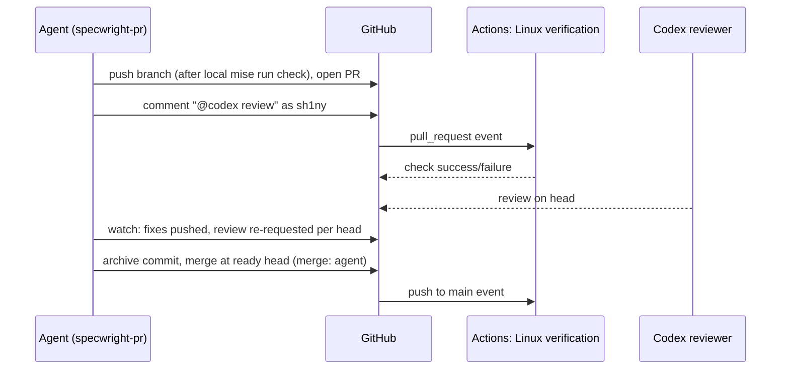
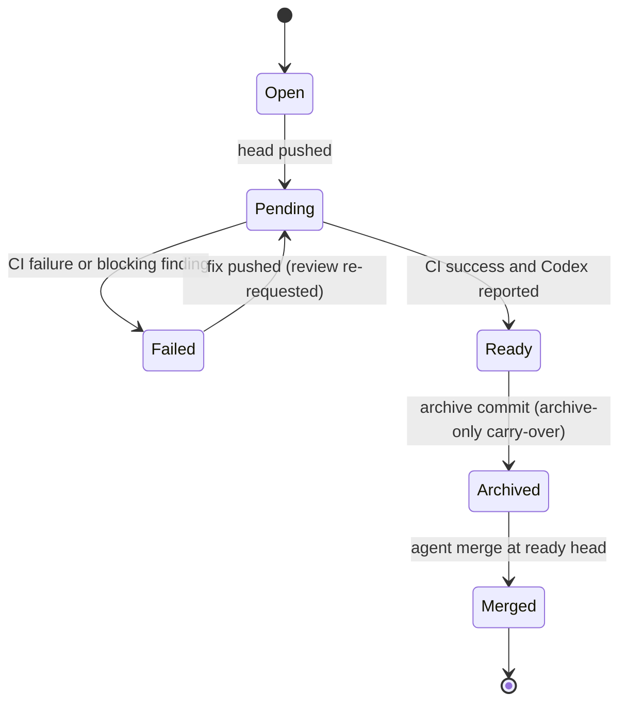

# Design

## Triage

| Trigger | Applies? | Evidence |
|---|---|---|
| T1 Components (new component, or 3+ with directed relationships) | yes | New CI workflow. GitHub Actions, branch protection, the Codex reviewer and Specwright watch now gate every merge together. |
| T2 State (persistent state, caches, 3+ state machine) | yes | The mise tool cache persists across runs. A PR moves through more states than before: open, checks pending, ready, archived, merged. |
| T3 Concurrency (background work, workers/isolates, async, retries) | yes | Overlapping runs for one PR; a push to `main` racing a PR run. |
| T4 Boundaries (data format, migration, shared interface, IPC, external) | yes | External system (GitHub Actions); the job name is the contract that branch protection requires. |
| T5 Volume (grows without a fixed bound) | no | One job per head; the cache has a fixed key per toolchain. |
| T6 Risk (security, money, data loss, unrecoverable user data) | yes | CI runs PR code on a public repo, so token scope matters. Agent merge to `main`. |

TIER: FULL

## Context

- The remote was switched on 2026-11-15, before this change (proposal.md, Why). `main` protection now
  requires:
  - a PR (0 approvals);
  - the status check `Linux verification` from GitHub Actions (app 15368), strict (the head is up to date
    with `main`);
  - the rules apply to admins, and force pushes and deletions are blocked.
- The toolchain is fully pinned in `mise.toml:11-17`: Flutter 3.47.9 (with Dart), Node 24, Go 1.27.3,
  buf 1.75.0 and OpenSpec 1.16.0. The Serverpod CLI is a pinned dev dependency, not a mise tool
  (`mise.toml:8-9`).
- `mise run check` (`mise.toml:112-127`) depends on `setup` (it writes the local passwords file) and
  `proto:setup` (a locked `npm ci`). `mise run test:all` (`mise.toml:101-104`) runs
  `tool/bin/tool.dart test --all`, which builds the Go plugins first (`tool/lib/src/test_command.dart:15-24`).
  Postgres is Serverpod's embedded one (`correlia_server/config/test.yaml:40`). No system Postgres is needed.
- `workspace-tooling` "Tasks run on plain Linux" already requires the tasks to have no WSL dependency. A grep
  of `tool/lib` for `wsl`, `/mnt/` and `microsoft` finds nothing.
- Local timings (`openspec/changes/archive/2026-11-14-plugin-forced-stop-status/evidence/gate-runs.md`):
  `check` about 182 s, `test:all` about 600 s. One of four `test:all` runs had a failure in the supplementary
  stress test `health_call_stalls_under_load`, which is outside this change's scope.
- Specwright merge settings: `openspec/specwright.yaml` `pr.reviewers` already names
  `chatgpt-codex-connector` as required (`request: "@codex review"`, `request_as: sh1ny`), and agent merge
  needs that.
- Pinned action releases, resolved on 2026-11-15:
  - `actions/checkout` v7.0.1 `3d3c42e5aac5ba805825da76410c181273ba90b1`;
  - `jdx/mise-action` v5.2.8 `d5574b52816a478f9d4e6529a3f6ff17a8a36785`.

## Decisions

### D1: One job, check then test:all, sequential in one runner

- **Choice:** A single job, `Linux verification`, on `ubuntu-24.04`, with `timeout-minutes: 60`. Its steps:
  check out, install mise and the tools, run `mise run check`, then `mise run test:all`. The second step does
  not run when the first fails (default step semantics).
- **Rejected:** separate jobs for check and test tiers, because each job pays the toolchain install again,
  branch protection would need every job name, and a failing check would not stop the expensive tiers.
- **Reversal cost:** low
- **Important:** yes (binds future changes: the required check name)
- **Chosen by:** agent

### D2: Triggers and cancellation

- **Choice:**
  - Triggers: `pull_request` to `main`, `push` to `main` and `workflow_dispatch`.
  - `concurrency: group: ci-${{ github.event_name }}-${{ github.event.pull_request.number || github.run_id }}`
    with `cancel-in-progress: ${{ github.event_name == 'pull_request' }}`. Runs of one PR share a group, so a
    new head cancels its older run. Every push to `main` and every dispatch gets its own group (its run id).
    GitHub keeps only one pending run per group, so a shared `main` group would drop intermediate pushes
    unverified (design review M1).
- **Rejected:** `pull_request_target`, because it would run PR code with a write token and with cache scope on
  the base branch. PR-only triggers were rejected because the health of `main` after a merge would then go
  unrecorded.
- **Reversal cost:** low
- **Important:** no
- **Chosen by:** agent

### D3: Least-privilege token, no secrets

- **Choice:**
  - `permissions: contents: read` at the workflow level.
  - `persist-credentials: false` on checkout.
  - The workflow references no secrets.
  - Actions are pinned by full commit SHA, with the tag in a comment.
- **Rejected:** default token permissions and tag-pinned actions, because a public repository runs code from
  fork PRs and a moved tag can change what runs.
- **Reversal cost:** low
- **Important:** yes (security)
- **Chosen by:** agent

### D4: mise-action installs the pinned toolchain, with its cache

- **Choice:**
  - `jdx/mise-action` with `version: 2026.11.8` (the mise version on the owner's machine), `install: true`
    and `cache: true`.
  - `MISE_TRUSTED_CONFIG_PATHS: ${{ github.workspace }}`, so the repository's `mise.toml` is trusted without
    a prompt.
  - The action's default `github_token` is used for tool downloads, read-only.
- **Rejected:** hand-written setup steps (setup-flutter, setup-go and others), because they duplicate the pins
  in `mise.toml`, which can then drift. `doctor` would catch that drift, but only after a wasted run.
- **Reversal cost:** low
- **Important:** no
- **Chosen by:** agent

### D5: Settings and documents for the PR workflow

- **Choice:**
  - `openspec/specwright.yaml`: `finish: pr`, `pr.merge: agent` (with `merge_method: merge` and
    `delete_branch: true` unchanged), and `github.review_request.after_fixes: true`. The comments are updated.
  - `AGENTS.md`: the push rule becomes the PR rule, and the line-129 note is updated.
  - `docs/plan/open-decisions.md`: D17 is resolved.
- **Rejected:** a new ADR, because the CI is what ADR 0014 already decided. The PR workflow is Specwright
  configuration, whose settings file is its own record.
- **Reversal cost:** low
- **Important:** yes (config keys; changes what users see)
- **Chosen by:** user (S1–S3)

### Decision summary

| # | Decision | Choice | Rejected | Reversal cost | Important | Chosen by |
|---|---|---|---|---|---|---|
| S1 | PR workflow | `finish: pr` | stay local | low | yes | user |
| S2 | Merger | `pr.merge: agent` | `merge: user` | low | yes | user |
| S3 | Re-request after fixes | `after_fixes: true` | `false` | low | no | user |
| S4 | CI scope | check + test:all, no load | check only; per-tier matrix | low | yes | agent |
| D1 | Job shape | one sequential job `Linux verification` | several jobs | low | yes | agent |
| D2 | Triggers | PR, push to main, dispatch; cancel superseded PR runs; one group per main push | `pull_request_target`; PR only; shared main group | low | no | agent |
| D3 | Token | `contents: read`, SHA pins, no secrets | default permissions, tag pins | low | yes | agent |
| D4 | Toolchain install | mise-action, cached | per-tool setup actions | low | no | agent |
| D5 | Settings/docs | yaml, AGENTS.md and D17 updates, no ADR | new ADR | low | yes | user |

## Diagrams (FULL)

## State & Ownership (FULL)

| State | Owner (sole writer) | Lifetime | Invalidation / rebuild | Authoritative copy |
|---|---|---|---|---|
| mise tool cache | mise-action, keyed by the tool config | Until the key changes or GitHub evicts it (7 days idle) | A new key on any pin change; a miss reinstalls | `mise.toml` |
| Check result per head | GitHub Actions | Per commit | A new head starts a new run | GitHub check run |
| Merge policy | `openspec/specwright.yaml` on `main` | Until changed by a PR | Specwright reads it from `main`, never from the PR head | `main`'s file |
| Branch protection | repo admin (`sh1ny`) | Until changed | Manual | GitHub settings |

## Failure & Visibility (FULL)

| Component | Fails / dies mid-operation → | Recovery | Retry safe? | Who finds out |
|---|---|---|---|---|
| Tool install (network, rate limit) | Job fails before check | Re-run the job | yes | PR check red; watch reports it |
| `mise run check` | Job fails; test:all skipped | Fix and push | yes | Log names the step |
| `test:all` (incl. a flaky stress test) | Job fails | Diagnose with specwright-debug; re-run only after reading the failure | yes | Log names the test; watch hands CI failures to debug |
| Runner timeout (60 min) | Job cancelled | Investigate the hang | yes | Check shows cancelled/timed out |
| Embedded Postgres on the runner | db/e2e tiers fail | Same as test failure | yes | Log |

## Resource Bounds (FULL)

| Queue / buffer / cache / transfer | Bound | At the bound | Timeout | At 10x / 100x |
|---|---|---|---|---|
| Runs per PR | 1 live (superseded runs cancelled) | Older run cancelled | 60 min job | Unchanged per PR |
| Runs on `main` | One per push (own group, never cancelled by grouping) | Runs queue for runners | 60 min job | 10x merges: parallel runs, more minutes |
| mise cache | One entry per tool-config key | GitHub evicts LRU at 10 GB per repo | n/a | Unchanged |
| Runner disk (Flutter, pub cache, embedded Postgres) | Runner image disk | Job fails with no space | n/a | n/a |

## Flow & State Gaps (FULL)

- **Superseded head:** cancelled by the concurrency group. Specwright only judges the reported head.
- **Base moved (strict check):** GitHub requires the branch to be up to date. Watch updates or rebases the
  branch and CI runs again.
- **Change to the merge policy in this PR:** watch reads policy from `main` (`merge: user` until this lands),
  so this PR is merged by the owner or with their yes. Agent merge applies from the next PR.
- **First PR:** this PR adds the workflow. GitHub runs `pull_request` workflows from the PR head, so the
  first run is this PR's own.

## Mechanism Ledger (FULL)

| Mechanism | Built? | Why (harm nobody catches / expensive later) | Evidence that would change the call |
|---|---|---|---|
| Upload test logs on failure | no | The job log carries test failures and the child-log excerpts the tests print | A CI failure that the job log cannot diagnose |
| Pub cache caching | no | mise caches the large part (Flutter). `pub get` costs about a minute | Install time dominating the run |
| Automatic retry of failed tests | no | It would hide flakes the project fixes at the root (ADR 0010, specwright-debug) | none |
| Windows/macOS jobs | no | ADR 0014: Linux only | A new ADR |

## Risks / Trade-offs

- [Risk] `test:all` is slower or flakier on a 4-vCPU runner than locally → the 60-minute timeout, and
  failures go through root-cause debugging, not retries. The first runs on this PR are recorded as
  evidence.
- [Risk] The mise flutter backend does not install on the runner image → the first run on this PR proves it.
  The fallback is pinning the flutter download in mise, which is still in scope here.
- [Risk] The agent merges a wrong change → it needs a required reviewer plus a green CI check, and it reads
  policy from `main`. `sh1ny` can revert.

## ADRs

- **In force, constraining this change:** 0014 (Linux-first; CI runs the same mise tasks on Linux), 0010 and
  0002 (embedded Postgres in tests).
- **To record during apply:** none.
