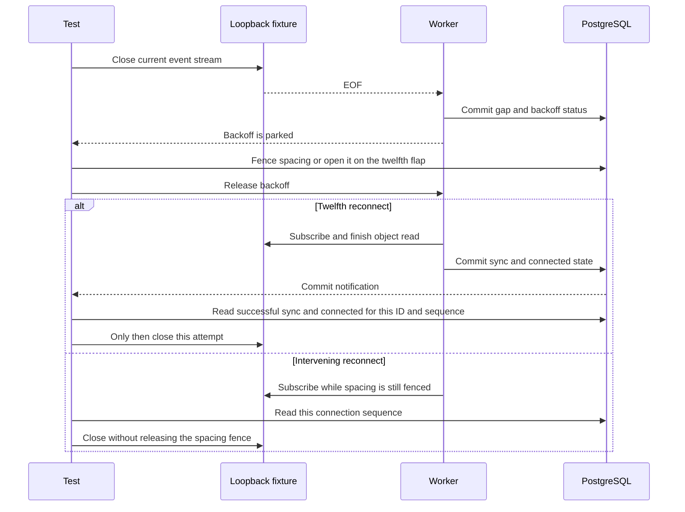

# Design

## Triage

| Trigger | Applies? | Evidence |
|---|---|---|
| T1 Components | No | Existing worker, PostgreSQL and fixture stay in place. |
| T2 State | No | No new product state or persisted format. |
| T3 Concurrency | Yes | Control I/O completion, reconnect and shutdown ordering across asynchronous tests. |
| T4 Boundaries | No | Same PostgreSQL and loopback TLS boundaries, no change to their contracts. |
| T5 Volume | No | Fixed test workloads and one coalesced change signal per observer. |
| T6 Risk | No | Test synchronization only. |

TIER: FULL

## Context

- `_until` busy-reads every condition under an independent five-second cap (`correlia_server/test/db/icinga2_stream_resync_test.dart:19-24`). CI failed at the `ready` call *inside* the flapping loop (`correlia_server/test/db/icinga2_stream_resync_test.dart:515-523`). Spacing is adjusted before the fake server closes the old stream (`correlia_server/test/db/icinga2_stream_resync_test.dart:509-514`), so the still-live old attempt can race to start the newly eligible sync (`correlia_server/lib/src/ingest/icinga2/stream/stream_holder.dart:415-432`).
- The 64-source two-worker case waits for headers and database connections but not for object queries before `stop()` (`correlia_server/test/db/icinga2_stream_stop_test.dart:499-525`). The consumer closes upstream TLS before waiting on dedicated database work (`correlia_server/lib/src/ingest/icinga2/stream/stream_holder.dart:155-173,384-390`). In embedded mode the dedicated database handles use Unix sockets (`correlia_server/lib/src/ingest/icinga2/stream/database.dart:21-44`), not TCP loopback. A consumer stop can therefore close first while the fixture is still sending TLS output; the fixture writes object bodies and its existing errno catch covers request handlers, not listener errors (`correlia_server/test/support/icinga2_consumer_loopback.dart:43-51,115-128`). The specific emitter of the historical CI exception is unconfirmed.
- The stop suite spins on `pg_stat_activity`, subscription counts and table counts and has elapsed assertions (`correlia_server/test/db/icinga2_stream_stop_test.dart:92-101,143-175,229-258,408-458,593-612`). Dedicated connection closure and Postgres locks and notifications can provide barriers instead.

## Decisions

### D1: Test waits observe committed changes and lifecycle events

- **Choice:** Use a dedicated connection to the test group’s embedded Postgres. Commit `LISTEN` before launching any writers; test-owned statement triggers publish on commit. Capture the next coalesced wake before each fresh predicate read. Stop the workers before removing the listener, triggers and their function. Park each ended attempt through `backoffScheduleForTest`; advance spacing only while parked. Use a finite future sentinel beyond the whole-test hang guard to close the window on intervening attempts, and backdate the latest start before releasing the twelfth reconnect. The sentinel is not a duration any assertion waits for; it cannot age into eligibility during a running test. On each twelfth reconnect await a successful completed read and `connected` status tied to that attempt’s connection ID and sequence. Assert 120 subscriptions, 119 gaps and 10 syncs. The direct database spacing test remains; it checks the gate independently of the live socket lifecycle.
- **Rejected:** A larger SQL poll budget; slow runners would still miss the per-step window.
- **Reversal cost:** low.
- **Important:** no; test-only observation and control of an established seam.
- **Chosen by:** agent.

### D2: Stop workers after there is no upstream response left to write

- **Choice:** Await all 64 initial `connected` rows joined to their successful completed reads and the fixture’s successful closes on both object routes. Give both supervisors the full target list. In test mode only, report each consumer's source ID and open future immediately when launched, before awaiting it, and signal successful acquisition-scan completion after the scan loop, not from `loadTargets` or an error return. After *both* expanded scans complete, await the recorded futures and compare cumulative opens and live sessions by `(holder, sourceId)` to all 64 lease rows: exactly one of each per leased pair, none per nonholder pair. Verify the TLS subscription queues cover those same 64 sources once. Then stop both workers concurrently before fixture teardown. Mark only the established event sockets about to be shut down; no remaining application traffic needs to write to them.
- **Rejected:** Ignore TLS errors broadly; that would hide broken fixture writes during ordinary startup.
- **Reversal cost:** low.
- **Important:** no; preserves real lease ownership, upstream connections and stop coverage.
- **Chosen by:** agent.

### D3: Prove shutdown ordering against database work still blocked

- **Choice:** For stalled admission, hold the Dart gate and transaction lock. For running SQL, lift the test transaction’s statement and lock timeouts; a single backend statement releases a session entry lock and then attempts a separate lock held by the observer. Acquisition of the entry lock proves entry; the SQL blocker stays held until shutdown interrupts the statement. In both cases, observe dedicated client closure, independently acquire the rolled-back transaction’s advisory lock, and check that its writes are absent and unrelated transaction work survives, all before releasing the Dart gate or SQL blocker. Only a generous whole-test hang guard bounds the awaits; production shutdown settings are unchanged.
- **Rejected:** Release the blockers before stop; that would stop testing cancellation of outstanding work.
- **Reversal cost:** low.
- **Important:** no; replaces the assertion mechanism, not production shutdown settings.
- **Chosen by:** agent.

### Decision summary

| # | Decision | Choice | Rejected | Reversal cost | Important | Chosen by |
|---|---|---|---|---|---|---|
| S1 | Integration boundary | Real TLS and DB | Longer per-step budgets or retries | Low | No | User |
| D1 | Readiness | Commit/fixture events and gated backoff | SQL polling | Low | No | Agent |
| D2 | 64-source shutdown | Sync and reconciliation barriers before stop | Blanket socket catches | Low | No | Agent |
| D3 | In-flight stop | Lock and connection completion barriers | Stop after work is released | Low | No | Agent |

## Assumptions

- **A1:** The precise emitter of the CI `Broken pipe` is unconfirmed; the CI log has no application stack. Decisions depend on the documented possible consumer-first cancellation of loopback TLS, not on attribution to a particular Dart SDK future.

## Carried constraints

- **C1:** Exercise real TLS loopback and the worktree’s embedded PostgreSQL. Kind: invariant. Destination: ADR 0014.
- **C2:** Await state changes and commits without per-step wall-clock deadlines. Kind: invariant. Destination: doc comment: `correlia_server/test/support/icinga2_test_db_changes.dart` `IcingaTestDbChanges`.
- **C3:** Surface transport errors outside deliberately staged peer shutdown. Kind: invariant. Destination: doc comment: `correlia_server/test/support/icinga2_consumer_loopback.dart` `IcingaConsumerLoopback`.

## Diagrams (FULL)

The test arms the database listener before the worker starts. A commit notification wakes a fresh predicate read.

## State & Ownership (FULL)

| State | Owner | Lifetime | Invalidation / rebuild | Authority |
|---|---|---|---|---|
| Change signal | Test DB listener | One test | Replace on delivery; close on teardown | PostgreSQL rows, not notifications |
| Backoff callback | Consumer scheduler until test releases it | One ended attempt | Cancellation drops scheduled resume | Worker state and committed connection sequence |
| Subscription readiness | TLS test fixture | One fixture | Count only after flushing headers | Loopback handler |

## Failure & Visibility (FULL)

| Component | Failure | Recovery / retry | Who finds out |
|---|---|---|---|
| Worker | Expected event never arrives | No retry; the whole-test guard fails | CI report |
| Fixture in the 64-source test | Request-handler, HTTP listener, header-flush, detached socket input or `socket.done` error | Each feeds the same first-error future, raced against readiness and checked on teardown. Only Linux peer-close errno on the particular established event socket marked for deliberate shutdown bypasses it. No retries. | CI report |
| Postgres | Write rolls back or connection closes | No notification for rollback; DB assertions see only committed rows | CI report |
| Test body | Assertion fails before gate release | `finally`/test teardown releases deliberate blockers and stops clients before closing the fixture | CI report |

## Resource Bounds (FULL)

| Resource | Bound | At the bound | Timeout | At 10x / 100x |
|---|---|---|---|---|
| DB observer | One signal and one predicate read in flight | Coalesce notifications, then read durable state | One generous whole-test guard | Notifications are still wakeups, not queued copies of DB rows |
| TLS and backoff | 64 parallel sources or 120 serial subscriptions; one flap resume at a time | Wait for the next specific event | Same guard | Fixed by test input, not runtime traffic |

## Flow & State Gaps (FULL)

- A DB write between subscription and initial query is covered by the initial read or the notification; a write during the query wakes the next read.
- A closed event stream must finish the old attempt before changing spacing. The next attempt cannot start until the test releases backoff.
- After fixture readiness, assert the exact durable outcomes. Header readiness alone is not equivalent to a completed sync.
- The successful acquisition and open observers are run-mode-gated. The next periodic reload does not prove a successful scan, and a missed async open could hide a duplicate consumer.

## Mechanism Ledger (FULL)

| Mechanism | Built? | Why |
|---|---|---|
| Test DB notifications | Yes | Another session commits the condition; there is no reliable same-isolate event for raw inbox and sync progress. |
| Run-mode-gated acquisition and open observers | Yes | After a successful acquisition scan, the test must know every launched asynchronous open, not just the ones that already finished. |
| Production callbacks for each DB assertion | No | Test LISTEN/NOTIFY already supplies a reliable commit barrier. |
| Test retries or error-wide socket suppression | No | Can hide both missing events and real peer or fixture failures. |

## Risks / Trade-offs

- DB notifications coalesce; therefore the predicates check durable conditions, never count signal deliveries as state transitions.
- A worker can drop its TLS peer during intentional cancellation. Do not use an expected peer-close allowance as evidence of a successful sync; the 64-source test verifies all known writes finished before stopping.

## ADRs

- In force: ADR 0014 (Linux CI and the worktree’s embedded Postgres only).
- To record during apply: none.
