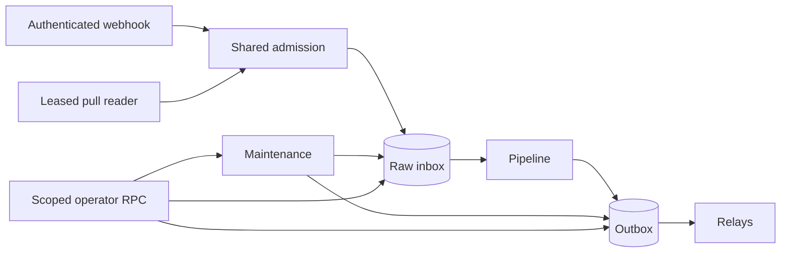
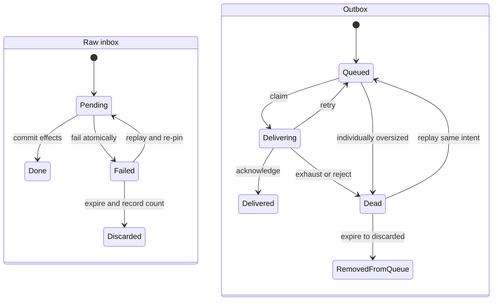
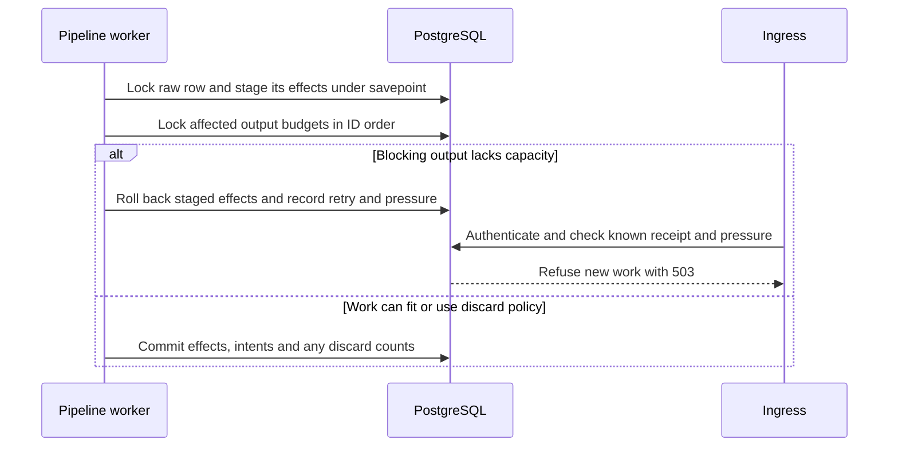

# Design

## Triage

| Trigger | Applies? | Evidence |
|---|---|---|
| T1 Components | yes | Webhook admission, pull readers, pipeline and relays share PostgreSQL. Add operator RPC and maintenance. |
| T2 State | yes | Raw and delivery rows gain replay and discard transitions. PostgreSQL stores capacity and maintenance outcomes. |
| T3 Concurrency | yes | Raw claims use `SKIP LOCKED` and relay completions check a live claim and lease. Replay and expiry contend with both. |
| T4 Boundaries | yes | Versioned configuration, generated RPCs and the offline partition migration bind later changes. |
| T5 Volume | yes | Retention must reclaim raw bytes, events and delivery evidence without draining work. |
| T6 Risk | yes | The service reads machine credentials, changes delivery state and deletes retained data. |

TIER: FULL

## Context

- See `proposal.md` for the M2 scope. ADR 0016 separates explicit pipeline replay from reprocessing and from immutable delivery replay (`docs/adr/0016-durable-staged-pipeline.md:113-130`). Its retention and budgets govern this design (`docs/adr/0016-durable-staged-pipeline.md:78-111,140-154`).
- Webhook admission checks the source and credential under transaction fences, resolves live duplicate/conflict reservations, and inserts the raw row in the same transaction (`correlia_server/lib/src/ingest/admission.dart:67-100,109-152`). Pull admission checks its committed batch receipt, config, lease and per-source retained work before writing (`correlia_server/lib/src/ingest/icinga2/stream/admission.dart:154-208`). Both pull readers already pause on `atCapacity` (`correlia_server/lib/src/ingest/icinga2/stream/stream_reader.dart:294-313,330-338`, `correlia_server/lib/src/ingest/icinga2/stream/sync_reader.dart:403-419`).
- The pipeline records the first pin under a shared active-snapshot row lock and processes only pinned, eligible pending rows (`correlia_server/lib/src/pipeline/pipeline.dart:363-399,410-420`). The existing savepoint encloses observation and output effects (`correlia_server/lib/src/pipeline/pipeline.dart:582-586,631-646,847-908`). Failure writes the raw failure record and marks the row failed in the same transaction (`correlia_server/lib/src/pipeline/pipeline.dart:1092-1124`).
- Icinga2 sync progress counts success and failure separately (`correlia_server/lib/src/pipeline/pipeline.dart:922-950,1125-1143`). Complete and failed sync runs are terminal; retained progress can later be removed (`correlia_server/schema/0009_icinga2_sync_finalization.sql:15-34`, `correlia_server/lib/src/ingest/icinga2/stream/supervisor.dart:291-297`). Tombstone reclamation currently includes pending rows in its horizon but not failed rows (`correlia_server/lib/src/state/tombstone_sweep.dart:60-76,110-123`).
- Relay completion uses original claim, lease and attempt identity; recovery counts interrupted attempts (`correlia_server/lib/src/output/output_relay.dart:504-527,539-578`). Publication bounds candidate, pinned-route and live output IDs together at 64 (`correlia_server/schema/0013_matcher_pins.sql:4-29`, `correlia_server/lib/src/ingest/config_repository.dart:216-230`). Output definition JSON participates in the plugin digest (`correlia_server/lib/src/pipeline/pipeline.dart:472-487`).
- `raw_inbox`, `events` and `outbox` start as regular SQL-owned tables with composite time keys (`correlia_server/schema/0001_ingest.sql:1-50`). Versioned SQL steps take a transaction advisory lock and commit their version with the changes (`correlia_server/lib/src/schema/schema_steps.dart:143-167`). The event-time function takes an `events` composite value (`correlia_server/schema/0004_icinga2.sql:10-17`). The raw cutoff uses a parent statement trigger with a transition table (`correlia_server/schema/0007_icinga2_reconcile.sql:38-54`). Both need explicit rebinding at cutover.
- Existing preview RPC access is limited to local development and test (`correlia_server/lib/src/endpoints/mapping_preview_endpoint.dart:10-24`, `correlia_server/lib/src/console/console_access_policy.dart:6-17`). The operator RPC uses a separate machine-credential check. The runtime starts ingest workers only in worker and all roles (`correlia_server/lib/src/ingest/ingest_workers.dart:49-59`).
- Change 6, `rule-simulator-and-classification`, runs in parallel. This change depends on merged change 4, not change 6. The offline cutover follows the schema versions already on `origin/main`, including Change 6's versions if it lands first.
- Manual Specwright branch gate, known issue `sh1ny/specwright#258`: the verified `sw` 0.39.1 interface-3 binary, the repo-local planning root, clean Orca feature branch and refreshed `origin/main` at `1bfa471` matched. `thanos-and-generic-webhook` was archived and this change name was not. The owner authorized keeping this already-created branch instead of switching the worktree to `main`.

## Decisions

### D1: Provision operator credentials on API replicas

Use `CORRELIA_DEAD_LETTER_CREDENTIALS_FILE` to point to a protected local file with machine IDs and SHA-256 digests of random 256-bit tokens. Absent file configuration disables the RPC. A malformed configured file fails startup without echoing its contents. Match Authorization bearer only; never accept a token in a URL or RPC argument. Rotate by deploying the updated file and restarting API replicas. The file identifies machines, not human operators.

The operator endpoint disables session logging. Handle denied and malformed requests with fixed errors rather than echoing headers or parameters. Prove redaction over HTTP with normal framework console and persistent logging enabled.

Rejected: a credential registry in published ingest configuration with live rotation. It couples operator access to source publication before the M4 access work. Reversal cost: medium. Important: yes, security boundary. Chosen by: user.

### D2: Re-pin raw replay without rewriting receipt or sync history

Replay all eligible, unexpired pipeline failure kinds under the active snapshot at request commit. Mark the pending raw row as a replay, advance its processing epoch and reset its processing attempt allowance. Preserve its body, receipt, IDs and Icinga2 admission origin. Classify reconcile behavior from origin, not from whether sync progress still exists. Never update or finalize original sync progress for a replay. If reconciliation stores no event, record its sanitized outcome in the ledger in the same transaction that removes the raw row and its origin.

Rejected: replay webhook and stream failures but require fresh sync for failed sync rows. Reversal cost: medium. Important: yes, changes what operators can recover. Chosen by: user.

### D3: Replay immutable delivery occurrences

A replay updates the original dead intent to queued. The last attempt number becomes the base of a fresh 20-attempt allowance; attempt numbers continue to increase. Normal completion and expired-lease recovery use attempts since that base for both exhaustion and backoff. Keep event and delivery IDs, bytes, pinned target and signing commitment. Refuse a missing webhook key or a replay that would exceed the 64-output live inventory. Do not acquire delivery capacity twice: a dead intent already consumes the output budget.

Rejected: replay only if the active output definition still matches. That would strand otherwise recoverable pinned destinations. Reversal cost: medium. Important: yes, delivery contract. Chosen by: user.

### D4: Publish shared limits and account for changes in PostgreSQL

Add optional `pipeline_operations` to the version-2 bootstrap document and immutable snapshot. Put optional `pending_max_rows`, `pending_max_age_seconds`, `disk_budget_bytes`, `disk_watermark_percent`, `raw_retention_days`, `event_retention_days`, `outbox_retention_days`, `dead_letter_retention_days` and `output_budgets` there. Each budget is keyed by output UUID and has optional `max_rows`, `max_payload_bytes` and `overflow_policy`. Reject unknown fields, invalid integers and budgets for outputs not in the candidate registry. Omit default values and empty objects in the canonical snapshot, so documents without this section keep their existing hashes. Do not put budget fields into hashed output definitions. The latest published policy controls work by output ID; a retired output retains its last policy while it has retained work or a pending pinned route.

The capacity writer counts queued, delivering and dead payloads; release occurs only when an intent becomes delivered or discarded. `discard_new` skips only intents that cannot fit and records their durable counts. `block_ingest` defers a raw transaction as a whole when it cannot reserve the required space. A publication must allow at least 1,000 intents per blocking output and 16 MiB of aggregate payload bytes. The raw member caps cover Alertmanager, generic and Icinga2 (`correlia_server/lib/src/ingest/alertmanager_decoder.dart:128-130`, `correlia_server/lib/src/ingest/generic_decoder.dart:13-14,80-85`, `correlia_server/lib/src/ingest/icinga2/stream/admission.dart:267-275`). The aggregate cap includes baseline copies and all successful matcher enrichment and added routes (`correlia_server/lib/src/pipeline/pipeline.dart:37-39,779-819,848-857`, `correlia_server/lib/src/matcher/matcher_evaluation.dart:189-210,226-250`).

Rejected: per-process settings and a soft cap for already accepted work. A worker and an API process could disagree, and the failed destination could grow beyond the declared limit. Reversal cost: high. Important: yes, persisted config, admission and data retention. Chosen by: user.

### D5: Attach existing heaps offline and partition new work by UTC day

Stop old roles before cutover. Attach each populated table under an initial historical range from `MINVALUE` to the first UTC midnight after its largest stored partition key. A fresh empty table needs no historical child. Prepare recent and upcoming daily partitions plus a default partition for valid timestamps outside those ranges. A write that targets the unclosed final historical day uses the historical child until midnight. Never block old accepted work merely because its receipt predates the prepared event partitions. Default rows receive the same bounded cleanup; the default partition itself is never dropped.

Rejected: copy all old rows into daily partitions, which needs a second copy of retained payloads and WAL during an offline upgrade. Reversal cost: high. Important: yes, populated schema and availability. Chosen by: user.

### D6: Route one Correlia-origin alert per overflow episode

Open an overflow episode on reaching a budget or refusing work for it. End it when the budget admits work again. Record the episode in the ledger and route a sanitized canonical alert to other active outputs with room. Never ingest or match the notice, change alert state, or raise a new episode for its delivery. If no output fits, the ledger and status RPC still show the episode. An event has either both existing sender raw key columns or one `system_activity_id`, never both or neither. The system event's `activity:` reference, digest and size describe a stored, sanitized evidence document. Event retention removes that reference; its document follows indefinite ledger retention.

Rejected: feed-only notices, which do not fulfill ADR 0016's delivery to other outputs. Reversal cost: high. Important: yes, externally observable event origin and routing. Chosen by: user.

### D7: Guard replay against reclaimed ordering evidence

Expire transport keys only after their window. Prune observation keys after the ADR 0024 age and only after comparing with the minimum receipt eligible for processing or replay and the durable admission cutoff. Extend the existing Icinga2 tombstone sweep horizon to include failed raw work. For pre-upgrade Icinga2 failures, preserve the old published cutoff minus the seven-day lateness horizon as a conservative boundary. Replay below that boundary counts as late per item. Later failures do not carry that old boundary. Evaluate timestamps with the existing effective-time logic and preserve original receipt/identity.

Rejected: refuse the whole pre-upgrade row if it could contain data below the boundary. This loses recoverable items in a mixed batch. Reversal cost: high. Important: yes, historical state correctness. Chosen by: user.

### D8: Expose protected status and disk readiness

Use the same protected RPC for inbox lag, disk pressure, output count and byte usage, overflow and discard counters, and the latest recorded maintenance outcome. The bounded output list puts blocking lanes first. Admission and status use the same pressure calculation. API and all-role readiness reports configured disk pressure without exposing details to unauthenticated clients. Workers continue cleanup under pressure. New ingress returns 429 for queue age or count and 503 for disk or blocking-output pressure. No Prometheus endpoint ships in this change.

Rejected: a separate metrics endpoint with a second access configuration. Reversal cost: medium. Important: yes, operator and demo contract. Chosen by: user.

### D9: Apply the shared pending count to raw replay

Raw replay reserves pending slots under the same lock as webhook and pull admission. Reserve one slot per successful transition. A full queue leaves unqueued failures and their ledger history unchanged and returns `inbox_capacity`; a batch can use the space available and report the rest as refused. Queue age alone does not prevent recovery.

Rejected: a separate allowance above the pending count cap. That would leave two limits on the same queue. Reversal cost: medium. Important: yes, externally visible refusal. Chosen by: user.

### D10: Require a compatible enabled source without rewriting origin

Before requeue, validate the binding against the active snapshot held through commit. Refuse a missing, disabled or incompatible source with `source_unavailable`, leaving the original failure and its expiry unchanged. For Icinga2 stream or sync evidence, select the decoder from trusted stored origin and format and use the admission-time stream policy. The new pin supplies mapping, namespace, matching and routing as applicable. Publication prohibits changing kind or mode for the same source UUID, even across disable and re-enable (`correlia_server/lib/src/ingest/config_repository.dart:318-350`). Reject inconsistent origin rather than using the webhook decoder.

Rejected: queue under an unusable binding and create a new failure instead. That spends a slot and changes the original failure's expiry without recovering work. Reversal cost: medium. Important: yes, externally visible refusal and preserved provenance. Chosen by: user.

### D11: Keep checks off growing payload tables

Maintain transactional live and pinned counts per output ID and an unpartitioned protected-outbox reference count keyed by full event identity. Use a compact indexed active-dead-letter directory for filtered pages. Select a bounded candidate page before testing protection or taking maintenance row locks. No request scans the backlog to check a budget, a live lane or a filtered failure.

Rejected: scan the payload queues under the active publication lock or walk a growing prefix of protected events on each maintenance tick. A timeout could repeat indefinitely. Reversal cost: high. Important: yes, persisted indexes and queue correctness. Chosen by: user.

### D12: Index historical delivery commitments

Extend D11's transactional counts with nonsecret `(reference, commitment, kind)` metadata and separate pinned and live counts. Publication imports use indexed lookups for supplied references. Worker startup still verifies every distinct live webhook commitment against authenticated stored bytes. Missing historical webhook material fails startup; plugin material remains a per-definition launch check.

Rejected: defer the startup check until relay claim. That would report a ready worker while previously accepted webhook work cannot deliver. Reversal cost: medium. Important: yes, security and startup behavior. Chosen by: user.

### D13: Make default-partition validation failure visible without stopping writes

Attempt to attach one empty UTC day per bounded transaction. The window includes today and the next seven days, so a failed attachment stays eligible when its day begins. PostgreSQL can scan the default child when validating the narrower range, even if an indexed probe found no row in the target day. On timeout, leave the partition map intact, record degraded maintenance status and retry on a durable schedule after bounded cleanup. Valid rows still reach default. There is no online preparation deadline. Offline repair uses the same range and occupancy checks, with all writers stopped and a maintenance-window timeout long enough for validation.

Rejected: extend the online DDL lock window until validation can finish. This could pause unrelated admission and processing under load. Reversal cost: medium. Important: yes, availability and operational fallback. Chosen by: user.

### Decision summary

| # | Decision | Choice | Rejected | Reversal cost | Important | Chosen by |
|---|---|---|---|---|---|---|
| S1 | Operator access before M4 | Opt-in RPC and dedicated machine credential | Development RPC and production CLI | medium | yes | user |
| S2 | Partition scope | Raw inbox, events and outbox; 7-day delivered-outbox default | Defer outbox partitions | high | yes | user |
| S3 | DUR-4 console scope | API in M2 and Change 9; console check in M4 | Interim read-only console | low | yes | user |
| D1 | Provision credentials | Protected digest file | Versioned credential registry | medium | yes | user |
| D2 | Raw replay | Active pin, original evidence and sync history | Require new sync for failures | medium | yes | user |
| D3 | Delivery replay | Original definition and bytes; fresh allowance | Active-definition match only | medium | yes | user |
| D4 | Shared policy | Published limits and strict transactional capacity | Local settings and a soft cap | high | yes | user |
| D5 | Partition cutover | Offline attach with daily and default children | Copy retained data by day | high | yes | user |
| D6 | Self-alert | Ledger plus budgeted Correlia-origin event | Feed only | high | yes | user |
| D7 | Ordering evidence | Retain through safe horizon; mark pre-cutover fence edge late | Reject whole pre-cutover row | high | yes | user |
| D8 | Status | Scoped RPC plus disk readiness | Separate metrics endpoint | medium | yes | user |
| D9 | Raw replay capacity | Same pending count reservation; no age-only refusal | Separate quota above cap | medium | yes | user |
| D10 | Missing or incompatible active source | Refuse without changing failure or its expiry | Create another failure | medium | yes | user |
| D11 | Bounded lookups | Transactional counts, indexed failures and bounded candidates | Scan payload queues | high | yes | user |
| D12 | Historical secrets | Indexed references, unchanged verification | Defer all validation to relay | medium | yes | user |
| D13 | Default validation | Bounded attempt, durable retry and documented offline repair | Longer online DDL lock | medium | yes | user |

## Assumptions

- A1. The new partition-parent transition triggers and legacy attachment preserve the existing cutoff, composite type use and indexed queries on the project's PostgreSQL version. Confirm in the fresh/populated schema tests, including a direct multi-row statement and the old cutoff race. D5 depends on it.
- A2. The generated Serverpod client can send the dedicated bearer header without enabling login or exposing it to framework logs. Prove it over HTTP on the pinned runtime before opening the RPC. D1 depends on it.
- A3. The pinned Serverpod runtime continues to fail readiness when PostgreSQL is unavailable. The tracked HTTP test describes that boundary (`correlia_server/test/e2e/health_e2e_test.dart:60-85`); rerun it with the new disk readiness indicator. D8 depends on it.

## Carried constraints

- C1. Automatic retry keeps its immutable pin; only explicit replay of failed rows can replace it. Kind: invariant. Destination: spec: specs/dead-letter-operations/spec.md → Requirement: Current configuration for pipeline replay
- C2. Delivery replay preserves the original definition and bytes, with new allowance but no reused attempt number. Kind: invariant. Destination: spec: specs/dead-letter-operations/spec.md → Requirement: Immutable delivery replay
- C3. The operator API does not replace M4 human access or provide a raw-payload read path. Kind: deliberate gap. Destination: ADR 0034
- C4. Expiry and its ledger discard count commit together. Kind: invariant. Destination: spec: specs/durable-pipeline/spec.md → Requirement: Atomic dead-letter expiry
- C5. Drop or defer at the output cap without bypasses or recursive alerts; do not reinterpret budget fields as a new plugin definition. Kind: invariant. Destination: ADR 0034
- C6. Keep ordering evidence during old replay, including the special pre-upgrade Icinga2 floor. Kind: invariant. Destination: spec: specs/durable-pipeline/spec.md → Requirement: Retention preserves retry and ordering evidence
- C7. Do not copy the old payload tables or demand a drained database. Kind: rejected alternative. Destination: ADR 0034
- C8. Keep the pressure/status API available for the M2 demo; no metrics endpoint or Flutter page in this change. Kind: deliberate gap. Destination: ADR 0034
- C9. Operator credentials come from a protected digest file and rotate by restart, not through ingest configuration. Kind: invariant. Destination: ADR 0034
- C10. Omitted and explicit-default policy values keep older snapshot hashes unchanged. Kind: invariant. Destination: ADR 0034
- C11. Retired outputs keep their last budget policy while retained work or a pending pinned route needs it. Kind: invariant. Destination: ADR 0034
- C12. Retention never reclaims protected raw or event work. Kind: invariant. Destination: spec: specs/durable-pipeline/spec.md → Requirement: Retention preserves unfinished pipeline work
- C13. Raw replay consumes the same pending-row allowance as new ingress when it moves to pending. Kind: invariant. Destination: spec: specs/dead-letter-operations/spec.md → Requirement: Bounded replay selection and audit
- C14. Replay requires a compatible active binding and keeps the original Icinga2 origin, never changing source mode. Kind: invariant. Destination: spec: specs/dead-letter-operations/spec.md → Requirement: Current configuration for pipeline replay
- C15. Capacity and filtered lookup work does not grow with the number of payload rows. Kind: invariant. Destination: ADR 0034
- C16. Historical signing material is validated through distinct commitment metadata, not a payload-table scan. Kind: invariant. Destination: ADR 0034
- C17. Default routing remains available if daily attachment times out; repair cannot shed work. Kind: invariant. Destination: spec: specs/durable-pipeline/spec.md → Requirement: Partitioned storage survives offline upgrade

## Diagrams (FULL)

T1: components and access.

T2: active versus terminal raw and delivery states.

T3: one accepted raw transaction when output capacity binds.

T4: cutover without a second copy of payloads.

## State & Ownership (FULL)

| State | Owner (sole writer) | Lifetime | Invalidation / rebuild | Authoritative copy |
|---|---|---|---|---|
| Admission policy | Config publication | Immutable snapshots; active pointer moves | Re-publish to change policy | PostgreSQL snapshot |
| Credential digests | API startup loader | Until process restart | Replace file and restart | Operator's protected file |
| Raw and pipeline failures | Raw state transitions: admission inserts; pipeline, replay and expiry coordinate through the raw key and processing epoch | Raw/dead retention windows | Never rebuild accepted raw work | PostgreSQL composite raw key and active failure metadata |
| Delivery and attempts | Output state transitions: pipeline inserts, relay claims/finalizes, replay and expiry require the same outbox-row status and lock | Outbox/dead retention windows | Lease recovery, not client reconstruction | PostgreSQL composite delivery key; attempt history |
| Attempt reclamation queue | Maintenance records a deleted terminal intent's full delivery key, then deletes attempts in bounded batches | Until its last attempt is removed | Durable queue resumes after interruption | PostgreSQL delivery key |
| Raw pending count and output usage | Queue transition accounting in the same transaction as the row changes | While there is current policy or work | Seed once in cutover, derive from authoritative rows for repair only | PostgreSQL counts; payload bytes are `octet_length(payload)` |
| Active lane and event-reference counts | Raw pin and output transition writers adjust their counts with the corresponding state change | For nonzero references; active policy rows may remain | Seed in cutover; no asynchronous invalidation | PostgreSQL output capacity rows and full event-key counts |
| Historical commitment references | Raw pin, relay and replay writers adjust counts with their lane changes | While a pin or live intent refers to the tuple | Seed in cutover; discard zero counts | Indexed PostgreSQL commitment metadata, never secret bytes |
| Partition preparation retry | Maintenance owns attempt sequence, target UTC day and retry outcome | Until attach or the day is no longer needed | Resume after restart; commit an outcome only for the current attempt | PostgreSQL retry state and catalog |
| Active dead-letter directory | Raw and output state owners add and consume entries under their corresponding work-row lock | One row per active failure occurrence | Seed in cutover; update with source transition | PostgreSQL indexed metadata and pointers to work keys |
| Retention continuation | Maintenance holds its transaction try-lock while selecting and advancing one candidate page | Until cursor wraps or its child disappears | Resume from last examined key after committed pages | PostgreSQL cursor per reclamation lane |
| Overflow demand, episodes and notices | Capacity writer changes demand and opens/closes episodes; maintenance consumes immutable notice occurrences with a claim | While demand or notice is live; permanent ledger evidence | Recheck then-current budgets, not a local timer | PostgreSQL capacity row, claim and ledger |
| Disk sample | A DB-serialized sampler called on demand by admission, status and readiness | One second freshness | Refresh using `pg_database_size(current_database())` | PostgreSQL sample and sample timestamp |
| Partition catalog and maintenance outcome | Worker maintenance; cutover seeds initial ranges | Until child drop; latest outcome plus ledger history | SQL-owned DDL and version lock | PostgreSQL catalog and status record |
| Dedup keys and tombstones | Admission, pipeline and tombstone sweep retain existing writers; maintenance deletes only under horizon fences | Until the time and safety bounds both pass | Never restore deleted ordering evidence | PostgreSQL keys and cutoff |

## Failure & Visibility (FULL)

| Component | Failure or interruption | Recovery | Retry safe? | Who finds out |
|---|---|---|---|---|
| Admission | DB error or pressure after claiming a transport key | Roll back reservation and raw insert together; pull pauses with its existing retained batch | Same ID returns prior committed outcome | Sender gets 429/503 and retry hint; status shows current reason |
| Replay | Timeout before commit or acknowledgement loss after commit | Check exact occurrence again; atomically consume only the old failure | Same occurrence cannot become a new replay | Authorized client gets counts and refusal; ledger identifies committed actor |
| Output reserve or finalization | Worker dies within the DB operation or while calling destination | Roll back uncommitted work; preserve live claim recovery | Same payload and IDs; remote acknowledgement ambiguity remains at-least-once | Durable attempts, pressure status and overflow notice |
| Overflow notice | Worker dies before marking notice handled | Claim again in a new short transaction | Event ID derives from the episode identity; one outbox effect set | Ledger is visible even if no output fits |
| Maintenance | Lock timeout or process stops partway through cleanup | Roll back that batch and record a sanitized failure in a separate bounded transaction; stop waits for the active batch | No expiry or drop without its commit | Last outcome in operator status; sanitized log if DB cannot record it |
| Cutover | Lock failure or DDL error | Startup fails closed; transactional DDL and version record roll back | Re-run once roles are stopped and lock is free | Sanitized startup failure names the schema step |

## Resource Bounds (FULL)

| Work | Bound | At the bound | Timeout | At 10x / 100x |
|---|---|---|---|---|
| Operator auth | 8 IDs of at most 64 ASCII characters; protected regular file at most 4 KiB; one 32-byte token, one bearer header | Invalid file fails startup; invalid credential is denied | Read local file once at startup; no network-based verifier | Request verification work does not grow with rows |
| List, replay and status pages | At most 100 result rows, no payload columns; one page per mutation transaction | Indexed keyset continuation; bounded rejection for invalid input | Statement and lock budgets within a five-second request DB budget | Each filter shape uses its matching B-tree prefix in the compact directory |
| Ingress | 30 s oldest pending age and 50,000 pending/processing rows by default; disk threshold 85% of configured budget; existing request body, rate and stream limits still apply | New requests retry; known receipts keep prior outcomes. Disk threshold absent when no budget was supplied. | One-second retry hint; bounded DB operation | Constant-time shared count, indexed oldest timestamp, one disk measurement per sample interval across roles |
| Output | 500,000 intents and 1 GiB of payload per output by default; 64 live output IDs; existing per-raw fanout and claim caps | Enforce first binding cap; defer or ledger discard; no network call in a budget transaction | Existing monotonic row/relay deadlines | Per-output accounting, not count or sum over a growing outbox; selection locks sorted by output ID |
| Retention and expiry | 30 d raw, 90 d events, 7 d delivered/discarded outbox and 14 d failure defaults; at most 500 candidates and 500 row mutations, or one child DDL operation, per transaction | Advance past protected rows; revisit on wrap | Two-second statement and lock budget per batch; worker exits between batches | Per-page work stays bounded even when every candidate is protected; fast drop requires an indexed proof |
| Partition preparation | Today and the next seven UTC days; one empty-day attachment under a try-lock | Degraded status and durable retry after DDL timeout; covered ranges stay usable and unmatched writes still go to default | Same bounded online DDL budget | PostgreSQL may scan default for validation; cleanup remains bounded, no automatic completion deadline, offline repair is documented |

Public configuration bounds all durations to positive integers. Disk budget must fit a signed 64-bit byte count, the watermark is 1–100 percent, and arithmetic must not overflow. Use DB time for maintenance, list expiry, disk samples and queue pressure; inject the time source at the test seam. The watermark is a measured database size, not a filesystem quota, and ordinary row deletion alone does not promise immediate space return.

## Flow & State Gaps (FULL)

### Admission and capacity ordering

Admission takes its existing credential or lease fences first. Resolve known transport outcomes before trying to reserve capacity. If a conflicting transport key disappears before its locked read, repeat the reservation under the same DB deadline. A key is live when its expiration is later than the request receipt, not the end of its body read. A refusal removes only the uncommitted receipt inserted by that transaction: it changes no existing receipt, commits no raw work and keeps any shared disk sample. Pull returns `atCapacity` without releasing its lease. Preserve the existing raw receipt cutoff and per-source retained-work cap. Only a newly queued replay uses replay time for queue age; its original observed time stays unchanged for events and retention. The pending counter tracks committed inserts and transitions into or out of pending or processing. Lock that row before admitting work and include the entire pull batch in the count check. Refusal, rollback or duplicate does not spend capacity.

Compare count and age under the admission counter lock. Read a bounded committed blocking-pressure view without taking output locks. A `block_ingest` destination blocks at exact saturation of either cap or when its remaining space cannot satisfy deferred demand. A racing output transition becomes visible to the next admission; already accepted rows use the strict output check. Compare database size using a shared sample row with a bounded fresh-or-refresh operation so an API-only deployment still checks pressure while workers are down. An unavailable sample under a configured budget refuses new admission and degrades readiness, without changing liveness. Keep the startup check (`correlia_server/lib/server.dart:51-56`, `correlia_server/lib/src/runtime/startup_state.dart:19-39`) and prove database readiness separately under A3.

Before writing intents, stage the bounded routed work in pipeline order. Lock affected capacity rows in output UUID order, reserve counts and bytes against the current policy, then insert only fitting intents. If any `block_ingest` output cannot fit its intents, roll back the effects savepoint. Lock the outputs affected by the current or previous deferral in the same order. Recheck capacity and replace that raw row's demand. Set a short next-attempt time on the still-locked raw row and keep its attempt count and pin. The output capacity row caches the maximum count and byte demands for its current overflow episode. Two indexes on the demand table find those maxima without reading payload rows or scanning the backlog. A raw row drops its demand when it leaves pending, even if it completes without writing an intent. `discard_new` records counts grouped by output within the raw transaction, not one ledger row per discarded intent.

Workers claim eligible pinned rows by their next attempt time, or their original receipt if no attempt is scheduled. Receipt and raw ID break ties. A row deferred again moves behind work that was already eligible. A partial index on pinned pending rows supports this order.

Only `block_ingest` records deferred demand. A policy switch or enough free space to satisfy all tracked demands resets the lane's demand and advances its epoch without changing retained usage. Prior demand records cannot block again and are removed or replaced the next time their raw rows run. Under `discard_new`, the first capacity update that puts usage below both caps closes the episode even if an earlier payload was too large for an empty queue.

A publication that lowers a blocking quota to current usage or below opens the overflow episode in that transaction. It needs no pending raw row. Repeating publication while the episode remains open does not enqueue another notice.

Lock raw or existing delivery rows first, then any needed active publication and ordered output capacity locks, then ordered event-reference keys, then sync progress if affected, then the raw count row if needed. A new sync admission does not lock existing raw rows. After its lease and source fences it locks open `icinga2_sync_progress` before the raw counter and keeps that progress lock through commit. Pipeline success and failure update progress before releasing raw count. Replay touches no progress. A transition that touches both capacity and pinned-route counts locks the union of affected output IDs in sorted order once.

Relay completion locks its existing outbox rows in ascending composite delivery-key order and checks every claim and lease under these locks before updating any attempts. Recovery already locks the parent intent first. Completion still rechecks the live lease at its final status update. Both apply a capacity delta in the same transaction. Publication reads inventory after taking its exclusive active pointer lock without taking existing queue-row locks. It acquires output capacity locks in UUID order and never waits for raw capacity while holding them. Ingress does not lock existing work or output capacity after the raw count.

One PostgreSQL capacity row holds each output's queued/delivering count and the number of pending raw pins whose base or matcher routes could use it. Compute each pin's distinct IDs from its immutable snapshot. Pin acquisition uses the shared active lock before creating references. Ending a pin decrements its route references and adds live intents in the same transaction. Claims and retries do not change live membership. Dead letters cease to be live; delivery replay adds live membership under the exclusive active lock. Index nonzero live or pinned entries by output ID. Publish and replay merge this indexed result with their registry and stop before ID 65. Seed once from retained rows at cutover; legacy work already over the live bound remains recoverable but cannot add lanes.

Build historical-secret evidence from the same pin-to-intent transitions. Pinning captures the distinct candidate webhook and plugin commitment tuples for the output definitions that can route the raw row. Live intent creation and completion move the corresponding references in the same transaction; delivery replay enters the live set only after its key and lane checks. Aggregate deltas by tuple across the transaction so a pin becoming an intent cannot disappear between scans. Take commitment locks in sorted identity order after event-reference locks and before sync progress or raw count. The publication lookup uses one statement over the compact view and an indexed join for each supplied reference. Worker startup walks distinct live webhook tuples in indexed pages, authenticates stored bytes and verifies each commitment in a consistent view under the publication fence. Its work is proportional to distinct commitments, not payload count; preserve the existing imported-reference verification and plugin startup distinction (`correlia_server/lib/src/ingest/config_repository.dart:401-448,477-501`, `correlia_server/lib/src/ingest/ingest_startup.dart:63-79`). Legacy counts are initialized from the old rows at cutover.

### Replay operations

Require one failure kind per filter. The directory stores kind, occurrence, scope ID, error class, failure time and full work key. Each raw or delivery failure gets a distinct monotonic occurrence. Add or remove the directory entry in the same transaction as the owning transition. Backfill at cutover. Use indexes for kind alone, kind plus scope, kind plus error, and kind plus both, each ending in failure time and occurrence. Keep sanitized raw details with the directory so listing does not touch payload tables. Sparse filters need no residual scan.

Validate the bounded cursor against kind and filter. Continue replay under a fixed upper failure-time bound. Bulk mutation selects a page, locks work rows in composite key order and rechecks occurrence, status and expiry. Apply successful changes in page order. The DB operations share one five-second monotonic budget. Cap each statement at the remaining budget and check it again before commit. A timeout rolls back the page and does not advance its continuation. Report queued and refused outcomes. Single replay identifies one occurrence, so retry cannot replay a later failure of the same work.

Raw replay locks the active snapshot in shared mode after locking rows and counts slots under the raw count lock. Refused occurrences are not removed, re-pinned or audited as successes. On success, advance `processing_epoch`. The worker carries its claimed epoch and matches it along with raw key, pin and pending status in the later error-recording transaction. Key local backoff hints by epoch too. This prevents a stale error from spending the fresh allowance even when the pin has not changed (`correlia_server/lib/src/pipeline/pipeline.dart:1025-1028,1160-1187`). Canonical generation remains 0.

Delivery replay serializes its historical-lane check with publication and other delivery replays under the exclusive active pointer lock, and checks the original webhook key against the configured store. No secret enters the reply and no remote I/O occurs in the transaction. Recheck at relay claim as before. Move only dead to queued, clear active dead fields and release no capacity.

Once replay holds the required capacity and commitment locks, it samples the clock and rechecks the failure window. Rows that expired during the wait stay failed or dead. They take no pending slot or live output ID from the rest of the page.

### Migration and reclamation

Keep the existing table names at the partitioned parents. Preserve columns, defaults, constraints, indexes, exact composite keys, and stored payloads. Rename legacy indexes to a distinct legacy prefix before creating parent indexes with the operational names; attach equivalent child indexes. Recreate the row-type helper against the new parent and bind the raw cutoff trigger to statements targeting it. Check the raw pending and retained-work indexes, event subject expression index, and outbox definition index on each child in the migration test. Test a parent-targeted insert spanning historical and daily children in which one receipt fails the cutoff; the entire statement must roll back. Complete all three attachments, state-column backfills and initial gauges in the version transaction. Newly dead intents store their failure time explicitly. For legacy dead or delivered intents derive the terminal time from the latest relevant attempt, or use migration time if none survives. Never infer past expiry solely from creation time.

The event-origin rule is an explicit exception to preserving legacy column nullability. Drop `NOT NULL` on `raw_observed_at` and `raw_id` on the old heap before attaching it; define the new parent with both columns nullable. Add `system_activity_id` on both and enforce the same exclusive-origin check before admitting writes: two non-null raw keys and a null system ID, or two null raw keys and a non-null system ID. Do not rewrite any sender payload to satisfy the rule. The cutover fixture routes a real overflow notice into the attached historical child and verifies the canonical reference, digest and byte count against its ledger evidence.

Maintenance takes a worker-scoped transaction try-lock for DDL. Before dropping a closed child, take an exclusive parent/child DDL lock with the short timeout and recheck the catalog, cutoff and protection predicates under it. Never detach before it is safe to drop. A fast drop is allowed only when there are no protected rows or related records to remove. Otherwise delete eligible raw rows with their `icinga2_raw_origin` rows in bounded keyset batches. For an eligible outbox row, delete the intent under its terminal-state lock and persist its composite key in the attempt reclamation queue in the same batch. Subsequent batches delete only attempts for retired keys and remove a queue entry after its final attempt. A long attempt history cannot stop the intent becoming reclaimable, and attempts are untouched while the parent is retained. Remove raw failures only via expiry or replay.

Reserve a drop candidate in a separate transaction before taking the DDL locks. A reservation puts the child behind other eligible children and sets its next retry time. If DDL rolls back, record the failure and renew the retry time only for the current attempt ID. Later children can still be dropped while that child is locked.

Track references by full event key in an unpartitioned table. The outbox writer increments on a new protected intent and decrements on delivery or discard. Dead-to-queued stays protected throughout. Remove zero counts. Retention checks the indexed keys without scanning outbox children. Fast-drop under the DDL lock needs indexed proof of age and no protected or dependent rows. Otherwise use per-row cleanup and drop the empty eligible child. Skip a planned daily partition if default rows already occupy its range.

An indexed default-child probe skips an occupied day. An empty result permits one bounded DDL attempt; PostgreSQL may still validate the default range. Under the DDL lock, reserve the attempt in a short transaction using a monotonic ID and key `(parent, day)`. Reacquire the lock and check that ID and the catalog before DDL. A successful attach clears the retry and records one affected partition in the same transaction. After a failed attach rolls back, reacquire the lock. Record the retry and failure outcome together only if the attempt is still current and the range is still missing. The outcome records zero affected partitions. A delayed failure cannot replace a newer result or recreate a deleted retry. A reservation with no outcome after interruption is eligible on the next scheduled pass. Partition degradation reflects outstanding, uncovered retry entries.

Finish the other retention lanes and do not spin on the same day. Retry after the scheduled time and bounded default cleanup. Pick an untried day before retrying an older attempt; include today until UTC midnight. If default already contains rows for that day, leave them there and let other days proceed. For offline repair, stop all writers, take the DDL lock, check the range against default and attach only if non-overlapping. Do not detach default or move protected rows to make the attach pass. Test an empty target in a populated default, an occupied target and a retry after midnight. Test the race where a second worker attaches the partition before the first logs its failed attempt.

Select a materialized ordered page of at most the candidate cap before following references or taking row locks. Only work from that page can change, including when protection or locking prevents removing some candidates. Advance the durable cursor from the last examined key at commit and wrap at the end. A protected prefix cannot hold up reclamation of the next page.

Batch expiry and raw, event and outbox reclamation take a nonwaiting share lock on the active retention policy before selecting candidates. A publication that holds the policy lock causes the batch to retry later. A batch that holds it keeps the same cutoff until commit.

Expiry selects and locks raw or delivery rows before removing the active failure marker, moving to `discarded` and recording the count. A replay that commits first leaves no old occurrence for expiry to remove. Age retention uses the stored receipt for raw/events and terminal time for outbox; a long-running delivery is not expired by its creation time. Use distinct bounded transactions for expiry, reclamation and old keys. For observation keys and tombstones, take the existing admission cutoff fence and read the horizon in a new statement, including both pending and failed rows. Keep keys that can match work at that horizon, including keys for retained event evidence that still participates in replay. Transport cleanup uses a non-locking read of the monotone admission cutoff and deletes only locked keys expired at or before both that cutoff and DB time. This keeps keys live for receipts that can still create rows. A raw receipt behind the cutoff can still acknowledge a known retained key, but cannot create new work if that key is gone. Keep the existing pull-batch receipt rules. Capture the pre-upgrade Icinga2 floor from `raw_admission_cutoff` once; it never advances on replay.

Worker maintenance advances the admission cutoff in its own transaction before deduplication cleanup. It uses the same one-hour rule and row fence as the tombstone sweep, even when Icinga2 targets cannot load.

Register maintenance in the worker/all subsystem lifecycle. It owns its session, stops scheduling or acquiring work once signalled, and awaits its active bounded batch before closing the session. A failed batch records its sanitized class only after the failed transaction rolls back, in a separate bounded transaction. No second work batch starts after stop, including after a failed active batch.

### Overflow alert delivery

Record a single episode-opening ledger occurrence before a worker tries to fan out its alert. On a bounded maintenance claim, lock the active publication pointer in shared mode from reading destinations through commit. Publication takes the exclusive lock before checking live output inventory, so a notice cannot add a historical live lane after that check. Construct a canonical CloudEvent with stable Correlia source and observation identity derived from the episode. Reference stored, sanitized ledger evidence. The event and fitting delivery intents commit with the handled marker in one transaction. Consider active output IDs in deterministic order and exclude the overflowing destination. Use the same capacity checks and count successful notice intents, including a notice that uses the last available slot. Suppress new episode creation for notice attempts themselves: a notice at exact saturation can block new ingress without recursively emitting another alert. The ledger covers the no-fit outcome; status does not claim a successful delivery.

## Mechanism Ledger (FULL)

| Mechanism | Built? | Reason | Evidence that would change the call |
|---|---|---|---|
| Transactional raw and per-output capacity | yes | Concurrent successful writers can otherwise overrun an enforced limit. Counting the whole backlog on admission would increase work with outage size. | Reconsider if storage is no longer shared among processes. |
| Failure occurrence ID and row-state recheck | yes | An RPC retry could otherwise replay a later failure or race expiry. | None while the API can mutate recorded failures. |
| Old ordering floor and cutoff-based evidence protection | yes | Old sync or stream replay can otherwise reopen an alert after its silent tombstone was reclaimed. | Revisit if alert ordering no longer needs tombstones. |
| Indexed lane, event and failure metadata | yes | Replay cannot hold publication open over a backlog scan, and maintenance must advance past protected prefixes. | Revisit only when another storage representation provides these lookups with the same bounds. |
| Full offline payload rewrite | no | Attachment preserves identity and avoids a temporary second payload copy. | Attachment cannot preserve constraints on the pinned database, or historical volume is small and an owner approves a new cutover plan. |
| Database-wide limit as a filesystem quota | no | The configured measurement is database size. WAL and table-space capacity still need operator headroom. | A later deployment feature has filesystem authority and can coordinate allocations. |
| Durable bulk replay jobs or new metrics listener | no | A bounded request with continuation and the protected status RPC cover M2 and the demo. | A later published client needs resumable unattended jobs or scrape integration. |

## Risks / Trade-offs

- A partition attachment or default overlap check can wait on busy tables. Stop all older roles for cutover, and use short runtime lock budgets. Use a populated fixture to prove byte-for-byte preservation and the raw cutoff trigger. No live mixed-version upgrade is supported.
- With `block_ingest`, pressure can last until a delivery succeeds or its dead letter expires. The API shows the blocking output and active limits. Strict deferral preserves work without turning it into a processing failure.
- Transactions that maintain exact counts add a short shared admission lock and ordered output locks. Verify contention with barriers and count operations, not elapsed-time thresholds.
- Attaching a large historical child avoids payload copying but cannot drop only part of the child. Maintenance deletes its eligible rows in bounded batches and drops the child once safe.

## ADRs

- In force: ADRs 0009 (machine identity), 0016 (staged pipeline), 0017 (ordering), 0021 (canonical v1), 0024 (retry identity), 0025 and 0027 (output fences), 0029 and 0030 (source admission), and 0032/0033 (versioned matcher and offline rollout).
- During apply, add ADR 0034 or the next available number after rebase. Record the scoped operator boundary, shared pressure and retention policy, offline partition cutover and Correlia-origin overflow contract as refinements of ADR 0016, without editing accepted ADRs. Update `openspec/architecture.md` and its ADR index with the same commit.
