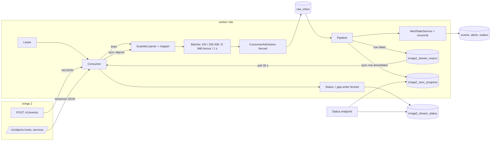
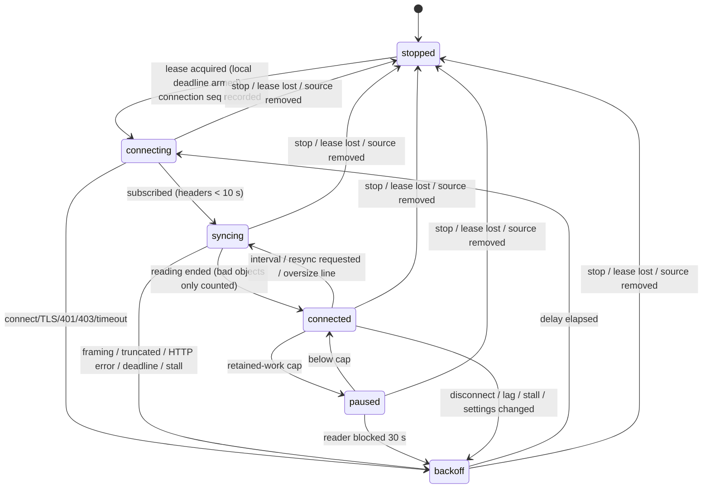

# Design

## Triage

| Trigger | Applies? | Evidence |
|---|---|---|
| T1 Components (new component, or 3+ with directed relationships) | yes | New consumer (HTTP client, line reader, sync reader, batcher, lease, status) feeding the pipeline through a new admission path; the alert-state service gains a reconcile input. |
| T2 State (persistent state, caches, 3+ state machine) | yes | New lease, status, gap and reuse-digest tables; a consumer state machine (`stopped`, `connecting`, `syncing`, `connected`, `paused`, `backoff`). |
| T3 Concurrency (background work, workers/isolates, async, retries) | yes | Long-lived stream read beside a sync, timers (lease renewal, flush, sync, lag, stall), takeover between processes, publication racing admission. |
| T4 Boundaries (data format, migration, shared interface, IPC, external) | yes | External Icinga 2 API, new configuration fields, a Serverpod migration, a stored raw-row format, a new status endpoint, new observation-key domains. |
| T5 Volume (grows without a fixed bound) | yes | Icinga 2 buffers events per client without limit; sync responses grow with the installation; raw rows and tombstones per source. |
| T6 Risk (security, money, data loss, unrecoverable user data) | yes | An API password and CA trust; a missed recovery leaves an alert firing; published event ids. |

TIER: FULL

## Context

The scope is in `proposal.md`. The three design-review rounds of `icinga2-ingest` that led to the split
(`openspec/changes/archive/2026-11-23-icinga2-ingest/review-history/round-{1,2,3}.md`) and this change's own
review round 1 are this design's acceptance input; the tables in "Review findings answered" map each finding to
its answer.

Current state that shapes the approach (paths under `correlia_server/`):

- **Admission is webhook-only.** `IngestAdmission.admit` takes a webhook `SourceCredential` and rechecks it
  (`lib/src/ingest/admission.dart:38-47`, `:79-99`); it locks the source row `FOR SHARE` and checks `enabled`
  and `kind` (`:67-78`) inside a transaction with 5 s statement and lock timeouts (`:58-66`). Its only
  production caller is the webhook route (`lib/src/ingest/ingress.dart:398`).
- **Publication serialises with admission** through exclusive row locks: it sets every `ingest_source` row
  `enabled=false` and upserts the published ones in one transaction under advisory lock 1129271884
  (`lib/src/ingest/config_repository.dart:122`, `:203-246`). Kind changes are refused (`:262-284`). Secret
  references are discovered in `lib/src/ingest/bootstrap.dart:338-370` and imported in
  `lib/src/ingest/config_repository.dart:314-409`.
- **Source model.** `SourceKind` is sealed (`lib/src/ingest/source_config.dart:51`, `:72-79`); the `icinga2`
  kind has no options and refuses Alertmanager-only fields (`:267-277`). Credentials are 32 bytes with a bare
  SHA-256 digest (`:298-303`). A source has at most 8 routes (`:310-314`), a file at most 64 sources
  (`lib/src/ingest/bootstrap.dart:310-313`). The secret import file caps one value at 16 KiB
  (`lib/src/ingest/bootstrap.dart:431-459`).
- **Webhook parser.** It refuses repeated members only at depth 1 (`lib/src/ingest/icinga2/webhook_parser.dart:228-260`)
  and reports `duplicate_field` and, for bad UTF-8, `invalid_json`.
- **Historical commitments.** `ingest_secret_commitment` receives output commitments, insert-only
  (`lib/src/ingest/config_repository.dart:186-246`); live credentials are in `ingest_source_credential`, replaced
  at publication; pinned webhook signing commitments are read from the outbox (`config_repository.dart:335-357`).
  Historical credential and signing-key digests also survive in the immutable snapshots' public JSON
  (`lib/src/ingest/source_config.dart:34-40`, `:112-126`; `lib/src/ingest/bootstrap.dart:163-171`), whose
  serialised source fields also determine the snapshot id; equal revisions with different content are refused
  (`config_repository.dart:135-150`).
- **Raw inbox index.** `raw_inbox` is indexed on `(status, next_attempt_at)` only
  (`correlia_server/schema/0001_ingest.sql:1-15`), so a per-source count of retained rows has no index today.
- **Commitments.** Bare SHA-256 for credentials and signing keys; keyed `hmac-sha256:` for plugin secrets, bound
  to the reference (`lib/src/secrets/commitments.dart:12`, `:43-44`), so a plugin commitment cannot be
  compared across references.
- **Pipeline.** Rows are pinned at first claim (`lib/src/pipeline/pipeline.dart:261-297`) and decoded by kind
  (`:687-702`), so every `icinga2` row reaches the webhook decoder today; the decoder gets one observed time per
  row (`:385-407`); one row is all or nothing (`:415-424`, `:618-628`); evidence is classified future, late or
  ready (`:32-45`); duplicates refresh freshness only when both are ready (`:480-489`); the budgets are 10 s per
  row, 16 MiB of canonical event bytes times fanout and 5 internal attempts (`:22-23`, `:547-555`, `:740-816`);
  `_fail` marks a row failed and keeps its body (`:704-738`); a late observation's key is inserted before effects
  (`:445-495`), so a late copy can take the event id of a prompt copy. Nothing removes `done` rows yet (change 7).
- **Alert state.** `OrderingKey.fromSource` clamps to observed + skew (`lib/src/state/ordering_key.dart:18-39`);
  `decideTransition` ignores `info`, marks older keys `Stale` and creates state on the first eligible observation
  (`lib/src/state/transition.dart:83-121`); a resolved alert is kept as a tombstone at least as long as the
  lateness horizon (`openspec/specs/alert-state/spec.md`, "Authoritative alert state per fingerprint"). There is
  no reconcile observation.
- **Icinga2 decoder.** Typed facts (`lib/src/ingest/icinga2/facts.dart:94-141`), one mapper with the
  `icinga2.notify.v1` key domains (`lib/src/ingest/icinga2/mapper.dart:15-28`), classification
  (`mapper.dart:33-47`), identity from the host and short service name (`mapper.dart:108-118`), one event per
  webhook decode (`decoder.dart:29`).
- **Workers.** `IngestWorkers` runs only in the `worker` and `all` roles
  (`lib/src/ingest/ingest_workers.dart:42`) and starts supervisor, pipeline and relay, stopping them in reverse
  (`:45-147`). No cross-process lease exists; the outbox lane uses a transaction advisory lock plus
  `lease_until` (`lib/src/output/output_relay.dart:286`, `:346-395`).
- **Console access.** The unauthenticated console endpoints call `ConsoleAccessPolicy.check`, which allows
  only local development and test use (`lib/src/console/console_access_policy.dart:6-19`,
  `lib/src/endpoints/alert_console_endpoint.dart:10-16`).
- **Capture tooling.** `tool/icinga2_capture.sh` runs official `icinga/icinga2:<release>` images and drives
  `correlia_server/tool/icinga2_capture/`; fixtures live under
  `test/unit/ingest/fixtures/icinga2/<release>/`.
- **Icinga 2 behaviour**, from reading upstream source at v2.13.0 and v2.16.6 (not yet confirmed by a capture;
  see A1):
  - `POST /v1/events` needs `types` and, before 2.16, `queue` (`lib/remote/eventshandler.cpp`).
  - Each request has its own inbox, an unbounded queue; a slow reader blocks the handler's write while producers
    keep pushing (`lib/remote/eventqueue.cpp`).
  - Headers are flushed before the first event. 2.13 to 2.15 send a close-delimited body, 2.16 a chunked one.
    There is no heartbeat.
  - Event `timestamp` is the emission wall clock as float seconds.
  - `StateChange` carries `check_result` with `execution_start`, `execution_end` and
    `vars_after = {state (raw ServiceState, also for hosts), state_type, attempt, reachable}`. Its top-level
    `state` is read live.
  - `ProcessCheckResult` rejects a result only when its `execution_start` is earlier than the stored one, but
    writes `last_state_change` from `execution_end` (`lib/icinga/checkable-check.cpp`). Hosts map raw OK and
    WARNING to UP and the rest to DOWN (`lib/icinga/host.cpp`).
  - Before 2.15 the signals fire after the object lock is released, so per-object event order is not
    guaranteed.
  - Objects queries have no pagination and refuse unknown attributes (400 before 2.16, a per-object error from
    2.16). `host_name` exists only on services; a service's `name` attribute is its short name.
  - A preliminary official-image probe returned 404 for a subscription missing `events/StateChange` on all
    four D16 candidates. For a host query, missing permission produced 404 on 2.13.14 and 403 on 2.14.10,
    2.15.7 and 2.16.6. The 2.13.14 denial body was identical to an authorized query matching zero hosts
    (`No objects found.`); an authorized zero-match query also returned 404 on 2.16.6.

## Decisions

Scope decisions S1-S5 are in `proposal.md`.

### D1: Ordering evidence is the check result's `execution_start`

- **Choice:** A stream `StateChange` and a sync object both yield a state observation built only from one check
  result: state and state type from `vars_after`, source time from `execution_start` (rounded down to whole
  microseconds, which is monotone, so it never inverts two results). The key is
  `["icinga2.check.v1", <state>, <state_type>, <start text>, <end text>]` (D17 for the time text, D9 for host
  state), so a stream event and a sync of the same result share an event id.
  - All state evidence of a stream source is then in Icinga 2's own acceptance order, and one fence orders it,
    so there is no cycle (round 3 Critical 1). A missed recovery is repaired by the next sync, whose last result
    is newer by start (round 2 Critical 1, round 1 Critical 1).
  - The guarantee covers results delivered to Correlia and applicable under the policy (a SOFT result skipped
    under `hard_only` is not one), when only this source writes the object's alert; a webhook source sharing the
    namespace writes the same fence (review round 3, Moderate 1).
  - The guarantee holds within limits that every source shares (ADR 0017): Icinga 2's clock within the
    accepted skew of Correlia's, so the clamp does not reorder, and the deciding result within the lateness
    horizon, and the deciding start at least 1 µs later than every other result's. Rounding down is monotone but
    not strict, so starts within one microsecond are equal starts (review round 2, Critical 1); distinct results
    with equal starts are outside the promise (D22). Checks of one object run one after another, so this needs
    passive results submitted with sub-microsecond start differences. Outside these limits, the clamp and lateness rules apply,
    and a sync that disagrees counts `diverged`, so the case is visible. Equal starts order by receipt time then event id. This is spec'd and documented, not hidden
    (review round 1, Critical 3).
- **Rejected:** `last_state_change` (written from `execution_end`, can regress); the emission `timestamp` (a
  sync has none, so sync would need a second rule that breaks transitivity); the live top-level `state` (on 2.13
  and 2.14 it can already reflect a later result); a per-source fence without the clamp (contradicts ADR 0017 for
  one source type, for a clock fault NTP prevents).
- **Reversal cost:** high (published event ids). The evidence is the upstream source cited in Context (A1); the
  captures are to confirm `vars_after` and the start rule on every release listed as supported, and a release
  whose capture disagrees is not listed.
- **Important:** yes (binds event ids).
- **Chosen by:** user (owner, 2026-11-23: "execution_start"). The stated limits were added after review round 1
  by the agent; they change no behaviour, only state ADR 0017's existing clamp and lateness rules for this source.

### D2: Reconcile observations confirm silently, repair, or leave a silent tombstone

- **Choice:** Sync objects are decoded as reconcile observations. Under the alert-row lock, the alert-state
  service runs the normal fence first. Then:
  - no alert and a resolved observation: a resolved tombstone holding the observation's fence, with no event,
    activity or intent, so an older problem processed later is stale (review round 1, Critical 1);
  - no alert and a firing observation: an ordinary applied observation;
  - stale: `last_observed_at` only, counted `stale`, and `diverged` on the sync when the state differs;
  - a duplicate (its key exists): the duplicate path as today, which only refreshes `last_observed_at`, and
    `diverged` on the sync when the alert disagrees with it, read under the alert lock it already takes
    (review round 5, Critical 1);
  - late or future-dated: counted, not stored, and `diverged` when it disagrees (D18);
  - newer with equal status and severity: the fence and `last_observed_at` advance, with no version, activity,
    event, observation key or intent;
  - newer and different: an ordinary applied observation, stored, keyed and routed.

  The silent writes commit in the transaction that processes the raw row (the alert-state single-writer rule is
  amended for this). Every state observation, reconcile ones included, reserves its observation key before it
  locks its alert, as today (`pipeline.dart:445-495`); a reconcile observation that then stores no event
  (confirm, tombstone or stale; late and future items reserve none) deletes its reserved key in the same
  transaction, so every reservation either keys a stored event or is gone at commit (review round 7, Critical 1). One lock order, key then alert, holds for stream and sync rows, so
  two copies of one result never wait on each other in opposite orders; the deletion leaves no key behind
  (review round 3, Critical 2).

  A silent write (confirm or tombstone) sets the fence with its own effective time, like any observation, and
  only when it passes the fence, so a fence never moves backwards. Distinct results with equal starts are
  outside the convergence promise (D22): a sync copy can then decide between them, and the next disagreeing
  sync counts `diverged` (review round 3, Critical 1; round 4, Critical 1). A tombstone fences every older
  start.

  A silent write keeps no key, so a later copy of the same result is a first delivery: it reaches the same
  status, severity and fence source time, and only the fence's observed time can differ by order (D28; review
  round 6, Critical 1).

  Every sync item whose state differs from its alert's once it is processed counts `diverged`, whatever its
  outcome, except a `soft_info` item. A stale *stream* observation is stored with its `stale` outcome but routed
  to no output, so an output never sees a firing event the alert never took (D25).

  A late or future-dated stream or sync item is classified by its time before any key lookup: it is counted
  `late` or `future_dated` even when its key exists, writes nothing, and reads the alert without a lock only to
  count `diverged` (D18). An hourly sync of a steady installation writes only fence updates and tombstone
  refreshes.
- **Rejected:** Publishing every sync object (thousands of events per sync); dropping matching objects without
  advancing the fence (a later, older stream event could then win against confirmed state); writing nothing for
  an OK object with no alert (a delayed older problem then fires a false alert until the next sync).
- **Reversal cost:** medium (stored outcomes and what outputs receive).
- **Important:** yes (changes what users see).
- **Chosen by:** user (owner, 2026-11-23: "Confirm silently"; tombstone for no-alert recoveries: owner,
  2026-11-23, "Silent tombstone", after review round 1)

### D3: Sync after every subscription and every `sync_interval_seconds`

- **Choice:** The consumer subscribes first, so later changes are already flowing through the stream, then
  syncs hosts and services while it keeps reading the stream. It syncs again every `sync_interval_seconds`
  (default 3600), on a resync request (D12) and after an oversize line. Hosts and services use separate
  attribute sets:
  - hosts: `name`, `last_check_result`;
  - services: `name` (the short name), `host_name`, `last_check_result`.

  The service identity is `host_name` plus `name`, the same values a `StateChange` carries as `host` and
  `service` and the webhook mapper uses (`mapper.dart:108-118`). A capture test checks that one real service's
  stream and sync observations of one source give the same fingerprint and event id. A webhook source in an
  explicitly shared namespace shares only the fingerprint: its observation key domain (`mapper.dart:15-28`) and
  source instance (ADR 0021) differ, as S1 intends (review round 6, Moderate 6). Both requests send `X-HTTP-Method-Override: GET` with a JSON body
  naming `attrs`, so an unknown attribute fails loudly on every release (round 3 Critical 4).

  The response is parsed incrementally: a byte scanner tracks JSON string and nesting state and cuts each
  element of `results` before parsing it with the guarded parser. A bad element does not stop the reading, so
  a persistent bad object never hides the objects after it (review round 2, Critical 7). A bad object is never
  admitted (D20): a well-framed element that fails validation is counted `invalid_object`, an element with an
  error code (2.16) `object_error`, a fully framed element over 1 MiB (scanned without its payload)
  `object_too_large`; the sync keeps the identifiers and codes of the first 20, logs those 20 and one summary with the counts (review round 7, Moderate 6), and ends `failed`. An
  identifier is the host and service name only when both were read as valid names of at most 255 bytes without
  control characters; otherwise it is the position `results[<index>]`, so the log and status never carry
  unvalidated text, and the sample is at most 20 × 600 bytes (review round 4, Moderate 3).

  Recovery needs framing the scanner can follow. An unterminated string or unmatched bracket leaves
  no reliable next element, so it ends reading as `invalid_framing`. Structural framing tracks at
  most 1,048,576 simultaneously open containers per result element. Attempting to open another
  also ends the read as `invalid_framing`, even if the element would eventually close correctly.
  Ordinary oversized elements at or below this nesting ceiling are counted and skipped without
  retaining them. Important: yes. Chosen by: user during apply to bound framing memory without disk spill.
  Count the result element's own container but not the envelope. Beyond the byte limit discard the
  payload and keep checking string state and bracket types. A mismatch or depth violation is
  `invalid_framing`, not `object_too_large`; report it before stopping or reconnecting.
  A truncated response, HTTP error, or deadline likewise closes the connection; rows already admitted
  still apply. HTTP 403 is `forbidden`;
  HTTP 404 is `http_status`, including a response that says no objects were found. Do not inspect the
  error body to infer permission or treat an ambiguous 404 as a successful empty projection. The status
  exposes the bounded class, and the setup docs warn that a genuinely empty host or service collection
  can keep the sync degraded. A sync that ends at the deadline records the last object it read, and the
  status counts consecutive timeouts, so an installation that cannot enumerate within 15 minutes is visible.
  Memory is bounded by one object, one batch, and a bracket stack of at most 1 MiB plus constant framing state.
  The whole sync has a 15-minute deadline and a 60-second read-idle deadline.
- **Rejected:** Sync on connect only (a missed event on a healthy connection is never repaired); an idle
  timeout as a liveness probe (quiet sites would reconnect constantly); decoding the whole response at once
  (memory grows with the installation).
- **Reversal cost:** low.
- **Important:** yes (changes behaviour and adds a setting).
- **Chosen by:** user (owner, 2026-11-23: "Connect + hourly"; during apply, keep all four candidates and fail
  closed on ambiguous 404 rather than claiming empty sync success).

### D4: A lease row with generation, fenced at every write

- **Choice:** A Serverpod-managed `icinga2_stream_lease` (`sourceId` unique, `holder`, `generation`,
  `expiresAt`).
  - **Create:** the consumer inserts the row at generation 0 with `ON CONFLICT DO NOTHING` before acquiring.
  - **Acquire:** in one transaction, `ingest_source FOR SHARE` (enabled, mode `event_streams`), then one
    conditional `UPDATE … SET holder = $me, generation = generation + 1, expiresAt = clock_timestamp() + 30 s
    WHERE sourceId = $s AND expiresAt <= clock_timestamp()`; the source-then-lease order is the one the
    retirement sweep uses (D12; review round 7, Moderate 1).
  - **Renew:** every 10 s, `… WHERE holder = $me AND generation = $g AND expiresAt > clock_timestamp()`. An
    expired lease is never renewed, only acquired again with a new generation, which records the ended
    connection's gap first.
  - **Local deadline:** the holder closes its Icinga 2 connections 20 s, by its own monotonic clock, after it
    *sent* the acquisition or renewal whose success it last received, so a late acknowledgement cannot extend it
    past the lease (review round 2, Critical 5); also when the database is unreachable. The acquisition arms the
    deadline, so a holder that loses the database before its first renewal still closes (review round 3,
    Critical 7). A success received after the deadline passed reopens nothing: the holder treats the lease as
    lost and acquires it again, with a new generation, before connecting. A frozen process cannot do this; it closes on
    resume, and its writes are refused. The spec therefore promises one durable writer, and one open connection
    except while a process is frozen.
  - **Fence:** the consumer admission transaction (D5) and every status write lock the lease row `FOR SHARE` and
    require `holder`, `generation` and `expiresAt > clock_timestamp()`. A takeover's `UPDATE` waits for
    in-flight writers, and an old holder's later write is refused (`lease_lost`; round 1 Critical 3). The write
    boundary is therefore the grant of a newer generation, not the expiry instant: a transaction that passed the
    check before expiry may commit after it, and the acquisition waits for it. The spec states this.
  - **Retire:** when the source is removed or disabled, the holder records `stopped` (fenced by the lease only)
    and releases the lease (`expiresAt = clock_timestamp()`). The rows stay, so a re-enabled source continues
    the generation.
- **Rejected:** A session advisory lock on a dedicated connection (writes on pooled connections are not fenced,
  and a dropped connection loses the lock silently).
- **Reversal cost:** medium (stored table).
- **Important:** yes (binds a stored format and the multi-instance contract).
- **Chosen by:** user (owner, 2026-11-23: "Lease row + generation"). Create, no-renew-after-expiry, local
  deadline and retire were added after review round 1 by the agent; they complete the chosen mechanism.

### D5: Consumer admission is a separate, fenced path storing lines as read

- **Choice:** A new `ConsumerAdmission.admit(sourceId, leaseGeneration, revision, rows)` runs one transaction on
  the consumer's own database connection (D13):
  1. `SET LOCAL` statement and lock timeouts of 2 s and `idle_in_transaction_session_timeout` of 5 s;
  2. `ingest_source FOR SHARE` (`enabled`, `kind = 'icinga2'`, `mode = 'event_streams'`);
  3. `ingest_active_config` revision equals the consumer's;
  4. the lease row check (D4);
  5. the raw inserts.

  Publication updates `ingest_source` before `ingest_active_config` under exclusive row locks (Context), so an
  insert either commits wholly before the new revision or is refused `config_changed` (round 2 Critical 3).
  Raw rows carry no transport key. Instead each batch carries a consumer-generated batch id (UUID), inserted into
  `icinga2_admitted_batch(sourceId, batchId)` (unique) in the admission transaction. A retry of a batch whose
  commit outcome is unknown conflicts on that row, inserts nothing and reports the batch committed, so no raw row,
  failed slot, resync request or `rowsAdmitted` increment repeats (D27; review round 5, Moderate 3). The
  retry first looks the batch id up, before the cap, revision and lease checks that gate new inserts, so a
  committed batch is reported committed even when the cap is now full or a newer revision is active; only a
  batch not found is inserted, through those checks (review round 8, Moderate 1). The supervisor deletes batch
  ids older than one hour for every source, held or not, so a removed source leaves none
  behind; a retry follows its failure within seconds (review round 6, Moderate 2).

  The same transaction writes `icinga2_raw_origin(rawId, origin, syncId, admissionSnapshotId)` for each row. Every failure path of a
  consumer row, the pre-decode refusals (`source_not_configured`, `unsupported_kind`, `unsupported_format`) and
  retry exhaustion through `_recordError` included (`pipeline.dart:339-355, 740-785`), reads this record by raw
  id, never the body or the pinned source. A failed sync row adds `rowsFailed` to its sync and raises no request;
  a failed stream row raises `requestSeq`; both in the failing transaction (D29; review round 6, Critical 3). The
  record is deleted with its raw row (D19) or kept with it.

  The raw body is `{"format":"correlia.icinga2.stream.v1","origin":"stream"|"sync","connection":<uuid>,
  "sync":<uuid>?,"items":[{"received":<µs>,"line":<text>}|{"received":<µs>,"line_b64":<base64>}]}`. Each item
  holds the line after redaction, its original receipt, and an optional consumer-written `invalid_json`
  flag. The flag preserves the original lexical verdict for malformed JSON or invalid UTF-8 even when the
  sanitized bytes happen to parse (D31). The pipeline rejects a flagged item before parsing the line;
  unflagged items still use the shared guarded parser. The pipeline decodes the row by `format`, not kind.
- **Rejected:** Reusing `IngestAdmission.admit` with a synthetic credential (it rechecks webhook credentials,
  and a fake credential would weaken that check); storing parsed JSON values (loses the inputs it must show);
  a per-row lease column (the lease is per source, not per row).
- **Reversal cost:** medium (stored raw format).
- **Important:** yes (binds a stored format).
- **Chosen by:** user (owner, 2026-11-23: "Separate path, raw text", after review round 1)

### D6: Validation in the consumer, isolation by row, bounds by encoded and fanout bytes

- **Choice:** The consumer runs the pipeline's stream parser and mapper on every line, which also gives each
  item's canonical event size. The stream parser refuses repeated and unknown members at every depth, not only at
  depth 1 as the webhook parser does, reporting `duplicate_field` and `unknown_field`; bad UTF-8 is `invalid_json`,
  as for the webhook (review round 2, Moderate 5). Field paths are kept as a list of segments and rendered after
  redaction: a segment is written by name only when it is a member the capability defines at that position, and
  as `*` otherwise, so a sender-chosen name never reaches a stored failure, even one that looks like a path
  (review round 3, Moderate 4; the structural rule of `icinga2-ingest` D9, carried to stream fields). Valid items go into the current
  batch, cut at the first of:
  - 100 items;
  - 256 KiB of encoded row body;
  - canonical event bytes × 9 over 8 MiB, half the pipeline's 16 MiB fanout limit. The pipeline charges one
    payload plus one per routed output (`pipeline.dart:547-555`), and routes are chosen at first claim, so the
    consumer uses the 8-route maximum, never its active routes (review round 2, Moderate 1);
  - 1 s after the first item.

  An item that alone exceeds 256 KiB (at most 1 MiB, the line limit) is admitted in a row of its own. An invalid
  line is admitted alone, so it fails visibly with its field error and its neighbours commit (round 3 Critical
  5, round 2 Critical 5). A line over 1 MiB is skipped to the next newline without buffering, counted in
  `oversizeLines`, and requests a sync. One batch is in flight at a time. That a full batch fits the 10 s row
  deadline is not assumed: a load-tier test runs worst-case rows (100 maximum-size items, 8 routes) against the
  embedded Postgres and the item cap is lowered if it does not fit (review round 1, Critical 5).
- **Rejected:** One row per line (100 k rows per sync); batching without pre-validation (one bad line fails the
  valid recovery beside it); bounding by raw bytes alone (canonical events can be larger than their input).
- **Reversal cost:** low.
- **Important:** no.
- **Chosen by:** agent

### D7: Retained work, read stalls and lag are bounded

- **Choice:**
  - **Retained work:** before each flush the consumer counts the source's `pending` and `failed` raw rows
    (`LIMIT max_pending_rows + 1`) and stops reading while the cap is reached. Counting failed rows bounds what a
    persistent fault can leave behind until change 7's replay and retention take over (review round 1,
    Critical 6; round 2 Critical 4). A schema step adds a partial index on `raw_inbox (source_id) WHERE status IN
    ('pending', 'failed')`, so the count visits only this source's retained rows (review round 3, Moderate 2).
  - **Read stall:** a timer independent of event receipt closes the connection (`backpressure`) when the reader
    has been kept from reading for 30 s: paused at the cap, or waiting for an insert or the in-flight slot. Waiting
    for data on a quiet connection does not count (review round 2, Moderate 5). The stream is read while a sync
    runs.
  - **Storage:** sync rows that stored nothing are deleted (D19). Kept rows (stream rows, sync rows that stored an
    event, failed rows) grow with stored events, as webhook rows do, with no limit of their own until change 7's
    database-size watermark; this is a documented exception to ADR 0016, not a bound (D21; review round 3,
    Critical 5).
  - **Lag:** each event's lag (receipt minus Icinga `timestamp`) is compared with the smallest lag seen on the
    connection. An excess above 60 s that lasts 120 s closes it (`lag`), which catches sustained production above
    drain rate made of many short pauses (round 3 Critical 6). The first events set the baseline; a baseline set
    late only lowers over time.
  - **Residual risk (D24):** these rules close a consumer only once a measured trigger persists (a 30 s reader
    stall, or 120 s of excess lag above 60 s); a consumer whose excess stays under 60 s while input matches drain
    stays connected and behind (review round 6, Moderate 3). They do not bound the memory Icinga 2 uses for its
    per-client queue, which Icinga 2 itself does not limit (A1). A backlog
    queued before the first line, or a burst shorter than the lag window, is read at full speed and is seen only
    by the cap and the stall rule. The documentation states this risk and the drain rate in events per second that
    the load test measures (review round 4, Critical 5).

  Closing drops Icinga's per-client queue, and the reconnect sync repairs state. Change 7's global ingest budget
  later adds one more pause reason at the same check.
- **Rejected:** An absolute lag threshold (a constant clock offset would disconnect forever); pausing without a
  limit (moves the backlog into Icinga 2's memory); counting pending rows only (failed rows grow without bound).
- **Reversal cost:** low.
- **Important:** yes (adds the `max_pending_rows` setting, S3).
- **Chosen by:** user (owner, 2026-11-23: S3 "Own bound now"; settings "Two settings"). Counting failed rows and
  the stall timer were added after review round 1 by the agent, within the owner's S3 choice.

### D8: TLS, credentials and password reuse

- **Choice:** The client is `dart:io` `HttpClient` with:
  - `findProxy = 'DIRECT'`, `followRedirects = false` and no `keyLog`;
  - a `SecurityContext(withTrustedRoots: false)` loaded with the CA bytes via `setTrustedCertificatesBytes`,
    TLS 1.2 or newer, and the default host name check;
  - a `connectionFactory` that sets `SO_KEEPALIVE`, a 60 s keepalive idle time, 10 s probe intervals and 6
    probes (A3);
  - basic authentication sent only after the TLS handshake to the configured host.

  Tests cover a public-CA certificate, a configured-CA certificate for another host, a redirect, and hostile
  `SSL_CERT_FILE` and `https_proxy` values.

  The password (1 to 1024 bytes) and the CA (at most 16 KiB, the importer's existing cap, round 1 Moderate 2) are
  `{bytes}` secrets with the keyed plugin commitment (ADR 0028). For `password_reuse` (round 3 Critical 7, round
  2 Moderate 3, review round 1 Moderate 1), an append-only `secret_reuse_digest` table keeps:
  - the bare commitment of every bare-commitment secret ever published (credentials, signing keys, historical
    pins). The live table does not hold them all (Context, historical commitments), so before the first password
    publication a backfill reads every stored `ingest_config_snapshot`'s public JSON (credential and signing-key
    digests), every `ingest_secret_commitment` row and every `ingest_source_credential` row, inserting each
    digest once (`ON CONFLICT DO NOTHING`). Every historical public format is read: format 1
    `sources[*].token_digest`, format 2 `sources[*].credentials[*].digest`, webhook output signing digests, and
    plugin `outputs[*].secret_refs` commitments that are bare SHA-256 (no `hmac-sha256:` prefix), as the tracked
    fixtures hold them (`secret_store_e2e_test.dart:185-207`, `fileless_worker_test.dart:120-203`; review round
    5, Critical 3). Outbox pins need no pass: the pipeline copies each outbox row's signing commitment from the
    output definition of the snapshot the row pins (`pipeline.dart:360-372`, `config_snapshot_id NOT NULL`,
    `schema/0001_ingest.sql:30-50`), and no code deletes or rewrites a snapshot, so the snapshot pass covers every
    pin; a database test checks that every distinct outbox commitment is in its pinned snapshot (review round 6,
    Critical 2). Its boundaries are fixed by the schema step under the publication lock (D26): the active
    revision and the highest serial `id` of the commitment and credential tables. It runs at startup in three
    passes (snapshots by revision, then commitment rows and credential rows by `id`), each in batches of 500 rows outside the publication lock, each with its own mark in one `secret_reuse_backfill` row that only
    advances, in the batch's transaction. The transaction of the last batch of the last pass sets `complete`, the
    one completion condition. A password publication fails `reuse_inventory_pending` until `complete` is set
    (review round 5, Moderate 2). Every publication after the step comes from this release or newer (D23), which inserts its own
    digests, so no catch-up at publication is needed (review round 2, Critical 8; round 3, Moderate 5; round 4,
    Moderate 2);
  - the cutover installs a `BEFORE UPDATE OR DELETE` row trigger on `ingest_source_credential`.
    For rows at or below the cutover's credential-id boundary it inserts the old digest transactionally
    into the append-only `secret_reuse_retired_credential` set. Credential replacement thus cannot erase
    an unread digest. The backfill never writes that set; password lookup probes both sets by digest.
    Publication and backfill each insert their entire batch into `secret_reuse_digest` in the same
    `(kind, digest)` index order. Thus overlapping batches cannot form a unique-index lock cycle,
    and trigger order does not matter. The three bounded passes remain outside the publication lock.
    Important: yes. Chosen by: user (apply, credential deletion race and concurrent digest inserts).
  - a reuse digest of every password ever published: HMAC-SHA256 under the commitment key over the domain
    `correlia-password-reuse-v1` and the bytes, with no reference, so it is never a bare digest.

  Publication compares each new password's SHA-256 with every bare commitment, and each new bare-commitment
  secret's reuse digest with every password reuse digest, candidates of the same publication included.
  Publication resolves the password bytes for this check only.
- **Rejected:** System roots (Icinga 2 uses its own CA); comparing the plugin commitments (bound to the
  reference, so equal bytes under two references are not seen); checking only current secrets (a removed
  password's bytes could later appear under a bare commitment).
- **Reversal cost:** low.
- **Important:** yes (binds the secret contract, S4).
- **Chosen by:** user (owner, 2026-11-23: S4). The reuse table and digest were added after review round 1 by the
  agent, to meet the owner's rule.

### D9: Host normalisation and status mapping

- **Choice:** For a host, raw `vars_after.state` 0 and 1 map to UP, 2 and 3 to DOWN, and DOWN with
  `reachable: false` to UNREACHABLE (round 3 Moderate 3). Services keep OK, WARNING, CRITICAL, UNKNOWN. Any
  other value (2.16's Pending 99 included) fails `invalid_state`. Status and severity reuse the webhook mapping
  (UNREACHABLE is `critical`, `icinga2-ingest` D7), and the summary reuses its projection (object and state
  only).
- **Rejected:** The live top-level `state` (not coherent with the check result on 2.13/2.14).
- **Reversal cost:** medium (event ids carry the normalised state).
- **Important:** yes (binds event ids).
- **Chosen by:** user (owner, 2026-11-23: "Icinga's own mapping", after review round 1)

### D10: SOFT problems under `hard_only` are counted, not stored

- **Choice:** `state_type_policy` comes from the admission snapshot stored on `icinga2_raw_origin`, not
  the first-claim snapshot used for source lookup, identity namespace and routing. Under `hard_only`, a SOFT
  non-OK observation (stream or sync) stores no event or observation key, changes no alert and counts
  `soft_info`. Under `soft_and_hard` it fires. OK/UP always resolves. Because a skipped observation leaves no
  key, two copies admitted under different policies end with the `soft_and_hard` copy firing, in either
  order (review round 1, Critical 2; `icinga2-ingest` round 4 Critical 5).
  A queued row keeps the policy recorded at admission even if a new active revision selects a different
  policy before claim. Important: yes. Chosen by: user (apply, separate admission and first-claim snapshots).
- **Rejected:** Storing an `info` event under `hard_only` (its key blocks a later `soft_and_hard` copy, so the
  outcome depends on processing order); putting the policy in the key (one result gets two event ids).
- **Reversal cost:** low.
- **Important:** yes (a setting users see).
- **Chosen by:** user (owner, 2026-11-23: "Not stored", after review round 1; scope S5 by the agent)

### D11: Non-state stream events

- **Choice:**
  - `AcknowledgementSet` and `AcknowledgementCleared` become `ack` events.
  - `DowntimeStarted` and `DowntimeRemoved` become `downtime` events.
  - `Flapping` becomes a `state` event.

  All are `info` with no alert effect. Their key is `["icinga2.stream.<type>.v1", <type>, <timestamp text>,
  <extra>]` (D17 for the text). The extra is the author for `AcknowledgementSet`, JSON `null` for
  `AcknowledgementCleared` with no author, the nested downtime's `name` for downtime events and `is_flapping`
  for flapping. The source time is the event `timestamp`. Use the bounded comment when present; an
  `AcknowledgementCleared` without author or comment has no actor or description. Do not infer either from
  a previous event. Captures from 2.13.14, 2.14.10, 2.15.7 and 2.16.6 all omit those fields on clears.
- **Rejected:** Object-native ids only (flapping has none; mixed rules per type).
- **Reversal cost:** medium (event ids).
- **Important:** yes (binds event ids).
- **Chosen by:** user (owner, 2026-11-23: "Type + Icinga timestamp"; during apply, keep clear events and use
  explicit JSON `null` in the key for their absent author).

### D12: Status, gaps, sync completion and resync requests

- **Choice:**
  - **Status:** `icinga2_stream_status` (Serverpod-managed, one row per source, written by the holder, fenced)
    holds `state`, `connectionId`, `connectionSeq`, `connectedAt`, `lastEventAt`; `gapCount`, `lastGapSeq`,
    `lastGapAt`, `oversizeLines`; `lagMs`, `lastErrorClass`; `servedResyncSeq`; `syncTimeoutsInARow`; the current
    and last sync id. The endpoint derives "unserved requests" from `requestSeq > servedResyncSeq`.
  - **Gaps:** every connection gets the next `connectionSeq`, written (fenced) before its subscription is sent;
    if that write fails, no subscription is sent. A gap for connection *n* is recorded by
    `UPDATE … SET gapCount = gapCount + 1, lastGapSeq = n WHERE lastGapSeq < n`, so each ended connection counts
    once whoever records it and in whatever order; a new holder records its predecessor's last connection. A
    holder that cannot write keeps the pending gap in memory and writes it with its next fenced write. No gap
    table is needed (review round 2, Moderate 3; replaces round 1's gap table).
  - **Sync progress:** `icinga2_sync_progress` (one row per sync) holds `syncId`, `sourceId`, `phase`
    (`reading`, `applying`, `complete`, `failed`, `stalled`), `rowsAdmitted`, `rowsDone`, `rowsFailed`,
    `counts` JSON, `startedAt`, `readEndAt`, `endedAt`, `reason`. The consumer inserts it fenced at start and
    sets `rowsAdmitted` with each batch, in the admission transaction. The pipeline, in the transaction that
    processes a sync row, increments `rowsDone` or `rowsFailed` and adds its counts. The pipeline needs no lease
    for this: it only counts rows it owns.
    Implement the table and transaction-owned counters with the pipeline in 6.4: deleting an eventless sync
    row before persisting its counts loses the only durable evidence. The reader and guarded phase finalization
    remain in 9.2. Important: yes. Chosen by: user (apply, bring forward transactional sync accounting).
  - **Finalization:** one guarded step decides the phase, under `SELECT … FOR UPDATE` on the progress row. It
    runs in the consumer's transaction that records the end of reading (`readEndAt`, `readProblem`), in every
    sync row's processing transaction, and in the holder's 30 s check. Rules, in order:
    - a terminal phase (`complete`, `failed`) never changes, but counts still add;
    - `failed` when `rowsFailed > 0` or `readProblem` is set;
    - `complete` when `readEndAt` is set and `rowsDone = rowsAdmitted` (at once for a sync with no rows);
    - `stalled` (by the holder's check) when `readEndAt` is more than 15 minutes ago; a later step can still set
      `complete` or `failed`;
    - otherwise `reading` or `applying`.

    The last row processed before the end of reading is recorded therefore completes the sync in the consumer's
    transaction; a failed row during reading makes it `failed` for good. A takeover records the predecessor's
    `reading` sync as read with `readProblem = holder_lost`; its admitted rows still add their counts (review
    round 3, Critical 3).
  - **Interrupted reading:** cancelling a sync's reading (reconnect, lag, backpressure, stop, lease loss) records
    its end with `readProblem = interrupted`, fenced, by `UPDATE … WHERE syncId = $id AND readEndAt IS NULL`, then
    runs finalization. If that write cannot be made, the holder closes every sync of the source with
    `readEndAt IS NULL` the same way before it starts its next sync; a takeover does the same with
    `holder_lost`. The rule keys on `readEndAt`, not on `phase`, because a row failure can set `failed` while
    reading is still open (review round 4, Critical 3). A source that leaves the active configuration or is
    disabled may have no holder left to do this, so the supervisor sweeps it (review round 5, Moderate 1). The
    sweep is one transaction that locks `ingest_source` (when the row exists) and then the lease row `FOR UPDATE`,
    the order publication and acquisition use, and acts only while the source is still absent or disabled and the
    lease is expired at the generation it read. It closes each sync with `readEndAt IS NULL` with `readProblem =
    source_retired` and runs finalization, records the last connection's gap, and sets the status `retired`, so a
    reader never sees a stale `connected`. A re-enable either commits before the sweep's locks, so the sweep sees
    the source enabled and changes nothing, or waits for the sweep, after which the new holder acquires a newer
    generation; the sweep never touches a newer generation's sync, lease or status (review round 6, Moderate 1).
    The retention rule below then applies.
  - **Spacing:** a sync starts at least 60 s after the previous one started, whatever triggered it (reconnect,
    request, oversize line), so progress rows are at most 1,440 per source per day (review round 4, Moderate 1).
    The previous start is the newest `startedAt` among the source's progress rows, whatever generation wrote it,
    so it holds across takeovers. A sync due earlier (after a subscription, a request or an oversize line) waits
    until 60 s have passed and then starts if the connection is still open; if the connection closes first, the
    next subscription's sync replaces it (review round 7, Moderate 3).
  - **Retention:** the holder prunes a progress row 30 days after `endedAt`, and only when `rowsDone + rowsFailed =
    rowsAdmitted`, so a row still pending always finds its record. At most `max_pending_rows` rows are pending, so
    the records kept beyond 30 days are bounded by it. The supervisor prunes, by the same rules, the progress rows
    of sources absent from the active configuration or disabled in it, so retired sources need no holder (review
    round 8, Moderate 3). The lease, status and
    resync rows are never pruned: one small row each per source UUID ever configured, so a source re-added after
    any absence continues its generation, `connectionSeq`, `lastGapSeq` and `requestSeq`, and a late pipeline
    failure still finds its resync row (review round 7, Moderate 1).
  - **Resync requests:** a pipeline-owned table `icinga2_stream_resync(sourceId unique, requestSeq)`. When
    `_fail` fails a stream row, it upserts the row and raises `requestSeq` in the same transaction, with no lease
    and whether or not a holder exists. A failed sync row only fails its sync: a sync that requested a sync after
    each failure would loop on a repeating failure and fill the retained-work cap, so the next periodic sync
    retries it (review round 3, Critical 4). The holder polls every 30 s and starts a sync when
    `requestSeq > servedResyncSeq`, writing `servedResyncSeq` when that sync starts; so a request made during a
    sync is served by the next one. While a holder is connected and not paused, a sync starts within 5 minutes of
    the request or of the running sync's reading end; otherwise the request stays unserved, is shown in the
    status, and the sync after the next subscription serves it (review round 2, Critical 3; round 3,
    Critical 4).
  - **Liveness:** the stored state is the holder's; readers derive the effective state by joining the lease and
    reporting `stale` when the stored state is live but the lease is expired by database time
    (`clock_timestamp()`). The endpoint and the documented SQL query use the same view, and neither writes the
    status (review round 8, Moderate 2).
  - **Endpoint:** a read-only method returns every stream status and its current and last sync progress,
    without secrets, behind `ConsoleAccessPolicy`, which allows local development and test only. Production
    operators use the logs (every state change is logged) and the tables until operator access exists (review
    round 1, Moderate 3).
- **Rejected:** Status only in tables and logs (owner's choice for the endpoint); a gap table (the sequence
  number gives exactly-once with one row); computing the sync outcome from rows the holder polls (done rows can
  be deleted, D19, and a takeover loses counts); a resync timestamp on the holder's status row (the pipeline
  would need the lease to write it).
- **Reversal cost:** medium (stored tables, endpoint).
- **Important:** yes (an interface users see).
- **Chosen by:** user (owner, 2026-11-23: "Read-only endpoint"). The gap sequence, progress table and resync
  table were added after review rounds 1 and 2 by the agent; they implement the chosen endpoint's contents.

### D13: Stop and lease loss are bounded end to end

- **Choice:** Each worker process runs one consumer supervisor, started by `IngestWorkers` after the pipeline
  and stopped before it; the supervisor runs at most one consumer per source and checks the active revision
  every 30 s (review round 2, Moderate 6). Each consumer that holds a lease owns one dedicated database connection, opened
  only after acquisition and closed when the lease ends, outside Serverpod's pool with Serverpod's own database settings: the Unix socket of the embedded database (`dataPath`),
  or TCP with the configured TLS for an external one. Its session sets `client_connection_check_interval = 1s`
  and `idle_in_transaction_session_timeout = 5s`; over TCP also `tcp_keepalives_idle = 5`,
  `tcp_keepalives_interval = 1`, `tcp_keepalives_count = 3` and `tcp_user_timeout = 10000`, which bounds a
  connection with unacknowledged data as keepalives bound an idle one. Every admission and fenced write runs on
  it, with 2 s statement and lock timeouts. PostgreSQL 16 has no transaction-wide timeout (A4), so stop bounds the rest:
  1. cancel the reader and the sync, closing sockets with `HttpClient.close(force: true)`;
  2. give an in-flight admission until 4 s after stop began, then close the dedicated connection's socket. When
     the close reaches the server, the backend notices it at its next check (every 1 s while running an
     interruptible statement, at once while waiting on the client) and ends its session, rolling back and
     releasing its locks. How long that takes is the backend's work: one inside commit or WAL I/O, or delayed
     before it can process the disconnect, takes longer, so no release time is promised. An admission either
     committed wholly or not at all;
  3. write the final status and release the lease on a fresh connection, each with a 1 s connect, statement and
     lock timeout, or skip them and let the lease expire. A reachable database does not mean the release
     succeeds: a closing admission's backend can still hold the lease row lock, and then the write times out and
     the lease expires. Only a committed release is recorded as one; the shutdown documentation states both
     outcomes (review round 7, Moderate 2).

  Stop returns within 10 s for all consumers: that is the process's own deadline, enforced locally. Lock release
  is the server's work and is not promised. The tests measure it from an independent connection, over the
  embedded Unix socket, for an idle transaction and an interruptible statement, and expect release within 5 s
  of stop there; that is a measurement of those states, not a guarantee for every backend state or topology.
  For a partition or a TCP-terminating proxy the keepalive and TCP user timeout settings help PostgreSQL notice a
  dead peer; the documentation states the limits (review round 3, Critical 6; round 4, Critical 4; round 5,
  Critical 5). The tests check the session settings; they do not simulate partitions. No
  `pg_terminate_backend` is used, so the rule holds unchanged on an external PostgreSQL
  (`config/production.yaml`) and touches no other session (review round 2, Critical 4). Lease loss runs the same
  sequence without the lease release.
- **Rejected:** `pg_terminate_backend` of a recorded pid (needs a privilege an external database may not grant,
  and a pid can be reused); abandoning the awaited insert (its locks could outlive the stop); statement and idle
  timeouts alone (they do not bound a transaction that keeps issuing statements); pooled connections (pool waits
  are unbounded and closing one affects other work).
- **Reversal cost:** low.
- **Important:** no.
- **Chosen by:** agent

### D14: Mode is immutable, and a stream source's webhook route refuses

- **Choice:** `ingest_source` gains `mode` (default `webhook`), set at first publication. Publication refuses
  `mode_changed` as it refuses `kind_changed`, also for a disabled source. Ingress treats a stream-mode source as
  unknown (401, no body read), in the same lookup that checks the kind (`ingress.dart:294-317`). Credentials and
  request budgets apply to webhook-mode sources only.
- **Rejected:** Allowing a mode change (a queued webhook row could be pinned to a stream-mode snapshot).
- **Reversal cost:** low.
- **Important:** yes (a configuration rule).
- **Chosen by:** user (owner, 2026-11-23: "Immutable")

### D15: Backoff and configuration adoption

- **Choice:**
  - **Reconnect delay:** 1 s doubling to 60 s with ±20 % jitter, reset after 300 s connected.
  - **Revision check:** on every refused batch and, through the supervisor, at least every 30 s, so a quiet
    source notices removal or rotation (D13).
  - **On a new revision:** with identical `api` settings, password and CA commitments and policy, the consumer
    adopts the revision and retries a refused batch. Webhook mode is the default and is not written to the
    snapshot JSON, so a snapshot published before this change keeps its id and republishes unchanged
    (`config_repository.dart:135-150`; review round 2, Moderate 6). Otherwise it closes, records a gap and
    reconnects (or stops, when the source was removed or disabled).
  - **Deadlines:** connect 10 s and headers 10 s.
- **Rejected:** Reconnecting on every revision (sync load on every unrelated publication).
- **Reversal cost:** low.
- **Important:** no (the limits are documented constants, per the owner's "Two settings").
- **Chosen by:** agent

### D16: Captured fixtures, a matrix test and a real consumer run

- **Choice:** The capture tool gains a stream scenario per supported release (2.13.14, 2.14.10, 2.15.7,
  2.16.6). It does the following:
  - creates an `ApiUser` with exactly the documented permissions;
  - subscribes;
  - drives a host and a service through SOFT and HARD problems and recoveries with passive results, including
    one with a regressing end;
  - sets and clears an acknowledgement, schedules and removes a fixed downtime, and forces flapping;
  - records every line and both sync responses;
  - runs the real consumer against the image: it subscribes, completes its first sync, and resolves a forced
    recovery.

  Fixtures go to `test/unit/ingest/fixtures/icinga2/<release>/stream/`. A matrix test decodes every capture,
  compares the expected events and key text, and checks a complete matrix: each documented grant is omitted
  individually on every candidate release with a populated fixture. Capture the actual upstream 403 or 404
  and the real consumer's `forbidden` or `http_status` respectively, with no successful first sync; a
  subscription refusal never starts a sync. The supported-release list
  names exactly the releases whose captures pass; a release whose capture fails is removed from the list, and
  the change does not ship unless at least one release qualifies (review round 1, Critical 4; review round 2, Moderate 7).
  The roadmap excludes `CheckResult` (S2).
- **Rejected:** Hand-written lines (M1 learned that documented payloads differ from real ones).
- **Reversal cost:** low.
- **Important:** no.
- **Chosen by:** agent

### D17: Key times are the shortest round-trip text of the parsed double

- **Choice:** Each time in an observation key (`execution_start`, `execution_end`, the event `timestamp`) is
  the JSON number parsed as a double and written with Dart's `double.toString`: in the accepted domain
  (1 ≤ t < 2^33) the shortest round-trip digits, `.0` for a whole number, never an exponent. The spec names this
  exact text, not "a shortest text", because `1` and `1.0` are both shortest (review round 4, Moderate 6). Equal
  doubles give equal text, so stream and sync agree whatever digits Icinga 2 printed. The ordering time is the
  exact floor of the double's value in microseconds, computed from its exact binary value (as a rational), never
  by multiplying by 10^6, which rounds `4294967296.000001` (about 0.954 µs past the second) onto the next
  microsecond. Vectors pin `1763571234.123456`, `4294967296.000011`, `8589934591.999999`, `4294967296.000001`
  and `1763571234`, plus every captured time.
- **Rejected:** `(x * 1e6).round()` to integer microseconds (off by one for some values, e.g.
  `4294967296.000011`; review round 1, Critical 4); the raw JSON number text (two paths or releases printing the
  same value differently give two ids); exact decimal microseconds refusing finer digits (refuses times Icinga 2
  may print with more digits).
- **Reversal cost:** high (published event ids).
- **Important:** yes (binds event ids).
- **Chosen by:** user (owner, 2026-11-23: "Shortest round-trip text", after review round 1)

### D18: Late and future-dated stream items are counted, not stored

- **Choice:** An item of a stream or sync row whose effective source time is older than the lateness horizon or
  beyond the future limit is counted `late` or `future_dated` on the row's outcome, and `diverged` on the sync
  when it disagrees with the alert, and nothing else is written: no event, observation key or output intent.
  Today a late observation's key is inserted before effects (Context), so a late stream copy could take the
  event id of a later prompt copy of the same result and turn it into a duplicate. Not storing the late copy
  removes that path (review round 2, Critical 2). This is an exception to ADR 0016's rule that late evidence is
  kept; ADR 0030 records it. Webhook rows are unchanged.
- **Rejected:** Storing late stream items as today (the late copy can win the key); a key that includes the
  path (the same result through stream and sync would get two ids, D1).
- **Reversal cost:** low (counts only; nothing stored to migrate).
- **Important:** yes (what users see of late evidence).
- **Chosen by:** user (owner, 2026-11-23: "Count, don't store", after review round 2)

### D19: Sync rows that changed nothing are deleted

- **Choice:** When the pipeline processes a sync row and no item of it stored an event (each was confirmed,
  stale, tombstoned, late, future-dated or a duplicate), it deletes the row in that processing transaction,
  after adding its counts to the sync progress (D12), whatever phase the sync is in. Rows that stored an event,
  and failed rows, are kept like any raw row; so are stream rows. An hourly sync of a steady installation then
  leaves no rows behind. What stays is D21's documented exception (review round 2, Critical 6; round 3,
  Critical 5).
- **Rejected:** Keeping every sync row until change 7 (up to 24 times the object count per day per source);
  adding the watermark now (change 7's scope, for every source).
- **Reversal cost:** low.
- **Important:** yes (what stays stored).
- **Chosen by:** user (owner, 2026-11-23: "Drop empty sync rows", after review round 2)

### D20: A bad sync object is counted, never admitted

- **Choice:** A sync object that fails validation, carries an error code or exceeds 1 MiB is not admitted as a
  raw row. The sync counts it (`invalid_object`, `object_error`, `object_too_large`), keeps the names and codes
  of the first 20 such objects, logs those and one summary, and ends `failed`; the object requests no sync.
  Oversized elements are counted and skipped only once their framing closes intact. If framing fails
  while skipping, D3 takes precedence; keep already admitted rows and the fixed error class.
  Bad stream lines are unchanged: each is admitted alone and fails visibly (D6). A bad object that
  Icinga 2 keeps returning adds nothing to the retained-work count, so it cannot pause the source.
  Fixing it upstream makes the next sync `complete` (review round 3, Critical 4).
- **Rejected:** One failing row per bad object and sync (fills the cap: one row per sync, with no drain in this
  release); one row per object, deduplicated by content (needs a lookup by object and hash); keeping the rows but
  excluding them from the cap (failed rows grow without bound until change 7).
- **Reversal cost:** low.
- **Important:** yes (what users see of bad input).
- **Chosen by:** user (owner, 2026-11-23: "Count, no row", after review round 3)

### D21: Kept raw rows grow with stored events, as a documented exception

- **Choice:** Stream rows, sync rows that stored an event and failed rows have no limit of their own until change
  7's database-size watermark. They grow with stored events, as webhook raw rows do today. ADR 0030 records this
  as an exception to ADR 0016 that change 7 removes; the setup documentation states it, and a test asserts that
  only rows with stored events or failures remain after syncs and stream traffic (review round 3, Critical 5).
- **Rejected:** A second cap on done stream rows (adds a setting and pauses healthy sources); building the
  watermark in this change (change 7's scope for every source).
- **Reversal cost:** low.
- **Important:** yes (what stays stored, an ADR exception).
- **Chosen by:** user (owner, 2026-11-23: "Document exception", after review round 3)

### D22: Distinct results with equal starts are outside the convergence promise

- **Choice:** Two distinct results of one object whose starts fall in the same microsecond are ordered by receipt
  time and event id, but the final state may depend on processing order when copies arrive through both stream
  and sync. The next disagreeing sync counts the object `diverged`, and the limits documentation lists the case
  beside the clock and lateness limits. It needs passive results submitted less than 1 µs apart (review round 4,
  Critical 1).
- **Rejected:** An order-independent fence rank for every mix of stream, sync, repair and silent copies (more
  mechanism for a case real checks do not produce); a silent write ranked below equal starts (round 4 showed a
  repair-bearing schedule it does not cover, and it can move a fence backwards).
- **Reversal cost:** low (narrows a promise; nothing stored).
- **Important:** yes (a guarantee users rely on).
- **Chosen by:** user (owner, 2026-11-23: "Outside guarantee", after review round 4)

### D23: Every role is upgraded before the first stream password

- **Choice:** This release's schema step installs a database trigger on configuration publication (the snapshot
  and commitment inserts) that refuses a session which has not declared this release's publisher version or newer
  (`SET LOCAL correlia.publisher_version`). Older processes of every role, including `api`, a restart and a
  rollback, can then no longer publish, so no bare commitment can be written by a binary without the reuse check
  after a password is accepted. Combined with the backfill boundaries (D8), recorded in the same transaction under
  the publication lock (D26), this closes the inventory. The setup documentation states that every process of
  every role is upgraded before a stream source is published, and that once one is published no older-release
  process may run against the database: an older worker sends every `icinga2` row to the webhook decoder
  (`pipeline.dart:687-702`) and an older publisher is refused (review round 4, Critical 2; round 5, Moderate 4).
- **Rejected:** A documented rule only (a rollback or a forgotten `api` process breaks the reuse rule silently);
  a process registry checked at publication (an older binary never registers, so it cannot be seen).
- **Reversal cost:** low (the trigger is dropped by a later step).
- **Important:** yes (an upgrade rule users must follow).
- **Chosen by:** user (owner, 2026-11-23: "All roles upgraded", after review round 4). The owner's option named a
  process registry; the agent chose the database trigger as the enforcement because an older binary cannot
  register, and records that here for the owner.

### D24: Icinga 2's queue memory is a stated residual risk

- **Choice:** The stall and lag rules close a consumer only once a 30 s stall or 120 s of excess lag persists;
  below those triggers a consumer can stay behind. They do not bound Icinga 2's per-client queue memory. The documentation states the risk and the measured drain rate; tests
  cover a backlog queued before the first line as well as repeated short pauses (review round 4, Critical 5).
- **Rejected:** An upstream rate limit that disconnects above a configured bytes-per-window (adds a setting and
  disconnects during legitimate bursts, which the reconnect sync then has to repair).
- **Reversal cost:** low.
- **Important:** yes (a resource promise).
- **Chosen by:** user (owner, 2026-11-23: "State residual risk", after review round 4)

### D25: Stale stream observations are stored, not routed

- **Choice:** A stale observation of an Icinga2 stream row is stored with its `stale` outcome, as today, and gets
  no output intent. A sync OK can leave a silent tombstone that publishes nothing; routing the older stream
  problem would then show outputs a firing event that Correlia never fired and never recovers (review round 5,
  Critical 4). Stale sync items are already counted, not stored (D2). Webhook stale observations are unchanged.
- **Rejected:** Counting stale stream items without storing them (less audit evidence); routing them as today
  (outputs see a firing event with no recovery).
- **Reversal cost:** low (what outputs receive; nothing stored changes shape).
- **Important:** yes (what outputs see).
- **Chosen by:** user (owner, 2026-11-23: "Store, don't route", after review round 5)

### D26: The cutover runs under the publication lock

- **Choice:** After taking the schema lock, the schema step that installs the publisher-version trigger takes
  the publication advisory lock (`pg_advisory_xact_lock(1129271884)`, the lock `_publish` takes first,
  `config_repository.dart:119-130`) and, in that one transaction, installs the trigger and records the backfill
  boundaries (D8). A publication already in flight holds that lock, so it commits first and its snapshot is
  within the boundary, or it starts later and the trigger refuses it. No publisher takes the schema lock, so the
  lock order cannot deadlock (review round 5, Critical 2).
- **Rejected:** Dropping the boundary and scanning every snapshot the trigger never stamped (a stamp column and a
  slower scan for the same guarantee).
- **Reversal cost:** low.
- **Important:** yes (an upgrade rule).
- **Chosen by:** user (owner, 2026-11-23: "Take publication lock", after review round 5)

### D27: Consumer admission is idempotent by batch id

- **Choice:** Each batch carries a consumer-generated id recorded in `icinga2_admitted_batch` in the admission
  transaction (D5). A retry after an unknown commit outcome finds it, inserts nothing and reports the batch
  committed, so no effect of admission repeats: raw rows, failed slots, resync requests or `rowsAdmitted`
  (review round 5, Moderate 3).
- **Rejected:** Plain inserts with documented over-counting (failed slots and resync requests double).
- **Reversal cost:** low (one small table).
- **Important:** yes (a stored table and a delivery guarantee).
- **Chosen by:** user (owner, 2026-11-23: "Idempotent admission", after review round 5)

### D28: Copies of one result may leave different fence receipt times

- **Choice:** A silent confirm deletes its key (D2), so a stream copy of the same result processed after it is
  applied again with its own, later receipt time. This holds within the clock skew: beyond it, a clamped stale
  stream copy is stored with its key (D25), so its sync copy is a duplicate and cannot repair the alert, the
  clock fault D1 already places outside the promise; alert-state states it and tests both schedules (review round
  8, Critical 2). Status, severity, display fields and the fence's source time
  converge in every order; the fence's observed time, the tie-breaker among equal starts, may differ. Equal starts
  are already outside convergence (D22), so the latest-state ordering of D1 is unchanged. Alert-state "State
  converges" names the exception, and "Silent confirms keep no key" holds the reviewer's schedule against
  committed fences.
- **Rejected:** Keeping silent keys (one key row per synced object per sync until expiry).
- **Reversal cost:** low (narrows a promise; nothing stored).
- **Important:** yes (a guarantee users rely on).
- **Chosen by:** user (owner, 2026-11-23: "Scope the fence", after review round 6)

### D31: An echoed password is redacted before admission

- **Choice:** A bounded lexical pass classifies each line or object before the semantic parser or any
  observable representation. With valid JSON, redact occurrences of the password and its padded and unpadded
  base64/base64url forms in decoded string keys and values, mapping matches back to wire spans. Do not match
  JSON syntax, numbers, or parts of escapes that decode to unrelated text. Preserve unrelated wire bytes.
  With malformed JSON or invalid UTF-8, match literal byte echoes and base64 forms, and scan recoverable
  strings for decoded echoes. Audit a malformed item's `line_b64` by decoding its wrapper before checking
  the sanitized bytes. Do not treat incidental matches in fixed metadata as echoes.
  Use a JSON-safe printable ASCII letter that is neither the first nor last byte of any forbidden form,
  repeated to the maximum forbidden form's byte length. This excludes every match inside the marker or
  crossing its edges without excluding any password: there are at most five forbidden forms. Replace
  overlapping matches together, flag changed items `redacted`, and enforce the existing size bounds on
  sanitized items and their encoded form. Diagnostics contain no input from the lexical pass. The semantic
  parser, failure recorder, batcher and mapper see only sanitized bytes. For a stream item classified as
  malformed JSON or invalid UTF-8 before redaction, admission
  records the original verdict as `invalid_json`; it is isolated and fails in the pipeline even when
  sanitization repairs the syntax. Sync retains its existing bad-object and broken-framing rules.
  A retained sync repair and an eventless confirm are checked at different boundaries.
- **Rejected:** Dropping a line that contains the password (loses the rest of the line's evidence).
- **Reversal cost:** low.
- **Important:** yes (the secret contract).
- **Chosen by:** user: redact literal and escaped echoes before any durable or diagnostic representation.
  After round 10 the owner kept the current password range, scoped valid JSON checks to decoded content,
  preserved unrelated decoded text, and required a replacement that cannot reproduce an echo.

### D32: Tombstone reclamation respects receipt time

- **Choice:** Lateness stays relative to the item's original receipt, not to processing time. A silent
  tombstone remains until its fence is strictly older than both the durable admission cutoff and the oldest
  pending raw receipt, each minus the seven-day lateness horizon. This covers delayed claims, automatic
  retries, and any source that can share the fingerprint's namespace. The sweep uses the global oldest pending
  receipt rather than reconstructing namespaces from historical snapshots and pins.
  The alert row has a `silent_tombstone` marker set only on insertion by a silent reconcile; a later applied
  state change clears it. An ordinary resolved alert never becomes sweep-eligible merely by losing its
  history. A marked row with retained event, key or activity evidence is not deleted.
  - The schema step creates a singleton `raw_admission_cutoff`, initially unbounded, and a partial index on
    `raw_inbox (observed_at) WHERE status = 'pending'`. Webhook rows already use their receipt time for
    `observed_at`; a consumer row uses the minimum receipt across its items, not the flush time.
  - An `AFTER INSERT` statement trigger takes a shared lock on the cutoff row and rejects any new raw row
    older than the cutoff. It covers both ingress paths and older webhook publishers. Rejection rolls back
    the entire admission, including any new reservation or batch receipt. An authorized webhook returns 503;
    a consumer closes the connection, counts the gap, and syncs on reconnect. An already committed delivery
    or batch still reports its existing receipt without inserting. No lock is held during body reads or
    consumer buffering.
  - Each bounded sweep takes the cutoff row exclusively and advances it to the greater of its current
    value and database time minus one hour, leaving headroom for normal reads and retries. Under READ COMMITTED it reads the
    oldest pending receipt in a separate statement after acquiring the lock, so admissions that won the
    lock first are visible. Fetch at most 500 candidates by a wrapping keyset cursor over a partial index on
    marked alerts' effective fence and ID. Advance the cursor only on commit; later passes reach candidates
    beyond busy or evidence-bearing rows. Acquire candidate alert locks in ascending `(tenant, fingerprint)`
    order, skipping locked rows, then recheck marker, horizon and retained evidence. Indexed existence probes
    use `activity(entity_kind, entity_id)`, `observation_keys(fingerprint)` and the canonical CloudEvent
    subject projection of `events`. The schema step indexes the immutable UTF-8 subject projection, including
    historical events. Keep key-before-alert order: a reservation is provisional until the writer locks or
    reacquires the alert and decides whether to retain evidence. The sweep checks committed evidence under
    the alert lock; it does not wait for provisional reservations. Probe evidence in separate, non-locking
    READ COMMITTED statements after acquiring alert locks. Reserve all keys in event-ID order, then
    acquire all alert locks in one fingerprint-ordered pass, including late and future-dated webhook
    evidence. If the sweep deletes first, a ready problem reacquires or creates the alert; late webhook
    evidence does not recreate it. The sweep never takes a source, lease or raw-row lock.
    Important: yes. Chosen by: user (apply, preserve key-before-alert order).
  - The sweep uses a short-lived supervisor-owned connection. Each pass has a one-second local budget from
    transaction begin through commit, with statement and lock timeouts bounded by its remaining time. On
    timeout or stop, close the connection and do not report success without commit acknowledgement. Stop
    cancels the pass, opens no replacement and does not wait for the backend to unwind (D13).
  - If a conflicting insert is followed by a missing locking read, the pipeline retries alert acquisition
    in ascending fingerprint order within its existing row deadline. Exhaustion rolls back effects and uses
    normal row retry accounting, never committing a firing event without its state effect. An eligible
    problem after reclamation creates a new alert at version 1 with `created` activity; if applied before
    deletion it refires the existing row. Status, severity and source-time ordering are unchanged.
  - A webhook gets the duplicate exception only for the same body under a live transport reservation.
    A live explicit key with a different body still returns 409; an expired reservation is a new admission.
    In-flight processing leaves the raw row visible as pending
    until its outcome commits. Terminal failed rows are not requeued by this release; any future replay path
    must honor the same cutoff before making them claimable.
- **Rejected:** Wall-clock-only deletion (already accepted rows can still be eligible); scanning committed
  work without an admission cutoff (a paused sender can commit an old receipt after the scan); never
  reclaiming (growth with historical identities even when queues are healthy).
- **Reversal cost:** medium (admission can refuse a previously valid but extremely delayed request).
- **Important:** yes (it changes reclamation and admission).
- **Chosen by:** user: preserve receipt-time eligibility with pending and admission guards; a reclaimed
  silent tombstone starts a new lifecycle when later fired. An old pending row can delay cleanup globally.

### D30: The displayed source converges only for one source

- **Choice:** In an explicitly shared namespace a silent sync confirm keeps the alert's displayed source instance
  (`alert_state_service.dart:21-35,220-227`), so the displayed source may differ by processing order while status,
  severity and fence converge. Display convergence is scoped to one writing source, as D1 already scopes its
  latest-result promise; the limits documentation states it and a test proves both orders (review round 7,
  Critical 2).
- **Rejected:** Treating a confirm from another source instance as a visible change (extra events and outputs in
  shared namespaces).
- **Reversal cost:** low (narrows a promise).
- **Important:** yes (what users see).
- **Chosen by:** user (owner, 2026-11-23: "Scope display", after review round 7)

### D29: Consumer rows carry an admission record by raw id

- **Choice:** `icinga2_raw_origin(rawId, origin, syncId, admissionSnapshotId)`, written in the admission
  transaction (D5), is the only source of failure provenance and admission-time policy for a consumer row.
  `raw_inbox` is unchanged; its snapshot still pins source lookup, identity namespace and routes at first claim.
- **Rejected:** Nullable `origin` and `syncId` columns on `raw_inbox` (changes the table every source uses).
- **Reversal cost:** low (one table).
- **Important:** yes (a stored table).
- **Chosen by:** user (owner, 2026-11-23: "Side table by raw id", after review round 6)

### Decision summary

| # | Decision | Choice | Rejected | Reversal cost | Important | Chosen by |
|---|---|---|---|---|---|---|
| S1 | Path per source | `mode`: webhook or event_streams | Both on one source; new kind | medium | yes | user |
| S2 | CheckResult | Not consumed | Opt-in freshness; opt-in observations | low | yes | user |
| S3 | Ingest bound | Own retained-work cap and disconnects now | Reorder M2; disconnect only | low | yes | user |
| S4 | API auth | Password + pinned CA, no bare-digest sharing | Also client certs; certs only | low | yes | user |
| S5 | Soft/hard policy | Stream sources only | On webhook sources | low | no | agent |
| D1 | Ordering evidence | `vars_after` + `execution_start`; ADR 0017 limits stated | `last_state_change`; emission timestamp; live state; no clamp | high | yes | user |
| D2 | Reconcile | Confirm silently, repair published, silent tombstone | Publish every sync; no fence advance; nothing for no alert | medium | yes | user |
| D3 | Sync timing and framing | Connect + every 3600 s; incremental parse with a 1,048,576-container framing ceiling; short names | Connect only; idle timeout; whole-response decode; bracket stack on disk | low | yes | user |
| D4 | Lease | Lease row, generation, no renew after expiry, local deadline from acquisition or renewal send | Session advisory lock | medium | yes | user |
| D5 | Admission | Separate fenced path; lines as read with receipt times | Reuse webhook admission; parsed values; per-row lease | medium | yes | user |
| D6 | Validation and batches | In consumer; all-depth guard; invalid line alone; encoded and ×9 fanout bounds | Row per line; no validation; raw bytes only | low | no | agent |
| D7 | Backpressure | Pending + failed cap, 30 s reader-blocked stall, relative lag | Absolute lag; unlimited pause; pending only | low | yes | user |
| D8 | TLS and secrets | Exclusive CA trust; keyed commitments; reuse table with backfill | System roots; plugin commitments; current secrets only | low | yes | user |
| D9 | Host state | Icinga's own mapping; unreachable from `reachable` | Live top-level state | medium | yes | user |
| D10 | SOFT under hard_only | Counted, not stored; pinned policy | Info event; policy in key | low | yes | user |
| D11 | Non-state keys | Type + Icinga timestamp + author, null on authorless clear, downtime name or flap flag | Object-native ids | medium | yes | user |
| D12 | Status and gaps | Status table, gap sequence, sync progress with guarded finalization, stream-row resync table, endpoint | Table and logs only; gap table; holder-computed outcome | medium | yes | user |
| D13 | Stop | Dedicated connection; close it at 4 s; 10 s local stop; release measured, not promised | `pg_terminate_backend`; abandon the insert; timeouts only | low | no | agent |
| D14 | Mode | Immutable; webhook route 401 | Mutable mode | low | yes | user |
| D15 | Backoff and adoption | 1-60 s jittered; 30 s revision check; adopt unchanged | Reconnect on every revision | low | no | agent |
| D16 | Fixtures | Captured stream and sync per release; real consumer run | Hand-written lines | low | no | agent |
| D17 | Key time text | Shortest round-trip text of the double | Rounded µs; raw text; exact decimal µs | high | yes | user |
| D18 | Late stream items | Counted, not stored | Stored as today; path in key | low | yes | user |
| D19 | Empty sync rows | Deleted when processed | Kept until change 7; watermark now | low | yes | user |
| D20 | Bad sync objects | Counted on the sync, no row, no resync | Row per sync; deduplicated row; excluded from cap | low | yes | user |
| D21 | Kept row growth | Documented ADR 0016 exception until change 7 | Second cap; watermark now | low | yes | user |
| D22 | Equal starts | Outside the convergence promise; `diverged` | Order-independent rank; silent rank below | low | yes | user |
| D23 | Upgrade cutover | Database refuses publication by older releases | Documented rule only; process registry | low | yes | user |
| D24 | Icinga queue | Residual risk stated; drain rate measured | Upstream rate limit | low | yes | user |
| D25 | Stale stream items | Stored, not routed | Counted only; routed as today | low | yes | user |
| D26 | Cutover | Trigger and boundaries in one transaction under the publication lock | Unstamped-snapshot scan | low | yes | user |
| D27 | Admission retry | Batch id, unique per source | Plain inserts, documented over-count | low | yes | user |
| D28 | Fence receipt time | May differ between copies of one result | Keep silent keys | low | yes | user |
| D29 | Row origin | `icinga2_raw_origin` by raw id | Columns on `raw_inbox` | low | yes | user |
| D30 | Displayed source | Converges for one source only | Other-source confirm is visible | low | yes | user |
| D31 | Password echo | Redacted before admission | Drop the line | low | yes | user |
| D32 | Tombstone growth | Lateness horizon plus pending receipts and a durable admission cutoff | Wall-clock-only expiry; never reclaim | medium | yes | user |

## Assumptions

- **A1:** The Icinga 2 behaviour in Context (unbounded inbox, `vars_after` contents, start-based rejection,
  framing, attribute errors, short service `name`) comes from reading upstream source at v2.13.0 and v2.16.6,
  not from a running Icinga 2. Not checked because no capture has run yet. Depends on it: D1, D3, D7, D9, D16;
  the captures will confirm them; a release whose capture disagrees is removed from the supported list, and the
  change does not ship without one qualifying release.
- **A2:** Icinga 2 writes JSON numbers that parse to the double it holds, so stream and sync of one result parse
  to equal doubles. Not checked because it rests on Icinga 2's JSON encoder. Depends on it: D1, D17; the capture
  test compares stream and sync keys of the same result.
- **A4:** The embedded PostgreSQL that Serverpod 4.1 runs is version 16, so `transaction_timeout`
  (PostgreSQL 17) is not available. Not checked in tracked files: the local data directories report 16, but they
  are generated and ignored. Depends on it: D13; if production runs 17 or newer, D13 still holds and
  `transaction_timeout` can be added as a second bound.
- **A3:** Dart's `HttpClient.connectionFactory` lets the client set TCP keepalive options on the socket through
  `RawSocketOption`. Not checked against the SDK yet. Depends on it: D8; if not, the client opens the
  `SecureSocket` itself and writes the request.

## Carried constraints

- **C1:** Stream and sync state observations take state, state type and source time from one check result
  (`vars_after`, `execution_start`); never `last_state_change` or the live `state`. Kind: invariant.
  Destination: spec: specs/icinga2-event-streams/spec.md → Requirement: Stream and sync observation evidence
- **C2:** A pull source writes raw rows only through fenced consumer admission (lease generation, revision,
  mode in one transaction), pauses rather than drops when retained work is over budget, and stores no transport
  key: a batch id recorded in the admission transaction makes a retried batch insert nothing. Kind: invariant.
  Destination: ADR 0030
- **C3:** Reconcile observations never create events unless they create a firing alert or change one. Kind:
  invariant. Destination: spec: specs/alert-state/spec.md → Requirement: Reconcile observations confirm or
  repair
- **C4:** `CheckResult` events were deliberately not consumed. Kind: rejected alternative.
  Destination: doc comment: correlia_server/lib/src/ingest/icinga2/stream/subscription.dart `streamTypes`
- **C5:** A gap can lose acknowledgement, downtime and flapping events and intermediate states; sync repairs
  only current state. Kind: deliberate gap. Destination: spec: specs/icinga2-event-streams/spec.md →
  Requirement: Event Streams limits documentation
- **C6:** An object removed from Icinga 2 keeps its alert; absence in a sync never resolves. Kind: deliberate
  gap. Destination: doc comment: correlia_server/lib/src/ingest/icinga2/stream/sync_reader.dart `SyncReader`
- **C7:** A source keeps the mode it was first published with, also across disable and re-enable. Kind:
  invariant. Destination: spec: specs/source-ingress/spec.md → Requirement: A source's mode never changes
- **C8:** The Icinga 2 client trusts only the configured CA, uses no proxy and follows no redirect. Kind:
  invariant. Destination: spec: specs/icinga2-event-streams/spec.md → Requirement: Exclusive TLS trust for the
  Icinga 2 API
- **C9:** A password never shares bytes with a bare-commitment secret, including ones removed or rotated
  since. Kind: invariant. Destination: spec: specs/secret-store/spec.md → Requirement: Passwords never share
  bytes with a bare commitment
- **C10:** Stream rows decode only in a build that knows the `correlia.icinga2.stream.v1` format; an older
  worker sends every `icinga2` row to the webhook decoder (`pipeline.dart:687-702`), and an older publisher has
  no reuse check, so every process of every role is upgraded before a stream source is published; publication
  by an older release is refused by the database (C21). Kind: deliberate gap. Destination: doc: docs/ingest-pipeline.md →
  Event Streams setup
- **C11:** The key encodings of `icinga2.check.v1` and `icinga2.stream.<type>.v1` (fields, order, and time text
  per D17) are frozen: changing them changes published event ids, so a change needs a new domain version. Kind:
  invariant. Destination: doc comment: correlia_server/lib/src/ingest/icinga2/stream/keys.dart
- **C12:** A SOFT result skipped by `hard_only` leaves no event and no observation key, so a later copy under
  `soft_and_hard` can still fire. Kind: invariant. Destination: spec: specs/icinga2-event-streams/spec.md →
  Requirement: Soft and hard state policy
- **C13:** Late and future-dated stream and sync items are never stored and write no key, so a late copy can
  never reserve the event id of a prompt copy. This is permanent, not tied to change 7. Kind: invariant.
  Destination: spec: specs/icinga2-event-streams/spec.md → Requirement: Late and future stream items are
  counted, not stored
- **C14:** Kept raw rows of stream sources grow with stored events until the database-size watermark; sync rows
  that stored nothing are deleted. An interim exception to ADR 0016 that change 7 removes. Kind: deliberate gap.
  Destination: ADR 0030
- **C15:** An expired lease is never renewed; the local deadline counts from the send time of the acquisition or
  renewal last acknowledged and is armed at acquisition; the write boundary is a newer generation, not expiry.
  Kind: invariant. Destination: spec: specs/icinga2-event-streams/spec.md → Requirement: A holder closes its
  connection before its lease can expire
- **C16:** A quiet stream is healthy: no read-idle timeout closes it; liveness comes from the lease, the lag rule
  and the periodic sync. Kind: rejected alternative. Destination: doc comment:
  correlia_server/lib/src/ingest/icinga2/stream/stream_reader.dart `StreamReader`
- **C17:** Reconcile observations reserve their key before the alert lock like every observation, and one that
  stores no event removes it in the same transaction. Kind: invariant.
  Destination: spec: specs/durable-pipeline/spec.md → Requirement: Observation keys are reserved before alert
  locks

- **C18:** A bad sync object is counted on its sync and never admitted as a row, and requests no sync, so a
  persistent bad object cannot fill the retained-work cap. Kind: invariant. Destination: spec:
  specs/icinga2-event-streams/spec.md → Requirement: A bad sync object does not hide the objects after it
- **C19:** A failed sync row fails its sync and requests no sync; only failed stream rows raise the request
  number. Kind: invariant. Destination: spec: specs/icinga2-event-streams/spec.md → Requirement: A failed stream
  row requests a sync
- **C20:** A holder counts the gap of its previous connection, or its predecessor's last one, before numbering a
  new connection. Kind: invariant. Destination: spec: specs/icinga2-event-streams/spec.md → Requirement: Gaps
  counted once per connection
- **C21:** After this release's schema step the database refuses publication by an older release of any role.
  Kind: invariant. Destination: spec: specs/secret-store/spec.md → Requirement: Only this release or newer
  publishes after the upgrade
- **C22:** Distinct results with equal starts and Icinga 2's own queue memory are outside the promises, by the
  owner's choice. Kind: deliberate gap. Destination: spec: specs/icinga2-event-streams/spec.md → Requirement:
  Event Streams limits documentation

- **C23:** An interrupted or orphaned sync is found by `readEndAt IS NULL`, never by phase, because a row
  failure can set `failed` while reading is open. Kind: invariant. Destination: spec:
  specs/icinga2-event-streams/spec.md → Requirement: An interrupted sync is closed before the next one
- **C24:** A sync's progress record is never pruned while any of its rows is pending, whatever its age. Kind:
  invariant. Destination: spec: specs/icinga2-event-streams/spec.md → Requirement: Sync counts survive late rows
- **C25:** A stale stream observation is stored but never routed, so outputs never see a problem the alert did
  not take. Kind: invariant. Destination: spec: specs/durable-pipeline/spec.md → Requirement: Stale stream
  observations are stored, not routed
- **C26:** The publisher-version trigger and the backfill boundaries are installed in one transaction holding the
  publication lock. Kind: invariant. Destination: doc comment: correlia_server/lib/src/schema/schema_steps.dart
  (the step that installs the trigger)
- **C27:** A consumer row's failure paths read its origin and sync only from its admission record, never from
  the body or the pinned source. Kind: invariant. Destination: spec: specs/icinga2-event-streams/spec.md →
  Requirement: Failed consumer rows find their admission record
- **C28:** Batch ids are retried only within seconds and expire after one hour, removed by the supervisor for
  held and retired sources alike. Kind: invariant. Destination: spec: specs/icinga2-event-streams/spec.md →
  Requirement: Admission is idempotent by batch id
- **C29:** Outbox pins hold only copies of their pinned snapshot's commitments, so the reuse backfill reads
  snapshots, not the outbox; a change that writes outbox commitments from elsewhere must add an outbox pass.
  Kind: invariant. Destination: doc comment: correlia_server/lib/src/secrets/reuse_backfill.dart
- **C30:** Every reconcile reservation either keys a stored event or is deleted in its transaction. Kind:
  invariant. Destination: spec: specs/durable-pipeline/spec.md → Requirement: Observation keys are reserved
  before alert locks
- **C31:** Lease, status and resync rows are never pruned, so a re-added source continues its sequences. Kind:
  invariant. Destination: doc comment: correlia_server/lib/src/ingest/icinga2/stream/supervisor.dart (pruning)
- **C32:** A lease release is recorded only when it commits; otherwise the lease expires. Kind: invariant.
  Destination: spec: specs/process-roles/spec.md → Requirement: Event Streams consumers run in background roles
- **C33:** Copies of one result converge in state and fence source time within the clock skew; only the fence's
  receipt time can differ, and beyond the skew a keyed stale stream copy can block its sync repair. Kind:
  deliberate gap. Destination: spec: specs/alert-state/spec.md → Requirement: Silent confirms keep no key
- **C34:** The displayed source converges only when one source writes the alert. Kind: deliberate gap.
  Destination: spec: specs/alert-state/spec.md → Requirement: Displayed source in a shared namespace
- **C35:** Remove decoded JSON password echoes and malformed-byte echoes before semantic parsing, batching,
  sampling or logging, with a marker that cannot recreate an echo. Kind: invariant.
  Destination: spec: specs/icinga2-event-streams/spec.md → Requirement: An echoed password is redacted before
  admission
- **C36:** A silent tombstone is deleted only once its fence predates the lateness horizon relative to both the
  durable admission cutoff and every pending receipt. Kind: invariant.
  Destination: spec: specs/alert-state/spec.md → Requirement: Tombstones are reclaimed after the lateness horizon

## Diagrams (FULL)

Components (T1):



Consumer state machine (T2):



Takeover and fencing (T3):

```mermaid
sequenceDiagram
  participant A as Holder A (gen 4)
  participant DB as Postgres
  participant B as Worker B
  A->>DB: BEGIN; source FOR SHARE; lease FOR SHARE (gen 4)
  Note over A: frozen
  B->>DB: UPDATE lease SET gen=5 WHERE expired (waits for A)
  DB-->>A: idle-in-transaction timeout (5 s) or closed-client check ends A's session
  DB-->>B: lease gen 5
  B->>DB: gap for A's last connectionSeq (once), mark A's reading sync holder_lost, next connectionSeq
  B->>DB: subscribe, sync
  A->>DB: on resume: next write, lease gen 4 ≠ 5 → lease_lost
  Note over A: closes its socket, writes nothing
```

Data boundaries (T4): configuration (`mode`, `api`, `state_type_policy`, `max_pending_rows`), raw body
`correlia.icinga2.stream.v1`, key domains `icinga2.check.v1` and `icinga2.stream.<type>.v1`, tables
`icinga2_stream_lease`, `icinga2_stream_status`, `icinga2_sync_progress`, `icinga2_stream_resync` and
`secret_reuse_digest`,
`ingest_source.mode`, and the status endpoint.

## State & Ownership (FULL)

| State | Owner (sole writer) | Lifetime | Invalidation / rebuild | Authoritative copy |
|---|---|---|---|---|
| `icinga2_stream_lease` | Consumer holding it; expiry lets another acquire | Source UUID lifetime | Acquisition increments generation | Postgres |
| `icinga2_stream_status` (incl. `connectionSeq`, `lastGapSeq`, `servedResyncSeq`) | Lease holder, fenced | Source UUID lifetime | Next holder continues it | Postgres |
| `icinga2_stream_resync.requestSeq` | Pipeline `_fail`, no lease; only raised | Source UUID lifetime | — | Postgres (the holder reads it and writes only its own `servedResyncSeq`) |
| `icinga2_sync_progress` | Consumer creates it and sets `rowsAdmitted`, `readEndAt`, `readProblem` (fenced); pipeline adds counts in the row transaction; phase only by the guarded finalization step under the row lock, from any of the three writers | 30 days after end, and while rows are outstanding | Pruned by the holder | Postgres (counters split by writer; phase set in one place; terminal phases never change) |
| Done sync rows that stored nothing | Pipeline, deleted in the row transaction (D19) | Until done | — | Counts kept in sync progress |
| `secret_reuse_digest` | Publication, append-only | Forever | — | Postgres |
| `ingest_source.mode` | Publication, first time only | Source row lifetime | Never changes | Postgres |
| Alert fence on confirm or tombstone | `AlertStateService` | As alerts | As today | Postgres |
| `secret_reuse_backfill` (boundaries, one mark per pass of three, `complete`) | Schema step writes the boundaries; startup backfill advances the marks | Forever | Marks only advance; `complete` set once | Postgres |
| `icinga2_admitted_batch` | Consumer admission, fenced | One hour | Deleted by the supervisor, held or retired source | Postgres |
| `icinga2_raw_origin` | Consumer admission, fenced | As its raw row | Deleted with the raw row | Postgres |
| `raw_admission_cutoff` | Alert-state reclamation advances it; both admission paths enforce it through the raw insert trigger | Lifetime of the database | Monotonic; advances atomically with sweep | Postgres |
| Consumer's dedicated database connection | Consumer | One consumer run | Closed at stop or lease loss | — |
| In-memory batch, pending gap | Consumer | One connection | Lost on crash; uncommitted lines are a gap, repaired by sync | Icinga 2 state |

## Failure & Visibility (FULL)

| Component | Fails / dies mid-operation → | Recovery | Retry safe? | Who finds out |
|---|---|---|---|---|
| Icinga 2 unreachable, TLS, 401, 403 | No subscription | Backoff | Yes | Status `backoff` + error class; log |
| Stream dies | Events after the last commit lost | Reconnect + sync repairs state | Yes | Gap count; status |
| Sync fails, times out or is truncated | State not reconciled | Close, backoff, reconnect + sync | Yes | Sync progress `failed` + class |
| Bad sync object | That object not applied | Reading continues; sync `failed`; next periodic sync reads it again | Yes | `invalid_object`/`object_error`/`object_too_large` with names; log; no row |
| Broken sync framing | Rest of the response unread | Close, backoff, reconnect + sync | Yes | `invalid_framing`; last object read |
| Syncs keep hitting the deadline | Tail of the installation never reconciled | None automatic; documented | n/a | `syncTimeoutsInARow`, last object read |
| Sync rows not applied in 15 min | State not reconciled yet | Rows still apply; next sync | Yes | Sync progress `stalled` |
| Consumer process dies | Batch in memory lost | Lease expires; next holder records the gap and syncs | Yes | Gap count |
| Process frozen past expiry | Old holder may hold a socket | Its writes are refused; it closes on resume | Yes | Generation change; log |
| Admission refused (`lease_lost`, `config_changed`) | Batch not written | Stop, or adopt and retry (D15) | Yes (dedup by event id) | Log; status |
| Admission commit outcome unknown | Batch may be written | Retried once; the batch id makes a committed batch insert nothing | Yes | Log |
| Source retired while its sync reads, database down | Sync left open with no holder | Supervisor sweep, under source and lease locks, closes it `source_retired` after the lease expires | Yes | Sync outcome `failed`; status `retired` |
| Consumer row refused before decoding | Its effects not applied | Admission record routes the failure to its sync or to a resync request | Yes | Failure row; sync `failed` or unserved request |
| Invalid line | Its row fails | Replay after fix (change 7) | Yes | Pipeline failure with field path |
| Stream row fails in pipeline | Its changes not applied | `requestSeq` raised → sync within 5 min while connected and not paused | Yes | Failure row; unserved request in status |
| Sync row fails in pipeline | Its repair not applied | Sync `failed`; next periodic sync | Yes | Failure row; sync outcome |
| Pipeline stopped or failing | Retained-work cap reached | Pause, then disconnect after 30 s | Yes | Status `paused`/`backoff`, `backpressure` |
| Icinga 2 faster than drain | Its queue grows | Lag or stall disconnect drops it; sync | Yes | `lag`/`backpressure`, gap |
| Clock beyond skew on Icinga 2 | Clamp may reorder | Next sync counts `diverged` | n/a | Sync counts |
| Database down | No writes | Consumer closes after 20 s (local deadline), gap held, reconnects later | Yes | `/readyz` 503; gap recorded later |
| Stop with stalled admission | Locks held | Dedicated connection closed at 4 s; PostgreSQL ends the session when its backend processes the close; release measured in tests, not promised | Yes | Log; documented limit |
| Sync reading cancelled by a reconnect | Sync left open | Closed `interrupted` at cancel, or before the next sync | Yes | Sync outcome `failed`, `interrupted` |
| Older process publishes after the upgrade | Publication refused | Upgrade that process | Yes | Publication error; log |
| Lease acknowledgement late or lost | Holder unsure it holds the lease | Local deadline from send time closes; reacquire with a new generation | Yes | Generation change; log |
| Late or future stream item | Not stored | Counted only (D18) | n/a | Row outcome; `diverged` on the sync |

## Resource Bounds (FULL)

| Queue / buffer / cache / transfer | Bound | At the bound | Timeout | At 10x / 100x |
|---|---|---|---|---|
| Line | 1 MiB | Skipped, counted, sync | — | Unchanged |
| Batch | 100 items, 256 KiB encoded, canonical bytes × 9 ≤ 8 MiB | Flush | 1 s after first item | More rows, same size |
| In-flight batches | 1 per consumer | Reading waits | Stall timer 30 s (reader blocked only); connection closed ≤ 4 s after stop | Unchanged |
| Retained raw rows per source | `max_pending_rows` (default 1000), pending + failed, counted through a partial index | Pause reading | 30 s reader blocked → disconnect | Cap holds; count cost independent of other sources |
| Icinga 2 per-client queue | Not bounded by Correlia (D24): the stall and lag rules close only once a trigger persists | Disconnect | 30 s stall; 60 s excess lag for 120 s | Residual risk, documented with the measured drain rate |
| Sync object | 1 MiB per element | If fully framed, skip and count `object_too_large`; reading continues, sync `failed` | Depth or bracket mismatch → `invalid_framing` | No oversized payload retained |
| Sync framing | Up to 1 MiB for bracket types plus constant string state | Type matching continues after payload discard | 1,048,577th open container → `invalid_framing` | No disk spill |
| Bad-object sample | 20 identifiers and codes per sync, 600 bytes each | Further ones counted only | — | Unchanged |
| Reuse backfill | Three passes (snapshots, commitment rows, credential rows), batches of 500 up to fixed boundaries | Each pass resumes from its own mark | — | Linear in history, off the publication lock |
| Admission records | One per consumer raw row | Deleted with the row | — | Follow kept rows (D21) |
| Admitted batch ids | One per batch, kept one hour | Pruned | — | At most one hour of batches per source |
| Sync total | Memory: one object + one batch | — | 15 min total, 60 s idle | 100x objects: rows grow, memory not; 15 min may need raising (Open Questions) |
| Sync rows per sync | At least objects / 100 (full batches), at most one per object (timed or byte flushes); rows that stored nothing deleted when processed (D19) | — | — | Transient only; retained rows follow stored events (D21) |
| Kept raw rows | No own limit until change 7 (D21) | — | — | Grow with stored events, like webhook rows |
| Sync progress rows | One per sync; syncs at least 60 s apart; kept 30 days and while rows are outstanding; retired sources pruned by the supervisor | Pruned | — | At most 1,440 per source per day, 43,200 per source at 30 days |
| Tombstones | One per synced OK identity until the fence is outside the lateness horizon relative to the admission cutoff and oldest pending receipt (D32) | Reclaimed in batches of at most 500 | Skip on lock timeout | A stuck queue can hold old tombstones globally; no fixed age bound with pending work |
| Gap state | Two columns per source (`gapCount`, `lastGapSeq`) | — | — | Unchanged |
| Reuse digests | One per secret ever published | — | — | Grows with publications, tiny rows |
| Status, resync and revision polling | Every 30 s per consumer (supervisor for revision) | — | — | Unchanged |
| Database connections | One dedicated per lease holder (contenders acquire through the pool and hold none), plus a short-lived one at stop | — | 2 s statement/lock; 1 s at stop | At most one client-owned session per enabled source across all workers (64), plus pools and stop connections per process; a backend whose socket was closed may outlive its session until PostgreSQL processes the close (D13), so the documented sizing keeps headroom for one lingering backend per source (review round 7, Moderate 4; round 8, Moderate 3) |
| Lease renewal | Every 10 s | — | Expiry 30 s; local close 20 s | One row per source |
| Sources | 64 per file (`bootstrap.dart:310-313`); 8 routes each (`source_config.dart:310-314`) | Activation error | — | Unchanged |

## Flow & State Gaps (FULL)

- **Takeover mid-insert:** the old holder's insert either commits before the takeover's `UPDATE` (it held the
  lease row lock) or is refused (D4).
- **Publication mid-insert:** commits wholly under the old revision or is refused (D5).
- **Events during sync:** read and admitted concurrently; they order by start against the sync (D1).
- **Same result on stream and sync:** same event id; the sync copy is a duplicate (D1, D17).
- **Older stream problem after a sync OK on an empty database:** fenced by the silent tombstone (D2).
- **Two results with starts within 1 µs:** equal starts, ordered by observed time, then event id; documented.
- **Icinga 2 clock beyond the skew:** clamped as for every source; counted `diverged` (D1); documented.
- **Deciding result beyond the lateness horizon:** counted `late` and `diverged` (D1); documented.
- **Future stored start on Icinga 2:** Icinga 2 then accepts any result, even an earlier-start one, which
  Correlia sees as stale. Sync counts it `diverged`; documented as outside the guarantee.
- **Restart mid-sync:** the old sync is marked `holder_lost`; its admitted rows still apply and are counted; the
  next holder syncs from scratch; reconcile observations are idempotent.
- **Late stream copy before a prompt copy:** the late one is counted, not stored, so the prompt copy keeps the
  key (D18).
- **Resync requested during a sync:** `requestSeq` exceeds the sync's `servedResyncSeq`, so the next sync
  serves it (D12).
- **Bad object in the middle of a sync:** later objects are still read and applied; the bad one is counted,
  never admitted (D3, D20).
- **Broken framing:** the reading ends; later objects wait for the next sync (D3).
- **Stream and sync copies of one result processed at once:** one lock order, key then alert (D2).
- **Sync copy among equal starts:** outside the convergence promise; counted `diverged` (D22).
- **Reconnect while a sync reads:** the sync is closed `interrupted` before the next one (D12).
- **Older `api` process publishing after a password:** refused by the database (D23).
- **Older publisher in flight at the cutover:** the step waits on the publication lock; the snapshot falls within
  the boundary (D26).
- **Sync copy of a result that lost an equal-start tie:** a duplicate; counted `diverged` (D2).
- **Stale stream problem after a silent tombstone:** stored, not routed (D25).
- **Admission acknowledgement lost:** the retry finds the batch id and inserts nothing (D27).
- **Source retired while its sync reads, with no holder:** closed by the supervisor (D12).
- **Re-enable during the retirement sweep:** serialized by the source and lease row locks (D12).
- **Stream copy after a silent confirm of the same result:** applied as a first delivery; only the fence's
  receipt time can differ (D28).
- **Consumer row refused before decoding:** its admission record decides sync or resync (D29).
- **Last sync row done before the end of reading is recorded:** completed by the end-of-reading step (D12).
- **Database lost before the first renewal:** the acquisition armed the local deadline (D4).
- **Policy revision between copies of a SOFT result:** the `soft_and_hard` copy fires in either order (D10).
- **Ack, downtime or flapping during a gap:** lost; documented (C5).
- **Removed object in Icinga 2:** its alert stays as it was (C6).
- **Rolling upgrade:** an old worker fails stream rows; documented upgrade order (C10).

## Mechanism Ledger (FULL)

| Mechanism | Built? | Why (harm nobody catches / expensive later) | Evidence that would change the call |
|---|---|---|---|
| Lease with generation fencing | yes | Two writers after a stall would commit evidence from an old endpoint | — |
| Local close deadline | yes | A holder cut off from the database keeps reading a stream it cannot write | — |
| Revision fence in admission | yes | Old-endpoint rows after rotation | — |
| Pre-validation and isolation | yes | One bad line silently drops a valid recovery | — |
| Retained-work cap, stall timer, lag disconnect | yes | Icinga 2 memory or `raw_inbox` grows until something breaks | — |
| Periodic sync | yes | Missed events on a healthy connection never repaired | — |
| Silent tombstone | yes | A delayed older problem fires a false alert | — |
| Durable receipt cutoff and oldest pending receipt check | yes | A queued or not-yet-admitted older problem can resurrect a reclaimed alert | Receipt-time eligibility no longer governs the fence |
| Resync on failed row | yes | A failed recovery row leaves the alert firing | — |
| Gap sequence (`lastGapSeq`) | yes | Gaps double-counted or lost across takeovers | — |
| Sync progress counted by the pipeline | yes | A sync reported complete before it is applied, or lost on takeover | — |
| Pipeline-owned resync table | yes | A failed recovery row leaves the alert firing with no holder to note it | — |
| Dedicated consumer connection closed at stop | yes | A stalled insert keeps locks past stop, on embedded or external Postgres | — |
| Deleting empty sync rows | yes | Hourly syncs grow `raw_inbox` without bound until change 7 | — |
| Reuse inventory backfill with mark | yes | A removed credential's bytes reused as a password go unseen | — |
| Guarded sync finalization | yes | A sync stuck in `applying`, or `complete` after a failure | — |
| Key reservation before the alert lock for reconcile | yes | Stream and sync rows deadlock and retry without spending their budget | — |
| Partial index for retained rows | yes | A quiet source's flush scans other sources' backlog | — |
| Publisher-version trigger | yes | An older binary writes a bare digest of a published password | — |
| Interrupted-sync close | yes | A sync stays `reading` forever after a reconnect | — |
| Order-independent rank for equal starts | no | D22 | Real installations show sub-microsecond passive results |
| Upstream rate limit | no | D24 | Icinga 2 memory incidents from Correlia's queue |
| Reuse digest table | yes | A password's bytes appear later under a bare commitment | — |
| Absent object resolves its alert | no | Deleted objects are rare; a partial sync would mass-resolve alerts | Owner reports stale alerts of removed objects |
| `CheckResult` freshness | no | S2 | Silent-source detection needs per-check freshness |
| Transport dedup keys for consumer rows | no | The batch id covers the only resend, a retry after an unknown outcome (D27) | — |
| Batch id for admission | yes | A lost acknowledgement doubles failed slots, resync requests and sync counts | — |
| Publication lock at the cutover | yes | An in-flight older snapshot escapes both trigger and inventory | — |
| Stale stream observations unrouted | yes | Outputs see a firing event Correlia never fired | — |
| Supervisor close of retired syncs | yes | A sync stays `reading` forever and is never pruned | — |
| Admission record by raw id | yes | A sync row failing before decode leaves its sync outstanding forever | — |
| Outbox reuse pass | no | Outbox commitments are copies of retained snapshots' (C29) | A path writing outbox commitments from elsewhere |
| Database-size watermark | no (change 7) | ADR 0016's watermark covers every source; D19 keeps steady-state growth like webhooks' | Raw inbox growth from stream sources before change 7 |
| Client certificate auth | no | S4 | Owner's Icinga 2 forbids password users |

## Test evidence map

Every scenario is proven by an automated test at the cheapest tier that proves it; `tasks.md` names the test
per scenario. Only the owner's day-long real feed is a `[user]` check.

| Scenarios | Tier | Evidence |
|---|---|---|
| Ordering permutations, equal starts, sync copy among equal starts, keyed sync copy counted `diverged`, host state, soft/hard policy, late and future items, key times, ack/downtime/flapping, reconcile confirm/repair/tombstone | fast | Pure Dart over in-memory alert state and the decoder; committed key vectors |
| Keyed sync copy of the losing result (duplicate, version, outbox, committed `diverged`), stream copy after a silent confirm against committed fences, fence after reload, committed key omission across policy revisions, no outbox intent after a tombstone or for a stale stream observation, stale webhook still routed | db | Committed alert, observation-key and outbox rows read back |
| Reclaim with old pending work, including another source; old uncommitted receipt against the cutoff; committed batch retry after the cutoff | db | Independent admissions and sweeps exercise both lock orders and read the committed raw, alert and outbox rows |
| Buffered stream item rejected by the cutoff | e2e | A real consumer reconnects and syncs; no partial batch writes commit |
| Line validation, oversize lines, batch bounds, fanout × 9 (encoded limit raised in the test so the fanout cut is reached), bad sync objects and their identifiers, broken framing, scanner memory | fast | Parser, scanner and batcher with byte fixtures and an injected clock |
| Lines stored as read, persisted failure paths, bad-object sample in the stored status and the captured log output | db | Committed raw and failure rows read back, through the pipeline's storage path transform; log records captured from the logger |
| Retained-work cap, reader-blocked stall, quiet connection, lag, initial backlog with constant and with growing excess | fast + db | Injected clock and fake Icinga 2 server; cap count against embedded Postgres |
| Lease (create, acquire, renew, expiry vs commit, late acknowledgement, first-renewal loss, frozen holder), fenced admission and status, publication race, lost acknowledgement of a stream batch and of a sync batch, batch-id expiry for a removed source, admission records on early refusal and retry exhaustion, gap sequence, sync finalization, interrupted close and counts, retired-source sweep with a concurrent re-enable, re-add after 40 days, sync spacing across a takeover, stale sync reservation removed, displayed source in both orders, bad-object log bound, stale stream copy beyond the skew in both orders, tombstone reclamation, disabled-source pruning, lost acknowledgement with a full cap and before a settings change, status `stale` after a dead holder, missed recovery under `hard_only`, resync sequence, key-before-lock with concurrent rows, deletion of empty sync rows, kept-row growth, reuse backfill passes, marks and interruption between passes, outbox commitments contained in pinned snapshots, historical `token_digest` and plugin `secret_refs` shapes, publisher-version trigger with a publisher in flight at the cutover, retained count beside another source's 100,000-row backlog (plan uses the partial index) | db | `withServerpod` (tag `db`) with independent connections and injected clocks |
| Stop during idle and interruptible statements, many sources, session settings, shutdown order with the database reachable, unreachable and with the lease row locked, two workers' dedicated session count | db | Dedicated connection over the Unix socket and over TCP; release measured from an independent connection, not promised; no partition simulation (D13) |
| TLS: public-CA certificate, wrong host, redirect, hostile `SSL_CERT_FILE` and `https_proxy` | e2e | The real HTTPS client against a test server with its own CA |
| Stream password and CA: authentication failure echoing the password, and an authenticated subscription echoing it in a malformed line, an acknowledgement comment and a sync object; then every endpoint, the status method, stored rows and logs | e2e | Real entry point with console and persistent logging enabled; the password and CA bytes searched in every response, row and captured log (review round 7, Moderate 5) |
| Consumer end to end: subscribe, sync on connect and periodically, reconnect with backoff, status endpoint, configuration adoption, zero-to-one publication, existing-snapshot republish | e2e | Real entry point with a fake Icinga 2 HTTPS server and test CA |
| Supported releases, permission list, real consumer run, stream and sync identity | plugin-free capture (manual tool, committed fixtures) + fast matrix | `tool/icinga2_capture.sh` against official images; matrix test over the captures |
| Load: worst-case batch within the row deadline; sustained drain rate | load | Manual tier: D6's worst-case batch, and a 10-minute run at full input whose drain rate is measured over its last 5 minutes |
| Setup and limits documentation | fast | Reads the doc and compares with the constants; each limit also has its behavioural scenario |
| Owner's day-long real Icinga 2 feed | `[user]` | Owner check (roadmap exit criterion) |

## Risks / Trade-offs

- [Upstream behaviour differs from source reading] → every supported release is captured and run; a disagreeing
  release is not listed, and the change needs one qualifying release (A1).
- [Hourly sync loads Icinga 2 on large installations] → `sync_interval_seconds` up to 24 h; only
  `last_check_result` and names requested.
- [Reconcile writes a fence update or tombstone per object per sync] → no events or keys; empty sync rows
  deleted (D19).
- [One dedicated database connection per consumer] → at most 64 sources per file; sizing documented.
- [Kept raw rows have no own limit until change 7] → documented exception (D21); growth follows stored events.
- [A failed sync row waits for the next periodic sync] → visible as a failed row and a `failed` sync; the
  interval can be lowered to 300 s.
- [Lag rule depends on Icinga 2's wall clock] → relative to the connection's best lag; a jump costs at most one
  reconnect.
- [Passive results with future starts, clocks beyond the skew] → counted `diverged` and documented.
- [A consumer whose excess lag stays under 60 s stays behind while input matches drain] → documented with the
  measured drain rate (D24).
- [Counting failed rows can stop a source on a persistent fault] → visible as `backpressure` with failed rows,
  which is the intended signal; change 7 adds replay.

## Review findings answered

`icinga2-ingest` rounds (before the split):

| Round · finding | Answer |
|---|---|
| 1 C1 recovery older than 7 days | D1 (limits stated), D3 (sync's last result is usually recent) |
| 1 C2 contradictory keys | D1, D17 (one domain for stream and sync), S1 (one path per source) |
| 1 C3 lease and rotation fencing | D4, D5 |
| 1 C4 backlog and gaps | D7, D12, C5 |
| 1 M1 informational-only subscription, deadlines | Fixed type set (spec), D15 deadlines, D13 |
| 1 M2 CA size and password commitments | D8 |
| 1 M3 failure paths | Structural `*` paths as in `icinga2-ingest` D9, extended to stream fields |
| 2 C1 regressing end | D1 |
| 2 C3 publication race | D5 |
| 2 C4 Icinga memory, retained failures, line limit | D7, D6 |
| 2 C5 sync chunk atomicity | D6, D12 |
| 2 M1 `CheckResult` state type; stop | S2, D13 |
| 2 M2 gap persistence | D12 |
| 2 M3 password digest via shared reference | D8 |
| 3 C1 ordering cycle | D1 |
| 3 C2 repair blocked by dedup | D1 + D2 + D10 (a newer last result has a new key; skipped SOFT results leave no key) |
| 3 C4 `host_name` on hosts | D3 |
| 3 C5 bad line beside a recovery | D6, D12 |
| 3 C6 repeated short pauses | D7 |
| 3 C7 bare digest through another use | D8 |
| 3 M1 shutdown deadline | D13 |
| 3 M2 gap double count | D12 |
| 3 M3 host normalisation | D9 |
| 3 M4 sync complete vs applied | D12 |
| 4 C5 policy owner | D10 |

This change's review round 1:

| Finding | Answer |
|---|---|
| C1 missing fence for a sync OK without alert | D2 silent tombstone; alert-state scenarios for both orders on an empty database |
| C2 policy across revisions | D10 counted, not stored; two-copy scenario |
| C3 clamp and lateness | D1 limits; "Ordering holds within the clock and lateness limits"; passive nine-day scenario |
| C4 time conversion | D17; vectors; real consumer run and one qualifying release (D16) |
| C5 raw representation and batch bounds | D5 lines as read; D6 encoded and fanout bounds, load-tier test |
| C6 retained failures and stalls | D7 pending + failed cap, stall timer |
| C7 stop deadline | D13 own-backend termination, pool and statement bounds; spec "commits wholly or rolls back" |
| C8 lease lifecycle | D4 create, no renew after expiry, local deadline, retire; status writes fenced by lease only |
| C9 sync completion | D12 one sync at a time, admission closed, `applying`, `holder_lost`; D3 error, malformed, truncated |
| M1 reuse lifetime | D8 reuse digest table |
| M2 gap ledger | D12 gap table, connection id before subscribe, oversize counter |
| M3 status access | D12 endpoint scope; documentation; real consumer run in D16 |
| M4 owner decisions | D5, D9, D10, D17 put to the owner (2026-11-23); roadmap `CheckResult` line updated in tasks |
| M5 baseline contracts | MODIFIED source-ingress (credentials, rate), durable-pipeline (late/future reconcile), alert-state (single writer); disjoint counters |
| M6 sync identity and receipt time | D3 short names + capture test; D5 per-item receipt time |
| M7 citations | Context corrected (secret discovery, caps, role filter); PostgreSQL version as A4 |
| M8 carried constraints | C6-C10 added; C2 extended |

This change's review round 2:

| Finding | Answer |
|---|---|
| C1 microsecond floor not strict | D1: starts within 1 µs are equal starts; spec requirement and scenario |
| C2 late copy takes the key | D18 counted, not stored (owner); durable-pipeline and alert-state MODIFIED |
| C3 sync progress and resync ownership | D12 `icinga2_sync_progress` counted by the pipeline; `icinga2_stream_resync` owned by the pipeline; `stalled` after 15 min |
| C4 stop needs `pg_terminate_backend` | D13 dedicated connection with closed-client check and keepalives; no termination; works on external Postgres |
| C5 lease expiry vs commit | D4 write boundary is a newer generation; deadline from renewal send time; spec scenarios |
| C6 sync rows grow storage | D19 delete empty done sync rows (owner); interim ADR 0016 exception in ADR 0030 |
| C7 bad object hides later ones | D3 reading continues; per-object counts; sync `failed` |
| C8 reuse inventory misses history | D8 backfill from snapshots, commitment rows and pins before the first password |
| M1 fanout from active routes | D6 × 9 (payload + the 8-route maximum), valid whatever routes are pinned at claim |
| M2 sync accounting | D12 progress row counted by the pipeline in the row transaction; survives deletion (D19) and takeover |
| M3 status and gap writers | D12 pipeline-owned resync table; status written by the holder only; gap sequence replaces the pruned gap table |
| M4 baselines and ADR exceptions | MODIFIED durable-pipeline "Rows decode by their source's kind", alert-state late fence, secret-store consumers; ADR 0030 lists its exceptions to 0016, 0017 and 0024 |
| M5 nested duplicates; stall definition | D6 all-depth guard, existing codes; D7 reader-blocked stall; quiet-connection scenario |
| M6 discovery; snapshot id | D13 per-process supervisor; D15 webhook mode not serialised; existing-snapshot scenario |
| M7 capture claims; matrix; roadmap | A1 and D1 "will confirm"; D16 listed releases and failing-release scenario; tasks map scenarios and correct the roadmap line |
| M8 carried constraints | C11, C12, C13 added; C2 states the single retry |

This change's review round 3:

| Finding | Answer |
|---|---|
| C1 silent reconcile vs equal starts | D2: a silent write ranks below equal starts; spec "Sync copy among equal starts"; alert-state "A silent reconcile ranks below equal starts" (superseded in round 5 by D22) |
| C2 key/alert lock order | D2: key reserved before the alert lock for every observation, removed by a silent one; durable-pipeline "Observation keys are reserved before alert locks" |
| C3 sync terminal transition | D12 guarded finalization from three writers, failure precedence, zero-row syncs, retention while rows are outstanding |
| C4 persistent bad object fills the cap | D20 counted, never admitted (owner); failed sync rows no longer request a sync; 5-minute rule only while connected and not paused |
| C5 storage bound | D21 documented exception (owner); D19 deletion per row in its processing transaction |
| C6 lock release at stop | D13 transport per run mode, `tcp_user_timeout`, local stop vs server release stated apart; running-statement and network-drop scenarios |
| C7 lease deadline anchor | D4 acquisition arms the deadline; a late success reopens nothing |
| M1 convergence scope | D1 scope: delivered, policy-applicable, single-writer source; `soft_info` not `diverged` |
| M2 retained count path; estimates | D7 partial index; bounds table corrected (288 per day, rows per sync range) |
| M3 scanner recovery | D3 framed vs broken framing; timeouts visible in status |
| M4 structural paths | D6 segment list rendered with `*`; spec "Failure paths name only known members" |
| M5 inventory evidence; bounded backfill | Context corrected; D8 batched startup backfill with mark and newer-snapshot catch-up |
| M6 baseline contradictions; ADR exceptions | MODIFIED durable-pipeline "Atomic raw processing outcome", alert-state "State converges in any processing order" with "Late duplicate" scoped; ADR 0030 exceptions to 0017 and 0029 added |
| M7 test map; THENs | Test evidence map; bad-object and blocked-insert scenarios rewritten; limits doc tied to behavioural scenarios; roadmap line in tasks |
| M8 carried constraints | C13 split into permanent C13 and interim C14; C15 lease rules; C16 no idle timeout; C17 lock order |

This change's review round 4:

| Finding | Answer |
|---|---|
| C1 equal-start repair schedule | D22 outside the promise (owner); silent rank removed; D2 fence never moves back |
| C2 older publisher after a password | D23 database trigger refuses older publishers (owner's all-roles rule); D8 fixed boundary |
| C3 sync left `reading` after reconnect | D12 interrupted close keyed on `readEndAt`, at cancel or before the next sync; takeover the same |
| C4 lock-release guarantee | D13 promise only for the supported topology; partitions and TCP-terminating proxies documented as not bounded |
| C5 Icinga queue bound | D24 residual risk stated (owner); initial-backlog scenario |
| M1 triggered syncs; retired sources; index evidence | D12 60 s spacing, supervisor pruning; test map keeps the beside-a-backlog case |
| M2 catch-up under the lock | D8 fixed boundary revision, monotonic mark, no catch-up (D23) |
| M3 diagnostic names | D3 validated identifiers or `results[<index>]`, bounded sample |
| M4 baseline commits | MODIFIED durable-pipeline "Clamped source time is recorded", integration-icinga2 "Icinga2 webhook document"; scenarios scoped; ADR 0030 stale-reconcile exception |
| M5 test layers | Test map: stored rows at db tier, TLS on the real client, fanout cut reached with a raised encoded limit |
| M6 time text | D17 exact `double.toString` text and exact floor; two new vectors |
| M7 constraints | C5 destination fixed; C10 publisher boundary; C18-C22 added |

This change's review round 5:

| Finding | Answer |
|---|---|
| C1 D22 not in alert-state; keyed sync copy | alert-state "State converges" carries the D22 exception; D2 duplicate path counts `diverged`; stream "Every disagreeing sync item counts diverged" with the exact schedule |
| C2 cutover race | D26 trigger and boundaries under the publication lock (owner); in-flight publisher scenario |
| C3 historical digest shapes | D8 names format 1 `token_digest` and bare plugin `secret_refs`; two scenarios |
| C4 stale stream routed | D25 stored, not routed (owner); durable-pipeline requirement; scenarios check the outbox |
| C5 D13 release deadline | D13 and the stop requirement: local 10 s stop; release measured for named states, not promised |
| M1 retired source strands a sync | D12 supervisor close `source_retired`; scenario |
| M2 backfill passes | D8 four bounded passes, a mark each, one `complete`; interruption and outbox scenarios |
| M3 unknown-commit retry | D27 batch id (owner); lost-acknowledgement scenario |
| M4 setup docs | D23 and setup requirement: all roles, no older release after a stream source is published |
| M5 test tiers | Test map: db row for reload, policy keys and outbox; log capture; sustained drain-rate load run |
| M6 lag wording | Lag requirement states the bound applies once excess persists; backlog split into constant and growing |
| M7 ledger | C23 `readEndAt IS NULL`; C24 retention while rows are outstanding; C25, C26 |

This change's review round 6:

| Finding | Answer |
|---|---|
| C1 fence after a silent confirm | D28 fence receipt time scoped (owner); alert-state "Silent confirms keep no key" with the reviewer's schedule |
| C2 outbox cursor | D8: no outbox pass; pins are snapshot copies (C29) with a db containment test; serial ids for the other passes |
| C3 failure before decoding | D29 admission record by raw id (owner); D5 failure paths; three scenarios |
| M1 retirement sweep fencing | D12 one transaction under source and lease locks; status `retired`; re-enable scenario |
| M2 lost-ack cases; receipt retention | Separate stream and sync cases; supervisor deletes batch ids for every source (C28) |
| M3 queue wording | D7, D24, bounds table and spec scoped to a persisting trigger; pause reasons listed |
| M4 shutdown with the database down | process-roles scenarios for reachable and unreachable database |
| M5 keyed divergence tier | Test map: db row |
| M6 identity across the webhook | D3 and spec: event id shared by stream and sync of one source; fingerprint only with a webhook |

This change's review round 7:

| Finding | Answer |
|---|---|
| C1 stale reconcile key left behind | D2: every reconcile reservation that stores no event is deleted (C30); stale-sync then stream-copy scenario |
| C2 displayed source in shared namespaces | D30 display scoped to one source (owner); alert-state requirement with both orders |
| M1 counters after pruning; acquisition lock order | D4 acquisition locks the source first; D12 lease, status and resync rows kept (C31); re-add scenario |
| M2 contended shutdown | D13 step 3 lock timeout, release recorded only on commit (C32); spec and process-roles scenarios |
| M3 spacing across takeovers | D12 newest `startedAt` of any generation; deferred sync rule; takeover scenario |
| M4 connections of contenders | D13 dedicated connection only for lease holders; two-worker scenario; bounds table |
| M5 password on the real path | Test map e2e row with both logging sinks |
| M6 bad-object log volume | D3, D20 and spec: 20 entries and one summary per sync |

This change's review round 8 (the owner chose to fix these and write tasks without a ninth design review; the
pre-ship review checks the code against them):

| Finding | Answer |
|---|---|
| C1 password echoed after login | D31 redaction before admission (owner); spec requirement; e2e with both log sinks |
| C2 clamped stale stream copy | D28 qualified by the skew; alert-state requirement and both schedules (C33) |
| M1 retry vs. cap and revision | D5 lookup before the gates; two scenarios |
| M2 status after a dead holder | D12 derived `stale` from lease expiry by database time; scenario |
| M3 sizing scope; disabled pruning | Bounds table scoped to client sessions with lingering-backend headroom; D12 disabled sources pruned |
| M4 tombstone growth | D32's owner-approved reclamation applies only after the horizon and the receipt guards; alert-state requirement |
| M5 `hard_only` repair | Scenario and limits documentation |
| M6 carried destinations | C33, C34; alert-state "Applied observations update state in place" MODIFIED for silent confirms |

## ADRs

- **In force, constraining this change:** 0016 (staged pipeline; "pull sources pause"), 0017 (fence, lateness,
  clamp), 0020 (built-ins in process), 0021 (canonical event v1), 0024 (identity and native observation keys),
  0028 (secret store, keyed commitments), 0029 (source credentials and admission limits).
- **To record during apply:** ADR 0030 "Pull sources: leased consumers, fenced admission and reconcile
  observations" (D2, D4, D5, D7, D13, D18, D19, D20, D21, D22, D23, D24, D25, D26, D27, D28, D29, D30, D31, D32). It extends 0016, 0017 and 0024 without superseding them, and
  lists its exceptions explicitly:
  - to 0016: no transport key on consumer rows; a batch id makes the one retry after an unknown commit outcome
    insert nothing (D27); stale stream observations are stored but not routed (D25); sync rows that
    stored nothing deleted when processed; kept rows without their own limit until change 7's watermark
    (interim, D21);
  - to 0017: late and future-dated stream and sync items are counted, not stored, and are classified by time
    before the dedup lookup; stale reconcile observations are counted, not stored; reconcile effects (confirm,
    tombstone) change alert state without an observation key or event; distinct results with equal starts are
    outside convergence for stream sources (D22), copies of one result may leave different fence receipt times
    (D28), and a disagreeing sync copy counts `diverged`;
  - to 0024: a silent tombstone holds a fence with no stored observation, and is reclaimed only after the
    lateness horizon relative to both the durable admission cutoff and the oldest pending receipt (D32);
  - to 0029: a stream source has no webhook credential and no request budget; its admission is fenced by the
    lease instead. Both admission paths refuse new raw rows older than the durable reclamation cutoff (D32).

## Open Questions

- Whether 15 minutes suffices for a sync of the owner's installation; the capture and the owner's day-long
  feed measure it, and the constant can change without changing the approach.
