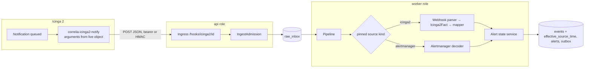
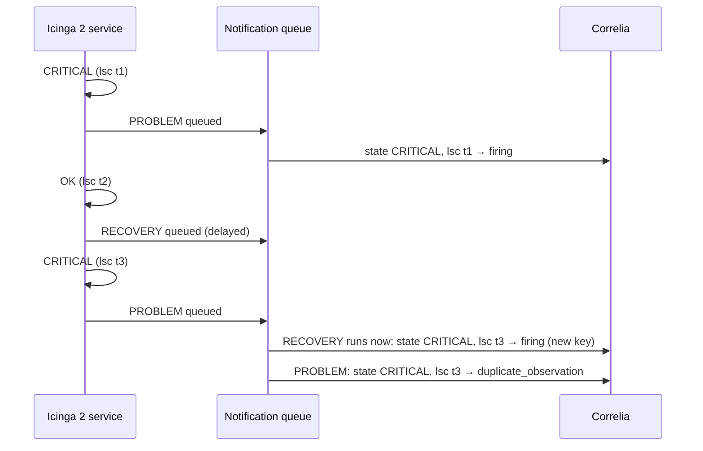

# Design

## Triage

| Trigger | Applies? | Evidence |
|---|---|---|
| T1 Components (new component, or 3+ with directed relationships) | yes | New Icinga2 parser and mapper behind a new decoder dispatch in the pipeline, feeding the alert-state service; a shipped notification command outside Correlia. |
| T2 State (persistent state, caches, 3+ state machine) | yes | A new events column (recorded clamp); alert state driven by a new source kind; source kind becomes immutable. |
| T3 Concurrency (background work, workers/isolates, async, retries) | no | No new background work: rows flow through the existing pipeline workers and claim protocol. ORD-7's concurrent transactions test existing behaviour. |
| T4 Boundaries (data format, migration, shared interface, IPC, external) | yes | Sender-facing webhook format, a shipped compiled sender run by Icinga 2, a Correlia schema step, a configuration format extension. |
| T5 Volume (grows without a fixed bound) | no | One delivery per notification, bounded by the source's body and rate limits as for Alertmanager. |
| T6 Risk (security, money, data loss, unrecoverable user data) | yes | Published event ids are frozen by the observation key; a lost recovery delivery leaves an alert firing; sender-controlled text in stored diagnostics. |

TIER: FULL

## Context

The scope is in `proposal.md`. The Event Streams consumer and state sync are out of scope (S2); the three
review rounds that led to the split are kept in `review-history/round-{1,2,3}.md` as input for
`icinga2-event-streams`. Current state that shapes the approach:

- **Source model.** Format version 2 sources carry `kind`; `_parseSource` rejects every kind but
  `alertmanager` (`correlia_server/lib/src/ingest/source_config.dart:229`) and accepts a fixed field set
  (`:216-225`).
- **Ingress and admission.** `/hooks/<kind>/<id>` splits the kind from the path (`lib/src/ingest/ingress.dart:175`)
  and 401s a kind mismatch (`:313`); admission rechecks the source row's kind under `FOR SHARE`
  (`lib/src/ingest/admission.dart:66-80`). The route exists once the kind is accepted. The one
  Alertmanager-specific exception is the path token: `source_config.dart:216-225,297-305` accepts
  `path_token_enabled` on any source and `ingress.dart:233-267` handles four-segment credential paths without
  checking the kind; D12 restricts both.
- **Pipeline.** Every row is decoded by `decodeAlertmanager` (`lib/src/pipeline/pipeline.dart:328-345`);
  `pinOne` pins a row to the active snapshot at first claim (`:207-236`), and the snapshot holds each source's
  kind and options. `classifyEvidence` (`:29-43`) applies the 24 h future limit and the 7-day lateness horizon.
  The skew clamp exists only inside `OrderingKey.fromSource` (`lib/src/state/ordering_key.dart:18-38`) and is
  never stored. Failure paths are persisted through `_safePath` (`pipeline.dart:65-87`, `:354-355`), which splits
  a rendered path on `.` and maps names outside an Alertmanager allowlist to `*`.
- **Alert projection.** `decideTransition` reports a visible change when status, severity, summary, source
  instance, `firingSince` or generator URL differ (`lib/src/state/transition.dart`); `firingSince` comes from
  the event's `starts_at` and the generator URL from its `generator` link
  (`lib/src/state/alert_state_service.dart:22-44`). Description is not part of alert state.
- **Identity.** `ObservationKey.native` exists (`lib/src/event/identity.dart:318`); `IdentityComponent`
  switches to a digest above its raw bound (`:89-130`), which gives ID-3's "identity unaffected".
- **Canonical event.** Kinds `ack`, `downtime`, `state`, `comment` and status `info` exist
  (`proto/correlia/event/v1/event.proto:9-24`); `info` observations are `Ignored` by the transition, so S4
  needs no alert-state change.
- **Capture precedent.** Alertmanager fixtures come from real releases run in Docker by
  `tool/alertmanager_capture.sh` (archive `2026-11-13-alertmanager-webhook-compat`, D6). Docker is available.
- **Icinga 2 behaviour (v2.13.0 source, to be confirmed by the captures).** Icinga 2 has no webhook; a
  `NotificationCommand` runs a program with `arguments` and `env` values from macros or runtime functions. Notification
  commands run asynchronously after the notification is queued, and `Service::ResolveMacro` reads `state` and
  `state_type` from the live object, not from the triggering check result; it also casts `last_state_change` to
  whole seconds. `PluginUtility::ExecuteCommand` converts each `env` value to a string before macro resolution,
  so a function placed directly in `env` is not evaluated; a custom variable holding a function (`vars.x = {{ …
  }}`) referenced as `$x$` is evaluated by the macro processor. The notification scheduler does not retry a
  failed command and sends reminders for open problems only. Ordinary notifications are sent for HARD changes
  and recoveries from HARD; none for SOFT changes or a SOFT problem's recovery, and none while downtime,
  acknowledgement, dependencies or flapping suppress them. `Checkable::ProcessCheckResult` rejects a result by
  `execution_start` but writes its `execution_end` into `last_state_change`, so passive results can make it
  regress or repeat. `Notification::BeginExecuteNotification` queues one command per recipient user, and
  `PluginNotificationTask` logs a failed command's output.
- **Sources and kind.** Publication disables every `ingest_source` row and upserts the published ones by UUID,
  so a removed source's row keeps its last kind (`lib/src/ingest/config_repository.dart:202-220`); the upsert
  overwrites `kind` today. A raw row stores only the source UUID (`admission.dart:140-149`).

## Decisions

Scope decisions S1-S6 are in `proposal.md`; their rows are in the summary below.

### D1: One mapping core with a typed intermediate

- **Choice:** A pure-Dart `lib/src/ingest/icinga2/` with a typed intermediate (`sealed class Icinga2Fact`:
  `StateFact`, `AckFact`, `DowntimeFact`, `FlappingFact`, `CommentFact`), a webhook parser that produces it,
  and one mapper that turns a fact into a `CanonicalEvent`. `icinga2-event-streams`
  adds its parsers in front of the same mapper.
- **Rejected:** Mapping inside the webhook parser (the stream would duplicate it and drift); an external
  plugin (ADR 0020 keeps P0 built-ins in process).
- **Reversal cost:** low.
- **Important:** no.
- **Chosen by:** agent

### D2: Webhook observation evidence

- **Choice:** Times are JSON strings in one fixed decimal form, Unix seconds with exactly six fraction digits
  (`^[1-9][0-9]{0,11}\.[0-9]{6}$`, as the shipped DSL function `correlia_time_text` writes them, D3), converted
  to integer microseconds exactly, by integer arithmetic on the two digit groups, never through a
  floating-point value; the reported source time is the RFC 3339 text of that instant. `ObservationKey.native` takes a
  string, so the key string is the canonical JSON array (no whitespace, strings only, times as decimal integer
  microseconds) of `["icinga2.notify.v1", state, state_type, last_state_change_us]` for a state notification,
  source time `last_state_change`. Re-notifications and reminders of one state are one observation; SOFT and
  HARD of one state change are two. Non-state notifications use `["icinga2.notify.<type>.v1", <type>,
  notification_time_us, author]` (author `""` when absent) with source time `notification_time`. Committed
  vectors pin the key string, the key bytes and the event id for one delivery of each kind. The
  domain names are versioned so `icinga2-event-streams` adds its own domains beside them. This key is frozen
  only by the capture task: the capture of HARD CRITICAL → OK → HARD CRITICAL within one second through the
  shipped command must yield three keys on a release for it to be supported (spec "Supported Icinga 2
  releases"); the key is not weakened to fit a release.
  Convergence is bounded (D4): coherent, eligible, unclamped deliveries with strictly increasing change times.
  The decoder accepts each time only as a string in that form whose value is below 253402300800 (before year
  10000, inside the canonical timestamp domain); the form excludes zero, a sign, an exponent and a leading zero.
  A missing required time (`notification_time` always; `last_state_change` for `PROBLEM` and `RECOVERY`, D13)
  fails with `missing_field`, a non-string (a JSON number included) with `invalid_type`, a string
  not in the form (`"0.000000"`, `"1.5"`, `"1e9"`) with `invalid_time`, and a value of 253402300800 or more with
  `out_of_range`, each on that field, so it is a validation outcome, not an internal retry. Distinct texts give
  distinct microseconds over the whole accepted range; committed vectors pin `"8589934592.000001"` and
  `"8589934592.000002"` (distinct keys, though the two round to one IEEE double) and `"253402300799.999999"`.
- **Rejected:** The `$service.last_state_change$` macro (whole seconds: two problems within one second would
  share a key and the second would be dropped as a duplicate before it reaches alert state); the decimal text
  as received (one instant prints differently across releases); notification time in state keys (every
  reminder would publish a new event); JSON numbers for times (Dart's JSON decoder yields an IEEE double, which
  above 2^33 seconds cannot hold every microsecond, so two reported times could share a key).
- **Reversal cost:** high (published event ids).
- **Important:** yes (binds the published event id).
- **Chosen by:** agent

### D3: Webhook document v1 and a compiled sender

- **Choice:** Correlia ships `correlia-icinga2-notify`, a small Dart command-line program in a new package
  `correlia_icinga2_notify/` (depends on `crypto` only), compiled with `dart compile exe` for linux-x64 and
  linux-arm64 by `mise run build:icinga2-notify`; it needs nothing else on the Icinga 2 host (no curl, jq,
  openssl, coreutils or shell features) and starts no child process. `contrib/icinga2/correlia.conf` holds two
  `NotificationCommand`s, `correlia-host` and `correlia-service`, which pass every input, settings and texts
  alike, as command-line `arguments` (`--base-url`, `--source`, `--token-file` or `--hmac-key-file`, optional
  `--ca-file`, then the document fields). The command never takes a full URL: the sender builds
  `<base-url>/hooks/icinga2/<source>` itself (Transport), so no path, query or userinfo an operator copies from
  another setup (an Alertmanager path-token URL, say) can carry a credential into argv. An optional setting is absent exactly when its argument is absent (`set_if`); a
  repeated or unknown argument exits 2 before any file is opened. No credential is ever an argument, only
  credential file paths.
  - **Launch with an empty environment.** The command line is `/usr/bin/env -i <sender> <arguments>`. The Dart
    runtime of a compiled executable reads `DART_VM_OPTIONS` before `main` (a `--help` there exits 0 with no
    request), and the dynamic loader reads `LD_*`; Icinga 2 hands the child its own inherited environment and
    appends a command's `env` entries after it (`process.cpp`), so with glibc's first-match `getenv` a command
    `env` value cannot override an inherited one. `env -i` (coreutils or BusyBox, present on every supported
    host) execs the sender with no environment at all, so no inherited variable, `CORRELIA_*` included, reaches
    the runtime or the program. The sender never reads environment values and exits 2 (`environment`) when its
    environment is not empty, which catches a command definition that dropped `env -i`; it is no defence
    against options the runtime acts on before `main`, so the proof runs the binary through Icinga 2 with
    `DART_VM_OPTIONS` set on the Icinga 2 process. The guarantee is scoped to the Dart exec: `/usr/bin/env` is
    itself started with Icinga 2's environment, so the dynamic loader's variables (`LD_PRELOAD`,
    `LD_LIBRARY_PATH`) act on it before it clears them. They are outside Correlia's boundary: whoever sets them in
    Icinga 2's service environment already runs code inside Icinga 2 itself, and the setup documentation says the
    service environment must not set them. The commands also set Icinga 2's `timeout = 15`, a termination threshold that
    holds even if the sender's own deadline cannot run (Bounds).
  - **Every value argument is an ASCII JSON string literal.** The runtime decodes every argument as UTF-8
    before `main` and refuses to start on an invalid one, and Icinga 2 builds argv from C strings
    (`process.cpp`), so a NUL silently shortens an argument (`db1<NUL>x` would arrive as `db1`). Neither can be
    repaired in the sender, so no raw text reaches argv. Names, texts, author, comment, base URL and file paths are
    passed through one of two shipped DSL functions, built only from Icinga 2's native operations, with no
    byte-by-byte loop:
    - `correlia_text(value, limit)` (texts, author, comment): a value that is not a string, or is empty, is
      absent: the helper returns the empty string and the argument's `set_if` omits it (`$service.output$` is
      empty before an object's first check result, so a CUSTOM notification can carry no output). Icinga 2 has
      no long-output macro: `output` already holds every line of the check output (`ParseCheckOutput`), so the
      document carries `output` only. Otherwise, if `value.len()` exceeds `limit` bytes, one
      `substr(0, limit)` call plus the marker `…[truncated by correlia]`; then `Json.encode`, which in v2.13.0
      repairs invalid UTF-8 with utf8cpp's `replace_invalid` and serialises with nlohmann's `ensure_ascii`
      (`json.cpp`), so its output is printable ASCII in which every non-ASCII character and every control
      character, NUL included, is a `\u` escape; then `replace("$", "\\u0024")`, which writes every literal `$`
      as its JSON escape, so the result holds no `$` and Icinga 2's macro processor has nothing to rewrite (JSON
      syntax has no `$` outside strings, so every `$` replaced is text). Each step runs in C++ and is linear in its
      input, and only a fixed number of full-input copies are made (`len` and `substr` copy their receiver), so a
      1 MiB output costs a few linear passes, not a walk, and a value made of `$` signs costs the same. A cut through a multibyte character leaves at most one U+FFFD before the marker.
    - `correlia_exact(value, limit)` (host and service names, base URL, file paths): the same encoding (with the
      `$` escape) without a cut, returned only when `value.len()` is at most `limit` bytes (1 KiB for names, 4 KiB for each setting) and
      `Json.decode(Json.encode(value)) == value`, which fails exactly when the encoder repaired invalid UTF-8;
      otherwise the empty string. A name or setting is therefore delivered exactly or not at all. The base URL
      is passed only when the whole value matches `\Ahttps?://[A-Za-z0-9.:\[\]-]+\z` (Icinga 2's `regex` calls
      Boost's `regex_search`, where `^` and `$` match at line breaks, so the buffer anchors `\A` and `\z` are
      used; the character class also excludes every line break), a scheme and an authority with no path,
      userinfo, query or fragment; the source only when the whole value matches
      `\A[0-9a-f]{8}-[0-9a-f]{4}-[0-9a-f]{4}-[0-9a-f]{4}-[0-9a-f]{12}\z`; otherwise each is the empty string. A token, which is neither, therefore never reaches argv or
      Icinga 2's failure log.
    The sender decodes each such argument with `dart:convert` and exits 2 if it is not a single JSON string. An
    empty or control-character-bearing (U+0000-U+001F, U+007F) host or service name exits 2 (`invalid_name`),
    and an empty setting, or one holding any control character (a NUL in a path would make the open stop at
    it and select the prefix file), exits 2 naming the argument, before any file is checked or connection
    made; the sender checks the base URL and source against the same forms again; an Icinga 2 object name is never
    empty, so the empty string is not a real name. A literal U+FFFD in a name is valid and delivered as is. In
    texts and the author, the sender replaces U+0000 with U+FFFD, so the decoder's `invalid_text` rule never
    rejects a shipped delivery. Times and the enumerated fields (object type, state, state type, notification
    type) are plain ASCII from macros and `correlia_time_text`, checked against their forms by the sender. Texts
    are visible in the process list and, on failure, in Icinga 2's log (Outcome).
  - **Launch size.** Texts are cut at 8 KiB (twice the ingress display bound) and the author at 1 KiB. Escaping
    expands a byte at most sixfold (`\u00XX`, and `\u0024` for `$`), so the largest
    argument is a text at under 50 KiB, below Linux's 128 KiB single-argument limit. The worst case of the whole
    argv (three texts, the author, two names, three settings, the fixed `/usr/bin/env -i` prefix and the sender
    path of at most 4 KiB, the small fields, terminators and pointers) is under 256 KiB. The kernel's limit on
    argv and environment together (`ARG_MAX`, a quarter of the stack limit, 2 MiB with the usual 8 MiB stack)
    also counts Icinga 2's inherited environment at the first exec, so `E2BIG` is possible if that environment
    is huge; the setup documentation states the budget (the service environment plus 256 KiB must fit
    `ARG_MAX`), and such a failure is logged by Icinga 2 like any other.
  - **Inputs, bound explicitly.** Every generated argument's `value` (and every `set_if`) is a function written
    in the command definition itself (`value = {{ … }}`, which `arguments` accept), never an unqualified macro:
    Icinga 2 resolves an unqualified `$name$` against the user, notification, service and host custom variables
    before the command's (`macroprocessor.cpp`, `pluginnotificationtask.cpp`), so a same-named service variable
    could replace a shipped helper's result. Inside each function, inputs are read only through qualified
    macros (`macro("$host.name$")`, `$service.name$`, `$service.state$`, `$service.state_type$`,
    `$notification.type$`, `$notification.author$`, `$notification.comment$`, and the host forms). The check
    output is read from the live object's `last_check_result.output` through `get_service(...)`/`get_host(...)`,
    not through `$service.output$`, which Icinga 2 resolves from the queued triggering check result
    (`notification.cpp`, `service.cpp`) while `state` comes from the live object; a delayed RECOVERY that runs
    after a refire would otherwise publish the OK text on a CRITICAL event whose own PROBLEM is then deduplicated.
    The reads are still not atomic (D4). The object's `last_state_change` is read through
    `get_service(...)`/`get_host(...)`, the notification time through `get_time()`. The operator settings are never read through a macro: Icinga 2 expands any resolved
    `vars` path recursively before `macro()` returns, even when qualified (`macroprocessor.cpp`), so
    `https://$host.name$` would become an object-derived destination before any check. They are global DSL
    constants that the operator sets in `contrib/icinga2/correlia.conf` (`CorreliaBaseUrl`, `CorreliaSource`,
    `CorreliaTokenFile` or `CorreliaHmacKeyFile`, and `CorreliaCaFile`, empty when absent), which the argument
    functions read directly as values, so a `$` in them is a literal character. One Icinga 2 instance therefore
    feeds one Correlia source, the supported setup. Each optional argument's `set_if` is a function testing its
    constant for the empty string; exactly one credential constant must be non-empty, or the sender exits 2. Times pass through one shipped DSL function
    `correlia_time_text(seconds)` that formats a fixed six-decimal string; names, texts and settings through the
    functions above. Icinga 2 expands macros again in a function's string result (`macroprocessor.cpp`); because
    the result holds no `$`, that expansion changes nothing and costs one scan, and text such as
    `OK: cost below $5` or `$host.name$` is delivered verbatim once the sender decodes the literal. The ingress display bounds (ID-3) still apply
    after.
  - **Author identity.** The v1 contract defines `notification_author` as the Icinga 2 author after
    `correlia_text` with its 1 KiB limit and the sender's NUL replacement, and the non-state key (D2) is over that delivered value, which Correlia
    then hashes in full like any identity input. Two authors whose first 1 KiB is equal and whose notifications
    share one microsecond are therefore one observation; this is the contract, not an accident of display
    truncation (the Icinga 2 DSL has no hash function to carry a digest of the full author), and is tested.
    Icinga 2 and Icinga Web user names are far shorter than 1 KiB.
  - **Document.** It builds `{format, object_type, host, service?, state, state_type, last_state_change?, output?,
    notification_type, notification_author?, notification_comment?, notification_time}` (`last_state_change`
    required for `PROBLEM` and `RECOVERY` only, D13, amended by the owner 2026-11-20) with
    `dart:convert`, writing each time's six-decimal text as a JSON string after checking it against the D2 form.
    The v1 notification types are Icinga 2's own `$notification.type$` strings, unchanged: PROBLEM, RECOVERY →
    state facts; ACKNOWLEDGEMENT → ack; DOWNTIMESTART, DOWNTIMEEND, DOWNTIMECANCELLED → downtime; FLAPPINGSTART,
    FLAPPINGEND → flapping; CUSTOM → comment. `DOWNTIMECANCELLED` stays in the vocabulary because Icinga 2
    defines it, but stock releases (v2.13.0 through v2.16.6) connect downtime removal to `NotifyDowntimeEnd`, so
    both the expiry and the manual removal of a triggered downtime arrive as `DOWNTIMEEND`, and removing a
    downtime that never triggered sends nothing. The webhook therefore cannot tell a cancellation from an
    expiry; the documentation says so, and the capture records which token each release actually sends.
  - **Authentication.** HMAC as ADR 0029 defines, over the exact body bytes sent, with `package:crypto`, when
    `--hmac-key-file` is given; the file holds Correlia's canonical credential form (43 unpadded base64url
    characters, as `decodeCredential` in `bootstrap.dart` accepts, optional trailing newline) and must decode to
    exactly 32 bytes. Otherwise the token text in `--token-file` is sent as a bearer token; exactly one of the two
    is required. Secrets stay in the process; no argument or output holds them.
  - **Transport.** The sender builds the URL as `<base-url>/hooks/icinga2/<source>`. The base URL must carry an
    explicit scheme: `https`, or `http` only when the host is a
    literal loopback address (`127.0.0.0/8` or `::1`; the name `localhost` is refused). Anything else exits 2
    before any credential is read. The `HttpClient` uses `findProxy = 'DIRECT'`, `followRedirects = false` and no
    `keyLog` callback. TLS uses `SecurityContext(withTrustedRoots: false)` loaded with
    exactly `--ca-file` when given, otherwise with the first existing file of a fixed list of distribution
    CA bundles (`/etc/ssl/certs/ca-certificates.crt`, `/etc/pki/tls/certs/ca-bundle.crt`,
    `/etc/ssl/ca-bundle.pem`, `/etc/ssl/cert.pem`); no environment variable selects trust. The Dart runtime's
    TLS (BoringSSL) reads no OpenSSL configuration file and no curl settings, so `OPENSSL_CONF`, `SSL_CERT_FILE`,
    `SSL_CERT_DIR`, `SSLKEYLOGFILE`, `CURL_CA_BUNDLE`, `http_proxy` and `ALL_PROXY` have no effect; a test sets all
    of them to hostile values.
  - **Bounds.** One deadline covers the whole run: a 10 s timer started first in `main` exits with status 3 and
    a sanitized line (`deadline`) whatever is outstanding, including file opens and reads and a peer that
    accepts a connection but never answers. Every file is opened and read only through Dart's asynchronous file
    API, which runs off the isolate, so a blocked open or read never stops the timer; the sender makes no
    synchronous file call. The token and key files are at most 4 KiB, the CA file at most 1 MiB. The type check is
    a path precheck: `stat` before opening refuses anything but a regular file, so a FIFO or device at the path is
    never opened, and the same `stat` refuses a token or key file with any group or other permission bit
    (`credential_mode`) and a CA file writable by group or others (`ca_mode`). Dart's file API exposes no
    descriptor and no `fstat`, so the opened input's type is not checked again. The supported setup, documented,
    is that every component of each file's resolved path, symbolic link targets included, is writable only by root
    or the Icinga 2 user, that the files are owned by one of them, and that the token and key files are readable
    only by the Icinga 2 user; a file swapped in between the check and the open is outside the contract, because
    whoever can write those paths can already rewrite the command definitions. The size cap is
    enforced on the bytes actually read from the opened file: it reads at most the cap plus one byte and exits 2
    when that extra byte arrives, so a file that grows or is swapped after the check cannot exceed it, and a
    blocking file swapped in after the check ends in `deadline`. The CA bytes read this way
    are loaded with `setTrustedCertificatesBytes`; no path-based TLS loading (`setTrustedCertificates(path)`,
    which reads synchronously) is used, for `--ca-file` or the distribution bundle. Anything else exits 2 naming
    only the argument. If the isolate itself stalls, Icinga 2's command `timeout` sends SIGTERM at 15 s and, on
    Linux, schedules SIGKILL at 1.1 times the timeout, nominally 16.5 s (`process.cpp`); these are Icinga 2's
    thresholds, not an exact wall-clock guarantee, while the sender's own deadline is 10 s.
  - **Outcome.** Only HTTP 202 (Correlia's durable admission) exits 0. Any other status exits 1; a configuration
    error exits 2; a connection or TLS failure exits 3. It writes one stderr line on failure holding only the
    status or the error class, never the response body (Icinga 2 logs a failed command's output), the token, the
    key or the signature. Icinga 2 also logs the complete command line of a failed command
    (`pluginnotificationtask.cpp`): names, check output, author, comment, the base URL, the source UUID and the
    credential file paths, never a credential value. Icinga 2 also logs every launched command line at Notice
    level right after spawning it (`process.cpp`), whatever the outcome, so with Notice logging enabled the texts
    of successful notifications are logged too. The setup documentation states these exposures, with the process list's, and the
    real-Icinga rejection test checks what that log line holds. Ingress caps concurrent requests (16 in total; 2 signed per source, 8 signed overall) and
    answers 503 beyond them; such a notification is lost like any failed one, which the setup documentation
    states, naming bearer mode for sources with many concurrent notifications. Icinga 2 does not retry a failed
    command: a webhook-only source loses a state change whose delivery fails, and the documentation says so
    (`icinga2-event-streams` will reconcile it).
  - **Proof.** The capture task installs the compiled sender into each official Icinga 2 image, drives known
    inputs with distinct last microsecond digits through `correlia_time_text` (a passive result's execution end
    for the state time; a replaced clock source for the notification time, the conversion path unchanged),
    samples `get_time()` 20 times to show resolution finer than 10 µs, runs `correlia_text` over captured
    inputs with a multibyte character across the cut, invalid UTF-8 bytes, NUL and `$` signs, runs
    `correlia_exact` over a name with an octal-escaped NUL and one with an invalid byte, sends a burst of 50
    notifications whose outputs are 512 KiB each (each REST request inside the API's 1 MiB body limit), runs the binary with `DART_VM_OPTIONS=--help` set on
    the Icinga 2 process, sends a notification for a service that defines same-named custom variables
    (`correlia_last_state_change`, `correlia_base_url`) to show they are ignored, drives passive results through
    the REST API with each request inside its 1 MiB body limit and invalid UTF-8 through an active check plugin
    (REST JSON decoding would repair it first), runs one real notification per shipped architecture with that
    exact release artifact
    (linux-arm64 in the official arm64 image, under QEMU user emulation when the capture host is x64) and records
    its 202 and the canonical event the pipeline produced from it; support is stated per release and
    architecture, a pair is advertised only with that recorded 202 and an expected, successfully decoded event.
    Both artifacts are always built; each is published only for an architecture with at least one qualified
    pair, so a release where only linux-x64 qualifies publishes only the linux-x64 artifact; and proves the binding on every
    listed release before the contract is published; with no passing release the contract is not shipped. HMAC is
    tested against RFC 4231 vectors and against real ingress with a canonical key file.
- **Rejected:** A POSIX shell script around curl, jq, openssl and basenc (design rounds 10–13 kept finding
  inherited curl, OpenSSL, NSS and environment settings that reopen the trust and secret boundaries, and it needs
  four tools of known versions on every Icinga 2 host); a Python script (not guaranteed on Icinga 2 hosts); a
  retry loop in the sender (blocks Icinga 2's notification worker, and a retried state change can arrive after a
  newer one).
- **Reversal cost:** medium (deployed binaries and command definitions).
- **Important:** yes (binds a sender-facing contract and a shipped binary).
- **Chosen by:** user (owner, 2026-11-19, after the round 13 escalation: "Compiled sender, round 14"); `last_state_change`
  optional for non-state notification types by the owner, 2026-11-20, after design round 26 (D13)

### D4: A webhook delivery reports the object's state when the command runs

- **Choice:** Because Icinga 2 resolves `state`, `state_type` and `last_state_change` from the live object
  when the queued command runs (Context), a delivery is evidence of the object's state at that moment, not of
  the transition that triggered it. The decoder takes status and severity from `state` and `state_type` only;
  `notification_type` selects the fact kind (state versus ack, downtime, flapping, comment) and is kept on the
  event's attributes, but never sets status. A RECOVERY that runs after a refire therefore reports the refire,
  whose own PROBLEM notification is then a duplicate; the recovery between them is not seen, which is correct
  for the final state. The three values are read in one macro resolution but not atomically; a transition
  between the reads can pair a new `state` with an old `last_state_change` or the reverse. Either pairing is
  followed by the notification of the new transition, but it is not guaranteed to win: a torn delivery that
  arrives after the coherent one ties on source time and wins by its later receipt, and a following reminder
  is a duplicate. The same holds for passive results whose `execution_end` regresses or repeats (Context), and
  for the pipeline's own rules: a first delivery of a problem older than the lateness horizon is `late`; the
  skew clamp can reorder two deliveries received in reverse order; deliveries sharing a key are one observation
  whose observed time comes from whichever is processed first. The convergence contract is therefore bounded to
  what the fence orders: every state-changing delivery coherent, eligible (not late, not future-dated),
  unclamped, and the object's state changes at strictly increasing microsecond times. Otherwise an alert can
  stay stale until a later eligible observation with a new key outranks its fence. Stated precisely, the
  guarantee is over committed, eligible, state-bearing observations after deduplication by event ID: the alert
  ends in the highest-ranked of them in any processing order. Whether that is the object's latest state depends
  on the latest state having been delivered and committed as such an observation (a lost recovery, a SOFT
  sample, or a late reminder winning the event-ID insert over a prompt delivery of the same problem all leave
  it stale). The conditions and the outcome are documented, and tests assert the stale outcomes (torn read,
  regressing end, old first delivery, reversed receipt under the clamp, equal times in both processing orders,
  lost recovery, late reminder winning the insert), not convergence. Event Streams with state sync
  (`icinga2-event-streams`) is the path that reconciles.
- **Rejected:** Status from `notification_type` (a delayed RECOVERY would resolve a refired problem); reading
  state from the triggering check result (Icinga 2 exposes only output, perfdata and timings of it to macros);
  dropping deliveries whose type and state disagree (loses current-state evidence, and a torn read can agree
  with its type); a webhook-specific tie rule in the fence (changes ORD-3 for every source, and still cannot
  tell a torn pair from a coherent one); exempting the webhook from lateness or clamping (the pipeline's
  ordering rules stay source-independent; ADR 0017). A late delivery that duplicates a ready observation does not
  refresh `last_observed_at`: the pipeline queues a duplicate for freshness only when the delivery's own
  disposition is `ready` (`pipeline.dart:407-418` checks only the original's today).
- **Reversal cost:** low (decoder rule and documentation).
- **Important:** yes (changes alert outcomes, and states a limit users rely on).
- **Chosen by:** agent

### D5: Clamp column in schema step 4

- **Choice:** `schema/0004_icinga2.sql` adds a nullable `events.effective_source_time timestamptz`, with no
  default and no backfill: in PostgreSQL that is a catalog-only change, so the step takes a brief exclusive lock,
  rewrites no rows and needs no disk headroom on a populated table. Every row this release writes sets it to the
  effective time computed by the ordering-key function the fence uses, clamped or not. Null means a row written
  before step 4; its effective time is defined as `LEAST(source_time, observed_at + interval '5 minutes')` (the
  M1 skew allowance, by which `AlertStateService` already clamped those rows without recording it), and readers
  get it through one SQL expression the step defines (`events_effective_source_time(events)`), never by reading
  the column alone. The value has microsecond precision, like `source_time`: it serves queries and stored
  ordering evidence; exact ordering keeps using the canonical evidence's nanosecond times, as the fence does.
  Operational expiry, correlation windows and reminders use observed time (ADR 0017). Tests: a populated
  upgrade keeps the table's `relfilenode` (no rewrite); a pre-upgrade clamped Alertmanager event reads back its
  clamped time through the expression. The schema runner (`schema_steps.dart`) sets `SET LOCAL lock_timeout =
  '30s'` as the first statement of every transaction it opens, before both `pg_advisory_xact_lock` calls, so
  both waiting behind another starter's schema transaction and step 4's `ALTER TABLE` waiting on a lock on
  `events` are bounded (PostgreSQL applies `lock_timeout` to advisory locks too). `SchemaStepException` gains a
  sanitized failure class: `lock_timeout` for SQLSTATE 55P03, `failed` otherwise; startup prints the step and
  class. The transaction rolls back, no version is recorded, and the operator restarts once the blocker ends.
  Tests: one holds the schema advisory lock, one holds `ACCESS SHARE` on `events`; each asserts the
  `lock_timeout` class and no step-4 version, releases the lock and asserts a successful restart (injected short
  timeout). The raw outcome JSON gains a `clamped` count. The raw outcome JSON gains a `clamped` count. A test upgrades a
  database holding a clamped Alertmanager event and reads its effective time.
- **Rejected:** A backfill with `NOT NULL` (rewrites every event row inside the startup schema lock, with no
  retention yet to bound the table; round 8 Moderate 2); writing the clamp into the canonical event (it depends on observed time, and ADR 0021 freezes
  v1); not storing it (ORD-4 requires it, and correlation in M3 needs the effective time).
- **Reversal cost:** medium (stored schema).
- **Important:** yes (stored data format).
- **Chosen by:** agent

### D6: Decoder dispatch by the pinned source's kind

- **Choice:** The pipeline looks up the pinned snapshot's source and dispatches on its kind with an exhaustive
  switch over a sealed `SourceKind` (`alertmanager`, `icinga2`). Because a source's kind never changes (D10),
  when the pinned snapshot configures the row's source its kind is the kind the row was admitted under, also on
  replay; a source absent or disabled there fails with `source_not_configured` as today. A row whose pinned
  source has no decoder fails with `unsupported_kind`. A source in a format version 1 snapshot carries no
  `kind`; M1 rows pinned to such a snapshot keep decoding as Alertmanager, because version 1 defines that kind.
  A missing kind in a version 2 snapshot, or an unknown kind, fails with `unsupported_kind`. The existing e2e
  case `m1_pending_raw_delivers_with_historical_signing_key` keeps passing unchanged, and a new case pins a
  pending row to a version 1 snapshot. Workers older than this change decode every row as Alertmanager and
  write no effective time, and an older `api`, `worker` or `all` process publishes configuration at startup with
  a publisher that overwrites a source's kind. The upgrade is therefore offline: every older process, of every
  role, stops before any process of this release starts and is not restarted afterwards (any role applies step 4
  at startup, `runtime/serverpod_adapter.dart:31-36`); a null effective time then always means a pre-step-4 row
  (D5). No database trigger guards `ingest_source.kind`: that table is Serverpod-managed, and Correlia schema
  steps own only the exception tables `openspec/architecture.md` lists; the offline cutover is the protection.
  Admitted rows stay `pending` in the inbox meanwhile and are claimed
  by the upgraded workers. An e2e test runs that sequence with pending Alertmanager rows. No mixed-version
  mechanism is built for a one-time cutover.
- **Rejected:** Sniffing the body (a malformed body would be decoded by the wrong decoder); a decoder registry
  keyed by strings (loses exhaustiveness; built-ins are a closed set until the plugin host, M8).
- **Reversal cost:** low.
- **Important:** no.
- **Chosen by:** agent

### D7: UNREACHABLE maps to `critical`

- **Choice:** Map UNREACHABLE like DOWN, keeping the original name in `severity_original`.
- **Rejected:** `unknown`, as the legacy did, because the Event Streams API reports DOWN for the same host, so
  the severity would change with the path that saw it last once `icinga2-event-streams` lands.
- **Reversal cost:** low.
- **Important:** yes (changes what users see).
- **Chosen by:** agent

### D8: Projection from object and state only

- **Choice:** Only `PROBLEM` and `RECOVERY` deliveries are state observations; every other notification type is
  informational whatever state it carries (D11). The parser rejects a control character in a host or service
  name, and U+0000 in any text field, with `invalid_text` (a field error), because `normalizeDisplayText` keeps
  U+0000 and PostgreSQL text cannot store it; the identity input is never altered. The mapper builds the summary only from object and state (`<host> <STATE>` or
  `<host>!<service> <STATE>`, UNREACHABLE shown as DOWN), sets no `starts_at` and no generator link, and puts
  check output only in the description. A new observation of an unchanged state from the same source instance
  (a new SOFT→HARD key, or the stream's evidence later) then records no visible change. The existing
  source-instance projection is unchanged: in a namespace shared by two sources, a newer same-state
  observation from the other instance changes the projected source instance, which `decideTransition` counts
  as a visible change (`transition.dart`), so the version advances and activity is written, as for every kind.
- **Rejected:** Check output as summary (every observation with new output would count a visible change, and
  state sync, which has no output, would flip it back).
- **Reversal cost:** low.
- **Important:** yes (changes what users see).
- **Chosen by:** agent

### D9: Structural failure paths

- **Choice:** The Icinga2 parser reports failure paths as segment lists and emits a structural `*` segment at
  the unknown-key boundary, before any rendering, so an unknown key that contains dots (`state.type`) becomes
  one `*`. `_safePath` gains the Icinga2 field names for rendering. Tests assert the persisted path, not only the
  parser exception, including a dotted unknown name made of allowlisted segments.
- **Rejected:** Reflecting the unknown name (sender-controlled text in stored diagnostics, against the
  credential-safe rule of the Alertmanager precedent); extending only the allowlist (a dotted unknown key would
  be split into allowlisted segments). The regression vector is `state.state_type`, two documented names the
  old split-and-allowlist path would both keep.
- **Reversal cost:** low.
- **Important:** no.
- **Chosen by:** agent

### D10: A source's kind is immutable

- **Choice:** Publication refuses (`kind_changed`, at `sources[i].kind`) a source UUID whose stored
  `ingest_source.kind` differs from the published kind, including a disabled source's row; the upsert stops
  writing `kind` for existing rows.
- **Rejected:** Storing the admitted kind on each raw row (a schema column and a second source of truth for a
  rare operator action; replay would still need a rule); allowing the change and failing stranded rows (loses
  deliveries Correlia acknowledged with 202).
- **Reversal cost:** low (an operator creates a new source UUID instead).
- **Important:** yes (changes what a configuration may do).
- **Chosen by:** agent

### D11: Non-state events are per command execution, with one Correlia user

- **Choice:** An ack, downtime, flapping or comment event represents one execution of the shipped command,
  timestamped by the command's own clock read (D3) at microsecond precision, so two actions by one author are
  two events unless they run in the same microsecond, when they coalesce into one (documented, tested with
  equal times). The release gate captures two executions in one integer Unix second (spec "Two comments from one
  author"), so a whole-second clock cannot pass. Icinga 2 runs one command per recipient user, so the documented setup applies the notification to
  exactly one dedicated Correlia user; more recipients publish one event per recipient, documented.
  Published fields: the summary follows D8 (object and state); the description is the comment, bounded to 4096
  characters with the display marker, omitted when the comment is absent or empty; the annotations are
  `icinga2.notification_type` and, when the author is present and not empty, `icinga2.notification_author`,
  bounded to 1024 characters with the marker. Check output is published only on state observations. Tests
  assert these fields on the emitted canonical payload.
- **Rejected:** `last_notification` of the notification object (updated before the queue, so two queued
  actions can read the same later time and one is dropped); `$icinga.timet$` (whole seconds).
- **Reversal cost:** medium (event ids of non-state events).
- **Important:** yes (binds event ids).
- **Chosen by:** agent

### D12: Path tokens and identity label exclusion stay Alertmanager-only

- **Choice:** The source parser accepts `path_token_enabled` only for `alertmanager`, and ingress refuses a
  four-segment credential path on any other kind's route with 401 before admission. The same holds for
  `excluded_identity_labels` (`source_config.dart` accepts it for every source today): an Icinga2 fingerprint is
  host and service, so the option could not take effect, and an `icinga2` source that declares it fails
  activation with a field error instead of appearing to work.
- **Rejected:** Allowing it for Icinga2 (a credential in the URL lands in Icinga 2's configuration and logs,
  outside the redaction setup the Alertmanager runbook documents; the shipped command sends headers).
- **Reversal cost:** low.
- **Important:** no.
- **Chosen by:** agent

### D13: State change time of an object with no state change yet, and the command's time range

Found while writing `contrib/icinga2/` (apply, group 7); amended after design round 26 from the Icinga 2 source
(`checkable.ti`, `checkable-check.cpp`, `host.cpp`, `service.cpp`, identical in this respect from v2.13.0 to
v2.16.6).

- **Facts.** Icinga 2 starts every checkable with raw state UNKNOWN and state type SOFT, and initializes
  `last_state_change` and `last_hard_state_change` to `Application::GetStartTime()`: 0 for objects loaded at
  startup (they are activated before the clock is set), the daemon's start time for objects created at runtime
  through the API. `ProcessCheckResult` writes `last_state_change` only on a state value change (for hosts,
  of the host state, where UNKNOWN and CRITICAL both mean DOWN), and `last_hard_state_change` on every SOFT to
  HARD step, on every HARD to HARD value change, and on every check of a `volatile` object. It records each
  result's state in `last_state_up` (OK or WARNING; host) or `last_state_ok`, `last_state_warning`,
  `last_state_critical` (service), all 0 until such a result arrives. `ProcessCheckResult` replaces a zero
  execution end with the current time but accepts any other value, a negative one from the passive API
  included. So a host has had a state value change exactly when `last_state_up != 0`, and a service exactly
  when one of its three is not 0; until then `last_state_change` holds the initializer, which can be a positive
  time days old, not a transition. The test is for a recorded result, never for a valid time: a result whose
  end is negative still marks a change.
- **Choice.** The commands compute the state change time with one shipped helper per object type, from the live
  object:
  - An object that has had a state value change: its `last_state_change`, a real result's execution end.
  - An object that has not, in state type HARD: its `last_hard_state_change`. Its state value has been the
    initial one throughout, so the last SOFT to HARD step is its first HARD result, whose execution end is
    recorded there; a later HARD result of the same value does not move it (no volatile object, below), so the
    first HARD notification, a second HARD check and every reminder read the same value and share one key.
  - Otherwise (no state value change and SOFT): no usable time.
  The initializers are never sent, whatever their value: the `>= 1` test of round 25 is gone. The history test
  and the validity of the chosen time are separate steps: the helper first picks the time by the rule above,
  then passes it through `correlia_time_text`, and a chosen time outside its input domain (a negative passive
  end, say) is no usable time; it never falls through to the other timestamp.
  The guarantee is scoped to state maintained by Icinga 2's own check processing and to intact retained state
  (`icinga2.state` written by Icinga 2 and restored at startup, which keeps the per-state times, the state type
  and both change times together); a hand-edited or partially restored state file is outside it.
- **Optional for non-state notifications (D3, amended by the owner).** `last_state_change` is required in the
  v1 document for `PROBLEM` and `RECOVERY` and optional for every other type, whose key and source time use
  `notification_time` only (D2, D11). The `--last-state-change` argument's `set_if` tests only the
  notification type, which is fixed for the command: it is passed for `PROBLEM` and `RECOVERY` and never for
  any other type. Its `value` is the one read of the object's timestamps in that command (Icinga 2 evaluates
  `set_if` and `value` separately, `macroprocessor.cpp`, so no omission decision depends on a second read); it
  renders the JSON empty string when no usable time exists, which the sender refuses with exit 2 naming the
  argument. A non-state document therefore never carries the field from the shipped command, whatever the
  object's timestamps; another sender may send it, and the decoder validates it then (an invalid one fails with
  `invalid_time`). This narrows the owner's "omit when unknown" to "never sent for non-state types" on the
  command side only: the document contract the owner chose (optional for non-state types) is unchanged, and the
  field takes no part in a non-state key or source time.
  The sender requires the argument only for `PROBLEM` and `RECOVERY`, and the decoder fails a state
  notification without the field with `missing_field`; a present field is validated as before in every type.
  A CUSTOM, acknowledgement, downtime or flapping notification for an object with no check result yet is
  therefore delivered. `notification_time` stays required for every type. The mapper's `StateFact` keeps a
  non-null state change time; only the parser's field becomes optional. A non-state delivery's key and event id
  are the same with the field present or absent (tested). The decoder maps an identical wire document to the
  same key and event id as before this amendment. The amended command can send a different time than the
  round 25 command for the same object (the first HARD result's time instead of an initializer); that
  command was never released, so no published event id changes.
- **Volatile objects.** `volatile = true` makes Icinga 2 notify on every HARD problem check and move
  `last_hard_state_change` with each. For a volatile object that has had a state value change, the key uses
  `last_state_change`, so those notifications are one observation, as for any object. For a volatile object
  with no state value change yet, a command carries the `last_hard_state_change` it reads from the live object
  when it runs (D4), the execution end of the latest HARD check by then. Each distinct, eligible value that a
  command actually samples is a new observation, stored and published as its own `firing` event with an output
  intent per route; two checks that complete before either command runs are both read as the second check's
  time and give one observation, so the guarantee is one observation per distinct, eligible time a command
  samples, not one per check. The alert stays one alert: a newer eligible observation from the same source
  with unchanged status and severity moves the fence, and D8 records no visible change, so the version does not
  advance. A reminder with no check between reads the same time and is a duplicate. This is documented; no
  stable time exists in Icinga 2 for that case.
- **Formatter domain.** `correlia_time_text` is exact only for `1 <= seconds < 2^32` (Icinga 2 numbers are IEEE
  doubles; above 2^32 some microsecond values do not round-trip): it computes `Math.round(seconds * 1000000)`,
  splits it with integer arithmetic, zero-pads the fraction, and returns the empty string outside that domain.
  This is the shipped formatter's input domain only. The decoder's range and D2's vectors
  (`"8589934592.000001"`, `"253402300799.999999"`) are unchanged: they pin exact wire decoding, and the command
  never produces a time after 2106. Known-input captures stay inside the formatter's domain.
- **Two failure values.** Absent optional text (`correlia_text`) is the empty DSL string, which the argument's `set_if` turns into an absent argument.
  An unusable required value (`correlia_exact`, `correlia_base_url`, `correlia_source`, and a state
  notification's unknown time) is the two-character JSON literal `""`, so the argument stays one JSON string
  literal and the sender refuses it, reporting `invalid_name` or naming the argument.
- **Proof.** The capture runs the first HARD DOWN of a host defined in configuration at startup and of a host
  created at runtime through the API, each followed by a second HARD DOWN check and a reminder: the delivered
  time equals the first HARD result's execution end, as the capture driver recorded it when it submitted the
  result, one `firing` event is stored, and the reminder's raw row ends with a committed
  `duplicate_observation` outcome. It restarts the daemon with its retained state and sends another reminder,
  which keeps the key. A passive regression submits an UP result with a negative execution end, then SOFT and
  HARD DOWN at current times: the delivery carries the SOFT DOWN's time (`last_state_change`), not the HARD
  one. The runtime host's delivery differs from the daemon start time read from the API. A
  helper capture evaluates the shipped helpers on a value that mimics a runtime-created host of a daemon started
  eight days earlier (`last_state_change` eight days old, `last_state_up` 0, a HARD state, a fresh
  `last_hard_state_change`) and asserts the fresh time; the round 25 rule would have returned the old one, which
  the pipeline marks `late` (D4). The capture also runs a volatile host's two HARD DOWN checks, the second
  submitted with a distinct, later, eligible execution end only after the first delivery's raw row has
  committed (two observations, one alert, the fence on the second, the version unchanged), and a CUSTOM notification on a startup-defined service before its first result (202,
  no `output`, no `last_state_change`, one `comment` event, no alert).
- **Rejected:** `>= 1` as the test for a real change (a runtime-created object's initializer is positive; round
  26); `> 0` on the per-state times (a passive result with a negative end is a real change; round 27); sending notification time as the state change time (each reminder would be a new observation); dropping
  the first notification silently (loses a real HARD DOWN); a decimal-text conversion of the double (prints
  differently across releases, D2); keeping `last_state_change` required for non-state notifications (a CUSTOM
  on an unchecked object could not be sent; owner's choice, 2026-11-20).
- **Reversal cost:** low (command definitions, one optional field; no published event id changes).
- **Important:** yes (decides which time keys a new object's first problem, and changes D3's document).
- **Chosen by:** agent (the optional field: user, owner, 2026-11-20, after design round 26: "Optional for
  non-state")

### Decision summary

| # | Decision | Choice | Rejected | Reversal cost | Important | Chosen by |
|---|---|---|---|---|---|---|
| S1 | Webhook contract | Correlia's own document from a shipped notification command | Native webhooks (none exist); legacy contract | medium | yes | agent |
| S2 | Scope split | Event Streams consumer and state sync move to `icinga2-event-streams` | Fourth review round on full scope; proceed with open findings | low | yes | user |
| S3 | SOFT on the webhook | `info`; recoveries always apply; policy moves to change 3 | `soft_and_hard` on the webhook; drop SOFT | low | yes | agent |
| S4 | Ack, downtime, flapping | Published `info` events, no alert effect | Drop until M5; change state now | low | yes | agent |
| S5 | ORD-4/6/7 | Proven pipeline-wide; clamp recorded | Defer ORD-6 to retention | low | no | agent |
| S6 | Supported releases | Official images from 2.13 on, webhook captured | Latest only; hand-written fixtures | low | yes | agent |
| D1 | Decoder structure | Typed facts, one mapper | Mapping in the parser; external plugin | low | no | agent |
| D2 | Observation evidence | Canonical JSON key string over state, state type, `last_state_change` µs; fixed vectors; frozen by capture | Whole-second macro; received text; notification time in state keys | high | yes | agent |
| D3 | Webhook format and sender | `correlia.icinga2.v1`; compiled Dart sender; host and service commands; explicitly bound argument functions; ADR 0029 auth; exclusive TLS trust; only 202; no retry | Shell script around curl/openssl; Python; retry loop | medium | yes | user |
| D4 | Webhook state semantics | State at command run; convergence bounded to coherent, eligible, unclamped, strictly increasing changes; documented | Status from notification type; drop mismatches; webhook tie rule; webhook exempt from lateness | low | yes | agent |
| D5 | Clamp storage | Nullable step 4 column, catalog-only; defined read expression for older rows | Backfill with NOT NULL; clamp in the event; not stored | medium | yes | agent |
| D6 | Decoder dispatch | Sealed `SourceKind` switch on the pinned source | Body sniffing; string registry | low | no | agent |
| D7 | UNREACHABLE | `critical` | `unknown` | low | yes | agent |
| D8 | Alert projection | Summary from object and state only | Check output as summary | low | yes | agent |
| D9 | Failure paths | Structural `*` at the unknown-key boundary | Reflect names; allowlist only | low | no | agent |
| D10 | Source kind | Immutable per UUID (`kind_changed`) | Kind per raw row; strand rows | low | yes | agent |
| D11 | Non-state events | One per command execution; same-microsecond executions coalesce; one Correlia user | `last_notification`; whole-second time | medium | yes | agent |
| D12 | Path tokens, identity label exclusion | Alertmanager-only | Allow for Icinga2 | low | no | agent |
| D13 | First state change time; command time range | Real change by the per-state result times, else HARD's `last_hard_state_change`; never an initializer; time optional for non-state types; volatile scoped; formatter exact below 2^32 s; empty DSL string omits, JSON `""` refuses | `>= 1` or `> 0` test; notification time; silent drop; decimal text; time required for every type | low | yes | agent; optional field: user |

## Diagrams (FULL)

Components (T1):

Delayed notification across a refire (T2, D4):

Data boundaries (T4): the webhook document `correlia.icinga2.v1`, the `icinga2` source kind (immutable per
source), and schema step 4 (`events.effective_source_time`) are the new formats; the canonical
event is unchanged.

## State & Ownership (FULL)

| State | Owner (sole writer) | Lifetime | Invalidation / rebuild | Authoritative copy |
|---|---|---|---|---|
| `events.effective_source_time` | Pipeline (on insert) | Event row lifetime | Never changes | Postgres |
| Source kind | First publication of the UUID; never changed after (D10) | Source row lifetime | None | Postgres |
| Alert state | `AlertStateService` only (unchanged) | As today | As today | Postgres |
| Webhook evidence | Icinga 2 (sender) | Until delivered | Not re-sent on failure | Icinga 2 object state |

## Failure & Visibility (FULL)

| Component | Fails / dies mid-operation → | Recovery | Retry safe? | Who finds out |
|---|---|---|---|---|
| Notification sender (launch) | Invalid UTF-8, NUL or a runtime option in the environment | Prevented: every value argument is an ASCII JSON literal, `env -i` clears the environment | n/a | Capture proof; the sender exits 2 on a non-empty environment |
| Notification sender (name or setting) | Name or setting not deliverable exactly (control character in a name, invalid UTF-8, over its limit) | None: not delivered, by design | n/a | Icinga 2 log (exit 2, `invalid_name`); documented |
| Notification sender (exec) | `E2BIG` from a huge Icinga 2 environment | None for that notification | n/a | Icinga 2 log; documented budget |
| Notification sender | Correlia down, 4xx or 5xx | None for that notification (Icinga 2 does not retry; reminders repeat open problems only) | Resending the same serialized document is (event-ID dedup; fresh HMAC request metadata). Rerunning the command is a new execution: a non-state notification gets a new `notification_time` and is a second event | Icinga 2 log (non-zero exit, with the command line and its texts); documented loss for webhook-only sources |
| Notification delayed | Runs after the object changed again | Reports the state at run time (D4); converges only within D4's bounds | n/a | Documented limits; stale alert visible in the console (M4) |
| Older process during upgrade | Not running: the upgrade is offline for every role (D6) | Rows wait `pending` and resume under upgraded workers | n/a | Upgrade sequence documented; e2e test |
| Icinga2 decode | Unknown field or bad value | Row `failed` with code and structural path; replay after a fix (change 7) | Yes | Pipeline outcome and log |
| Release changes the macros' shape | Unknown or missing field | Rows fail loudly; version-matrix test catches it before support is claimed | n/a | Failed rows; CI on new captures |
| Pipeline (Icinga2 rows) | Crash mid-transaction | Existing claim and retry | Yes | Existing outcome counters |

## Resource Bounds (FULL)

| Queue / buffer / cache / transfer | Bound | At the bound | Timeout | At 10x / 100x |
|---|---|---|---|---|
| Webhook body | Source `body_limit_bytes` (≤1 MiB) | 413, no row | Existing ingress | Unchanged per request |
| Delivery rate | Source `rate_limit` | 429 | Existing | Notification storms are throttled per source; the sender logs the failure |
| Concurrent deliveries | 16 requests; 2 signed per source, 8 signed overall | 503 | Existing | A notification beyond the cap is lost (no retry); documented, bearer mode recommended for bursty sources |
| Check output in the event | Display bound with marker | Truncated | — | Unchanged |
| Sender run time | Whole-run timer from the start of `main` | Exit 3 (`deadline`) | 10 s | New |
| Sender file inputs | Regular file at the path (precheck); token and key 4 KiB, CA 1 MiB, enforced on the bytes read | Exit 2 | Whole-run deadline | New |
| Sender process | Empty environment (`env -i`) | Exit 2 if not empty | Sender deadline 10 s; Icinga 2 SIGTERM at 15 s, SIGKILL nominally at 16.5 s | New |
| Sender diagnostics | One stderr line, status or error class only | — | — | New |
| Names and settings into the sender | Names 1 KiB, base URL and paths 4 KiB, exact or not sent; base URL and source in fixed forms | Exit 2, no delivery | — | New |
| Texts into the sender | 8 KiB per text, 1 KiB for the author, one cut then `Json.encode` (C++, linear) and `$` as `\u0024` | Truncation marker | One linear pass per text | Largest argument under 50 KiB; whole argv under 256 KiB |

## Flow & State Gaps (FULL)

- **Delayed notification across a transition.** Reports the later state (D4); the intermediate state is not
  seen; the alert ends in Icinga 2's state only within D4's conditions.
- **Non-atomic macro reads.** A mixed pair can win over the coherent one; stale until a later eligible
  observation outranks it (D4).
- **Old problem on a new source, reversed receipt under the clamp, equal change times.** Outside the
  convergence contract; tested and documented (D4).
- **Two problems within one second.** Distinct keys through `last_state_change` µs (D2), proven by capture.
- **First problem of a new object.** Its state value never changed, so `last_state_change` holds an
  initializer (0, or a days-old daemon start time for a runtime-created object); the first HARD result's time
  is sent instead, and a volatile object with no change yet gets one observation per distinct, eligible time a
  command samples (D13).
- **Notification for an object with no check result.** Non-state types carry no state change time and are
  delivered (D13).
- **Lost delivery on a webhook-only source.** Not recovered until a later eligible observation of that object;
  documented, and reconciled by state sync in `icinga2-event-streams`.
- **SOFT then HARD with the same state change time.** State type is in the key, so the HARD observation is
  new and applies under `hard_only`.
- **Recovery reported SOFT.** Resolves under both policies.
- **Kind change with rows pending.** Refused at publication (D10). A source disabled before the first claim
  fails its rows with `source_not_configured`, as for every kind.
- **Torn read or regressing end time.** The alert can stay stale until a later eligible observation with a new
  key outranks its fence (D4);
  documented, proven by tests.
- **SOFT problem sampled by a delayed notification.** `info`, no alert (S3), because no recovery would follow.
- **Suppressed notifications** (downtime, acknowledgement, dependencies, flapping): no delivery; documented.
- **Late or future evidence.** Unchanged pipeline rules; ORD-4, ORD-6 and ORD-7 prove them with Icinga2 events.

## Mechanism Ledger (FULL)

| Mechanism | Built? | Why (harm nobody catches / expensive later) | Evidence that would change the call |
|---|---|---|---|
| Argument functions for times | yes | Whole-second macros drop a second problem within one second; nobody would notice the alert stays resolved | — |
| Status from state, not notification type | yes | A delayed RECOVERY would resolve a refired problem | — |
| Recording the clamp | yes | ORD-4 requires it; correlation (M3) needs the effective time | — |
| Fixture version-matrix test | yes | An upstream format change otherwise fails only in production | — |
| Sender retry | no | Icinga 2 does not retry; state sync will reconcile | Webhook-only sites reporting lost recoveries |
| Event Streams and state sync | no (S2) | Moved to `icinga2-event-streams` | — |

## Risks / Trade-offs

- [Icinga 2 macro shapes differ by release] → captures from every supported minor and a matrix test; unknown
  fields fail loudly with a structural path.
- [The argument function may not keep the fraction on some release] → that release is not supported
  (D2); with none passing, the contract is not published and the change returns to the owner.
- [The webhook does not always converge] → bounded contract stated and documented (D4); stream with sync in
  change 3.
- [A webhook-only source can lose a state change] → documented; `icinga2-event-streams` adds reconciliation.
- [Summary no longer shows check output] → the description carries it; console and outputs show both.
- [Icinga 2 logs a failed command's arguments, so notification texts reach its log] → documented with the
  process-list exposure; credentials are only ever file paths.
- [A compiled binary must be built and installed per architecture] → linux-x64 and linux-arm64 builds from one
  mise task; the capture installs the binary into official images the way an operator would; other
  architectures are not supported in this change.

## ADRs

- **In force, constraining this change:** 0016 (durable staged pipeline), 0017 (alert state, fence, lateness),
  0020 (built-ins in process), 0021 (canonical event v1 frozen), 0024 (identity: Icinga2 host and service;
  native observation keys; namespaces), 0029 (source credentials and admission limits).
- **No new ADR.** The webhook key refines ADR 0024's Icinga2 example ("check-result execution time") within its
  rules: a native key from fields the path carries. The consume-source ADR moves to `icinga2-event-streams`.

## Open Questions

- Which Icinga 2 minor releases have official images that run headless for capture (2.13 is the intended
  floor), and on which of them the runtime function keeps the fraction. The answers set the list in the
  supported-release statement; they do not change a decision.
