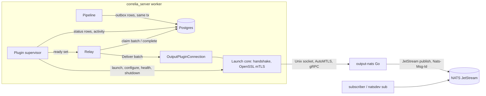
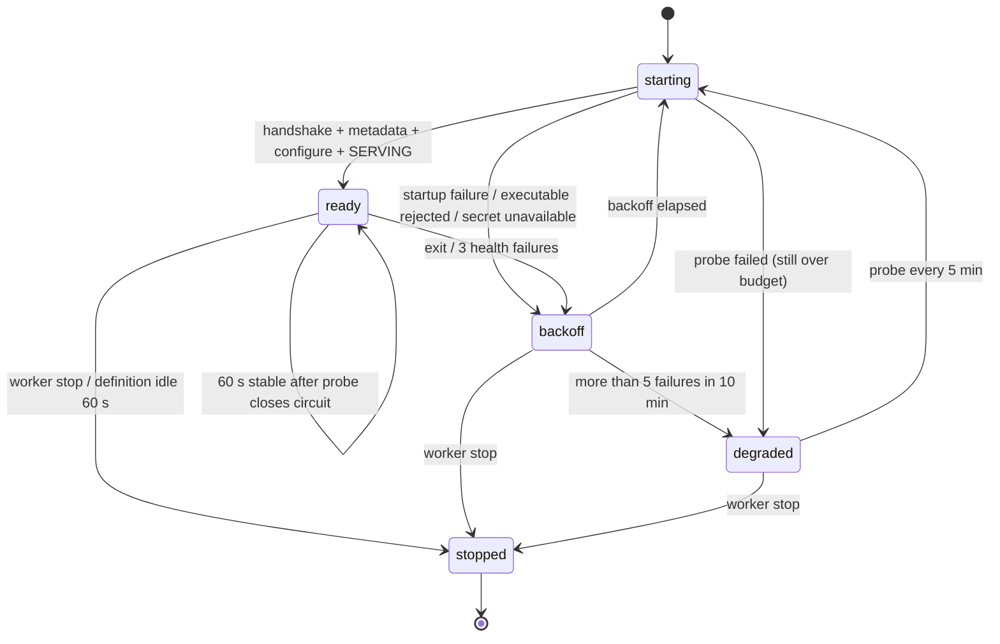
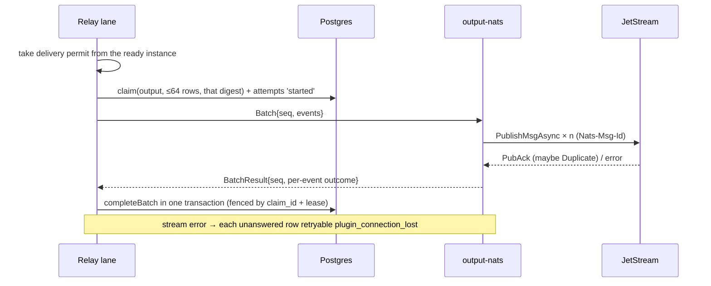

# Design

## Triage

| Trigger | Applies? | Evidence |
|---|---|---|
| T1 Components (new component, or 3+ with directed relationships) | yes | New supervisor subsystem, production plugin client, Go `output-nats` process, NATS dev tool; relay → supervisor → plugin → NATS |
| T2 State (persistent state, caches, 3+ state machine) | yes | `plugin_instance_status` table; supervision state machine (starting, ready, backoff, degraded, stopped); outbox columns |
| T3 Concurrency (background work, workers/isolates, async, retries) | yes | Relay lanes, supervisor timers, plugin restarts, concurrent workers claiming batches, async JetStream publishes |
| T4 Boundaries (data format, migration, shared interface, IPC, external) | yes | `correlia.plugin.v1` protobuf, schema step 0003, bootstrap config format, NATS subjects/headers, Go module paths |
| T5 Volume (grows without a fixed bound) | yes | Status rows and activity entries over time; batches; plugin stderr logs |
| T6 Risk (security, money, data loss, unrecoverable user data) | yes | Executing operator-named binaries, secrets passed to plugins, at-least-once delivery across worker death |

TIER: FULL

## Context

Read `proposal.md` for scope. The existing code this change builds on:

- **Relay.** `correlia_server/lib/src/output/relay_subsystem.dart`:
  - The loop (:49) runs `recoverExpired`, then `discover`, and starts up to 64 lanes, one per output.
  - Each lane (`_deliver`, :94) claims one row and calls the hard-wired `WebhookOutput.send` (:21, :104).

  `output_relay.dart` holds the rest:
  - the `Output` interface (:56) and `DeliveryOutcome` sealed type (:28);
  - claims under a per-output advisory lock, with a "no row delivering" check and
    `FOR UPDATE SKIP LOCKED LIMIT 1` (:166–243);
  - fenced completion with backoff `min(300, 2^(n-1))` and 20 attempts (:267–287);
  - `recoverExpired` marks attempts `interrupted` (:326).
- **Outbox.** It is SQL-owned (`schema/0001_ingest.sql:30-50`). It has no output-kind column, and
  `target_url` and `signing_key_*` are `NOT NULL`. Intents are inserted in the processing transaction
  (`pipeline/pipeline.dart:455-479`) from the pinned snapshot's `outputs` (:274-288).
- **Bootstrap.** `ingest/bootstrap.dart` accepts only `{id, kind, url, signing_key_ref}` and rejects
  `kind != 'webhook'` (:159-162). Secret files must be 0600 and owner-checked (:346-367).
- **Worker lifecycle.** `ingest/ingest_workers.dart` starts the pipeline and then the relay (:36), and
  stops both (:73). Registry order is set in `runtime/registry.dart:15`.
- **Spike host.**
  - `plugin/plugin_host.dart` launches stock go-plugin through `umask 0177; exec` in a 0700 directory
    (:205-270), with its own cookie default `correlia-plugin-host-spike` (:71). It connects over the
    in-process OpenSSL connector (`openssl_engine.dart`, `openssl_socket.dart`) and stops with a
    graceful-then-forced shutdown (:456).
  - Its connection exposes only the spike's generated `outputClient` (:59-68).
  - `plugin_delivery.dart` keeps an in-memory pending queue with manual `restart()` (:455) and no backoff.
  - The client identity is supplied as PEM. Only the Go test helper
    (`test/plugin/fixtures/go/cmd/credential-helper`) mints one. The OpenSSL bindings load and verify
    certificates but have no key-generation or certificate-signing symbols.
- **Activity and feed.**
  - `activity` (`schema/0002_activity.sql`) accepts any `entity_kind`, and the only writer is inline SQL in
    `state/alert_state_service.dart:252`.
  - `feed/feed_reader.dart:99` loads alert rows only for `entity_kind = 'alert'`. Other entries pass through
    as `FeedEntry` values and still advance the cursor (:117-121). The console does not read
    `entries`, only `alerts`.
- **Tests.**
  - `test/support/child_server.dart` starts real server children.
  - `test/support/output_process.dart` writes bootstrap files and runs an HTTP receiver.
  - `test/plugin/support/plugin_fixture_suite.dart:80-124` builds Go fixtures with
    `mise exec -- go build -trimpath`.
  - No NATS server, `nats.go` or `plugins/` folder exists, and `mise registry` offers no nats-server.
- **Owner decisions.** D24 (owner, 2026-11-11) accepts the protected Unix socket and stock AutoMTLS through
  grpc-dart's custom connector over in-process OpenSSL 3 for future production plugin work
  (`docs/plan/open-decisions.md:39`).

## Decisions

### D1: `correlia.plugin.v1` output contract with per-event outcomes

- **Choice:** New protobuf package `correlia.plugin.v1` in `proto/correlia/plugin/v1/`:
  - `PluginService.GetMetadata`: name, version, kinds, config JSON Schema and protocol minor.
  - `PluginService.Configure`: config JSON bytes, a `map<string, bytes>` of secrets, and a host limits
    proposal. The answer is accepted plus the plugin's limits and non-secret configuration information,
    or field errors with an optional plugin error class.
  - `PluginService.CheckHealth`: serving or not serving, with a bounded reason.
  - `OutputService.Deliver`: a bidirectional stream.
    - Requests: `Batch{sequence, events[{event_id, payload}]}`.
    - Responses: `BatchResult{sequence, results[{event_id, outcome ACKNOWLEDGED|RETRYABLE|REJECTED,
      error_class}]}`.

  One stream is one connection epoch, so no epoch field is needed. The go-plugin magic cookie is
  `CORRELIA_PLUGIN` / `correlia.plugin.v1`, distinct from the spike's. Application protocol version is 1.
  Error classes match `^[a-z][a-z0-9_]{0,63}$`.

  **Configure diagnostics (owner-approved amendment, 2026-11-12).** `ConfigureResponse.error_class`
  is empty or matches the error-class pattern above. `configuration_info` is a map of at most eight
  entries: keys match the same pattern (at most 64 ASCII bytes) and values are at most 256 UTF-8 bytes
  each. The 64 KiB response and frame checks run first: exceeding either gives
  `plugin_metadata_invalid`. Within those transport bounds, information or class validation and
  accepted/rejected exclusivity are checked before classifying acceptance or rejection; any violation
  gives `plugin_protocol_error`, without logging diagnostic content. Accepted responses have no error
  class or field errors; rejected responses have no configuration information. The host preserves its
  `plugin_config_rejected` classification and exposes the validated plugin class as `pluginErrorClass`.
  It silently drops that class if its ASCII bytes contain any non-empty resolved secret's exact bytes.
  Field error messages and configuration information are never automatically logged or persisted.
  Successful information is exposed as an immutable map to the caller. NATS reports keys
  `stream` (capturing stream name) and `duplicate_window_ms` (decimal milliseconds). Its rejected Configure
  response carries `stream_missing` or `nats_auth_failed` as appropriate.

  Rejected: encoding machine-readable classes in free-text field messages or the health reason, or
  dropping the required NATS diagnostics. Typed fields preserve sanitization and distinguish the host's
  classification from the plugin's. This is additive before the D15 compatibility freeze; reversal cost
  remains medium.
- **Rejected:** Whole-batch acknowledgements as in the spike probe. One oversized or unroutable event would
  hold its whole batch in retry until the batch dead-letters, and output-delivery requires per-intent dead
  letters.
- **Reversal cost:** medium. Pre-1.0 changes are allowed (D14), but a third party may build against it.
- **Important:** yes. Binds future changes (contract).
- **Chosen by:** agent.

### D2: One protocol-neutral launch core under two clients

- **Choice:** Factor the launch, handshake, TLS, readiness and shutdown parts of `PluginHost` into an
  internal launch core that yields an authenticated gRPC channel, the evidence and lifecycle hooks.
  - The spike's public `PluginHost`/`PluginDelivery` API and tests stay unchanged on top of it.
  - A new internal `OutputPluginConnection` builds the v1 clients on the same channel.
  - No production class is exported from `plugin.dart`. The supervisor uses them in-package.
- **Rejected:** A second, independent launcher for production. It would duplicate the native TLS and
  socket ownership code, the riskiest code in the spike.
- **Reversal cost:** low.
- **Important:** no.
- **Chosen by:** agent.

### D3: Ephemeral host identity minted in process with OpenSSL

- **Choice:** Each launch gets a fresh P-521 key and a self-signed certificate valid for 30 days with a
  `localhost` SAN, signed with ECDSA-SHA-512. They are minted in Dart through new narrow libcrypto
  bindings: key generation by EVP_PKEY_CTX, then X509 creation, signing and PEM export. The key lives
  only in memory and is passed to the connector, never written to disk. The bindings resolve eagerly with
  the existing ones, so a missing symbol fails startup (ADR 0023).
- **Rejected:**
  - Shipping the Go credential helper as a production binary. It is a test tool by ADR 0023, and it would
    put a private key on disk between processes.
  - A pure-Dart crypto package. It adds a new dependency for P-521 ECDSA when libcrypto is already a
    required runtime dependency.
- **Reversal cost:** low.
- **Important:** yes. Security (T6).
- **Chosen by:** agent.

### D4: The outbox is the only queue; relays claim plugin batches

- **Choice:** Generalise the relay's `claim(outputId)` to `claim(outputId, limit, readyDigests)`.
  - Webhook outputs keep limit 1 and pass no digests, so their behaviour is unchanged.
  - For plugin outputs the claim picks the oldest due row whose `definition_digest` is in `readyDigests`
    (M1), then claims up to 64 due rows and 1 MiB of payload of that one digest, oldest first. Rows of
    other digests are not touched and keep their attempt counts.
  - The batch shares one `claim_id` and lease and gets one `delivery_attempts` row per intent.
  - The existing rule of one delivering set per output (the advisory lock plus the "no delivering row"
    check) stays. So each output has at most one batch outstanding across all workers.
  - **Batch completion is one transaction (M3).** The new `completeBatch(claimId, outcomes)` writes every
    outcome with one `UPDATE outbox … FROM unnest(…)` and one `UPDATE delivery_attempts … FROM unnest(…)`.
  - **One end-to-end lease budget (R2-M1).** The relay lane starts a monotonic batch deadline of 27 s
    *before* the claim transaction begins. The lease is set later, inside that transaction, from
    `clock_timestamp()` plus 30 s, so the local deadline always ends at least 3 s before the lease. Every
    database statement of the claim and of the completion runs with `statement_timeout` and
    `lock_timeout` set to the time left on that deadline (capped at 5 s), as the pipeline's `_Deadline`
    already does. Phases: the claim must commit by 5 s; delivery gets `min(20 s, deadline − 5 s)`; the
    completion transaction gets what is left. No phase can outlast the deadline, whatever the split.
  - **Real-time, all-or-nothing fence.** Both completion updates are fenced by `claim_id`, status
    `delivering` and `lease_until > clock_timestamp()` (not `now()`, which is frozen at transaction
    start). The completion checks that each update touched exactly the batch's row count and rolls back
    otherwise. The updates hold the row locks until commit, so a concurrent `recoverExpired`, which
    re-checks `status = 'delivering'` after waiting on those locks, sees the committed result and leaves
    the rows alone.
  - **Over budget.** If the deadline passes before completion commits, the lane rolls back and writes
    nothing. Lease recovery later marks the batch `interrupted`, which consumes the attempt, and the
    redelivery is deduplicated by JetStream, so the stream still holds one message per event. Webhook rows
    keep the per-row `complete`, under the same deadline rule.

  The plugin output adapter sends the batch and maps each result to `DeliveryOutcome`.
- **Rejected:** Feeding claimed rows into the spike's in-memory `PluginDelivery` queue. That creates a
  second owner of pending work. Rows acknowledged into memory but not completed in Postgres would depend on
  lease expiry for recovery, while the memory copy could still be redelivered: two delivery state machines
  for one row. Also rejected: completing a batch row by row, which can run past the lease after a slow
  delivery (round 1 M3).
- **Reversal cost:** medium.
- **Important:** yes. Binds future changes, and is a data-loss risk.
- **Chosen by:** agent.

### D5: Plugin rows are acquired only while a ready instance serves their definition

- **Choice:**
  - `discover` lists plugin outputs that have due rows of any digest in the relay's in-memory ready set
    `(output_id, definition_digest)`, which the supervisor publishes to the relay of its own process.
  - **Delivery permit before claim (M1).** The relay lane first takes a delivery permit from the ready
    instance, then claims with that instance's digest only (D4). A permit is refused once the instance has
    left `ready`. A stop the supervisor starts itself (idle release, rotation, shutdown) waits
    for outstanding permits, so it never strands a claimed batch. A plugin in `starting`, `backoff` or
    `degraded` therefore spends no attempts, and an older unavailable definition never blocks a ready one.
  - **Permit generation and commit boundary (R2-M2).** A permit names the instance's launch generation.
    When the supervisor observes the process exit, a failed health streak or a lost connection, it bumps
    the generation and invalidates every permit of the old one at once. The claim transaction checks its
    permit as its last step, after writing the rows and the `started` attempts and just before `COMMIT`.
    An invalid permit rolls the transaction back: the rows stay queued with unchanged attempt counts.
    That check is the commit boundary.
  - A readiness loss observed after that check (in the short gap before `COMMIT` returns, or during
    delivery) completes each unanswered row as `DeliveryRetryable` with error class
    `plugin_connection_lost`. That consumes an attempt and matches `recoverExpired`'s `interrupted`. A
    process death the supervisor has not yet observed counts as after the boundary; the rule is about
    observed transitions.
  - If the worker itself dies, lease expiry recovers the batch as today.
- **Rejected:** Letting the relay acquire and fail fast while the plugin is down. That burns the 20-attempt
  budget during a restart loop, and dead-letters work because of a local fault. Also rejected: checking
  readiness only in `discover`, which loses the check before the claim (round 1 M1).
- **Reversal cost:** low.
- **Important:** yes. It changes what users see (attempt counts and dead letters).
- **Chosen by:** agent.

### D6: Supervision policy and its values

- **Choice:** A pure-Dart state machine (`starting → ready → backoff → starting`, plus `degraded` and
  `stopped`) driven by an injected clock and timers. Defaults:

  | Setting | Value |
  |---|---|
  | Start timeout | 10 s |
  | Health interval | 5 s |
  | Health call deadline | 2 s |
  | Health failures that count as a crash | 3 consecutive |
  | Backoff | 1 s doubling to a 60 s cap |
  | Backoff reset | after 10 min continuously ready |
  | Crash budget | more than 5 crashes or startup failures in a 10 min window opens the circuit |
  | Degraded probe | every 5 min |
  | Circuit close | a probe stays ready for 60 s |
  | Shutdown grace | 5 s |

  These are code constants, injectable in tests, not configuration keys.
- **Rejected:** Making them bootstrap configuration keys now. Nobody has needed to tune them yet, and
  config keys bind the format. M2's configuration work can expose them on evidence.
- **Reversal cost:** low.
- **Important:** yes. It changes behaviour users see (when `degraded` shows).
- **Chosen by:** agent.

### D7: Instances follow due work, admitted round-robin

- **Choice:** An instance is one plugin process for one `(output, definition digest)`. The supervisor
  starts instances only for definitions with due work, and shares a fixed number of slots round-robin
  (C1, R3-C1). The number of live definitions is not bounded: raw work pinned under an older snapshot can
  still create rows for that snapshot's definitions after a newer one activates (durable-pipeline
  pinning, ADR 0016). So nothing in the scheduler assumes a bound, and memory holds only the running
  instances and one cursor.
  - **Slots.** 16 per worker and 4 per output. A slot is held only by an instance that is `starting` or
    `ready`. A launch failure, a crash or an open circuit frees the slot at once; the definition's
    backoff and circuit live in its durable health row (D19), not in a slot.
  - **Admission cursor.** The worker keeps one cursor over the key `(output_id, definition_digest)`.
    When a slot is free, one query returns the first definition after the cursor that has a due queued
    plugin row, is not running in this worker, whose output has fewer than 4 running instances, and
    whose health row says it may start now (`next_start_at` absent or past). It is keyset-ordered by the
    key, `LIMIT 1`, and wraps to the start once. The cursor moves to the admitted key. A definition that
    leaves its slot is behind the cursor, so it cannot overtake any definition ahead of it: with N
    runnable definitions waiting, each is admitted within N admissions.
  - **Release.** Any instance, active definition included, stops after 60 s with no due rows and frees
    its slot. It starts again on demand (start timeout 10 s).
  - **Waiting demand (R4-C1).** Waiting is checked apart from admission. A second keyset query from the
    same cursor finds the first definition with due rows that is not running here and may start now,
    *ignoring both caps*. If it is blocked only because no worker slot is free, it waits for a worker-wide
    handover. If it is blocked by its output's cap of 4, it waits for a handover inside that output, even
    while worker slots are free.
  - **Rotation.** While a definition waits, the longest-held ready instance in the blocking scope (the
    whole worker, or the waiting definition's own output) is stopped after its current batch and its slot
    is freed, once it has held the slot for at least 60 s. The cursor then admits the next runnable
    definition in key order. So while anything waits, a slot in the right scope frees at least every
    60 s plus one batch (at most 27 s, D4) plus any probe protection below, and the cursor's
    N-admissions bound becomes a time bound. Status shows `instance_limit` for a waiting definition.
  - **Probes are not rotated (R4-M1).** An instance whose circuit is `probing` cannot be chosen for
    rotation until its readiness has lasted the 60 s that closes the circuit (D6), or until it fails.
    Rotation then picks the next eligible instance. If no other instance in the scope is eligible, the
    handover waits, at most 10 s of start plus 60 s of readiness, and this allowance is part of the time
    bound. A probe stopped for another reason (idle release or shutdown) before closing writes its health
    row back to `open` with the next probe time kept, so readmission continues the same circuit; it does
    not count as a failure.
  - The definition digest is the SHA-256 of the canonical JSON definition, without secret values.
- **Rejected:** Running only the active definition and re-pinning old rows to it. That breaks the
  output-delivery rule that pending work is never redirected (`openspec/specs/output-delivery`,
  Immutable routed delivery intent). Also rejected: keeping active instances always warm, which strands
  the 17th output (round 1 C1); a publication bound on live definitions, which pinned raw work bypasses
  (round 2); and a longest-waiting table, which needs its own bound and can starve what it drops (round 3).
- **Reversal cost:** medium. It shapes the outbox columns.
- **Important:** yes. Binds future changes (stored format) and users see waiting outputs.
- **Chosen by:** agent.

### D8: Schema step 0003 extends the outbox

- **Choice:** SQL step `0003_plugin_outputs.sql`:
  - adds `output_kind text NOT NULL DEFAULT 'webhook'` with a check of `('webhook','plugin')`;
  - adds `definition_digest text`;
  - drops `NOT NULL` on `target_url`, `signing_key_ref` and `signing_key_commitment`, with a check that
    `webhook` rows keep them and `plugin` rows have a digest;
  - adds an index on `(output_id, definition_digest, status)`.

  Existing rows become `webhook`. The plugin definition itself is read from the pinned
  `ingest_config_snapshot` through `config_snapshot_id`, so no definition bytes are copied per row.
- **Rejected:** A separate `plugin_outbox` table. The relay, recovery, budgets and the later M2 retention
  and partitioning would all need a second copy.
- **Reversal cost:** medium. It is a forward-only migration.
- **Important:** yes. Binds future changes (data format).
- **Chosen by:** agent.

### D9: Plugin output definition in bootstrap

- **Choice:** An output of kind `plugin` has exactly these keys, each with a field error on failure:
  - `id` and `kind`;
  - `plugin`: a file name matching `^[a-z0-9][a-z0-9._-]{0,63}$`, resolved in `CORRELIA_PLUGIN_DIR`;
  - `sha256`: 64 lowercase hex;
  - `config`: a JSON object of at most 16 KiB;
  - `secret_refs`: a map of at most 8 names to references in the secrets file, stored as commitments.

  The plugin directory must be owned by the server user and not writable by group or others. Workers
  check the executable before every launch (plugin-supervision). An api-only process validates the shape
  but does not require the plugin directory.

  **Secret values of any length (M2).** A secrets-file entry is either today's string (exactly 32 bytes
  as unpadded base64url) or an object `{"bytes": "<unpadded base64url>"}` of 1 byte to 16 KiB decoded.
  The decoded bytes of the whole file are bounded to 256 KiB, besides the existing 128 entries. The
  loader's encoded byte cap becomes per kind (R2-M3): the secrets file may be up to 512 KiB on disk, which
  covers 256 KiB decoded as base64url plus the JSON and reference overhead of 128 entries. The config
  file keeps 64 KiB. Both the `stat` check and the streaming read use the per-kind cap. The secrets
  file's mode and owner checks and the sanitized `bound` error stay as they are. Source
  credentials and webhook signing references still require exactly 32 bytes, with today's error. Plugin
  secret references accept either form, so a NATS token or a creds document fits. Commitments are the
  SHA-256 of the decoded bytes, whichever form held them.
- **Rejected:** An absolute executable path in config. It invites binaries outside an owner-controlled
  folder, and makes snapshots machine-specific. Also rejected: a second secrets file for plugins, which
  doubles the owner, mode and rebinding checks.
- **Reversal cost:** medium. It is a config format.
- **Important:** yes. A config key, and security.
- **Chosen by:** agent.

### D10: Secrets reach plugins only through Configure

- **Choice:** At configure time the host resolves the definition's `secret_refs` from the loaded
  secrets file. It checks each value against the stored commitment, as the signing keys do. Values are
  sent only in `Configure.secrets` and are never logged or stored. A missing or mismatched reference keeps
  the instance in `starting` with error class `plugin_secret_unavailable`, and its rows stay queued
  (D5). It never fails worker startup (D18).
- **Rejected:** Passing secrets through environment variables. A child's environment is readable through
  `/proc` by the same user, and it outlives configuration changes.
- **Reversal cost:** low.
- **Important:** yes. Security.
- **Chosen by:** agent.

### D11: Status rows and activity entries

- **Choice:** A managed model `plugin_instance_status` with:
  - `id`, `outputId`, `definitionDigest`, `hostInstanceId` (a random UUID per worker process) and `state`;
  - `pluginName`, `pluginVersion` and `pid`;
  - `restartCount`, `crashesInWindow`, `lastErrorClass`, nullable `lastPluginErrorClass`, `version` and
    `heartbeatAt`. On Configure rejection, `lastErrorClass` remains `plugin_config_rejected`;
    `lastPluginErrorClass` holds only the separately validated and secret-scrubbed plugin class (D1).

  There is a unique index on `(hostInstanceId, outputId, definitionDigest)`. Each process's supervisor is
  the sole writer of its own rows, and writes them on each state change and every 15 s.
  - A row read with a heartbeat older than 60 s is stale; the status query reports it so.
  - At startup a supervisor deletes rows of any host that are both stale and in `stopped`, or more than
    24 h stale. That is the one cross-process write, and it only touches rows whose writer is dead.

  Transitions into and out of `degraded` write one activity entry each (`entity_kind = 'plugin'`,
  `entity_id` = the status row id, `change_kind` `plugin_degraded` or `plugin_recovered`, `actor_kind`
  `supervisor`). The entry is written in the same transaction as the status update.
- **Rejected:** Keeping status in memory only. Nobody could see a degraded plugin of a headless worker
  before M4.
- **Reversal cost:** low.
- **Important:** yes. It changes what users see.
- **Chosen by:** agent.

### D12: Go layout and module paths

- **Choice:**
  - **`plugins/`:** Go module `github.com/sh1ny/correlia/plugins`.
    - `plugins/protocol/correlia/plugin/v1` holds the generated Go code.
    - `plugins/output-nats/` holds the plugin (`main.go`, `stdin.go`, `publish.go`, `config.go`).
    - It pins `hashicorp/go-plugin v1.8.0` (as the spike) and the latest `nats.go` release at apply
      time.
  - **`tool/natsdev/`:** a separate module `github.com/sh1ny/correlia/tool/natsdev`, with `serve`,
    `stream` and `sub` commands. It embeds `nats-server/v2` in process.

  Both modules record checksums in `go.sum` and build through `mise run plugins:build` into the ignored
  folder `build/plugins/`.
- **Rejected:** Placing the NATS plugin inside the spike fixture module. That ties a production plugin to
  test fixtures and to the unstable probe's generated code.
- **Reversal cost:** low.
- **Important:** yes. Binds future changes (the module path plugin authors import).
- **Chosen by:** agent.

### D13: NATS server for tests and the demo is embedded and pinned

- **Choice:** `natsdev serve` starts an embedded JetStream server with:
  - `--port 0` and loopback only;
  - `--store <dir>`;
  - a printed `ready <url>` line on stdout, then logs to a file;
  - exit when stdin closes.

  `natsdev stream` creates the demo stream (`CORRELIA_EVENTS`, subjects `correlia.v1.ev.>`, a 10 min
  duplicate window). Tests use the same commands through a Dart helper. The mise tasks `nats:dev`,
  `nats:stream` and `nats:sub` serve the owner demo.
- **Rejected:**
  - A `nats-server` binary from GitHub releases through mise. It is not in the mise registry, and an
    unregistered download backend gives weaker pinning than `go.sum`.
  - Docker or Testcontainers, which `AGENTS.md` rules out.
- **Reversal cost:** low.
- **Important:** no.
- **Chosen by:** agent.

### D14: Publish semantics of `output-nats`

- **Choice:** For each batch the plugin:
  1. validates subject tokens;
  2. publishes each event with `PublishMsgAsync`, `WithMsgID(event_id)` and `WithExpectStream(stream)`;
  3. waits on all futures under one deadline of 10 s.

  Outcomes:
  - a confirmation, including `Duplicate`, is ACKNOWLEDGED;
  - a timeout is RETRYABLE `publish_timeout`;
  - a lost connection or no responders is RETRYABLE `nats_unavailable`;
  - a wrong stream is RETRYABLE `stream_mismatch`;
  - payloads over `MaxPayload` are REJECTED `payload_too_large`;
  - invalid tokens are REJECTED `invalid_subject_token`.

  Configure connects, checks the stream with `StreamNameBySubject` for the prefix, and returns its name
  and duplicate window in the bounded `configuration_info` fields specified in D1. A rejected Configure
  returns the validated plugin class separately from the host's generic rejection classification.
  CheckHealth reports serving only while connected.

  Logs are JSON on stderr, with no payloads or credentials. The host captures stderr bounded, as in the
  spike.
- **Rejected:** Core NATS publish without JetStream. It gives no storage confirmation, so DUR-3 and the
  burst criterion could not be proven.
- **Reversal cost:** low.
- **Important:** no.
- **Chosen by:** agent.

### D15: Plugin protocol compatibility gate starts at 1.0

- **Choice:**
  - `buf lint` covers `proto/correlia/plugin/v1`.
  - Generated Dart and Go drift checks run in `proto:check`.
  - No `buf breaking` baseline yet. The baseline is frozen when the protocol is declared stable for 1.0
    (D27); the ADR records this.
- **Rejected:** Freezing a v1 baseline now. Until M8's SDK work exercises other plugin kinds, every
  correction would need a new major.
- **Reversal cost:** low.
- **Important:** yes. Binds future changes (compatibility promise).
- **Chosen by:** agent.

### D16: Supervisor runs inside the worker lifecycle, before the relay

- **Choice:** `IngestWorkers.start` starts the supervisor, then the pipeline, then the relay.
  `IngestWorkers.stop` stops in this order:
  1. the relay, which stops acquiring and finishes or abandons its in-flight batch;
  2. the pipeline;
  3. the supervisor, which shuts plugins down with the grace period of D6.

  The supervisor does not block `/startupz` on plugins becoming ready: a down NATS must not make the
  worker unready. Plugin readiness is in status rows.
- **Rejected:** A separate registry subsystem with its own role entry. The relay and supervisor share the
  ready set and must stop in a fixed order, and `IngestWorkers` already owns that ordering.
- **Reversal cost:** low.
- **Important:** no.
- **Chosen by:** agent.

### D17: Exit-criteria proofs run on real processes

- **Choice:** One e2e test per criterion:
  - **Burst:** a worker child with `output-nats` and a test-owned `natsdev` server. It posts 1,000 alerts
    in 20 webhook bodies through an api child. The kill is deterministic (S1): a test-only barrier in the
    worker, enabled by a test-mode flag, holds the first batch completion after at least 100 stream
    messages exist, between the plugin's answer and the local commit, and reports the hold on a file. The
    test asserts through SQL that a live `delivering` claim exists, then kills the worker with SIGKILL. A
    replacement worker then starts and the test waits for all outbox rows to be terminal. It asserts the
    reconciliation in output-delivery (No loss across worker death), including that the held batch was
    stored once in JetStream and reached `delivered` through redelivery. It also asserts that the killed
    worker's plugin pid exited with its stdin marker, which is the NATS plugin's ADR 0020 criterion 4.
  - **DUR-3:** the same barrier on a single event, then kill the worker.
  - **DUR-8:** kill the plugin pid, then crash it six times, using an injected short backoff and window.
  - **Demo path:** an Alertmanager fixture body, then the feed endpoint shows the alert, then
    `natsdev sub` receives it.
  - The barrier compiles in only when the run mode is `test`; production builds ignore the flag.
- **Rejected:** Simulated plugins for these criteria. The criteria name real NATS and real process death.
  Also rejected: killing on a stream-count threshold alone, which can race past the in-flight window.
- **Reversal cost:** low.
- **Important:** no.
- **Chosen by:** agent.

### D18: Kind-aware commitments and startup validation

- **Choice (C2):**
  - Publication records a commitment for every plugin `secret_refs` reference as well as for webhook
    signing references, and `_validateCommitments` rejects any reference rebound to different bytes
    (`reference_rebound`), whichever kind uses it.
  - `validateLiveSecrets` reads only `output_kind = 'webhook'` live rows. Missing webhook material still
    fails startup with `historical_key_unavailable`.
  - Live plugin rows never fail startup. Their secrets are resolved at Configure (D10); a missing one
    leaves that definition in `starting` with `plugin_secret_unavailable` and its rows queued, while
    other outputs deliver.
  - The existing output-delivery requirement "Signing key availability before acquisition" is scoped to
    webhook intents (a MODIFIED requirement in this change).
  - Publication adds no bound on live definitions. Pinned raw work can create definitions after
    activation, so such a bound could not hold (round 2 R2-C1). D7's rotating sweep handles any count.
- **Rejected:** Giving plugin rows dummy signing columns so today's code keeps working. It hides the
  kind in fake data and still fails on a missing plugin secret.
- **Reversal cost:** low.
- **Important:** yes. It changes when startup fails.
- **Chosen by:** agent.

### D19: Supervision history is durable per definition

- **Choice (R3-M1):** A managed table `plugin_definition_health`, keyed by `(host_instance_id,
  output_id, definition_digest)`, holds what must survive an instance leaving its slot:
  - the failure times in the current 10 min window (at most 6 kept);
  - the backoff step and `next_start_at`;
  - the circuit state (`closed`, `open` or `probing`), the next probe time, and the last host error class.
    Plugin diagnostic classes are mirrored only in status, not used by health or admission policy.

  The supervisor writes it on every launch failure, crash, circuit change and backoff reset, before it
  frees the slot, and reads it in the admission query. Memory holds only the up to 16 running instances.
  So a definition that cycles through slots keeps its backoff step and crash budget instead of starting
  fresh. Rows whose definition has no queued or delivering rows are deleted by the same periodic task
  that prunes status rows; rows of dead hosts are pruned as status rows are (D11). The table grows only
  with live definitions that have failed, on disk, not in memory.
- **Rejected:** Keeping evicted state in memory, which is unbounded once live definitions are, and
  dropping it, which resets the crash budget and breaks D6 and DUR-8. Also rejected: deriving it from the
  status row, which is a mirror, not an authority.
- **Reversal cost:** low. A managed table without other readers.
- **Important:** yes. It keeps the crash budget honest.
- **Chosen by:** agent.

### Decision summary

| # | Decision | Choice | Rejected | Reversal cost | Important | Chosen by |
|---|---|---|---|---|---|---|
| S1 | Protocol scope | `correlia.plugin.v1` output subset only | Promote spike probe; all plugin kinds now | medium | yes | agent |
| S2 | Durable queue | Outbox is the only queue | Host-side queue beyond the claim | medium | yes | agent |
| S3 | NATS subjects | Event subjects only | Incident subjects before incidents exist | low | no | agent |
| S4 | Owner demo | Judged at M1 close; runbook + e2e here | `[user]` task in this change | low | yes | agent |
| S5 | Status visibility | SQL status rows + activity entries | Console plugin page now | low | yes | agent |
| D1 | Protocol shape | Per-event outcomes, stream = epoch, own cookie; typed bounded Configure information and plugin error class | Whole-batch acks; diagnostics in free text or discarded | medium | yes | agent (diagnostic amendment approved by user) |
| D2 | Host structure | Shared launch core, two clients | Second launcher | low | no | agent |
| D3 | Host identity | Ephemeral P-521 minted via libcrypto in memory | Go helper binary; pure-Dart crypto | low | yes | agent |
| D4 | Batching | Relay batch claims of ready digests; one 27 s deadline over claim, delivery and one-transaction completion | Spike in-memory queue; per-row completion; per-statement budgets | medium | yes | agent |
| D5 | Readiness gate | Generation-checked permit at the claim commit; later loss = retryable attempt | Fail fast and burn attempts; discover-only check | low | yes | agent |
| D6 | Supervision values | Code constants, injectable | Config keys now | low | yes | agent |
| D7 | Instances | Follow due work; slots 4/16 admitted round-robin by key cursor; idle release; rotation per blocking scope, probes protected | Re-pin old rows; always-warm active; publication bound; waiting table | medium | yes | agent |
| D8 | Outbox schema | Step 0003 adds kind + digest | Separate plugin outbox | medium | yes | agent |
| D9 | Plugin config | Name in plugin dir + sha256 + config + secret refs; byte secrets ≤ 16 KiB | Absolute path; second secrets file | medium | yes | agent |
| D10 | Plugin secrets | Only in Configure, commitment-checked | Environment variables | low | yes | agent |
| D11 | Status persistence | Managed status rows + degraded/recovered activity | Memory only | low | yes | agent |
| D12 | Go layout | `plugins/` and `tool/natsdev/` modules | Inside spike fixtures | low | yes | agent |
| D13 | Test NATS | Embedded pinned nats-server tool | mise GitHub binary; Docker | low | no | agent |
| D14 | Publish | Async JetStream with msg id; per-event mapping | Core NATS publish | low | no | agent |
| D15 | Compat gate | Lint + drift now, breaking baseline at 1.0 | Freeze baseline now | low | yes | agent |
| D16 | Lifecycle | Supervisor inside `IngestWorkers`, readiness not gating | Separate registry subsystem | low | no | agent |
| D17 | Exit proofs | Real-process e2e per criterion; barrier-held kill | Simulated plugins; threshold kill | low | no | agent |
| D19 | Supervision history | Durable per-definition health row; memory holds only running instances | Evicted state in memory; drop it | low | yes | agent |
| D18 | Startup secrets | Kind-aware commitments; plugin secrets never fail startup | Dummy signing columns | low | yes | agent |

## Diagrams (FULL)

Components (T1):

Supervision state machine (T2):

A probe that reaches `ready` stays flagged `probing` until 60 s pass. A crash in that window returns to
`degraded`.

Batch delivery sequence (T3, T4):

Data format (T4): an outbox row gains `output_kind` and `definition_digest`. The pinned definition is
read from `ingest_config_snapshot` through `config_snapshot_id`.

## State & Ownership (FULL)

| State | Owner (sole writer) | Lifetime | Invalidation / rebuild | Authoritative copy |
|---|---|---|---|---|
| `outbox` rows incl. new columns | Pipeline (insert), relay (status, claim, attempts) | As today (M1 retains all) | Unchanged | Postgres |
| `delivery_attempts` | Relay | As today | Append-only | Postgres |
| `plugin_instance_status` row | The supervisor of the process whose `hostInstanceId` it carries. Startup pruning of dead hosts' stale rows is the only other write | Until stopped and stale, or 24 h stale | Rewritten on each transition and heartbeat | Postgres (mirror of memory) |
| `activity` plugin entries | Supervisor, in the status transaction | Indefinite (append-only) | Never | Postgres |
| Running instance state (≤ 16) | Supervisor | Instance lifetime | Rebuilt from config and the outbox at start | Memory |
| `plugin_definition_health` row | Supervisor of its host | While the definition has live rows and its host lives | Written on each failure, circuit change and backoff reset; pruned with status rows | Postgres |
| Admission cursor | Supervisor | Process lifetime | Starts at the beginning of the key order | Memory |
| Ready set `(output, digest)` | Supervisor; read-only for the relay | Process lifetime | Recomputed on every transition | Memory |
| Batch in flight | Relay lane | One claim | Completed or lease-recovered | Postgres claim; memory copy is transient |
| Host identity (key, cert) | Launch core | One launch | New per launch | Memory only |
| Plugin process, socket dir | Launch core | Process lifetime | Removed at stop | OS |
| JetStream messages | Stream (operator-owned) | Stream retention | Dedup by `Nats-Msg-Id` within the window | NATS |

## Failure & Visibility (FULL)

| Component | Fails / dies mid-operation → | Recovery | Retry safe? | Who finds out |
|---|---|---|---|---|
| Plugin process crash during a batch | Stream errors | Rows go retryable `plugin_connection_lost`; supervisor backoff restart | Yes: same bytes and id, JetStream dedups | Attempt rows; status `backoff`; after the budget, `plugin_degraded` activity |
| Plugin hangs (no answer) | Batch deadline of 20 s | Connection failed; rows retryable; instance restarted | Yes | Attempt error class; status |
| Plugin health fails | 3 consecutive failures | Restart | Yes | Status `lastErrorClass` |
| NATS down | Publishes fail retryable; health not serving | Relay backoff per row; after 3 failed health checks, restart | Yes | Attempt error classes; status; after 20 attempts, dead letters with reason |
| Stream missing or no longer capturing | Configure rejects, or publish `stream_mismatch` | Backoff until the operator fixes it, then degraded | Yes | Status `plugin_config_rejected` with separate scrubbed plugin class `stream_missing`; activity on degraded |
| Executable replaced or unsafe | Launch refused | Backoff, then degraded | n/a | Status `plugin_executable_rejected`, rows queued with no attempts |
| Secret missing | Configure not attempted; startup unaffected (D18) | Stays starting/backoff | n/a | Status `plugin_secret_unavailable` |
| Instance leaves ready before the claim commits | Permit refused, or invalid at the commit check | Claim rolled back; rows stay queued, no attempt | Yes | Nothing changes |
| Batch over its deadline | Lane rolls back before the lease ends | Lease recovery, redelivery, JetStream dedup | Yes | Attempts `interrupted` |
| Worker SIGKILL | Plugins exit on stdin EOF; claims expire | Replacement worker's `recoverExpired` gives rows `interrupted` and requeues them | Yes | Attempts `interrupted`; stale status rows |
| Worker SIGTERM | Ordered stop (D16) | n/a | n/a | Status `stopped` |
| Postgres down while ready | Heartbeat or claim fails | Supervisor keeps processes; retries writes next tick | Yes | Server log; `/readyz` 503 |
| Status write fails | Row lags | Next tick rewrites the whole row | Yes (idempotent upsert) | Server log |
| Relay answer after lease expiry | Fenced complete rejects it | Unchanged | Yes | Nothing changes (proven by test) |

## Resource Bounds (FULL)

| Queue / buffer / cache / transfer | Bound | At the bound | Timeout | At 10x / 100x |
|---|---|---|---|---|
| Plugin batch | 64 events and 1 MiB, and ≤ the plugin's accepted limits | Claim stops adding rows | Batch deadline 20 s, lease 30 s | 10k alerts is about 157 batches per output; 100x is a throughput question (measured in M10 load) |
| Outstanding batches per output | 1 (existing per-output rule) | Lane waits | As above | Serial per output. Ledger: more lanes per output only on load evidence |
| gRPC message | 2 MiB (spike `GrpcFrameGuard`) | Connection error | n/a | Fixed |
| Plugin metadata / config answer | 64 KiB and valid frame, checked first; Configure information ≤ 8 entries, keys ≤ 64 ASCII bytes and values ≤ 256 UTF-8 bytes | Response/frame overflow: `plugin_metadata_invalid`; then diagnostic bounds, class or accepted/rejected exclusivity violation: `plugin_protocol_error` | Start timeout 10 s | Fixed |
| Instances | 4 per output, 16 per worker; a slot only while starting or ready | Round-robin key cursor; release after 60 s idle; rotation in the blocking scope (worker or output) after 60 s held, never of an unfinished probe; status `instance_limit` | Start 10 s | N waiting definitions each admitted within N admissions; latency grows and stays visible |
| Plugin stderr capture | Spike's bounded log capture | Drops beyond the bound, counted | n/a | Fixed |
| Status rows | One per (host, output, digest) | Pruned when stopped and stale or 24 h stale | Heartbeat 15 s | Workers × instances; small |
| Activity plugin entries | Two per degraded episode; the circuit reopens at most every 5 min | n/a | n/a | At most about 576 per instance per day |
| JetStream publish in flight (plugin) | One batch (64) | n/a | 10 s | Fixed |
| Admission query | `LIMIT 1` keyset after the cursor, one wrap, per free slot | No runnable definition: nothing starts | 5 s statement | Index on `(output_id, definition_digest, status)` |
| Supervision history | Memory: 16 running instances; disk: one health row per failed live definition per host, ≤ 6 failure times each | Pruned with status rows and when the definition has no live rows | n/a | Grows with failing live definitions on disk only |
| Batch lifetime | One 27 s monotonic deadline over claim, delivery and completion; lease 30 s from the claim | Rollback, lease recovery as `interrupted`, JetStream dedup | Each statement gets the time left, ≤ 5 s | Fixed |
| Secrets file | 128 entries; each ≤ 16 KiB; 256 KiB decoded; 512 KiB on disk (config file stays 64 KiB) | Bootstrap field error `bound` | n/a | Fixed |

## Flow & State Gaps (FULL)

- **Partial batch answer.** Not possible: an answer must cover the whole batch (D1). A malformed answer is
  a protocol error, and the unanswered rows go retryable.
- **Concurrent workers.** The advisory lock and the "no delivering row" check keep one batch per output
  across processes. Each worker runs its own plugin process; status rows are per host.
- **More waiting definitions than slots.** The round-robin cursor admits each within N admissions, and
  rotation frees a slot every 60 s while anything waits (D7).
- **Configuration change mid-batch.** The batch is pinned to one digest. New rows get the new digest and
  wait for their own instance (D7).
- **Stale status after SIGKILL.** Readers compare the heartbeat with 60 s. A replacement worker writes
  new rows under its own host id.
- **Redelivery outside the duplicate window.** A redelivery more than the stream's duplicate window
  after the first publish creates a second message. Consumers dedup by event id (ADR 0018). The runbook
  states the window, and the demo stream uses 10 min, well over the 30 s lease.
- **Event order.** No order per alert (ADR 0018). Batches follow `created_at` order per output, but
  retries reorder.
- **Plugin activity rows in the feed.** The console reads only `alerts`. Plugin entries advance the
  cursor without alert rows (`feed_reader.dart:99-121`). A test proves the console list is unaffected.
- **Restart mid-configure.** Configure is per launch, and nothing persists in the plugin.

## Mechanism Ledger (FULL)

| Mechanism | Built? | Why (harm nobody catches / expensive later) | Evidence that would change the call |
|---|---|---|---|
| Readiness gate on acquisition | yes | Without it, a restart loop silently dead-letters work | n/a |
| SHA-256 pin of the executable | yes | Binary substitution runs code as Correlia; it is cheap and is a config format (expensive later) | M8 lock file replaces or extends it |
| Instance per old definition | yes | Required by the spec's no-redirect rule | Evidence that operators never change plugin outputs with work pending |
| Status pruning of dead hosts | yes | Without it, rows grow with every restart | n/a |
| Several batches per output in flight | no | One batch per output is enough for M1's 1,000-alert burst; throughput is measured in M10 | Load test showing a per-output backlog |
| Host-side pending queue | no | S2/D4: a second owner of delivery state | n/a |
| Breaking-change baseline for the plugin protocol | no | D15 | A third-party plugin in use before 1.0 |
| Plugin JSON Schema validation in the host | no | The plugin validates its own config in Configure with field errors; the host has no JSON Schema validator | M4 console editors need it |
| Restart of plugins on config change without work | no | Instances follow work and the active definition already | n/a |
| Incident subjects | no | S3 | M3 incidents |
| Persisted plugin logs | no | Bounded stderr goes to the server log | M10 observability |

## Risks / Trade-offs

- [Native X509 minting is new FFI surface] → Narrow bindings that resolve eagerly. A plugin-tier test
  checks the minted cert's group, SAN, validity and key match. A cold-process allocation test, as in the
  spike, covers repeated minting.
- [Serial delivery per output limits throughput] → It is bounded and measured. The ledger names the
  evidence for adding lanes.
- [An embedded nats-server version differs from production NATS] → Only JetStream publish, dedup and
  stream lookup are used, which are stable across 2.x. The runbook names the tested version.
- [A schema step that relaxes `NOT NULL`] → A check constraint keeps webhook rows complete. It is tested
  on fresh and populated databases, as steps 0001 and 0002 are.
- [Go module downloads on a fresh clone] → Pinned in `go.sum`. As with npm, the network is needed only
  to fill the first cache, and a build failure names the module.

## ADRs

- **In force, constraining this change:**
  - 0016: outbox and relays, no processing order;
  - 0018: NATS subjects, headers, stdin watcher, no order;
  - 0020: hybrid plugins, supervision, criterion 4 for the NATS plugin;
  - 0023: native OpenSSL connector, with D24 owner-accepted;
  - 0024: identities and event ids for `Nats-Msg-Id`;
  - 0014: Linux, no other Postgres;
  - 0004/0021: exact canonical bytes.
- **To record during apply:** ADR 0025, "Plugin protocol v1 output contract and supervision". It covers
  D1, D4, D5, D6 (as policy), D7, D12, D15, D18 and D19. It is additive and supersedes nothing. The same task
  updates `openspec/architecture.md`:
  - the Boundaries plugin-protocol bullet;
  - the state ownership rows for the outbox and plugin status;
  - the resource bounds row for plugin processes;
  - the in-force index.
  - **Configure amendment:** task 4.4 writes ADR 0026, superseding only the Configure-response portion
    of ADR 0025 D1, and updates the architecture boundary/index. Accepted ADR 0025 remains immutable;
    its other decisions remain in force. This records the typed diagnostics, validation precedence,
    exclusivity, secret scrubbing and separate host/plugin classification.

## Open Questions

None that change specs or tasks. Two items are settled at apply: the exact `nats.go` and `nats-server`
releases (the latest stable that builds with Go 1.27.3), and the plugin directory default for
`mise run run` (`build/plugins`).
