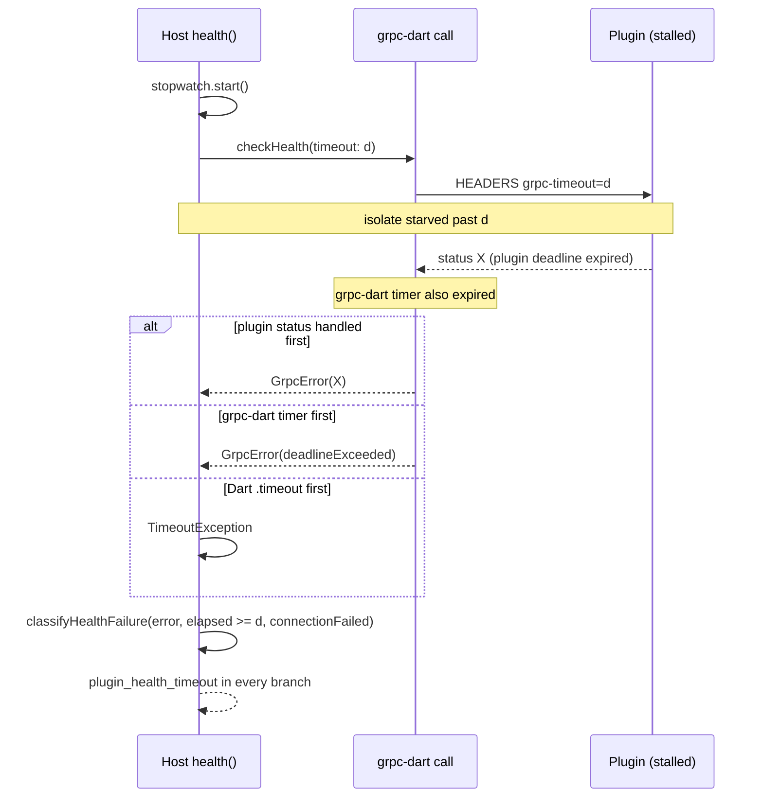
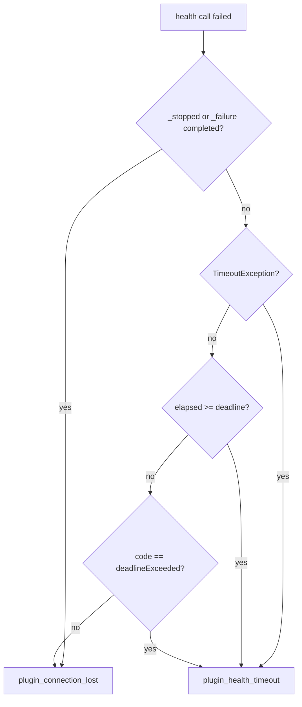

# Design

## Triage

| Trigger | Applies? | Evidence |
|---|---|---|
| T1 Components (new component, or 3+ with directed relationships) | no | Only `OutputPluginConnection.health` and its test change; host and plugin process are the existing two parties. |
| T2 State (persistent state, caches, 3+ state machine) | no | No new state. The supervisor state machine (`plugin_supervisor.dart`) is unchanged; it only receives a different error class at startup. |
| T3 Concurrency (background work, workers/isolates, async, retries) | yes | Three completions race for one health call: the Dart `.timeout` timer, grpc-dart's `CallOptions` deadline timer, and the plugin's own status sent when its copy of the deadline expires (`output_plugin_connection.dart:367-372`, fixture `main.go:88`). |
| T4 Boundaries (data format, migration, shared interface, IPC, external) | yes | The error class is part of the plugin supervision contract (ADR 0025: `last error class` persisted on `plugin_definition_health`) and is shown to operators. The gRPC call crosses the process boundary. The wire protocol does not change. |
| T5 Volume (grows without a fixed bound) | no | One call, one stopwatch. |
| T6 Risk (security, money, data loss, unrecoverable user data) | no | Classification only; no delivery or durable state path changes. |

TIER: FULL

## Context

See proposal.md for the failure and the reasons.

- `OutputPluginConnection.health` (`correlia_server/lib/src/plugin/output_plugin_connection.dart:357-386`):
  - caps the deadline at 2 s;
  - a pre-check throws `plugin_connection_lost` when `_stopped` or `_failure.isCompleted`;
  - calls `checkHealth` with `CallOptions(timeout: deadline)`, so grpc-dart sends `grpc-timeout` to the plugin and arms its own timer;
  - wraps the call in `.timeout(deadline)`;
  - maps `TimeoutException` and `GrpcError(deadlineExceeded)` to `plugin_health_timeout`, and every other `GrpcError` to `plugin_connection_lost` (line 385).
- **Evidence from the failing run** (M1 close, `test:all`, 2026-11-13): the stack points at `output_plugin_connection.dart 385:7`.
  - So the call ended with a `GrpcError` whose code was not `deadlineExceeded`.
  - It was neither the Dart timer nor the pre-check.
  - It failed at 00:05 into the run, while many test files were starting plugin processes and Postgres at once.
- **The fixture's stall mode** (`correlia_server/test/plugin/fixtures/go/cmd/output-production/main.go:88`) waits for `ctx.Done()` and returns `ctx.Err()`. The plugin's context carries the host's deadline, so the plugin ends the call itself when that deadline expires.
- **Why the plugin can answer first:** the Dart isolate handles timers and socket events from one event loop. When the isolate is starved for longer than the deadline, the plugin's status frame and the expired timers are all ready together. Which runs first is not specified.
- **Which status code arrives** (from the handler's `ctx.Err()` or from an HTTP/2 stream reset, through grpc-go v1.75.1 and grpc-dart 5.2.0) is not known yet. Task 1.1 captures it. The design does not depend on the answer (D1); it is recorded so the rule rests on evidence.
- **Connection loss is already detected outside `health`:**
  - the delivery stream's `onError`/`onDone` handlers (`output_plugin_connection.dart:311-327`);
  - process exit (`:330-336`).

  Both complete `_failure` through `_fail` (`:465`).
- **The supervisor:**
  - the startup health call (`plugin_supervisor.dart:329`) lets the exception propagate, and `:345-346` records its class as `instance.failure`;
  - the periodic `_health` (`:389-396`) treats any exception as not serving.

  So only the startup path shows the class to operators.

## Decisions

### D1: Classify by the call's elapsed time and the connection's state

- **Choice:**
  - `health` starts a monotonic `Stopwatch` just before `checkHealth`.
  - The class is decided from the connection state the host has observed when the call fails, applied the same way to every completion (`TimeoutException` and `GrpcError` alike):
    1. if `_stopped` or `_failure.isCompleted`, the class is `plugin_connection_lost`;
    2. otherwise a `TimeoutException` is `plugin_health_timeout`;
    3. otherwise, for a `GrpcError` whose elapsed time is at or past the deadline, the class is `plugin_health_timeout`;
    4. otherwise the class is unchanged from today: `deadlineExceeded` is a timeout, anything else is `plugin_connection_lost`.
  - The observation boundary is deliberate. An exit that has happened but has not yet completed `_failure` when an at-deadline call fails is classified as a timeout. The next health call or the delivery stream then reports `plugin_connection_lost` (Flow & State Gaps). The spec's "Connection lost during a health call" scenario is stated against what the host has observed.
  - The rule lives in one pure function, `classifyHealthFailure`. It takes the error, the elapsed time, the deadline and whether the connection has failed, and it is `@visibleForTesting`, so every branch is tested without a process. That includes each error kind with a recorded connection failure.
- **Rejected:** Stop sending the deadline to the plugin (drop `CallOptions(timeout:)` and keep only the Dart timer), so the plugin never ends the call first. It lost because:
  - the plugin needs the deadline to bound its own dependency checks;
  - the HTTP/2 stream would stay open after the host gave up;
  - grpc-dart can still surface a reset or an `unavailable` status that reaches the host before its timer, so the race narrows but does not go away.
- **Rejected:** A list of extra codes (`cancelled`, `unknown`, `unavailable`) treated as a timeout (S2).
- **Reversal cost:** low (one function and its callers in one file)
- **Important:** yes: it changes what users see (the startup error class on plugin status rows)
- **Chosen by:** agent

### D2: An error that arrives before the deadline keeps today's classes

- **Choice:** A non-`deadlineExceeded` `GrpcError` that arrives before the deadline on a live connection stays `plugin_connection_lost`, as today.
- **Rejected:** A new class such as `plugin_health_error` for a plugin that answers health with an error status. It lost because:
  - it adds an error class operators and the supervisor history must learn;
  - it has no evidence behind it;
  - it is outside the M1 gap (S3).
- **Reversal cost:** low (a later change can add the class; classes are strings stored as-is)
- **Important:** no
- **Chosen by:** agent

### D3: The deterministic regression proof is the pure classifier; real-process load is supplementary

- **Choice:**
  - The regression proof is a fast-tier unit test of `classifyHealthFailure`. It covers a non-`deadlineExceeded` `GrpcError` at and past the deadline on a live connection (the failure seen at the M1 close) and every other branch of D1. It is red before the fix and green after, with no timing dependence.
  - The real-process `health_call_stalls` test stays as integration coverage of the stall.
  - A `plugin`-tier stress test issues health calls to the stalled fixture while the isolate is kept busy past the deadline by a synchronous loop bounded by a `Stopwatch` (not a sleep: it waits for no condition). It runs 20 iterations and asserts `plugin_health_timeout` every time. It is labelled supplementary stress evidence: it cannot prove which completion won.
  - Repeated parallel runs of the file are further supplementary evidence.
- **Rejected:** Treat the starvation or parallel runs as the regression proof. It lost because nothing forces the plugin's status to win over the host timers: 12 isolated parallel runs did not fail, and a pass may never reach the new branch.
- **Reversal cost:** low
- **Important:** no
- **Chosen by:** agent

### Decision summary

| # | Decision | Choice | Rejected | Reversal cost | Important | Chosen by |
|---|---|---|---|---|---|---|
| S1 | Fix the classification, not only the test | Change `health` and assert the class | Loosen, retry or lengthen the test | low | yes | agent |
| S2 | The deadline decides, not the status code | Elapsed deadline on a live connection | List of extra codes as timeouts | low | no | agent |
| S3 | Scope stays M1-sized | Health classification and this test file | General flakiness sweep | low | no | agent |
| D1 | Classification rule | Observed connection state first, then elapsed deadline, in one pure function | Drop the deadline sent to the plugin | low | yes | agent |
| D2 | Pre-deadline errors | Unchanged (`plugin_connection_lost`) | New `plugin_health_error` class | low | no | agent |
| D3 | Regression proof | Pure classifier unit test; starvation and parallel runs supplementary | Starvation or parallel runs as the proof | low | no | agent |

## Diagrams (FULL)

T3: the race inside one health call.

T4: the classification contract.

## State & Ownership (FULL)

| State | Owner (sole writer) | Lifetime | Invalidation / rebuild | Authoritative copy |
|---|---|---|---|---|
| Health-call stopwatch | The `health` invocation | One call | Discarded when the call returns | Local variable |
| `_failure` / `_stopped` (existing) | `OutputPluginConnection._fail` / `stop` | One connection | Never reset; a new connection is a new object | The connection object |

`health` only reads `_failure` and `_stopped`; it writes nothing new.

## Failure & Visibility (FULL)

| Component | Fails / dies mid-operation → | Recovery | Retry safe? | Who finds out |
|---|---|---|---|---|
| Plugin stalls past the deadline | `plugin_health_timeout` | Supervisor counts a failed check (3 in a row is a crash, ADR 0025); at startup the start fails and backoff applies | yes (health is read-only) | Operator: status row's last error class |
| Plugin exits or the stream breaks, observed (`_failure` completed) before the call fails | The call fails as `plugin_connection_lost`, whichever completion ended it | Supervisor restart path | yes | Operator: status row; supervisor log |
| Plugin exits after the deadline, but before the exit is observed | That call is `plugin_health_timeout`; the exit then completes `_failure`, and the next call or the delivery stream reports `plugin_connection_lost` | Same as above, one observation later | yes | Operator, via the next observation |

## Resource Bounds (FULL)

| Queue / buffer / cache / transfer | Bound | At the bound | Timeout | At 10x / 100x |
|---|---|---|---|---|
| One health call | One in flight per supervisor tick (unchanged) | n/a | min(timeout, 2 s), unchanged | Unchanged; a stopwatch per call |
| Stress-test busy loop (D3) | 20 iterations × (deadline + margin) per test | Test ends | Test framework's default timeout | n/a (test only) |

## Flow & State Gaps (FULL)

- **Exit racing the deadline:** described in Failure & Visibility. The call is classified by what is known when it ends; the next observation corrects it. This is accepted.
- **Loss detected during the call:** `_failure` is checked when the error is classified, not only before the call, and for every completion. A failure that `_fail` records before the call fails is classified as lost, whatever the elapsed time and whichever completion ended the call.
- **Clock:** a monotonic `Stopwatch`, never wall time, so clock steps do not change the class.
- **Restart mid-operation:** not applicable (no persistent state in this path).

## Mechanism Ledger (FULL)

| Mechanism | Built? | Why (harm nobody catches / expensive later) | Evidence that would change the call |
|---|---|---|---|
| Elapsed-deadline check in `health` | yes | Without it the startup class misleads operators, and the M1 gate fails intermittently | n/a |
| Pure `classifyHealthFailure` function | yes | The only cheap way to prove every branch; the race cannot be forced through a real process | n/a |
| Re-checking `_failure` after one microtask, to catch an exit that is in flight | no | The next observation corrects it (Flow gaps); no harm nobody catches | A test showing exits misreported as timeouts at a rate operators notice |
| New `plugin_health_error` class | no | D2 | Plugins that answer health with error statuses in the field |
| Test retry on failure | no | Hides defects (S1) | none |
| Fixture change | no | The stall mode already exercises the race | Task 1.1 shows the race cannot be reached with it |

## Risks / Trade-offs

- [A real transport failure exactly at the deadline is reported as a timeout once] → `_failure` is checked at classification time, and the next observation reports the loss.
- [The busy loop is CPU-heavy in the `plugin` tier] → it is bounded to 20 short iterations (about 20 × deadline + margin, around 3 s at a 100 ms deadline).
- [The captured status depends on grpc-go/grpc-dart versions] → the rule does not depend on the code (D1); the capture only documents it.

## ADRs

- **In force, constraining this change:**
  - 0025: health deadline 2 s, failures counted by the supervisor, last error class persisted;
  - 0020: plugin architecture;
  - 0014: Linux-first platform and test tiers (supersedes 0010 through 0013); the testing rules in AGENTS.md (cheapest layer, no sleeps).
- **To record during apply:** none. This refines a classification inside ADR 0025's contract and binds no future boundary.

## Open Questions

- Which gRPC status the host receives when a stalled plugin's own deadline expires under starvation. Task 1.1 records it here; the answer does not change D1.
