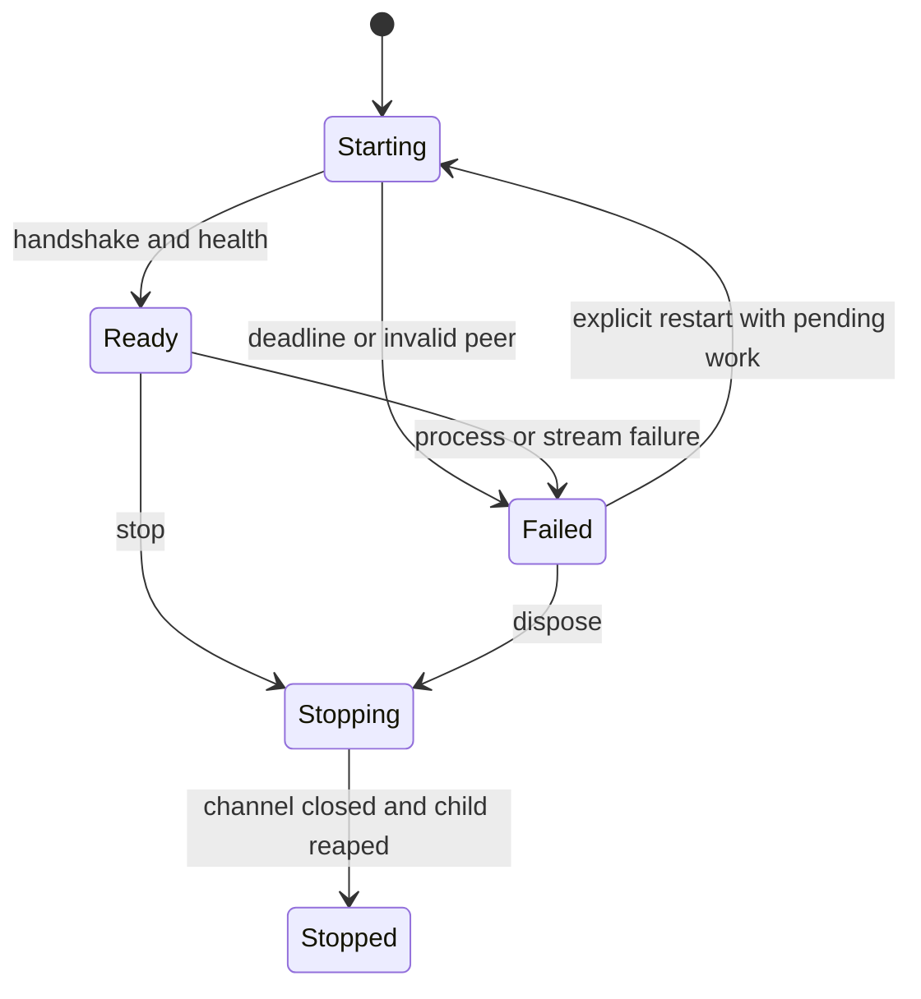
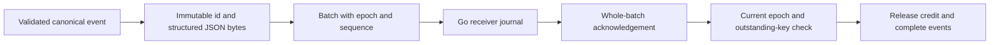

# Design

## Triage

| Trigger | Applies? | Evidence |
|---|---|---|
| T1 Components | yes | New Dart host, Go child and independent test observer |
| T2 State | yes | Starting, ready, failed, stopping and stopped lifecycle; outstanding batch map |
| T3 Concurrency | yes | Process streams, gRPC streams, deadlines and crash/restart |
| T4 Boundaries | yes | go-plugin wire protocol and experimental output protobuf |
| T5 Volume | yes | Delivery backlog, stderr and receiver evidence can grow |
| T6 Risk | yes | Certificate authentication and acknowledgement-loss semantics |

TIER: FULL

## Context

Scope and exclusions are in proposal.md. Existing `correlia_server/lib/event.dart:4` exports validated canonical values; `correlia_server/pubspec.yaml:12-25` has protobuf/codegen but no direct grpc dependency. `mise.toml:11-16` pins Linux Go and Buf. `tool/lib/src/proto_command.dart:68-76` owns event generation paths and the frozen baseline; its generation must not accidentally absorb plugin service descriptors into the event schema. `tool/lib/src/test_command.dart:25-37` already selects the plugin tier. The inspected server test tree has no plugin tests. New code is proposed, not existing functionality.

The primary go-plugin documentation confirms the handshake and health service; v1.8.0 `mtls.go` confirms P-521, localhost SAN and client/server usages:
- https://github.com/hashicorp/go-plugin/blob/v1.8.0/mtls.go
- https://github.com/hashicorp/go-plugin/blob/main/docs/internals.md
- https://github.com/hashicorp/go-plugin/blob/main/docs/guide-plugin-write-non-go.md

Runtime support for Dart P-521 client authentication remains the experiment, not an assumed fact. Research notes are hypotheses where marked uncertain. Third-party source/proto templates are not copied into this repository.

## Decisions

### D1: Experimental output-only contract

- **Choice:** Define Correlia-owned `correlia.plugin.spike.v1` messages under `proto/correlia/plugin/spike/v1/`. One bidirectional `Deliver` RPC carries batches of `(event_id, canonical structured-JSON bytes)` and acknowledgements containing a connection epoch and batch sequence. Acks mean the entire batch has been accepted. No partial outcomes in this probe. Epochs change per connection, sequences increase without reuse within an epoch. Stale callbacks are ignored by epoch fencing; unknown or repeated current-epoch acknowledgements fail the connection. Freeze byte snapshots on admission and validate ids against canonical envelopes. Expose the small experimental host through `plugin.dart`, not Serverpod generated APIs.
- **Rejected:** Publish the complete `correlia.plugin.v1` protocol now; source/config/patch semantics are unnecessary for the four gates. Sending only counters would not prove real event interoperability.
- **Reversal cost:** low; deliberately separate experimental package prevents mistaking it for the eventual stable protocol.
- **Important:** yes — binds an IPC boundary.
- **Chosen by:** agent

### D2: Stock serving and real mutual TLS

- **Choice:** Pin go-plugin v1.8.0 in a fixture Go module with go.sum; no patches or fork. Use plain-stock and stdin-watched entry points sharing Correlia's generated application service. Generate ephemeral P-521 host credentials with an original Go standard-library test helper in owner-only scratch; the helper is not a production certificate dependency. Load the identity into a Dart SecurityContext with `withTrustedRoots: false`; trust only the handshake server certificate and use authority localhost, never an accept-all callback. Decode the handshake's unpadded standard-base64 DER certificate and PEM-wrap it for trust loading. If needed, subclass grpc-dart ChannelCredentials to override `securityContext` with the identity-bearing context. Pin a protobuf-6-compatible grpc release and generators after checking their APIs; inability to resolve without dependency overrides is a stop-and-report feasibility failure. Record criterion-1 handshake parsing, negotiation and socket connection independently of TLS/application readiness. Parameterize criterion-3/4 harnesses by explicit security mode: AutoMTLS is the default; a separately requested diagnostic-only mode uses a verified 0600 socket without AutoMTLS. It is never an automatic retry or an adoption decision; evidence names the mode per criterion.
- **Rejected:** Go proxy client (would not prove Dart TLS), committed private keys, P-256 substitution, plaintext automatic fallback or modified stock server TLS.
- **Reversal cost:** medium; positive and negative real-process tests determine feasibility before adoption.
- **Important:** yes — security boundary and weak runtime evidence.
- **Chosen by:** agent

### D3: Small lifecycle owner, explicit restart

- **Choice:** One Dart host instance owns its process, channel, stdin and subscriptions. Start with a minimal inherited environment plus explicit cookie, versions, host certificate and private socket directory; no broker multiplexing. Parse a newline-terminated six-field handshake, accepting an optional seventh flag only when false; reject unsupported core/app/transport/protocol and, in AutoMTLS mode, a missing certificate. The attempt directory is mode 0700 and current-uid-owned; the announced path must resolve inside it to a socket owned by that uid with no group/other write bits. Record its actual mode. Continuous stream draining is bounded below. Implement health Check(`plugin`), controller Shutdown and stock GRPCStdio draining as required, using original hand-coded Dart ClientMethod descriptors and minimal codecs with provenance links, not upstream `.proto` files or copied schemas. Restart is explicit, not a production supervisor.
- **Rejected:** A generic registry/supervisor or direct server-startup integration; both hide experimental failures and expand the spike.
- **Reversal cost:** low.
- **Important:** yes — process and security boundary.
- **Chosen by:** agent

### D4: Surviving-host authority and independent crash evidence

- **Choice:** The delivery owner alone mutates pending events and the in-flight map. A stream generation holds its epoch, next sequence and credit counter and reports acks/terminal events to that owner. The owner atomically removes acknowledged batches; on the first terminal event it retires the epoch and moves its outstanding batches to retained pending work once. Restart re-batches retained immutable bytes under a fresh epoch. The Go fixture journals id, SHA-256 payload digest, epoch and sequence before ack, flushes, then notifies a test Unix control socket and awaits explicit release; the observer kills the exact plugin at that barrier. Reconciliation rejects torn records and compares every id/digest, including duplicates. For host-death tests launch the resolved Dart executable directly or an AOT binary, assert plugin PPid equals the host PID before SIGKILL, and observe exact PID/start identity without retaining stdin writers. Exit means `/proc/<pid>` absent or the same start identity in state `Z`. The stdin watcher writes and flushes a distinct EOF exit-cause marker before exit; during this test nothing writes fd 1/2 after the handshake, so SIGPIPE cannot masquerade as EOF success.
- **Rejected:** Receiver-only memory evidence, sleep-triggered crashes, process-name kills and claims of host-crash delivery durability.
- **Reversal cost:** low.
- **Important:** yes — failure guarantee and evidence integrity.
- **Chosen by:** agent

### D5: Preserve event tooling isolation

- **Choice:** Add pinned plugin generation/check stages to existing proto tasks with isolated input selection and outputs. Correlia's `correlia.plugin.spike.v1` definitions pass STANDARD lint. Upstream interoperability uses D3's hand-coded Dart descriptors: no upstream schemas enter the linted `proto` Buf module or event generator. Keep the existing event proto:check behavior and frozen baseline unchanged; select event-only input for event schema/bounds generation before adding plugin services. Use scratch-regenerate-and-compare for plugin outputs. Structured JSON avoids Go event types. Record an additive experimental-protocol ADR during apply, leaving accepted ADRs unchanged; D24 confirmation remains owner-only.
- **Rejected:** A second independent manual codegen workflow or regeneration of the event-v1.0 baseline.
- **Reversal cost:** medium.
- **Important:** yes — generation boundary and future protocol expectations.
- **Chosen by:** agent

### Decision summary

| # | Decision | Choice | Rejected | Reversal cost | Important | Chosen by |
|---|---|---|---|---|---|---|
| S1 | Scope | Four-gate output spike | Full SDK | low | yes: boundary | agent |
| S2 | Security/owner gates | Attempt AutoMTLS; owner confirms D24/fallback | Silent downgrade | medium | yes: security/evidence | agent |
| S3 | Durability scope | Surviving-host pending set | Database queue/host-crash delivery claims | low | yes: guarantee | agent |
| D1 | IPC | Experimental batch/epoch/ack protocol | Premature full v1 | low | yes: boundary | agent |
| D2 | TLS | Stock Go; ephemeral P-521; independent evidence with explicit diagnostic mode | Proxy/automatic downgrade/static keys | medium | yes: security/evidence | agent |
| D3 | Lifecycle | Single owner, exact socket checks, hand-coded upstream descriptors | Production supervisor/upstream schemas in Buf module | low | yes: boundary | agent |
| D4 | Recovery proof | Sole delivery-map writer; journal/control barrier and EOF-cause proof | Sleep/receiver-memory-only proof/ambiguous writers | low | yes: guarantee | agent |
| D5 | Generation | Isolated plugin stages, existing tasks | Manual parallel pipeline | medium | yes: boundary | agent |

## Diagrams (FULL)

T1 — components:


T2 — lifecycle:


T3 — crash/ack race:
```mermaid
sequenceDiagram
  participant H as Host
  participant P as Plugin
  participant O as Observer
  H->>P: Batch(epoch, sequence, bytes)
  P->>O: Journal flushed; pre-ack barrier
  O->>P: SIGKILL exact process
  H->>H: Retain outstanding batch
  H->>P: Explicit restart and redelivery under new epoch
  P->>H: Ack new epoch and sequence
```

T4 — boundary:


## State & Ownership (FULL)

| State | Owner (sole writer) | Lifetime | Invalidation / rebuild | Authoritative copy |
|---|---|---|---|---|
| Process/channel/lifecycle | Dart host | One host instance | Dispose; explicit new attempt | Host memory |
| Pending immutable bytes | Delivery owner | Admission to valid ack | Retained on plugin crash; lost on host death | Host memory |
| Epoch, sequence, credit counter | Stream generation | Connection | Retired by delivery owner; no map mutation from callbacks | Generation memory |
| In-flight batch map | Delivery owner | Admission to ack or epoch retirement | Atomically return retired epoch's outstanding batches to pending once | Host memory |
| Accepted deliveries journal | Go fixture | One test run across restarts | Observer deletes after all processes exit | Test-owned file |
| Credentials/socket directory | Attempt owner | One attempt | Destroy after process/channel exit | Restricted scratch |
| Gate evidence | Implementer, committed by orchestrator | Change history | New evidence supersedes with explanation | Committed evidence file |

## Failure & Visibility (FULL)

| Component | Fails / dies mid-operation → | Recovery | Retry safe? | Who finds out |
|---|---|---|---|---|
| Credential helper | No usable credentials | Fail startup; clean scratch | New attempt | Named startup diagnostic/test |
| Host startup | Invalid handshake, socket ownership/mode, exit, timeout, TLS/health failure | Close channel, terminate/reap own child; record parsed-handshake evidence before TLS | Explicit restart only, never automatic plaintext retry | Typed error and bounded diagnostics |
| Deliver stream/plugin | Uncertain acceptance | Preserve pending set; restart | At least once; consumer dedup required | Test result and receiver journal |
| Host SIGKILL | No graceful cleanup | Watched child exits on EOF | No delivery durability claim | Independent observer |
| Uncooperative shutdown | RPC blocked or child remains | Force own PID after grace | Stop is idempotent | Forced-stop diagnostic |
| Evidence/generation | Missing journal, mismatch or tool failure | Fail check, never report pass | Rerun after cause fixed | Command exits nonzero with stage/path |

## Resource Bounds (FULL)

All initial defaults below are injected policy, not stable operator settings. Validate positive values and reject oversize single events before admission. Existing canonical event bounds still apply.

| Queue / buffer / cache / transfer | Bound | At the bound | Timeout | At 10x / 100x |
|---|---|---|---|---|
| Host pending admission | 1,024 events and 16 MiB total | Await capacity; cancellation fails caller, no admission | Delivery run deadline below | Lazy producer never materializes entire source |
| Batch | 64 events, 1 MiB encoded message | Flush before next event exceeds cap; flush partial batch at source completion or end of currently available input turn, without waiting for a full batch | Ack progress deadline below | More batches, same memory |
| Outstanding batches | 4 | Stop sends until ack | 10 s ack progress deadline | Fixed memory, slower throughput |
| gRPC message/stream | 2 MiB send/receive cap | Reject over-bound message | 10 s stream-open/first-response deadline, then 10 s ack-progress while outstanding; no whole-stream deadline or idle timeout with no outstanding work | Fixed cap, healthy progressing streams can stay open |
| Handshake | 16 KiB including newline | Fail and clean child | 10 s total start including TLS/health | Fixed cap |
| stderr/stdio/stdout after handshake | 8 KiB per diagnostic chunk; 64 KiB retained tail | Drain/discard excess with truncation count | Entire process lifetime | Constant retained memory; no blocked child pipes |
| Stop | One shutdown RPC/child | Force terminate then await exit | 2 s grace, 5 s force/reap watchdog | One process per host |
| SIGKILL orphan observation | One PID/start identity | Fail assertion before teardown cleanup | 5 s | Independent observer; never name-match |
| Spike event source | 10,000 distinct events generated lazily | Exact set reconciliation | 120 s whole test | 100k/1M use same streaming bounds, not mandatory benchmark |
| Receiver journal/test logs/control | 32 MiB digest journal, 4 MiB diagnostics per test; control socket one 8 KiB frame in each direction per barrier | Fail test, stop children; no silent overwrite or unbounded control queue | Whole test deadline; journal-flush barrier explicitly released or child killed | Fail visibly rather than disk growth |
| Fixture builds | One module build per suite into owned scratch | Serialize build, reuse binaries for suite | 120 s build | No process per event |

## Flow & State Gaps (FULL)

- Admission assigns ownership only after immutable bytes fit the pending budget; cancellation before admission does not create pending work. Stop rejects new admissions and completes blocked callers with an explicit stopped error.
- Ack and stream-error callbacks report to the sole delivery owner, which validates epoch/key before mutating maps. Its first terminal event retires that epoch and returns all remaining in-flight batches to pending atomically once; late callbacks cannot mutate the new generation.
- All-or-nothing ack avoids ambiguous per-event credit accounting. A receiver records whole batches before ack. A crash after record/before ack creates intentional duplicates, reconciled by exact id and bytes.
- After restart, acknowledged events are absent from the pending set. Pending batches can change grouping, never identity/bytes. No alert ordering guarantee is introduced.
- EOF is held open until disposal. The independent observer directly launches the Dart host (no `dart run`/timeout wrapper), verifies the plugin's PPid is that exact host, and retains no plugin stdin writer. SIGKILL assertions require the EOF marker and exact-process exit state as defined in D4 before any teardown signal. A zombie counts as terminated, not as a running orphan; teardown handles reaping where possible.
- Shutdown races with start/delivery are serialized through the lifecycle owner. Any startup failure cleans even a partially initialized child/channel. Failure of the cleanup watchdog is a test failure, not a successful stop.
- Socket checks use D3's directory, uid, type and mode criteria. A mismatching stock mode is recorded as a failed check for owner disposition, not silently chmodded or repaired by a modified plugin. Diagnostic plaintext mode additionally requires exact 0600; it is explicitly selected before launch, never entered after authentication failure.
- No arbitrary sleeps: barriers signal readiness, withheld acks, journal flush and pre-ack crash points. Process exit observation uses Linux identity-aware bounded polling only where the OS lacks a parent wait handle.

## Mechanism Ledger (FULL)

| Mechanism | Built? | Why (harm nobody catches / expensive later) | Evidence that would change the call |
|---|---|---|---|
| TLS pinning and negative checks | yes | Wrong trust/client setup can make a positive smoke test misleading | Owner-approved superseding security ADR |
| Epoch/ack validation | yes | Late ack can lose pending events or invent credits | Different reviewed connection-ownership proof |
| Bounded admission and log draining | yes | Slow receiver/noisy child exhausts memory or blocks pipes | None for this process boundary |
| Journal and explicit crash barriers | test only | Otherwise success can hide loss at ack uncertainty | Equivalent independent exact reconciliation |
| Stdin watcher | fixture only | Host SIGKILL cannot run cleanup | Owner-approved alternative with equivalent proof |
| Retry backoff/circuit breaker/status DB | no | Output-NATS change owns production supervision | Production integration scope begins |
| Full metadata/config/source/patch APIs | no | No gate needs them | First real consumer establishes requirements |
| Durable queue/registry/lockfile | no | Surviving-host experiment only | Production relay/distribution work |

## Risks / Trade-offs

- P-521 or client certificate support may fail → record criterion 2 as failed, retain criterion-1 handshake evidence and explicitly run criterion-3/4 diagnostic experiments only when selected by the test operator. Label each result's security mode. This gathers evidence without approving the plaintext fallback or unblocking dependent production work.
- Minimal upstream interoperability descriptors can drift → pin upstream, link wire methods, prove against stock executables and keep those descriptors outside Buf input; Correlia-owned proto must pass STANDARD lint.
- Probe protocol is not full v1 → explicit experimental namespace and ADR keep downstream work from treating it as stable.
- The Go credential helper proves Dart TLS loading/transport but not production Dart certificate issuance → make no claim about production issuance; decide it in real plugin integration.
- Existing event generation scans `proto` → isolate event inputs before adding services; upstream declarations are hand-coded Dart descriptors, not module schemas. Preserve event-only schema/bounds generation, baseline and existing event-contract checks.
- Stock socket permissions may disagree with ADR 0020's exact 0600 wording → record actual mode and escalate the discrepancy to the owner; do not modify the stock plugin or treat diagnostic mode as transport adoption.

## ADRs

- **In force, constraining this change:** 0020 (all four gates and owner fallback/transport), 0018 (stdin EOF), 0014 (Linux), 0021 (canonical event boundary).
- **To record during apply:** New additive ADR documenting the experimental output protocol boundary, not superseding accepted decisions. A failed gate's fallback requires a separate owner-approved superseding ADR and renewed review before adoption.

## Open Questions

- D24 production Unix-socket confirmation remains owner-only and is a `[user]` completion gate. Testing the accepted recommended transport does not record that confirmation.
- None of the runtime feasibility questions is assumed answered; the four criterion tests and evidence are their planned resolution.
