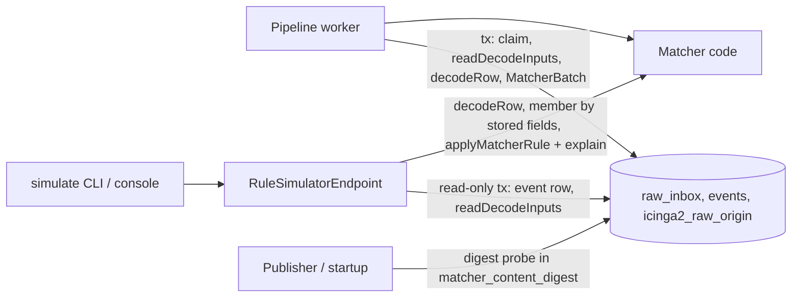
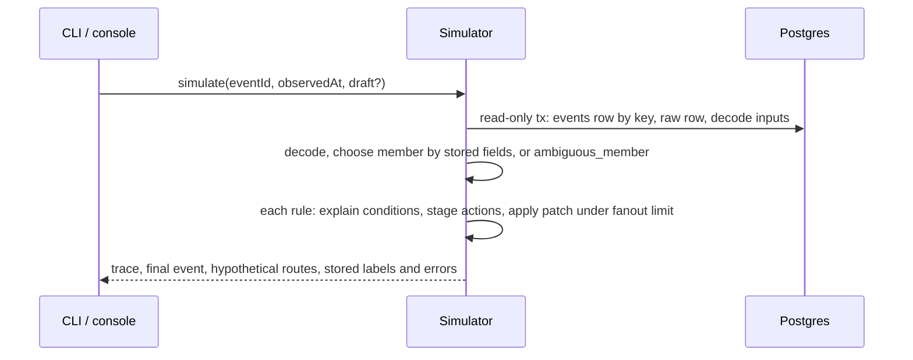

# Design

## Triage

| Trigger | Applies? | Evidence |
|---|---|---|
| T1 Components (new component, or 3+ with directed relationships) | yes | New simulator endpoint and CLI; CLI → endpoint → decode and evaluator |
| T2 State (persistent state, caches, 3+ state machine) | yes | Two new SQL-owned tables: digests of published matcher content and the fill's completion row |
| T3 Concurrency (background work, workers/isolates, async, retries) | yes | The simulator shares the regex worker design with the pipeline; the upgrade fill runs under the publication lock |
| T4 Boundaries (data format, migration, shared interface, IPC, external) | yes | A new matcher action, a new console API, a schema step |
| T5 Volume (grows without a fixed bound) | yes | The reserved-label check looks up a history of snapshots that grows forever |
| T6 Risk (security, money, data loss, unrecoverable user data) | no | No credentials, no outbound calls; the simulator is read-only behind the console policy |

TIER: FULL

## Context

See proposal.md for scope. What the code does today:

- **Claim and transaction.** A worker claims a pending, pinned row with `FOR UPDATE SKIP LOCKED`
  inside the processing transaction (`correlia_server/lib/src/pipeline/pipeline.dart:410-417`). The row
  deadline is 10 s (`pipeline.dart:38`), and optional matcher work stops 2 s before it
  (`pipeline.dart:267-268`). Matchers run inside that transaction over the retained events
  (`pipeline.dart:789-818`). This change keeps that shape.
- **Decode inputs.** Non-stream rows decode from the raw bytes and the processing pin's source
  settings (`pipeline.dart:443-520`, `:529`). Icinga2 Event Streams rows also load the trusted origin,
  state policy and sync ID from `icinga2_raw_origin`, joined to the **admission** snapshot
  (`pipeline.dart:524-527`, `:1059-1088`). `processedAt` comes from the clock (`pipeline.dart:521`).
- **Stored events.** `events` has primary key `(observed_at, event_id, disposition)` and stores
  `raw_observed_at`, `raw_id` and `config_snapshot_id` (`correlia_server/schema/0001_ingest.sql:17-28`).
  `observed_at` is the event's observed time (`pipeline.dart:520`, `:761`), which is the payload's
  `observed_at` (`proto/correlia/event/v1/event.proto:286-289`), stored as its microsecond projection
  (`pipeline.dart:68-72`): a caller keying a stored event by payload time drops sub-microsecond digits.
  There is no index on `event_id` alone. A future-dated non-stream event is stored with disposition
  `future_dated` (the effect is built at `pipeline.dart:752-766` and inserted at `:776-783`), and its
  later eligible copy at a later `observed_at` (`pipeline.dart:47-65`). A future-dated or late stream
  item is counted and skipped before retention and is never stored (`pipeline.dart:594-611`).
- **Duplicates in one raw batch.** The pipeline sorts prepared events by event ID with `List.sort`,
  which is not stable, then keeps the first of each event ID (`pipeline.dart:567`, `:612-625`). Two
  Alertmanager alerts with equal identity can differ in annotations
  (`ingest/alertmanager_decoder.dart:196-215`, `:286-299`), so today the retained member is unspecified,
  and rows stored before this change keep that unspecified member.
- **Matcher.** `applyMatcherRule` evaluates the condition on the original event and stages actions
  (`correlia_server/lib/src/matcher/matcher_evaluation.dart:18-102`). `MatcherBatch.enrich` applies
  patches under the fanout and time budgets and records failures by rule ID
  (`matcher_evaluation.dart:123-247`): it checks the fanout bound rule by rule and charges only patches
  it applies (`:188-203`); a cutoff leaves later rules unattempted without a diagnostic, and
  diagnostics that do not fit are dropped (`:172-176`, `:204-247`). Failures commit through
  `correlia_record_matcher_batch` (`pipeline.dart:909-915`).
- **Conditions.** `matches` returns a bare `bool` (`matcher/matcher_condition.dart:86-87`). A field
  read returns a nullable string with no presence bit (`matcher_condition.dart:239-279`, scalar catalog
  from `:309`), and canonical
  parsing rejects explicit nulls in catalog text fields (`event/canonical_event.dart:1345-1363`). `_Many`
  short-circuits on the first decisive child (`matcher_condition.dart:158-169`). A leaf returns false
  on a missing or null value (`matcher_condition.dart:177-186`).
- **Actions and label keys.** `set_label` writes any key matching the label key pattern
  (`matcher/matcher_document.dart:302-304`, `:149`), and so does `extract` (`matcher_document.dart:354-368`);
  the pattern admits `kind` and `correlia.noise_class` today. The previous binary's
  `MatcherDocument.fromSnapshot` rejects unknown actions (`matcher_document.dart:41-52`, `:300-425`).
- **Regex budgets.** The row's regex worker fails the first over-long regex with `regex_timeout` and
  every later regex in the row with `regex_budget` (`matcher/matcher_regex_worker.dart:65-145` for the
  timeout, `:171-201` for the sticky budget state);
  non-regex rules keep running. Only the overall optional cutoff stops the rule walk
  (`matcher_evaluation.dart:172-176`, `:204-220`). A canonical label value is at most 1024 characters
  (`proto/correlia/event/v1/event.proto:251-257`); an `extract` capture is staged and the resulting
  event validated against that bound (`matcher_evaluation.dart:53-58`, `:100-102`).
- **Routes.** The pipeline takes the source's route IDs and the output registry from the same
  processing pin (`pipeline.dart:456-494`) and charges the source routes in the fanout calculation
  (`pipeline.dart:780-818`, `matcher_evaluation.dart:188-203`).
- **Publication and startup.** Startup parses and validates the bootstrap file before the repository
  can recognize an identical active snapshot (`ingest/bootstrap.dart:469-501`,
  `ingest/ingest_startup.dart:64-76`, `ingest/config_repository.dart:71-103`, `:159-179`). The matcher content of a snapshot is `publicJson.matcher`,
  and the guard compares its digest (`config_repository.dart:161-179`). ADR 0032 and the main matcher
  spec ("Atomic matcher publication and restore") require an exact-file restart and a rollback to
  earlier matcher content at a higher revision to succeed. The main spec's scenario "NUL operands do
  not break existing snapshot readers" is covered for admission and a direct read of the pinned
  matcher by `correlia_server/test/db/matcher_publication_test.dart:675-738`; that test does not run the
  pinned row through the worker, so the upgrade test of D13 processes such a row through the worker.
- **Schema.** Schema changes are numbered SQL steps registered in `schema/schema_steps.dart:71-93`
  (`schema/0001_ingest.sql` to `0014_matcher_failures.sql`). `ingest_config_snapshot` is a
  Serverpod-managed table (`models/ingest_config_snapshot.spy.yaml`). Plugin configuration strings may
  hold U+0000, stored as a JSON escape in `publicJson` (`ingest/bootstrap.dart:91-145`, `:205-213`,
  `:337-369`), which PostgreSQL refuses to convert to `jsonb`.
- **Read-only console endpoint pattern.** `ConsoleAccessPolicy.check`, then a helper reading the
  active snapshot (`endpoints/mapping_preview_endpoint.dart:13-31`, `ingest/mapping_preview.dart:21-46`).
- **Kinds.** Icinga2 webhook (`ingest/icinga2/mapper.dart:33-46`). Event Streams: a state change is
  `alert`, but a non-OK SOFT state under `hard_only` yields no event
  (`ingest/icinga2/stream/decoder.dart:240-259`); acknowledgements, downtimes and flapping are `ack`,
  `downtime` and `state`, and other types are `unsupported_type` (`stream/decoder.dart:287-324`).
  Alertmanager (`ingest/alertmanager_decoder.dart:264`) and generic (`ingest/generic_decoder.dart:190`)
  are `alert`.
- **Console.** The live alert list reads only firing alerts
  (`correlia_server/lib/src/feed/feed_reader.dart:22-47`) and renders severity, summary, source and
  times (`correlia_flutter/lib/src/alert_list_page.dart:115-150`). The console bundle `web/app` is
  gitignored; without `index.html` the server serves its not-built route
  (`runtime/console_subsystem.dart:35-63`; `correlia_server/.gitignore:9` ignores `web/app`). Alert state keeps the original severity: main spec
  `openspec/specs/matcher-rules/spec.md`, scenario "Enrichment cannot alter alert state or
  reconciliation".

## Decisions

### D7: Explained evaluation shares the evaluator and keeps short-circuiting

- **Choice:** `MatcherCondition` gains `explain(event, regexTest)`, which returns a trace tree. It
  evaluates children in order, stops at the first decisive child exactly as `_Many` does now, and
  marks the rest `not_evaluated`. Leaves carry `matched`, `value_differs`, `field_missing` or
  `failed:<code>`. `matches` shares the same control flow with a no-op sink and allocates no trace. A
  test proves that a skipped regex child is never called. There is no null reason, because no input
  path can carry an explicit null to a leaf.
- **Rejected:** a separate explaining evaluator that visits every leaf, because it would run regex
  work the pipeline skips, and the two evaluators could drift apart.
- **Reversal cost:** low.
- **Important:** no (internal).
- **Chosen by:** agent

### D8: Simulator API types

- **Choice:** the Serverpod models `RuleSimulationResult`, `RuleTrace`, `ConditionTrace` (a flat list
  with parent indexes), `ActionTrace` and `SimulationError`. The method is
  `RuleSimulatorEndpoint.simulate(eventJson?, eventId?, observedAt?, disposition?, draftMatcher?)`:
  either `eventJson` with no stored-key field at all (`eventId`, `observedAt`, `disposition`), or
  both `eventId` and `observedAt` with an optional `disposition` and no `eventJson`. Each field is
  checked before any lookup: an orphaned or partial key field, `disposition` alone, a malformed event
  ID or an unknown disposition is `invalid_input` naming the field. `observedAt` is an RFC 3339
  timestamp checked as ADR 0021 checks canonical timestamps: an invalid calendar date, or a missing or
  invalid offset, is `invalid_input` naming `observedAt`, never read in the machine's local zone. A
  valid value is projected to the stored UTC microsecond key (`pipeline.dart:68-72`, `:761`) before
  lookup. The CLI passes the operator's text through unchanged and prints that field error. `RuleTrace` carries
  a rule outcome, `matched`, `not matched`, `failed` (with its code) or `not attempted`, apart from the
  condition outcome: a rule can match its condition and then fail an action. A `not attempted` rule
  has no condition entries and no action entries; a `not matched` rule lists its conditions and no
  actions; a short-circuited condition entry is `not evaluated`. Like `MappingPreviewEndpoint`
  (`endpoints/mapping_preview_endpoint.dart:9-11`), the endpoint sets `logSessions => false`, so a
  simulation writes no session log; the no-write test calls the real RPC endpoint.
- **Rejected:** one JSON string, because it is untyped for the console.
- **Reversal cost:** medium (client contract).
- **Important:** yes (binds the M4 console).
- **Chosen by:** user

### D9: Stored events are found by key and simulated from their raw row

- **Choice:** look the event up by its primary key prefix `(observed_at, event_id)`, preferring the
  non-`future_dated` row when there are several and no disposition is given, or by the full key when
  one is given. A future-dated row and its later ready copy have different `observed_at` values, so
  each key names one row. Read `raw_observed_at`, `raw_id` and `config_snapshot_id` from the row and
  decode through D12. Among the decoded members with that event ID, choose the one whose
  matcher-invariant projection equals the stored payload's: the canonical event without labels,
  labels origin, links, severity, enrichment errors, processing time and observation generation. No
  match, or matches that differ from each other, is `ambiguous_member`. This finds the member the
  pipeline kept whenever the stored fields tell the members apart, for rows stored before D14 too.
  Members that share an event ID can still differ only in fields the projection leaves out, such as
  an identity-excluded label (`pipeline.dart:517-518`, `alertmanager_decoder.dart:196-209`,
  `:286-299`); such a row is `ambiguous_member` even after D14, and a test covers one. A missing raw row is
  `raw_unavailable`.
- **Rejected:** event ID alone with a new index on `events(event_id)` (write cost on the hottest
  table); event ID alone with a bounded partition scan (old events cannot be found); stripping matcher
  effects from the stored payload (a mapped severity cannot be undone).
- **Reversal cost:** low.
- **Important:** yes (users see it).
- **Chosen by:** user (re-decoding in round 1 planning, the key after review round 1, matching stored
  fields after review round 3)

### D10: The simulator reuses the pipeline's rule code with a recording sink

- **Choice:** the simulator runs `applyMatcherRule` rule by rule over its one event, with the same
  regex worker design and fresh regex and time budgets, and applies each patch with the same fanout
  rule as `MatcherBatch` (`matcher_evaluation.dart:188-203`), using the whole 16 MiB limit (`pipeline.dart:39`) for that one
  event: an effect beyond it shows as `failed: batch_bound`. It records an `ActionTrace` per action and
  writes nothing. It reports the routes added beyond the source's routes
  (`matcher_evaluation.dart:195-203`), marked hypothetical: delivery eligibility is not applied. For a
  stored event it also shows the stored labels (including any `correlia.noise_class` an older
  snapshot wrote) apart from the simulated hint, names the snapshot the event was processed under next
  to the one simulated, and shows the stored payload's `enrichment_errors`, noting that the pipeline
  shared its budgets across the row, so a stored cutoff may have left rules unattempted without a
  diagnostic. Route baseline: the source routes are those of the event's source in the configuration
  the rules come from (the active snapshot, which a draft also uses for sources and outputs), for
  pasted and stored events alike; a source absent there has an empty baseline and the result says so.
  A route the source configuration no longer has but a rule adds therefore shows as added. Rule
  states: `matched`, `not matched`, `failed: <code>` and `not attempted`. The first over-long regex
  fails with `regex_timeout`; later regex work in the simulation fails with `regex_budget` while
  non-regex rules still run; at the overall cutoff the rule in progress fails with `matcher_cutoff`
  and every later rule is `not attempted`, as `MatcherBatch` does. Equal results are a property of equal inputs: the same event and snapshot, and no
  budget, cutoff or fanout bound reached in either run. Tests prove it under those conditions; the
  simulator does not claim it for an arbitrary stored event.
- **Rejected:** running `MatcherBatch.enrich` inside a rolled-back transaction, because it would take
  pipeline locks and could fire notices before the rollback.
- **Reversal cost:** low.
- **Important:** no (internal).
- **Chosen by:** agent

### D11: Simulator command line

- **Choice:** `correlia_server/tool/simulate.dart` calls the simulator endpoint through the generated
  client against a running server, for a pasted event file or a stored event key, optionally with a
  draft matcher file, and prints the trace readably or as JSON. Errors print their code and field and
  exit non-zero. Fast tests cover the output and exit codes.
- **Rejected:** no command line until the M4 console, because the owner wants to check traces before
  then (S8).
- **Reversal cost:** low.
- **Important:** no (follows from S8).
- **Chosen by:** agent

### D12: One shared row decode

- **Choice:** split the decode in two. `readDecodeInputs(tx, rawKey, pin)` reads the pin's source
  settings and, for a stream row, the admission metadata from `icinga2_raw_origin`. `decodeRow(inputs,
  bytes)` is pure. The pipeline calls both inside its transaction, as today. The simulator (D9) reads
  in one read-only transaction and decodes the same way. Tests cover an admission snapshot that
  differs from the processing pin, in the pipeline and in stored simulation.
- **Rejected:** decoding from the processing pin alone in the simulator, because it would fail to
  reconstruct stream events.
- **Reversal cost:** low.
- **Important:** no (internal; it keeps existing behaviour).
- **Chosen by:** agent

### D13: Reserved noise label: reject new content only

- **Choice:** publication and startup reject a non-`classify` write to `correlia.noise_class` only when
  the candidate matcher content differs from the matcher content of every snapshot still stored. The
  check runs after parsing and only for content that makes such a write. Lookup: a new SQL-owned table
  `matcher_content_digest(digest bytea PRIMARY KEY, first_snapshot_id text)`, created by schema step
  `0015` (registered in `schema_steps.dart`). The key is the digest the publication guard already
  computes, `sha256Digest` of the matcher JSON (`config_repository.dart:161-179`). Publication inserts
  it in the same transaction as the snapshot. On upgrade, the new binary fills it once for existing
  snapshots in Dart, before it accepts publications; PostgreSQL never parses snapshot JSON, so a
  plugin configuration holding U+0000 cannot block the upgrade. The fill is one transaction under the
  publication advisory lock (`config_repository.dart:142`): it inserts every digest with `ON CONFLICT
  DO NOTHING` and, last, a completion row in the one-row table `matcher_content_digest_fill`, also
  created by step `0015`. A crash rolls the whole fill back, so a partial fill is never visible.
  Publication and startup read the completion row under that lock and, if it is absent, run the fill
  first; concurrent starters wait on the lock and the second finds the row. Snapshots are written
  only by publication. The fill reads snapshots in keyset pages of 100 by snapshot table ID, each page
  starting after the last ID read (never `OFFSET`), so it makes one pass and memory stays bounded
  however long the history is; it stays one transaction, so completion is atomic. Startup runs the
  fill as its own step right after the schema steps and before the configuration file is parsed or
  validated, so completion never depends on the candidate file. It takes the advisory lock with its
  own 60 s timeout rather than publication's 5 s (`config_repository.dart:137-153`); a starter that
  times out exits non-zero with failure class `lock_timeout`, like a schema-step lock timeout, and
  the next start retries. Tests cover a fill spanning several pages and a concurrent starter. The check is one primary-key probe
  however long the history grows. Like `raw_inbox`, the table is SQL-owned, outside Serverpod's
  managed models and repairs, and so is `matcher_content_digest_fill`; this change adds both to the
  SQL-owned exceptions in `openspec/architecture.md`. An exact-file
  restart and a rollback that restores earlier matcher content therefore succeed as ADR 0032
  requires, and pinned snapshots run unchanged. New content that writes the key fails with a field
  error naming the key and the fix (use `classify`, or rename the label). `kind` stays an ordinary
  label key. The simulator reports a hint only from a simulated `classify` action, never from origin
  `matcher` alone. A draft is always new content: a draft whose text equals an earlier snapshot that
  writes the key is rejected in the simulator, although a guarded publication of the same text is a
  restore and succeeds. Tests: a guarded restore and a rejection through the real publication path
  against a long history, an upgrade from a database holding an inactive snapshot with U+0000 in a
  plugin configuration and one with an encoded NUL matcher operand, the same matcher text as a draft
  and as a restore, and a fill interrupted by an injected failure after some inserts, then a restart
  and a restore of a snapshot the interrupted fill had not reached. The long-history test populates many snapshots with distinct matcher
  content, so the digest table itself is large, and runs `EXPLAIN` on the real lookup statement with default planner settings and asserts an index scan on
  the primary key. The repair guidance in `docs/ingest-pipeline.md` ("Repair migrations") names
  `matcher_content_digest`, `matcher_content_digest_fill` and their primary keys among the tables a
  repair must not drop or alter.
- **Rejected:** accepting such writes and giving `classify` its own label origin, because it adds an
  origin value to `labels_origin`. Rejecting restart and rollback too, because it would break ADR 0032's
  restart and restore contract (review round 3).
- **Reversal cost:** low.
- **Important:** yes (users see the validation).
- **Chosen by:** user ("reject on new publish"; confirmed as new content only after review round 3,
  2026-11-25); user (the digest table, after review round 6, 2026-11-25)

### D14: One deterministic retained member per event ID

- **Choice:** the pipeline orders prepared events by event ID and then by input position, a stable
  order, and leaves the gates where they are: each stream item is still classified and counted by
  its own receipt time before the same-ID check (`pipeline.dart:534-544`, `:594-611`), and the
  existing same-ID check (`:612`) admits the first remaining item of each event ID in input order.
  Later items count as duplicates as today. A stream copy before the future limit is therefore kept
  even when an earlier copy of the same ID was future-dated. It governs rows processed after
  this change. The simulator selects the kept member only when D9's projection identifies it, and
  otherwise returns `ambiguous_member`; the stable order does not remove that ambiguity.
- **Rejected:** keeping the unstable `List.sort` and recording the retained input position in the
  event row, because that is a schema change for a choice that a stable order makes deterministic.
- **Reversal cost:** low.
- **Important:** no (it makes an unspecified choice deterministic; no stored format changes).
- **Chosen by:** agent

D1 to D6 were query enrichment decisions; they moved with S9 (see "Handed to query-enrichment").

### Decision summary

| # | Decision | Choice | Rejected | Reversal cost | Important | Chosen by |
|---|---|---|---|---|---|---|
| S1 | Simulator input | Canonical event or stored event; active or draft | Raw payload decode; stored search | low | yes | user |
| S3 | Noise hint location | Reserved label via `classify` | Typed event field v1.1; defer | low | yes | user |
| S4 | Kind ownership | Decoders own kind | Rules reclassify kind | low | yes | user |
| S5 | Simulation side effects | None | Rolled-back transaction | low | no | agent |
| S6 | Out of scope | Console UI, other simulators, query enrichment, kind change | n/a | low | no | agent |
| S7 | End-to-end demo | Last M2 change (9), `enrichment-demo`, with hand-off; tests all of M2 | Fix here (round 11) | low | yes | user |
| S8 | Where results are observed | Simulator CLI here; console and NATS in the demo change | Console detail panel | low | yes | user |
| S9 | Query enrichment | Own M2 change (now 7), with hand-off | Round 6 here; override | low | yes | user |
| D7 | Explained evaluation | Shared short-circuit flow, trace only in simulator | Full-visit evaluator | low | no | agent |
| D8 | Simulator API | Typed Serverpod models | JSON string | medium | yes | user |
| D9 | Stored event input | ID + observed_at (+ disposition), re-decode raw, member by stored fields | ID + index; ID + scan; strip payload | low | yes | user |
| D10 | Simulation engine | `applyMatcherRule`, fresh budgets, whole fanout limit, active-source route baseline, stored values shown | Rolled-back `MatcherBatch` | low | no | agent |
| D11 | Simulator CLI | `tool/simulate.dart` over the generated client | None until M4 | low | no | agent |
| D12 | Row decode | Input read + pure decode, with admission metadata | Pin-only decode | low | no | agent |
| D13 | Reserved key | Reject new content only, digest table; restart, rollback and pins run | Separate origin; reject always | low | yes | user |
| D14 | Retained member | Event ID, then input position | Unstable sort + stored position | low | no | agent |

## Assumptions

- **A1:** Decoding the same raw row through D12 yields the same events in the same order, apart from
  `processedAt` and the observation generation. Not checked across every decoder path in full.
  Depends on it: D9. tasks.md tests it for every source.

## Carried constraints

- **C3:** Every decode of a raw row goes through the shared decode, which reads stream admission
  metadata. Kind: invariant. Destination: doc comment:
  `correlia_server/lib/src/pipeline/row_decode.dart` `readDecodeInputs`.
- **C4:** New matcher content writes `correlia.noise_class` only through `classify`; content equal to
  an earlier stored snapshot, and pinned snapshots, may still write it with `set_label` or `extract`.
  Kind: invariant. Destination: spec: specs/event-classification/spec.md → Requirement: Noise class
  hints.
- **C4b:** A simulator draft is always new content, even when its text equals an earlier snapshot's.
  Kind: deliberate gap. Destination: spec: specs/rule-simulator/spec.md → Requirement: Simulate one
  event against active or draft rules.
- **C4c:** The simulator reports a noise class hint only from a simulated `classify` action; origin
  `matcher` alone is not proof. Kind: invariant. Destination: spec: specs/rule-simulator/spec.md →
  Requirement: Hints come only from simulated classify.
- **C5:** Rules never set canonical `kind`. Kind: invariant. Destination: spec:
  specs/event-classification/spec.md → Requirement: Decoder-owned event kind.
- **C8:** Simulated routes are hypothetical: delivery eligibility is not applied.
  Kind: deliberate gap. Destination: spec: specs/rule-simulator/spec.md →
  Requirement: Simulation results match the pipeline.
- **C8b:** The fanout bound is the whole limit for the one simulated event, its baseline routes
  included; a baseline already over the bound leaves every rule `not attempted`. Kind: deliberate
  gap. Destination: spec: specs/rule-simulator/spec.md → Requirement: Simulated fanout bound.
- **C9:** Condition evaluation short-circuits in the pipeline and the simulator alike. Kind:
  invariant. Destination: spec: specs/matcher-rules/spec.md → Requirement: Short-circuit evaluation
  is preserved.
- **C11:** Each stream item is classified by its own receipt time before the same-ID check, and that
  check admits the first remaining same-ID item of a raw batch in input order.
  Kind: invariant. Destination: spec: specs/durable-pipeline/spec.md → Requirement: The earliest
  same-ID member of a batch is the candidate.

C1, C2, C6, C7, C10, C12 and C13 concerned query enrichment and moved with S9.

## Diagrams (FULL)

## State & Ownership (FULL)

| State | Owner (sole writer) | Lifetime | Invalidation / rebuild | Authoritative copy |
|---|---|---|---|---|
| `matcher_content_digest` rows and the fill completion row | Publication transaction; the one-time upgrade fill, one transaction | Forever, like snapshots | Recomputable from `publicJson` in Dart | `ingest_config_snapshot.publicJson` |
| Simulation trace | The endpoint call | One request | None | Response |

## Failure & Visibility (FULL)

| Component | Fails / dies mid-operation → | Recovery | Retry safe? | Who finds out |
|---|---|---|---|---|
| Simulator | Typed error (`event_not_found`, `raw_unavailable`, `ambiguous_member`, `invalid_input`, validation) | Caller retries or fixes input | yes, read-only | Caller |
| Reserved-label check | Field error, active snapshot unchanged | Operator edits the file | yes | Operator at publish or startup |

## Resource Bounds (FULL)

| Queue / buffer / cache / transfer | Bound | At the bound | Timeout | At 10x / 100x |
|---|---|---|---|---|
| Simulator input event | Event wire bound | `too_large` | Request | n/a |
| Simulator draft | Ingest config file bound | `too_large` | Request | n/a |
| Simulated fanout | 16 MiB for the one event | `failed: batch_bound` on that rule | n/a | n/a |
| Simulated regex | Fresh row regex budget | First `regex_timeout`, later regex `regex_budget`; non-regex rules run | Row optional budget | n/a |
| Simulated time | Fresh optional budget | Rule in progress `matcher_cutoff`, later rules `not attempted` | Row optional budget | n/a |
| Matcher content history lookup | One primary-key probe | n/a | Publication lock timeout | Unchanged as history grows |
| Upgrade digest fill | One pass over existing snapshots, once | n/a | Offline upgrade | Linear in history, once |

## Flow & State Gaps (FULL)

- **Historical duplicate:** the simulator finds the kept member from stored fields, or reports
  `ambiguous_member` (D9).
- **Pinned pre-change snapshot writes the reserved key:** it runs unchanged; a simulation of the
  stored event shows the stored label apart from simulated hints (D10, D13).
- **Stored event processed under other rules:** the result names both snapshots (D10).
- **Pipeline cutoff stopped rules:** the simulator evaluates them with fresh budgets and says the
  stored result may differ (D10).
- **Digest fill interrupted:** the transaction rolls back; the next start or publication runs the
  fill again before any check (D13).
- **Source route moved to a matcher action:** the simulator's baseline is the simulated
  configuration's, so the route shows as added (D10).

## Mechanism Ledger (FULL)

| Mechanism | Built? | Why (harm nobody catches / expensive later) | Evidence that would change the call |
|---|---|---|---|
| Member choice by stored fields | yes | Without it, old duplicate rows simulate the wrong alert | n/a |
| Matcher content digest table | yes | A scan under the publication lock grows with history forever; a jsonb index can fail on old NULs | n/a |
| Simulation result cache | no | Requests are rare and cheap | Console use at scale (M4) |

## Risks / Trade-offs

- [Simulator results differ from the pipeline] → shared rule code and decode, the parity scenario
  under equal inputs, and stored errors shown beside the simulated decision.
- [Operators with files that write the reserved key] → restart and rollback keep working; the field
  error names the fix for new content; the upgrade note says so.

## Release and upgrade

- Upgrade is offline (ADR 0033): stop admission, drain the inbox and outbox on the old release, stop
  every old process and supervisor, then start the new binary, which applies schema step `0015` and
  fills `matcher_content_digest` before accepting publications. A
  previous binary cannot read a snapshot whose matcher uses `classify` (`matcher_document.dart:41-52`,
  `:300-425`), so going back to it after such a publication is not supported. The upgrade section of
  `docs/ingest-pipeline.md` gives this sequence. Tests cover a fresh install and an upgrade through
  `0015`, and startup with an active snapshot that uses `classify`.

## ADRs

- **In force, constraining this change:** 0032 (matcher rules and versions; supersedes 0008), 0033
  (offline matcher upgrade), 0016 (durable staged pipeline), 0030 (pull sources and leased consumers:
  stream admission metadata), 0021 (canonical event v1 contract, unchanged here).
- **To record during apply:** ADR 0034, "Rule simulator and event classification": the read-only
  simulator over re-decoded stored events, decoder-owned kind, and the reserved noise label for new
  content. It updates the `openspec/architecture.md` index and adds `matcher_content_digest` and
  `matcher_content_digest_fill` to its SQL-owned tables.

## Handed to query-enrichment

The owner moved query enrichment to its own M2 change, `query-enrichment`, now change 7 (S9). Its design starts from these
decisions, already taken by the owner on 2026-11-25:

- A matcher action `query` (chosen by the owner during this change's planning, before the split, in
  place of a separate enricher stage), with targets in `matcher.query_targets` guarded as matcher content,
  the webhook URL rule, a bearer secret only over `https`, and safe tenant headers.
- Bounds: per-query deadline 1 s default, 2 s cap; per row 4 s, 4 concurrent, 32 requests; 8 KiB
  request, 64 KiB response; no request merging; constants, not settings.
- PromQL templates with `{{field.path}}` placeholders only inside double-quoted strings, the whole
  string re-encoded after substitution.
- Evaluation time: the event's observed time, clamped to one query-phase start per attempt.
- Matchers evaluated once, outside any transaction, in a leased phase; the commit only applies the
  results. A `raw_inbox.lease_token` column separate from the retry time, committed before any
  fallible read. A 5 s evaluation bound, today's 10 s commit deadline kept whole, a 30 s lease.

The open findings handed over are exactly those listed here; that change's design and review will
raise others afresh:

- Bearer bytes must join the two-way historical reuse check (`ingest/secret_reuse.dart:10-108`), and
  the previous publisher (version 2, `schema/0010_publisher_version_2.sql`,
  `config_repository.dart:155`) must be fenced at cutover so it cannot bypass that check.
- Round 5 settled that the credential-echo check runs on the decoded values the action reads, not
  on raw bytes; carry that forward.
- The 16 MiB staging bound must keep today's behaviour of not charging rejected patches
  (`matcher_evaluation.dart:188-203`) and must not charge candidates that later prove not retained.
  Regression cases: a candidate that loses its observation-key reservation or quarantine insert,
  and a later small patch that fits after an oversized one failed.
- The claim must tell the worker which path a row takes before the lease commits, although the pin's
  matcher is parsed only after the claim (`pipeline.dart:410-417`, `:443-473`).
- Outstanding DNS lookups must be bounded across rows and simulations, not only per row.
- The evaluation cutoff must say what happens to a rule in progress, matching the main matcher spec's
  cutoff scenario; lease takeover tests should advance an injected clock. The sequence diagram's
  lease must read `now+30s`, not `now+15s`.
- The release must carry the ADR 0033 drain, and the reuse invariant and the separate commit budget
  must be carried constraints.

## Open Questions

None.

## Handed to enrichment-demo

After design-review round 10 the owner moved the simulated end-to-end demo to its own M2 change,
`enrichment-demo` (S7), and during apply moved it to the end of M2 (change 9), so that one run tests all
of M2's functionality, query enrichment and dead letters included. Rounds 6 to 10 kept finding process-lifecycle edges in it while the simulator
and classification converged. The demo change starts from these decisions, taken by the owner on
2026-11-25:

- `mise run demo:enrichment` runs a Dart tool (`correlia_server/tool/demo/enrichment_demo.dart`), not a
  shell script. It builds the console bundle and the pinned NATS tools, starts `natsdev serve`,
  `natsdev stream` and the dev server with a demo ingest config and its own embedded PostgreSQL,
  sends firing fixture alerts to two Alertmanager-protocol sources (one fed Thanos Ruler payloads),
  an Icinga2 webhook source and a generic source, prints one expected-results row per alert and
  compares the delivered events with it. It waits for Enter, sends the recoveries, and runs until
  Ctrl-C. Event Streams is not simulated (it needs a live Icinga2 API).
- A new `natsdev consume` subcommand reads the stream from its start as an ordered JetStream
  consumer, stopping after `--count` or `--deadline 30s`; the demo prints a `consume` command, not a
  live `natsdev sub` (`tool/natsdev/main.go:124-145`).
- The demo rules include a deterministic failure: an `extract` capture longer than the canonical
  1024-character label value bound (`proto/correlia/event/v1/event.proto:251-257`,
  `matcher_evaluation.dart:53-58`, `:100-102`).
- Each child must be ready within 60 s; any failure stops every process started and exits non-zero.
  `--check` runs the same flow without waiting, through the e2e child harness, and an `e2e` test runs
  the real `mise run demo:enrichment --check`. A `[user]` task has the owner check the live console
  and the runbook `docs/runbooks/enrichment-demo.md`.
- Ownership: one run folder per run, `.serverpod/demo/<run-id>/`, and a lock file
  `.serverpod/demo-locks/<run-id>.lock` that is never deleted. Children start through an `exec` shell
  line that takes a shared `flock` on an inherited descriptor and then checks that the run folder
  still exists (exit 75 on lock failure, 76 on a swept folder), so the child keeps its PID and the
  harness's PID, listener and signal checks (`test/support/child_server.dart:165-200`, `:399-443`,
  `:488-493`). The demo holds its own shared lock through a lock-holder process (`flock` then `exec
  cat` on a stdin pipe) taken before the folder exists, so its output stays on the terminal.
- Cleanup of a run needs the exclusive lock (taken through a holder the same way) and the run's
  `pgdata/postmaster.pid` absent or naming no live `/proc/<pid>`; a process exit does not prove its
  embedded PostgreSQL stopped (`child_server.dart:24-29`, `:546-578`). A run cleaning its own folder
  waits for its children, releases its shared holder, then takes the exclusive lock.
- Parent death: the stdin-end-of-file shutdown (`runtime/test_mode_switches.dart:17-38`,
  `server.dart:59-61`) becomes `CORRELIA_EXIT_ON_STDIN_CLOSE=1` in every run mode. End of file during
  startup sets a latch that `RoleRuntime.start()` checks after `port.start()` and after each subsystem
  (`role_runtime.dart:108-135`); the one lifecycle owner then stops what started. `natsdev stream`
  gains the same end-of-file exit as `natsdev serve` (`tool/natsdev/main.go:39-81`).
- Ports: the interactive demo uses fixed ports, API 8080 as the bundle's `correlia_flutter/assets/
  config.json` names; `--check` uses harness-picked ports with the lost-port retry. Both check the
  console configuration their server serves against their own API port.

Open findings of review round 10 for that change, besides those its own review will raise:

- The console configuration is the Flutter asset key `assets/config.json`, served at
  `/assets/assets/config.json` (`correlia_flutter/pubspec.yaml:70`, `mise.toml:107-110`); patch and
  check that path, and verify the URL the app resolves against the final child after any lost-port
  retry.
- Ctrl-C in the terminal reaches every child in the foreground process group directly, bypassing the
  stdin-EOF latch and the demo's ordered shutdown. Keep the managed processes out of the terminal's
  foreground signal delivery while keeping their PIDs and locks, and test a real foreground-group
  interrupt during startup and while ready.
- The immediate port-collision failure applies to interactive mode only; `--check` needs a lost-port
  case that proves the console uses the successful attempt's API.
- The startup-latch test needs an acknowledgement from the child after it records the latch, before
  the gate is released.

