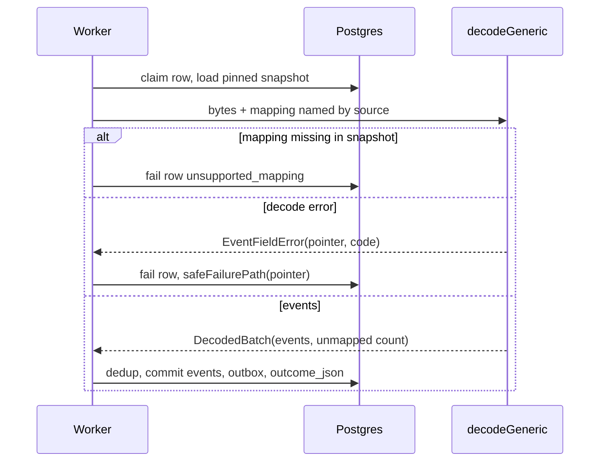
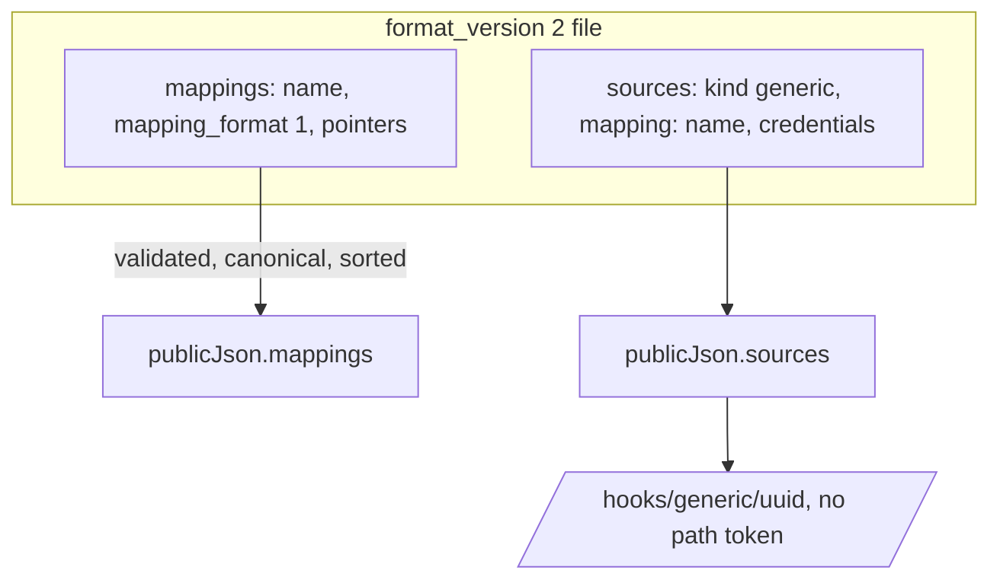

# Design

## Triage

| Trigger | Applies? | Evidence |
|---|---|---|
| T1 Components (new component, or 3+ with directed relationships) | yes | New generic decoder and mapping parser, a new preview endpoint, plus bootstrap → snapshot → ingress → pipeline → decoder |
| T2 State (persistent state, caches, 3+ state machine) | yes | Mappings become part of the persisted configuration snapshot (`config_repository.dart:203`); a parsed-snapshot cache in ingress |
| T3 Concurrency (background work, workers/isolates, async, retries) | yes | Generic rows are decoded by the pipeline workers under the existing retry budget (`pipeline.dart:865-869`) |
| T4 Boundaries (data format, migration, shared interface, IPC, external) | yes | Configuration file format (mapping documents), snapshot JSON, a new public RPC method, a new webhook route, captured Thanos fixture format |
| T5 Volume (grows without a fixed bound) | yes | Batched `items` arrays and mapping documents need explicit bounds |
| T6 Risk (security, money, data loss, unrecoverable user data) | yes | Sender-controlled payloads reach failure records; a new authenticated ingress route |

TIER: FULL

## Context

The proposal (`proposal.md`) and the four spec deltas state what changes; this section records the code the design builds on.

- **Configuration file.** The bootstrap file is JSON: `_readFile` decodes it with `jsonDecode`
  (`correlia_server/lib/src/ingest/bootstrap.dart:620-629`). Root fields are an allow-list that adds `namespaces`
  only in format version 2 (`bootstrap.dart:217-223`); unknown fields fail through `_sourceFields`
  (`source_config.dart:304-318`), which reflects a key only if it matches `^[a-z][a-z_]{0,31}$`
  (`source_config.dart:318`).
- **Source kinds.** `SourceKind` is a sealed class with `alertmanager` and `icinga2`, resolved by `named`
  (`source_config.dart:51-80`). A source's kind is read from `kind` in version 2 and defaults to Alertmanager in
  version 1 (`source_config.dart:414-416`). Alertmanager-only options fail with `alertmanager_only` on other kinds
  (`source_config.dart:456-463`). The `ingest_source.kind` column is a free string
  (`correlia_server/lib/src/models/ingest_source.spy.yaml:6`), so a new kind value needs no migration.
- **Snapshot.** `publicJson` writes `format_version`, `revision`, `sources` and `outputs`
  (`bootstrap.dart:163-168`); `snapshotId` is the SHA-256 of those bytes (`bootstrap.dart:171`). A committed pin
  is reloaded through `ConfigRepository.snapshot` (`config_repository.dart:505-517`).
- **Ingress.** Routes are `/hooks/<kind>/<uuid>[/<token>]` (`ingress.dart:171-175`); a four-segment path
  on any kind but Alertmanager answers 401 (`ingress.dart:180-183`). Each request loads and decodes the active
  `publicJson` (`ingress.dart:294-312`) and rejects a kind mismatch with 401 (`ingress.dart:318-321`). It checks
  content type `application/json` and identity encoding (`ingress.dart:356-366`) and never parses the body.
- **Decoding.** `KindDecoder` maps a `DecodeRequest` to a `DecodedBatch` (`source_decoder.dart:8-48`, `:79`);
  the pipeline picks it by the pinned source's kind (`pipeline.dart:856-869`). `checkBodyDepth` bounds nesting at
  32 before `jsonDecode` (`body_depth.dart:5-12`). Failure paths keep only a kind's documented field names and
  turn every other segment into `*`, bounded at 256 characters (`pipeline.dart:140-157`). The done outcome is a
  JSON column (`pipeline.dart:797-815`), so new counters need no migration.
- **Identity.** `alertFingerprint` hashes tenant, namespace, kind and identity fields with byte-sorted keys
  (`event/identity.dart:275-299`), within 1..128 fields (`event_generated/correlia/event/v1/event_bounds.dart:101-104`).
  `ObservationKey.native` takes a source key (`identity.dart:318-329`); `ObservationKey.fallback` needs status,
  severity and reported source time and fails `missing_evidence` without it (`identity.dart:357-370`).
- **Time.** `classifyEvidence` marks evidence more than 24 hours ahead as future-dated and more than 7 days old as
  late (`pipeline.dart:43-57`); the skew allowance is 5 minutes (`pipeline.dart:35`).
- **Console access.** `ConsoleAccessPolicy.check` admits only development or test run modes, the api or all
  role, a loopback peer and allowed Host and Origin (`console/console_access_policy.dart:7-18`); endpoints call
  it first (`endpoints/alert_console_endpoint.dart:10-16`).
- **RPC size.** `maxRequestSize` is 524288 bytes in development, staging and production
  (`config/development.yaml:42`); `config/test.yaml` sets none.
- **Capture tooling.** `tool/alertmanager_capture.sh` runs Docker containers (`:16`) and a Python receiver
  (`:25`); fixtures are named per release, such as
  `correlia_server/test/unit/ingest/fixtures/alertmanager/v0.16.2-firing.json`.

## Decisions

Scope decisions S1–S6 are in `proposal.md`; they appear in the summary table.

### D1: How a mapping selects fields

- **Choice:** JSON Pointer (RFC 6901), evaluated against one alert object.
- **Rejected:** dotted paths with `[n]` indexes, as in ADR 0008's matcher, because a key containing a dot is
  ambiguous; JSONPath, because wildcards make cost and safety harder to bound.
- **Reversal cost:** high (every stored mapping uses the syntax)
- **Important:** yes (binds future changes: configuration format)
- **Chosen by:** user (owner via Ormy, 2026-11-24: "D1a")

### D2: Value transforms

- **Choice:** Status and severity come from value tables with an optional default; each time pointer declares
  `rfc3339`, `epoch_seconds` or `epoch_millis`; display fields copy one pointer or take a constant. No templates.
- **Rejected:** string templates for display fields, because they add an expression language to validate and
  bound before anyone needs one.
- **Reversal cost:** medium (adding templates later is additive)
- **Important:** yes (binds future changes: configuration format)
- **Chosen by:** user (owner via Ormy, 2026-11-24: "D2a")

### D3: Naming and placement

- **Choice:** Source kind `generic`; a root `mappings` list of documents with `name` and `mapping_format: 1`;
  a generic source names one with `mapping: <name>`, so sources can share a mapping.
- **Rejected:** the mapping written inline in each source, because shared senders would duplicate it and the M4
  console edits mappings as their own objects.
- **Reversal cost:** high
- **Important:** yes (binds future changes: configuration format)
- **Chosen by:** user (owner via Ormy, 2026-11-24: "D3a")

### D4: Batched payloads

- **Choice:** An optional `items` pointer selects an array whose elements are alerts; without it the body is one
  alert. Identity comes from mapped fields only, never from position.
- **Rejected:** one alert per delivery, because common senders batch.
- **Reversal cost:** medium
- **Important:** yes (binds future changes: configuration format)
- **Chosen by:** user (owner via Ormy, 2026-11-24: "D4a")

### D5: Unmapped payload fields

- **Choice:** `unmapped_fields: reject` (default) or `count` per mapping.
- **Rejected:** always `count`, because it would silently drop data that a mapping author never looked at.
- **Reversal cost:** medium
- **Important:** yes (changes what users see)
- **Chosen by:** user (owner via Ormy, 2026-11-24: "D5a")

### D6: Generic source authentication

- **Choice:** The existing per-source bearer and HMAC credentials with rotation overlap; no path tokens. The
  existing ingress rule already refuses them (`ingress.dart:180-183`); activation refuses `path_token_enabled`
  through the Alertmanager-only check (`source_config.dart:456-463`).
- **Rejected:** path tokens for senders without headers, because credentials in URLs leak into proxies and logs.
- **Reversal cost:** low
- **Important:** yes (changes what users see)
- **Chosen by:** user (owner via Ormy, 2026-11-24: "D6a"; the owner kept the recommended default)

### D7: Key layout inside one mapping

- **Choice:** Flat keys, one per canonical field: `name`, `mapping_format`, `items`, `unmapped_fields`,
  `identity` (name → pointer), `observation_id` (pointer), `source_time` (`{pointer, format}`), `status` and
  `severity` (`{pointer, values, default}`), `summary` and `description` (`{copy}` or `{constant}`), `labels` and
  `links` (name → `{copy}` or `{constant}`). Each value is a pointer, a `{pointer, …}` object or `{copy|constant}`.
- **Rejected:** grouped sections (`identity`, `evidence`, `state`, `display`), because the nesting adds keys
  without adding meaning.
- **Reversal cost:** high
- **Important:** yes (binds future changes: configuration format)
- **Chosen by:** user (owner via Ormy, 2026-11-24: "E1a")

### D8: Preview API shape

- **Choice:** `mappingPreview.preview(sourceId, sample, draftMapping?)`: the sample is JSON text, the optional
  draft is one mapping as JSON text (the configuration file's own form); without a draft the source's active
  mapping is used. Namespace and source instance come from the source in the active snapshot, so fingerprints
  and event ids match real deliveries. It returns a typed `MappingPreviewResult`: events (fingerprint, event id,
  status, severity, summary, source time), unmapped paths, field errors (pointer and code) and the validation
  error, if any. Bounds: sample at most 1 MiB, at most 100 alerts.
- **Rejected:** no source id, with fixed preview identity values, because its fingerprints would not match the
  real source's and could not be compared with stored events.
- **Reversal cost:** medium (public RPC contract the M4 console uses)
- **Important:** yes (binds future changes: public interface)
- **Chosen by:** user (owner via Ormy, 2026-11-24: "E2a"; draft format corrected from YAML to JSON by the agent, as
  the configuration file is JSON, and reported to the owner)

### D9: Mappings in the stored snapshot

- **Choice:** `publicJson` gains a canonical `mappings` list (sorted by name) only when the file declares at
  least one mapping. Files without mappings keep byte-identical snapshot JSON and snapshot ids.
- **Rejected:** always writing `mappings`, because every existing snapshot id would change, and re-publishing an
  unchanged file at its current revision would fail with `activation_conflict`.
- **Reversal cost:** high (stored data format)
- **Important:** yes (binds future changes: data format)
- **Chosen by:** user (owner via Ormy, 2026-11-24: "E3a")

### D10: The generic decoder runs only in the pipeline

- **Choice:** A pure `decodeGeneric(DecodeRequest, GenericMapping)` beside the other decoders, dispatched from
  `_decoderFor` with the mapping taken from the pinned snapshot. Ingress keeps admitting bytes without parsing.
  The preview calls the same function.
- **Rejected:** mapping at ingress, because a mapping error would refuse a delivery that a later mapping fix
  could process, and it would break the bytes-first admission model (ADR 0016).
- **Reversal cost:** medium
- **Important:** no
- **Chosen by:** agent

### D11: What counts as a read field

- **Choice:** A mapping reads exactly the JSON leaves (scalars, and empty objects or arrays) its pointers select
  in one alert, plus every ancestor on those paths. Every other leaf in the alert object is unmapped. With
  `items`, only the selected elements are alerts; fields outside the array are unmapped at the body level.
- **Rejected:** treating a selected object's whole subtree as read, because a pointer to `/labels` used as a
  label source does not exist in D7 and would hide extra fields.
- **Reversal cost:** low
- **Important:** no
- **Chosen by:** agent

### D12: Safe failure paths for generic rows

- **Choice:** `safeFailurePath` gains a generic arm whose allowed segments are the segments of the pinned
  mapping's own pointers plus array indexes up to 4 digits; every other segment is stored as `*`. Mapping
  pointers are operator-written, so naming them leaks no sender data; values are never stored.
- **Rejected:** a fixed allow-list like the other kinds (`pipeline.dart:140-157`), because generic field names
  are only known per mapping, so a fixed list would redact everything or nothing.
- **Reversal cost:** low
- **Important:** no
- **Chosen by:** agent

### D13: Required and wrong-typed fields fail the row

- **Choice:** Identity values, status, and the observation id or source time a mapping declares are required;
  an absent value or one of the wrong JSON type fails the whole raw row with the pointer and a code. Identity
  values may be strings or numbers; numbers are encoded by their JSON text.
- **Rejected:** skipping the bad alert and committing the rest, because a partial batch hides data loss.
- **Reversal cost:** low
- **Important:** no
- **Chosen by:** agent

### D14: Identity, display and time reuse the event library

- **Choice:** Fingerprints use `alertFingerprint` with `source_kind` `generic`; the observation key is
  `ObservationKey.native` when an observation id is mapped, else `ObservationKey.fallback`. Display text goes
  through the existing display truncation (ID-3); source times go through `classifyEvidence` and the skew clamp.
- **Rejected:** a generic-specific hash or truncation, because the canonical-event spec already fixes both.
- **Reversal cost:** high (identity bytes)
- **Important:** no (follows the canonical-event spec; no new format)
- **Chosen by:** agent

### D15: Mapping bounds

- **Choice:** At most 64 mappings per file, 32 KiB of canonical JSON each, 128 identity fields (the canonical
  bound), 128 labels, 32 links, value tables of at most 256 entries with 256-byte keys, and pointers of at most
  512 bytes. A batched delivery holds at most 1000 alerts; more fails the row with `items_bound`.
- **Rejected:** no caps, because each request parses the snapshot and each worker parses mappings.
- **Reversal cost:** low (caps can rise)
- **Important:** no
- **Chosen by:** agent

### D16: Ingress caches the parsed active snapshot

- **Choice:** Ingress keeps one parsed copy of the active snapshot keyed by snapshot id, replaced when the id
  read with the source row differs (`ingress.dart:294-312`). Snapshots are immutable, so the cache cannot be stale.
- **Rejected:** decoding `publicJson` per request with mappings inside it, because up to 2 MiB of mappings would
  be parsed on every delivery.
- **Reversal cost:** low
- **Important:** no
- **Chosen by:** agent

### D17: Preview request size

- **Choice:** Raise `maxRequestSize` to 1310720 bytes (1.25 MiB) in `config/development.yaml` and set it in
  `config/test.yaml`, the only run modes the console policy admits, so a 1 MiB sample plus a draft fits. Staging
  and production keep 524288.
- **Rejected:** a 448 KiB sample cap, because D8 sets 1 MiB to match the default body limit.
- **Reversal cost:** low
- **Important:** no (development and test settings only)
- **Chosen by:** agent

### D18: Thanos capture

- **Choice:** Extend `tool/alertmanager_capture.sh` with a Thanos mode: a Ruler container with a static rule and
  two replicas, sending to one pinned Alertmanager, whose webhook goes to the existing receiver. Fixtures go
  under `fixtures/thanos/` with a `manifest.json` of image names and digests; a test checks the manifest and the
  files match.
- **Rejected:** a second capture script, because receiver, ports and cleanup would be duplicated.
- **Reversal cost:** low
- **Important:** no
- **Chosen by:** agent

### Decision summary

| # | Decision | Choice | Rejected | Reversal cost | Important | Chosen by |
|---|---|---|---|---|---|---|
| S1 | How Thanos is supported | Through Alertmanager, no new kind | `thanos` kind | low | yes | user |
| S2 | Tenant headers | One source per tenant; no header read | Header to namespace | medium | yes | user |
| S3 | Where mappings live | Bootstrap configuration file only | Database-managed now | medium | yes | user |
| S4 | Mapping preview | Read-only API method | CLI only; both | low | yes | user |
| S5 | Replay after a mapping fix | Stays in change 7 | Replay here | low | no | agent |
| S6 | Thanos releases captured | Last 4 minors, latest patch | Latest only; every minor | low | no | agent |
| D1 | Field selection | JSON Pointer | Dotted paths; JSONPath | high | yes | user |
| D2 | Value transforms | Tables, time formats, copy/constant | Templates | medium | yes | user |
| D3 | Naming and placement | `generic`, shared named `mappings` | Inline per source | high | yes | user |
| D4 | Batched payloads | Optional `items` pointer | One alert per delivery | medium | yes | user |
| D5 | Unmapped fields | `reject` default or `count` | Always `count` | medium | yes | user |
| D6 | Authentication | Bearer/HMAC, no path tokens | Path tokens | low | yes | user |
| D7 | Mapping key layout | Flat keys | Grouped sections | high | yes | user |
| D8 | Preview API shape | Source id, sample, optional draft | No source id | medium | yes | user |
| D9 | Mappings in the snapshot | Only when declared | Always written | high | yes | user |
| D10 | Where mapping runs | Pipeline only | At ingress | medium | no | agent |
| D11 | Read fields | Selected leaves and ancestors | Whole subtrees | low | no | agent |
| D12 | Safe failure paths | Mapping-named segments only | Fixed allow-list | low | no | agent |
| D13 | Required/wrong-typed fields | Fail the whole row | Skip the alert | low | no | agent |
| D14 | Identity, display, time | Reuse event library | Generic-specific | high | no | agent |
| D15 | Mapping bounds | Explicit caps | No caps | low | no | agent |
| D16 | Ingress snapshot parse | Cache by snapshot id | Parse per request | low | no | agent |
| D17 | Preview request size | 1.25 MiB in dev/test | 448 KiB sample | low | no | agent |
| D18 | Thanos capture | Extend the existing tool | Second script | low | no | agent |

## Assumptions

- **A1:** Thanos Ruler can drop its replica label before sending to Alertmanager through its own flag, and sends
  through Alertmanager's v2 API, which the pinned Alertmanager forwards as ordinary v4 webhooks. Not checked
  because it is external behaviour; the capture task proves it, and if Ruler cannot drop it, the setup relies on
  `excluded_identity_labels`, which already exists. Depends on it: D18, the Thanos tasks.
- **A2:** The last four Thanos minor releases publish multi-arch images that run under Docker on the developer
  machine. Not checked because the capture runs during apply. Depends on it: S6, D18.
- **A3:** Serverpod 4.1 applies `maxRequestSize` to RPC bodies and accepts the value in `config/test.yaml`.
  Not checked against Serverpod source; the preview size test proves it. Depends on it: D17.

## Carried constraints

- **C1:** A file without mappings must produce byte-identical snapshot JSON, so its snapshot id is stable across
  upgrades. Kind: invariant. Destination: doc comment: `correlia_server/lib/src/ingest/bootstrap.dart` `IngestBootstrap.publicJson`
- **C2:** Mapping format 1 fixes JSON Pointer selection, flat keys, copy/constant display and no templates; any
  change is a new `mapping_format`. Kind: invariant. Destination: ADR 0031
- **C3:** Generic failure records name only segments the pinned mapping writes; payload keys and values never
  enter stored errors, logs or metrics. Kind: invariant. Destination: spec: specs/durable-pipeline/spec.md → Requirement: Generic decode failures name paths, never values
- **C4:** Ingress never parses or maps a generic body; mapping happens only in the pipeline. Kind: rejected
  alternative. Destination: spec: specs/source-ingress/spec.md → Requirement: Generic deliveries are admitted before mapping
- **C5:** No Thanos source kind and no tenant header handling; tenants are separate sources (D20).
  Kind: rejected alternative. Destination: spec: specs/integration-alertmanager/spec.md → Requirement: One source per Thanos tenant
- **C6:** The ingress snapshot cache is valid only because snapshots are immutable and content-addressed.
  Kind: invariant. Destination: doc comment: `correlia_server/lib/src/ingest/ingress.dart` the snapshot cache

## Diagrams (FULL)

Components (T1):

Data flow of one generic row (T2, T3):

Configuration and route boundary (T4):

## State & Ownership (FULL)

| State | Owner (sole writer) | Lifetime | Invalidation / rebuild | Authoritative copy |
|---|---|---|---|---|
| Mapping documents in a snapshot | `ConfigRepository` publish (`config_repository.dart:203`) | Forever (immutable snapshot) | Never; a change publishes a new snapshot | `ingest_config_snapshot.publicJson` |
| Ingress parsed-snapshot cache | Ingress handler | Process | Replaced when the active snapshot id differs | The snapshot row |
| Parsed `GenericMapping` per worker claim | Pipeline worker | One row | Rebuilt per claim from the pinned snapshot | The snapshot row |
| Raw generic row and its outcome | Pipeline worker (existing) | Existing retention | Existing | `raw_inbox` |
| Preview result | None (returned, never stored) | One call | n/a | n/a |

## Failure & Visibility (FULL)

| Component | Fails / dies mid-operation → | Recovery | Retry safe? | Who finds out |
|---|---|---|---|---|
| Mapping validation at activation | Invalid mapping | Activation fails; prior snapshot stays | yes | Operator: bounded field error at startup |
| Ingress, generic route | Crash before commit | Sender retries; transport dedup | yes | Sender sees no 202 |
| `decodeGeneric` | Field error | Row fails with pointer and code | n/a (deterministic) | Operator: failed row and pipeline log line with safe path |
| Worker dies mid-row | Transaction rolls back | Row reclaimed (existing) | yes | Nobody needs to |
| Pinned snapshot lacks the mapping | `unsupported_mapping` | Row fails; replay in change 7 | n/a | Operator: failed row |
| Preview | Invalid draft or sample | Typed error result | yes | Console user |
| Thanos capture tool | Container fails | Script exits non-zero, cleans containers | yes | Developer |

## Resource Bounds (FULL)

| Queue / buffer / cache / transfer | Bound | At the bound | Timeout | At 10x / 100x |
|---|---|---|---|---|
| Generic body | Source body limit, default 1 MiB; depth 32 | 413 / `depth_bound` | Existing ingress | Unchanged: per-source limit |
| Alerts per delivery | 1000 (D15) | Row fails `items_bound` | Existing processing deadline | 10x senders batch less; bound holds |
| Mappings per file | 64 × 32 KiB (D15) | Activation fails | n/a | Fixed by the caps |
| Ingress snapshot cache | One entry | Replaced | n/a | Constant |
| Preview sample | 1 MiB, 100 alerts (D8) | Typed error | RPC default | Dev/test only |
| Unmapped path list in preview | 100 paths, then a count | Count of the rest | n/a | Constant |

## Flow & State Gaps (FULL)

- **Mapping changed while rows are pending:** rows decode with the mapping of their pinned snapshot (durable-pipeline delta).
- **Mapping removed while rows are pending:** the old snapshot still holds it, so pending rows decode; only a
  snapshot that never had it fails `unsupported_mapping`.
- **Same alert in two deliveries, different batching:** identity depends only on mapped values (D4, D14);
  dedup works as for other kinds.
- **Concurrent activation and preview:** the preview reads the active snapshot once per call; a later activation
  does not affect a running call.
- **Restart mid-row:** unchanged pipeline behaviour.
- **Out-of-order source times:** the existing fence and lateness rules apply (`pipeline.dart:43-57`).

## Mechanism Ledger (FULL)

| Mechanism | Built? | Why (harm nobody catches / expensive later) | Evidence that would change the call |
|---|---|---|---|
| Mapping-named failure path redaction (D12) | yes | Sender keys could carry secrets into stored errors | none |
| Byte-stable snapshot without mappings (D9) | yes | Snapshot ids are stored pins; changing them is expensive | none |
| Ingress snapshot cache (D16) | yes | Per-request parse of mappings grows with the config | Profiling showing parse cost is negligible |
| Per-alert partial commit | no | Hides loss; a whole-row failure is visible | Owner asks for best-effort batches |
| Mapping templates | no | Owner chose D2a | A new `mapping_format` |
| Database-managed mappings | no | S3 | M4 console change |
| Replay after a mapping fix | no | S5 / change 7 | n/a |
| Tenant header parsing | no | S2 / D20 | Multi-tenant Correlia |

## Risks / Trade-offs

- [`reject` makes common senders fail out of the box] → The preview lists unmapped paths; `count` is one key away.
- [Redacted paths make `reject` failures hard to read] → The preview shows full paths, and the stored path still
  names the mapping-known parents.
- [Thanos capture depends on Docker images] → Images pinned by digest in the manifest; the capture runs only on
  a developer machine, never in CI.
- [Raising the dev/test RPC limit affects every dev endpoint] → It applies only where the console policy
  already restricts callers to loopback.

## ADRs

- **In force, constraining this change:** ADR 0008 (declarative rules; mappings publish in the configuration
  version), ADR 0016 (durable staged pipeline, pins), ADR 0019 and ADR 0024 (identity and upstream evidence),
  ADR 0029 (source credentials and admission limits).
- **To record during apply:** ADR 0031, "Generic webhook mapping documents": mapping format 1 (D1–D4, D7), its
  place in the snapshot (D9) and the `mapping_format` versioning rule (C2), with the architecture index updated.

## Open Questions

None.
