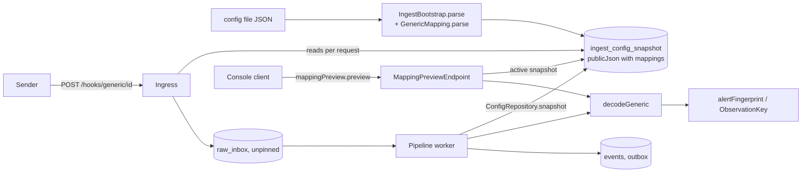
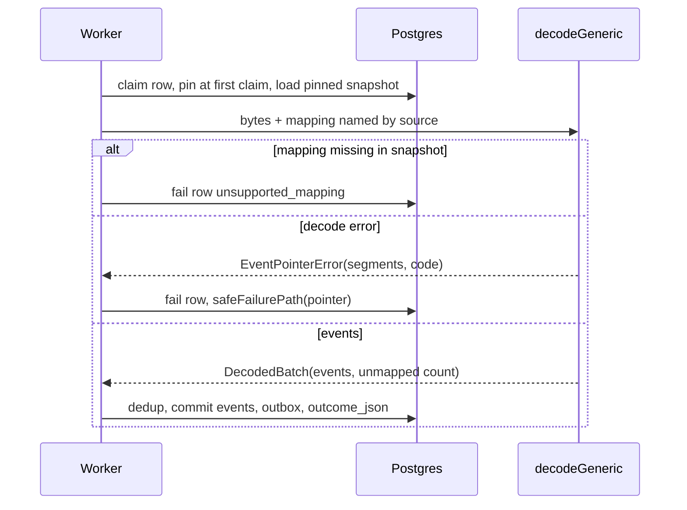
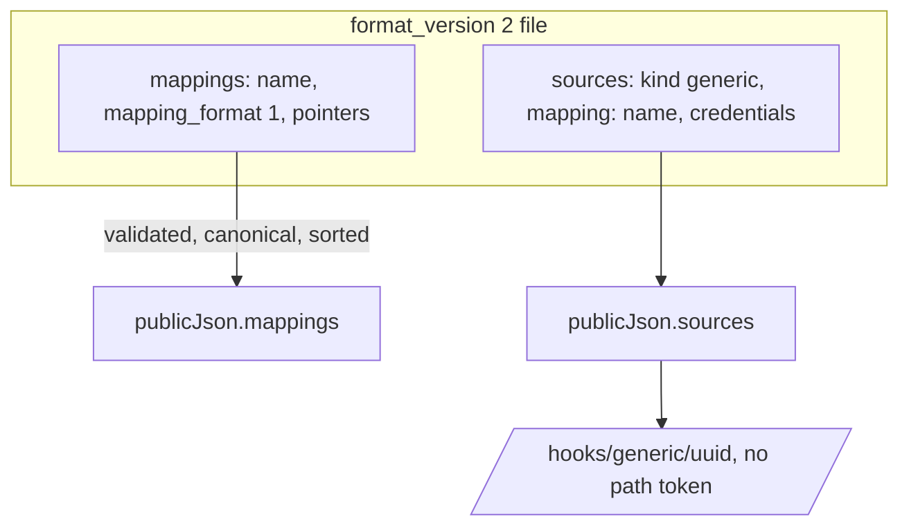

# Design

## Triage

| Trigger | Applies? | Evidence |
|---|---|---|
| T1 Components (new component, or 3+ with directed relationships) | yes | New generic decoder and mapping parser, a new preview endpoint, plus bootstrap → snapshot → ingress → pipeline → decoder |
| T2 State (persistent state, caches, 3+ state machine) | yes | Mappings become part of the persisted configuration snapshot (`config_repository.dart:203`) |
| T3 Concurrency (background work, workers/isolates, async, retries) | yes | Generic rows are decoded by the pipeline workers (`pipeline.dart:865-869`) with transient errors retried and other internal errors failing after five attempts (`pipeline.dart:1005-1018`) |
| T4 Boundaries (data format, migration, shared interface, IPC, external) | yes | Configuration file format (mapping documents), snapshot JSON, a new public RPC method, a new webhook route, captured Thanos fixture format |
| T5 Volume (grows without a fixed bound) | yes | Batched `items` arrays and mapping documents need explicit bounds |
| T6 Risk (security, money, data loss, unrecoverable user data) | yes | Sender-controlled payloads reach failure records; a new authenticated ingress route |

TIER: FULL

## Context

The proposal (`proposal.md`) and the four spec deltas state what changes; this section records the code the design builds on.

- **Configuration file.** The bootstrap file is JSON, read with a 64 KiB cap and decoded with `jsonDecode`
  (`correlia_server/lib/src/ingest/bootstrap.dart:620-629`). Root fields are an allow-list that adds `namespaces`
  only in format version 2 (`bootstrap.dart:217-223`); unknown fields fail through `_sourceFields`
  (`source_config.dart:304-318`), which reflects a key only if it matches `^[a-z][a-z_]{0,31}$`
  (`source_config.dart:318`).
- **Source kinds.** `SourceKind` is a sealed class with `alertmanager` and `icinga2`, resolved by `named`
  (`source_config.dart:51-80`). A source's kind is read from `kind` in version 2 and defaults to Alertmanager in
  version 1 (`source_config.dart:414-416`). Alertmanager-only options fail with `alertmanager_only` on other kinds
  (`source_config.dart:456-463`). The `ingest_source.kind` column is a free string
  (`correlia_server/lib/src/models/ingest_source.spy.yaml:6`), so a new kind value needs no migration.
- **Snapshot.** `publicJson` writes `format_version`, `revision`, `sources` and `outputs`
  (`bootstrap.dart:163-168`); `snapshotId` is the SHA-256 of those bytes (`bootstrap.dart:171`). A committed pin
  is loaded by the worker from `raw.pin` (`pipeline.dart:363-373`). Rows are pinned at first claim, not at admission:
`pinOne` writes the snapshot active at that moment (`pipeline.dart:287-319`).
- **Ingress.** Routes are `/hooks/<kind>/<uuid>[/<token>]` (`ingress.dart:171-175`); a four-segment path
  on any kind but Alertmanager answers 401 (`ingress.dart:180-183`). Each request loads and decodes the active
  `publicJson` (`ingress.dart:294-312`) and rejects a kind mismatch with 401 (`ingress.dart:318-321`). It checks
  content type `application/json` and identity encoding (`ingress.dart:356-366`) and never parses the body.
- **Decoding.** `KindDecoder` maps a `DecodeRequest` to a `DecodedBatch` (`source_decoder.dart:8-48`, `:79`);
  the pipeline picks it by the pinned source's kind (`pipeline.dart:856-869`). `checkBodyDepth` bounds nesting at
  32 before `jsonDecode` (`body_depth.dart:5-12`). Failure paths keep only a kind's documented field names and
  turn every other segment into `*`, bounded at 256 characters (`pipeline.dart:140-157`). The done outcome is
  JSON text in the `outcome_json` text column (`correlia_server/schema/0001_ingest.sql:12`, `pipeline.dart:797-815`),
  so new counters need no migration.
- **Identity.** `alertFingerprint` hashes tenant, namespace, kind and identity fields with byte-sorted keys
  (`event/identity.dart:275-305`), within 1..128 fields (`event_generated/correlia/event/v1/event_bounds.dart:101-104`).
  `ObservationKey.native` takes a source key (`identity.dart:318-329`); `ObservationKey.fallback` needs status,
  severity and reported source time and fails `missing_evidence` without it (`identity.dart:357-370`).
- **Source time is required downstream.** The worker dereferences `event.sourceTime!` to classify, record and order
  each observation (`pipeline.dart:445`, `:539`, `:613`). The Icinga2 mapper, which has a native observation key,
  still sets a source time and reports an epoch time as its RFC 3339 rendering (`ingest/icinga2/mapper.dart:92-137`).
- **Bounds the mapping must respect.** Events carry at most 16 links (`proto/correlia/event/v1/event.proto:275-279`);
  a link needs a bounded valid HTTP(S) target (`event/canonical_event.dart:110-127`).
- **Row budget.** After decoding, the worker skips repeated ids and existing observations, then sums each inserted
  event's payload times one plus its output count when it is ready and routed, and fails the row with
  `batch_bound` past 16 MiB (`pipeline.dart:32`, `:498-545`, `:640-670`), but only once the whole batch is decoded
  (`pipeline.dart:426-455`). `CanonicalEvent` keeps its serialized bytes from construction
  (`canonical_event.dart:546-559`).
- **Validation errors.** `EventValidationError` carries one untagged `path` string and a code
  (`event/validation.dart:4-18`), a sealed class, so subtypes live in the event library; both worker catches pass it to `safeFailurePath` (`pipeline.dart:457-465`,
  `:733-743`).
- **Publisher gate.** Schema step 5 refuses snapshot and commitment inserts unless the session sets
  `correlia.publisher_version` to at least 1 (`correlia_server/schema/0005_secret_reuse.sql:33-47`); the publisher
  sets `'1'` (`config_repository.dart:150`). ADR 0030 requires every role to be upgraded before a stream source is
  published. An older worker resolves an unknown kind to `unsupported_kind` (`pipeline.dart:409-414`).
- **Epoch precedent.** The Icinga2 parser converts decimal epoch text with integer arithmetic
  (`ingest/icinga2/webhook_parser.dart:209-220`).
- **Time.** `classifyEvidence` marks evidence more than 24 hours ahead as future-dated and more than 7 days old as
  late (`pipeline.dart:43-57`); the skew allowance is 5 minutes (`pipeline.dart:35`).
- **Console access.** `ConsoleAccessPolicy.check` admits only development or test run modes, the api or all
  role, a loopback peer and allowed Host and Origin (`console/console_access_policy.dart:7-18`); endpoints call
  it at the start of each method (`endpoints/alert_console_endpoint.dart:18-34`).
- **RPC size.** `maxRequestSize` is 524288 bytes in development (`config/development.yaml:42`), staging
  (`config/staging.yaml:46`) and production (`config/production.yaml:42`); `config/test.yaml` sets none.
- **Capture tooling.** `tool/alertmanager_capture.sh` defines a Python receiver (`:36-61`) and starts it
  (`:62-63`), runs Alertmanager in Docker (`:82`) and drives resolution by posting an explicit `endsAt` (`:93-98`); fixtures are named per release, such as
  `correlia_server/test/unit/ingest/fixtures/alertmanager/v0.16.2-firing.json`.

## Decisions

Scope decisions S1–S6 are in `proposal.md`; they appear in the summary table.

### D1: How a mapping selects fields

- **Choice:** JSON Pointer (RFC 6901), evaluated against one alert object.
- **Rejected:** dotted paths like ADR 0008's matcher fields, because a key containing a dot is ambiguous; JSONPath, because wildcards make cost and safety harder to bound.
- **Reversal cost:** high (every stored mapping uses the syntax)
- **Important:** yes (binds future changes: configuration format)
- **Chosen by:** user (owner via Ormy, 2026-11-24: "D1a")

### D2: Value transforms

- **Choice:** Status and severity come from value tables with an optional default; each time pointer declares
  `rfc3339`, `epoch_seconds` or `epoch_millis`; display fields copy one pointer or take a constant. No templates.
- **Rejected:** string templates for display fields, because they add an expression language to validate and
  bound before anyone needs one.
- **Reversal cost:** medium (adding templates later is additive)
- **Important:** yes (binds future changes: configuration format)
- **Chosen by:** user (owner via Ormy, 2026-11-24: "D2a")

### D3: Naming and placement

- **Choice:** Source kind `generic`; a root `mappings` list of documents with `name` and `mapping_format: 1`;
  a generic source names one with `mapping: <name>`, so sources can share a mapping.
- **Rejected:** the mapping written inline in each source, because shared senders would duplicate it and the M4
  console edits mappings as their own objects.
- **Reversal cost:** high
- **Important:** yes (binds future changes: configuration format)
- **Chosen by:** user (owner via Ormy, 2026-11-24: "D3a")

### D4: Batched payloads

- **Choice:** An optional `items` pointer selects an array whose elements are alerts; without it the body is one
  alert. Identity comes from mapped fields only, never from position.
- **Rejected:** one alert per delivery, because common senders batch.
- **Reversal cost:** medium
- **Important:** yes (binds future changes: configuration format)
- **Chosen by:** user (owner via Ormy, 2026-11-24: "D4a")

### D5: Unmapped payload fields

- **Choice:** `unmapped_fields: reject` (default) or `count` per mapping.
- **Rejected:** always `count`, because it would silently drop data that a mapping author never looked at.
- **Reversal cost:** medium
- **Important:** yes (changes what users see)
- **Chosen by:** user (owner via Ormy, 2026-11-24: "D5a")

### D6: Generic source authentication

- **Choice:** The existing per-source bearer and HMAC credentials with rotation overlap; no path tokens. The
  existing ingress rule already refuses them (`ingress.dart:180-183`); activation refuses `path_token_enabled`
  through the Alertmanager-only check (`source_config.dart:456-463`).
- **Rejected:** path tokens for senders without headers, because credentials in URLs leak into proxies and logs.
- **Reversal cost:** low
- **Important:** yes (changes what users see)
- **Chosen by:** user (owner via Ormy, 2026-11-24: "D6a"; the owner kept the recommended default)

### D7: Key layout inside one mapping

- **Choice:** Flat keys, one per canonical field: `name`, `mapping_format`, `items`, `unmapped_fields`,
  `identity` (name → pointer), `observation_id` (pointer), `source_time` (`{pointer, format}`), `status`
  (`{pointer, values, default}`), `severity` (`{pointer, values, default}` or `{constant}`), `summary` and
  `description` (`{copy}` or `{constant}`), `labels` and `links` (name → `{copy}` or `{constant}`). Each value is
  a pointer, a `{pointer, …}` object or `{copy|constant}`.
- **Rejected:** grouped sections (`identity`, `evidence`, `state`, `display`), because the nesting adds keys
  without adding meaning.
- **Reversal cost:** high
- **Important:** yes (binds future changes: configuration format)
- **Chosen by:** user (owner via Ormy, 2026-11-24: "E1a")

### D8: Preview API shape

- **Choice:** `mappingPreview.preview(sourceId, sample, draftMapping?)`: the sample is JSON text, the optional
  draft is one mapping as JSON text (the configuration file's own form); without a draft the source's active
  mapping is used. Namespace and source instance come from the source in the active snapshot, so fingerprints
  and event ids match real deliveries. It returns a typed `MappingPreviewResult`: events (fingerprint, event id,
  status, severity, summary, source time), unmapped paths, field errors (pointer and code) and the validation
  error, if any. Bounds: sample at most 1 MiB decoded and 100 alerts, draft at most 32 KiB; errors and unmapped
  paths at most 100 entries and 64 KiB of serialized diagnostics (the JSON the result carries), ordered by alert
  index, then path UTF-8 bytes, then code, the same for active and draft mappings; body-level diagnostics (beside
  the `items` array, no alert index) come first. Preview paths are unredacted (nothing is stored) and cut at a
  segment boundary within 256 bytes; `overflow` counts the entries left out. The cap holds while collecting: the
  collector keeps at most the 100 smallest entries by that order (a bounded max-heap) and counts the rest, so its
  memory never grows with the number of unmapped leaves; the 64 KiB cut is applied to those 100 in order.
  Alerts are decoded independently in a collecting mode of the same decoder (D10). Each event is built with preview
  metadata: the nil UUID and the call time as raw reference, observed and processed times. Production metadata
  (`pipeline.dart:419-436`) is serialized into the same bytes (`canonical_event.dart:412-464`), so the result is
  labelled "computed with preview metadata": near the per-event or D21 bound, production may decide differently.
  There is no row-budget estimate (owner, J1a, 2026-11-24): the worker's charge depends on production metadata and
  on which events are new and routed, which the preview cannot know.
- **Rejected:** no source id, with fixed preview identity values, because its fingerprints would not match the
  real source's and could not be compared with stored events.
- **Reversal cost:** medium (public RPC contract the M4 console uses)
- **Important:** yes (binds future changes: public interface)
- **Chosen by:** user (owner via Ormy, 2026-11-24: "E2a"; draft format corrected from YAML to JSON by the agent, as
  the configuration file is JSON, and reported to the owner; row-budget estimate dropped, "J1a")

### D9: Mappings in the stored snapshot

- **Choice:** `publicJson` gains a canonical `mappings` list (sorted by name) only when the file declares at
  least one mapping. Files without mappings keep byte-identical snapshot JSON and snapshot ids.
- **Rejected:** always writing `mappings`, because every existing snapshot id would change, and re-publishing an
  unchanged file at its current revision would fail with `activation_conflict`.
- **Reversal cost:** high (stored data format)
- **Important:** yes (binds future changes: data format)
- **Chosen by:** user (owner via Ormy, 2026-11-24: "E3a")

### D10: The generic decoder runs only in the pipeline

- **Choice:** A pure `decodeGeneric(DecodeRequest, GenericMapping)` beside the other decoders, dispatched from
  `_decoderFor` with the mapping taken from the pinned snapshot. Ingress keeps admitting bytes without parsing.
  The decoder works per alert and has two modes: production stops at the first error and fails the row;
  the preview collects each alert's outcome, bounded as in D8.
- **Rejected:** mapping at ingress, because a mapping error would refuse a delivery that a later mapping fix
  could process, and it would break the bytes-first admission model (ADR 0016).
- **Reversal cost:** medium
- **Important:** no
- **Chosen by:** agent

### D11: What counts as a read field

- **Choice:** One rule over the body: a leaf (scalar, or empty object or array) is read when a field pointer
  selects it or one of its ancestors in some alert, whether or not that field then validates, or when it lies on
  the `items` path itself. Every other leaf is unmapped, whether inside an alert or beside the `items` array. Every
  field but `items` needs a scalar, so a pointer that selects a container always fails with its own field error;
  the container's children are covered by that error, not listed again. Under `count`, each unmapped leaf of the
  body counts once.
- **Rejected:** counting only selected leaves as read, because a wrong-typed container would then be reported
  twice, once as a field error and again leaf by leaf.
- **Reversal cost:** low
- **Important:** no
- **Chosen by:** agent

### D12: Safe failure paths for generic rows

- **Choice:** A generic arm of `safeFailurePath` renders RFC 6901 paths: a segment is kept only where some pointer
  of the pinned mapping has that segment at that position under the same kept prefix; an index is kept only
  where the decoder traversed an array; everything else is `*`. The path is cut at a segment boundary within 256
  bytes, so no UTF-8 character or `~0`/`~1` escape is split; when not even the first segment fits (pointers may
  be 512 bytes), the stored path is `/*`, distinct from the empty pointer of a root failure. A new `EventPointerError`, a final subtype added in
  `event/validation.dart` beside the sealed base, carries the structured segments (token, array flag); the decoder
  raises it, and only the decode-stage catch (`pipeline.dart:457-465`) receives it. Sender paths are redacted
  structurally; canonical paths, such as `event` from `event_too_large` at construction, keep the existing
  allow-list; the commit-stage catch (`:733-743`) sees only `batch_bound`, whose generic path is stored as none. Failures are recorded by `_fail`; no new log line is added.
- **Rejected:** a fixed allow-list like the other kinds (`pipeline.dart:140-157`), because generic field names
  are only known per mapping, so a fixed list would redact everything or nothing.
- **Reversal cost:** low
- **Important:** no
- **Chosen by:** agent

### D13: Required and wrong-typed fields fail the row

- **Choice:** Identity values, status, source time and a declared observation id are required in each alert;
  an absent value or one of the wrong JSON type fails the whole raw row with the safe path and a code (identity
  values must be strings, D20). Table inputs must be strings or integers (an integer is looked up by its
  decimal text); a native observation id must be a string. A default covers an unlisted value, never an absent
  one. A copied string is used verbatim; a copied number or boolean is used as its JSON text (`42`, `true`);
  `null` and absent omit an optional field and fail `summary`. Before any pointer is evaluated, a body with two
  equal member names in one object fails with `duplicate_field`, in delivery and preview, as the Icinga2 parser
  does (`icinga2/webhook_parser.dart:47-55`), because `jsonDecode` keeps the last value and a pointer would read
  a member nobody validated. Activation refuses constants the event cannot hold (empty summary, over-bound text, a non-http(s) link) and
  table outputs outside the canonical enums.
- **Rejected:** skipping the bad alert and committing the rest, because a partial batch hides data loss.
- **Reversal cost:** low
- **Important:** no
- **Chosen by:** agent

### D14: Identity, display and time reuse the event library

- **Choice:** Fingerprints use `alertFingerprint` with `source_kind` `generic`; the observation key is
  `ObservationKey.native` when an observation id is mapped, else `ObservationKey.fallback`. Display text goes
  through `normalizeDisplayText` (`canonical_event.dart:694`, ID-3); source times go through `classifyEvidence`
  and the skew clamp. Epoch values must be JSON integers (Dart `jsonDecode` yields `int` only for those, so
  fractions and exponents are rejected) from 0 to 253402300799 seconds or 253402300799999 millis inclusive (year 9999); `epoch_seconds` renders
  with no fraction and `epoch_millis` with exactly three digits, both UTC `Z`, so the rendering is exact and
  deterministic, as the Icinga2 path keeps exact time (`icinga2/webhook_parser.dart:209-220`). The number stays in
  the raw body. RFC 3339 input keeps its text as sent. A mapped `observation_id` must name one immutable
  observation (a state change), not the alert object: a resolve reusing the firing id would be deduplicated. The
  runbook says so.
- **Rejected:** a generic-specific hash or truncation, because the canonical-event spec already fixes both.
- **Reversal cost:** high (identity bytes)
- **Important:** no (follows the canonical-event spec and the Icinga2 precedent; no new format)
- **Chosen by:** agent

### D15: Mapping bounds

- **Choice:** Mappings share the configuration file's existing 64 KiB cap (`bootstrap.dart:625`), which is the
  aggregate bound; each mapping is at most 32 KiB of canonical JSON, at most 64 per file. Inside one: 128 identity
  fields (the canonical bound), 128 labels, 16 links (the event bound), value tables of 256 entries with 256-byte
  keys, pointers of 512 bytes. A delivery holds at most 1000 alerts; more fails the row with `items_bound`.
  `summary`, `status` and `severity` are required at activation, so an activated mapping can build every
  required canonical field.
  The serialized `mappings` part of `publicJson` is capped at 64 KiB at activation (`mappings_bound`); no cap is
  put on the whole snapshot, so a configuration valid today is never newly refused. The admission lookup returns
  the snapshot with each of at most four credential rows (`ingress.dart:294-312`); mappings add at most 64 KiB to
  each copy.
- **Rejected:** raising the file cap for mappings, because no realistic mapping set needs more and the active
  snapshot is read on every delivery.
- **Reversal cost:** low (caps can rise)
- **Important:** no
- **Chosen by:** agent

### D16: Ingress keeps reading the snapshot per request

- **Choice:** No ingress cache. Ingress already reads and decodes `publicJson` per request (`ingress.dart:294-312`);
  mappings add at most D15's 64 KiB to each snapshot copy a lookup returns.
- **Rejected:** a parsed cache keyed by snapshot id, because the bounded growth does not justify a second copy
  of configuration state, and the transfer would remain.
- **Reversal cost:** low
- **Important:** no
- **Chosen by:** agent

### D17: Preview request size

- **Choice:** Set `maxRequestSize` to 2621440 bytes (2.5 MiB) in `config/development.yaml` and `config/test.yaml`.
  Sample and draft travel as JSON strings, and escaping at most doubles valid JSON text, so 2 × (1 MiB + 32 KiB)
  plus the envelope fits. The endpoint enforces the decoded budgets itself. A test sends an escape-heavy 1 MiB
  sample and a draft through the real client. The limit is global: every development and test RPC then accepts
  bodies up to 2.5 MiB, which is acceptable for local and test runs. Staging and production keep 524288, where
  the console policy refuses the preview anyway (`console_access_policy.dart:10`).
- **Rejected:** a 224 KiB sample cap within today's limit, because D8 sets 1 MiB to match the default body limit.
- **Reversal cost:** low
- **Important:** no (development and test settings only)
- **Chosen by:** agent

### D18: Thanos capture

- **Choice:** Extend `tool/alertmanager_capture.sh` with a Thanos mode: one pinned Prometheus container is the
  query endpoint (`--query`) of two Ruler containers (replica labels `a` and `b`), which evaluate rule `CorreliaCapture`
  with expression `vector(1)` and fixed labels, sending to one pinned Alertmanager. The tool waits for each
  container's `/-/ready`, then for the firing notifications; to resolve, it rewrites the same rule with the same
  labels to `vector(1) < 0` (empty result) and calls each Ruler's `/-/reload`, then waits for the resolved
  notifications. Every wait is bounded at 5 minutes and fails the run. The receiver writes every notification with a
  sequence number, never overwriting. Two runs are captured per release: replica label kept (two fingerprints
  expected) and dropped by Ruler (one). `fixtures/thanos/manifest.json` lists each file with its sequence, run,
  replica labels seen, each Ruler's sent-alert counter before and after, and the Thanos, Alertmanager and
  Prometheus image names and digests. Ruler's `--alert.query-url` and Alertmanager's `--web.external-url` are valid
  HTTP URLs, so captured `externalURL` and `generatorURL` pass the decoder's link checks
  (`alertmanager_decoder.dart:245-251`) without the receiver rewriting them. The fixture test checks files and
  manifest match, that every pinned release × run (kept, dropped) × status (firing, resolved) is present, and that
  each run shows both replicas' counters rising. Recording each Ruler's own counter so both replicas are shown to have sent even
  when Alertmanager merges them. The drop run asserts no replica label and one fingerprint with no source exclusions.
- **Rejected:** a second capture script, because receiver, ports and cleanup would be duplicated.
- **Reversal cost:** low
- **Important:** no
- **Chosen by:** agent

### D19: Source time is required in every mapping

- **Choice:** `source_time` is required; `observation_id` is optional. Activation refuses a mapping without
  `source_time`. The worker needs a source time for every observation (`pipeline.dart:445`, `:539`, `:613`).
- **Rejected:** observation-id-only mappings ordered by observed time, because arrival time would stand in for
  source evidence, against ADR 0024.
- **Reversal cost:** low (the rule can be relaxed later)
- **Important:** yes (changes what users see: activation refuses more mappings)
- **Chosen by:** user (owner via Ormy, 2026-11-24: "G1a")

### D20: Identity values are JSON strings

- **Choice:** Each identity pointer must select a JSON string; any other type fails the row with `identity_type`
  and the safe path. This keeps `1` and `"1"` from sharing an identity.
- **Rejected:** strings and numbers with the JSON type in the identity bytes, because identity would change when
  a sender switches between `1`, `"1"` and `1.0`.
- **Reversal cost:** low (a type-tagged encoding can come in a new `mapping_format`)
- **Important:** yes (changes what users see)
- **Chosen by:** user (owner via Ormy, 2026-11-24: "G2a")

### D21: Decode budget checked while decoding

- **Choice:** After building each event, the generic decoder adds its serialized bytes
  (`defaultStructuredEventBytes`, `canonical_event.dart:689-691`, fixed at construction `:546-559`) to a row total
  and fails with `decode_bound` once the total passes 16 MiB, before building the next event. The overshoot is at
  most one event (256 KiB). JSON escaping is charged, because the serialized form is measured. The worker's
  fan-out check stays as is.
- **Rejected:** counting raw text, because escaping (a NUL becomes six bytes) lets retained bytes outgrow the text
  count; and relying on the post-decode fan-out check, which runs after the whole batch is built.
- **Reversal cost:** low
- **Important:** yes (changes what users see: a new failure code)
- **Chosen by:** user (owner via Ormy, 2026-11-24: "H1a", cumulative per-row decode budget)

### D22: Rollout guard for generic sources

- **Choice:** Schema step 10 first takes the publication advisory lock, as step 5 does
  (`0005_secret_reuse.sql:1`) and as the publisher holds it for its whole transaction (`config_repository.dart:136-152`),
  then replaces `correlia_require_publisher_version` to require version 2; this release's publisher sets `'2'`. An
  old publication in flight finishes before the step applies, and no older process can publish a new snapshot
  after it. The gate does not prove old processes stopped: an equal-snapshot startup takes the no-op path and runs
  no trigger (`config_repository.dart:202-225`). A test holds an old-version publication open across the step. Operators upgrade every role before
  publishing a generic source; the runbook and ADR 0031 say so, following ADR 0030. Older workers still running
  are not detected. Rollback (owner, R1a): rotate the source to a credential no sender holds, keep it enabled
  until it has no pending rows, then remove it; disabling or removing it earlier fails unpinned rows
  `source_not_configured` (`pipeline.dart:374-380`). Binary downgrade after step 10 is unsupported, as for
  streams. A test covers the drain.
- **Rejected:** a process registry with leased release heartbeats, because it is a new mechanism that stream
  sources lack too; documentation alone, because an old publisher could still activate generic sources.
- **Reversal cost:** medium (gate versions only go up)
- **Important:** yes (changes what operators see)
- **Chosen by:** user (owner via Ormy, 2026-11-24: "H2a", the revised option; rollback "R1a")

### Decision summary

| # | Decision | Choice | Rejected | Reversal cost | Important | Chosen by |
|---|---|---|---|---|---|---|
| S1 | How Thanos is supported | Through Alertmanager, no new kind | `thanos` kind | low | yes | user |
| S2 | Tenant headers | One source per tenant; no header read | Header to namespace | medium | yes | user |
| S3 | Where mappings live | Bootstrap configuration file only | Database-managed now | medium | yes | user |
| S4 | Mapping preview | Read-only API method | CLI only; both | low | yes | user |
| S5 | Replay after a mapping fix | Stays in change 7 | Replay here | low | no | agent |
| S6 | Thanos releases captured | Last 4 minors, latest patch | Latest only; every minor | low | no | agent |
| D1 | Field selection | JSON Pointer | Dotted paths; JSONPath | high | yes | user |
| D2 | Value transforms | Tables, time formats, copy/constant | Templates | medium | yes | user |
| D3 | Naming and placement | `generic`, shared named `mappings` | Inline per source | high | yes | user |
| D4 | Batched payloads | Optional `items` pointer | One alert per delivery | medium | yes | user |
| D5 | Unmapped fields | `reject` default or `count` | Always `count` | medium | yes | user |
| D6 | Authentication | Bearer/HMAC, no path tokens | Path tokens | low | yes | user |
| D7 | Mapping key layout | Flat keys | Grouped sections | high | yes | user |
| D8 | Preview API shape | Source id, sample, optional draft; no row-budget estimate | No source id | medium | yes | user |
| D9 | Mappings in the snapshot | Only when declared | Always written | high | yes | user |
| D10 | Where mapping runs | Pipeline only | At ingress | medium | no | agent |
| D11 | Read fields | Selected nodes and their subtrees | Selected leaves only | low | no | agent |
| D12 | Safe failure paths | Mapping-named segments only | Fixed allow-list | low | no | agent |
| D13 | Required/wrong-typed fields | Fail the whole row | Skip the alert | low | no | agent |
| D14 | Identity, display, time | Reuse event library | Generic-specific | high | no | agent |
| D15 | Mapping bounds | 64 KiB file, 64 KiB serialized mappings, explicit caps | Raise the file cap | low | no | agent |
| D16 | Ingress snapshot read | Per request, unchanged | Cache by snapshot id | low | no | agent |
| D17 | Preview request size | 2.5 MiB in dev/test | 224 KiB sample | low | no | agent |
| D18 | Thanos capture | Extend the existing tool | Second script | low | no | agent |
| D19 | Source time in mappings | Required | Id-only, ordered by arrival | low | yes | user |
| D20 | Identity value type | JSON strings only | Strings and numbers, type-tagged | low | yes | user |
| D21 | Decode budget | 16 MiB counted while decoding | Post-decode check only | low | yes | user |
| D22 | Rollout guard and rollback | Publisher gate 2, upgrade order, documented drain | Process registry; paused setting | medium | yes | user |

## Assumptions

- **A1:** Thanos Ruler can drop its replica label before sending to Alertmanager through its own flag, and sends
  through Alertmanager's v2 API, which the pinned Alertmanager forwards as ordinary v4 webhooks. Not checked
  because it is external behaviour; the capture task proves it, and if Ruler cannot drop it, the setup relies on
  `excluded_identity_labels`, which already exists. If Ruler cannot drop it, apply stops before Thanos support is
  claimed and the owner decides the setup (S1 is not changed silently); the drop-run scenario stays required. The sent-alert counter name is
  checked during the capture. Depends on it: D18, the Thanos tasks.
- **A2:** The last four Thanos minor releases publish multi-arch images that run under Docker on the developer
  machine. Not checked because the capture runs during apply. Depends on it: S6, D18.
- **A3:** Serverpod 4.1 applies `maxRequestSize` to RPC bodies and accepts the value in `config/test.yaml`.
  Not checked against Serverpod source; the preview size test proves it. Depends on it: D17.

## Carried constraints

- **C1:** A file without mappings must produce byte-identical snapshot JSON, so its snapshot id is stable across
  upgrades. Kind: invariant. Destination: doc comment: `correlia_server/lib/src/ingest/bootstrap.dart` `IngestBootstrap.publicJson`
- **C2:** Mapping format 1 fixes JSON Pointer selection, flat keys, copy/constant display and no templates; any
  change is a new `mapping_format`. Kind: invariant. Destination: ADR 0031
- **C3:** Generic failure records name only segments the pinned mapping writes; payload keys and values never
  enter stored errors, logs or metrics. Kind: invariant. Destination: spec: specs/durable-pipeline/spec.md → Requirement: Generic decode failures name paths, never values
- **C4:** Ingress never parses or maps a generic body; mapping happens only in the pipeline. Kind: rejected
  alternative. Destination: spec: specs/source-ingress/spec.md → Requirement: Generic deliveries are admitted before mapping
- **C5:** No Thanos source kind. Kind: rejected alternative. Destination: spec:
  specs/integration-alertmanager/spec.md → Requirement: Thanos Ruler through Alertmanager
- **C10:** Correlia reads no tenant header; each Thanos tenant is its own source (D20). Kind: rejected alternative.
  Destination: spec: specs/integration-alertmanager/spec.md → Requirement: One source per Thanos tenant
- **C11:** The preview stores and publishes nothing, labels its results as computed with preview metadata, and
  gives no row-budget estimate. Kind: invariant. Destination: spec: specs/integration-generic-webhook/spec.md → Requirement: Mapping preview
- **C6:** Mappings are authored only in the bootstrap configuration file; there is no second activation path
  until M4 adds console editing. Kind: deliberate gap. Destination: ADR 0031
- **C8:** Ingress reads the active snapshot per request with no cache; growth is bounded by D15's mappings cap.
  Kind: rejected alternative. Destination: doc comment: `correlia_server/lib/src/ingest/ingress.dart` the
  active-snapshot lookup
- **C9:** Every role must run this release before a generic source is published; the publisher gate is version 2.
  Kind: invariant. Destination: ADR 0031
- **C12:** Binary downgrade after schema step 10 is unsupported, and a generic source stays enabled until its
  pending rows finish before removal. Kind: invariant. Destination: spec: specs/source-ingress/spec.md →
  Requirement: Generic sources drain before removal
- **C13:** A mapped observation id names one state change, never the alert object; a reused id turns a resolve
  into a duplicate. Kind: invariant. Destination: spec: specs/integration-generic-webhook/spec.md → Requirement:
  Generic alert identity
- **C7:** A generic row always decodes with the mapping of its pinned snapshot; retries never re-pin, and
  decoding with a repaired mapping is operator replay, deferred to change 7. Kind: deliberate gap. Destination:
  spec: specs/durable-pipeline/spec.md → Requirement: Rows decode by their source's kind

## Diagrams (FULL)

Components (T1):

Data flow of one generic row (T2, T3):

Configuration and route boundary (T4):

## State & Ownership (FULL)

| State | Owner (sole writer) | Lifetime | Invalidation / rebuild | Authoritative copy |
|---|---|---|---|---|
| Mapping documents in a snapshot | `ConfigRepository` publish (`config_repository.dart:203`) | Forever (immutable snapshot) | Never; a change publishes a new snapshot | `ingest_config_snapshot.publicJson` |
| Parsed `GenericMapping` per worker claim | Pipeline worker | One row | Rebuilt per claim from the pinned snapshot | The snapshot row |
| Raw generic row and its outcome | Pipeline worker (existing) | Existing retention | Existing | `raw_inbox` |
| Preview result | None (returned, never stored) | One call | n/a | n/a |

## Failure & Visibility (FULL)

| Component | Fails / dies mid-operation → | Recovery | Retry safe? | Who finds out |
|---|---|---|---|---|
| Mapping validation at activation | Invalid mapping | Activation fails; prior snapshot stays | yes | Operator: bounded field error at startup |
| Ingress, generic route | Crash before commit | Sender retries; transport dedup | yes | Sender sees no 202 |
| `decodeGeneric` | Field error | Row fails with safe path and code | n/a (deterministic) | Operator: failed row evidence (code and safe path) |
| Worker dies mid-row | Transaction rolls back | Row reclaimed (existing) | yes | Nobody needs to |
| Pinned snapshot lacks the mapping | `unsupported_mapping` | Row fails; replay in change 7 | n/a | Operator: failed row |
| Preview | Invalid draft or sample | Typed error result | yes | Console user |
| Thanos capture tool | Container fails | Script exits non-zero, cleans containers | yes | Developer |

## Resource Bounds (FULL)

| Queue / buffer / cache / transfer | Bound | At the bound | Timeout | At 10x / 100x |
|---|---|---|---|---|
| Generic body | Source body limit, default 1 MiB; depth 32 | 413 / `depth_bound` | Existing ingress | Unchanged: per-source limit |
| Alerts per delivery | 1000 (D15) | Row fails `items_bound` | Existing processing deadline | 10x senders batch less; bound holds |
| Serialized events per row | 16 MiB counted while decoding (D21) | Row fails `decode_bound` | Existing deadline | Constant |
| Preview request | 2.5 MiB wire; 1 MiB sample, 32 KiB draft, 100 alerts (D8, D17) | Typed error; over the wire cap Serverpod refuses | RPC default | Dev/test only |
| Preview diagnostics | 100 entries kept while collecting (bounded heap), 64 KiB returned, then a count | Count of the rest | n/a | Constant |
| Mappings in the file | 64 KiB file cap (D15) | Activation fails | n/a | Fixed by the cap |
| Serialized mappings | 64 KiB per snapshot (D15) | Activation fails `mappings_bound` | n/a | Fixed by the cap |

## Flow & State Gaps (FULL)

- **Mapping changed while rows are pending:** rows decode with the mapping of their pinned snapshot (durable-pipeline delta).
- **Mapping changed between admission and first claim:** the row is pinned at first claim (`pipeline.dart:287-319`), so
  it decodes with the mapping active then; after the pin, retries keep it (C7).
- **Mapping removed while rows are pending:** rows already pinned keep the old snapshot and decode; an unpinned row
  whose source is gone from the active snapshot fails `source_not_configured` at claim (`pipeline.dart:379`), and a
  snapshot that never had the mapping fails `unsupported_mapping`.
- **Rollback with accepted work:** D22's drain keeps the source enabled until no rows are pending.
- **Mixed-version rollout:** D22. An older worker that claims a generic row fails it `unsupported_kind`; the
  upgrade order prevents this, and replay (change 7) is the repair.
- **Same alert in two deliveries, different batching:** identity depends only on mapped values (D4, D14);
  dedup works as for other kinds.
- **Concurrent activation and preview:** the preview reads the active snapshot once per call; a later activation
  does not affect a running call.
- **Restart mid-row:** unchanged pipeline behaviour.
- **Out-of-order source times:** the existing fence and lateness rules apply (`pipeline.dart:43-57`).

## Mechanism Ledger (FULL)

| Mechanism | Built? | Why (harm nobody catches / expensive later) | Evidence that would change the call |
|---|---|---|---|
| Mapping-named failure path redaction (D12) | yes | Sender keys could carry secrets into stored errors | none |
| Byte-stable snapshot without mappings (D9) | yes | Snapshot ids are stored pins; changing them is expensive | none |
| Ingress snapshot cache (D16) | no | Growth per snapshot copy is bounded by the 64 KiB serialized-mappings cap | Profiling showing snapshot reads dominate ingress latency |
| Per-alert partial commit | no | Hides loss; a whole-row failure is visible | Owner asks for best-effort batches |
| Mapping templates | no | Owner chose D2a | A new `mapping_format` |
| Database-managed mappings | no | S3 | M4 console change |
| Replay after a mapping fix | no | S5 / change 7 | n/a |
| Tenant header parsing | no | S2 / D20 | Multi-tenant Correlia |

## Risks / Trade-offs

- [`reject` makes common senders fail out of the box] → The preview lists unmapped paths; `count` is one key away.
- [Redacted paths make `reject` failures hard to read] → The preview shows full paths, and the stored path still
  names the mapping-known parents.
- [Thanos capture depends on Docker images] → Images pinned by digest in the manifest; the capture runs only on
  a developer machine, never in CI.
- [Raising the dev/test RPC limit affects every dev and test endpoint] → Accepted for local and test runs only;
  staging and production limits are unchanged.
- [An operator ignores the upgrade order] → Older publishers are blocked by the gate; an older worker still
  running fails generic rows visibly, and replay arrives in change 7.

## ADRs

- **In force, constraining this change:** ADR 0008 (declarative rules; mappings publish in the configuration
  version), ADR 0016 (durable staged pipeline, pins), ADR 0019 and ADR 0024 (identity and upstream evidence),
  ADR 0029 (source credentials and admission limits).
- **To record during apply:** ADR 0031, "Generic webhook mapping documents": mapping format 1 (D1–D4, D7), its
  place in the snapshot (D9), the `mapping_format` versioning rule (C2), bootstrap-only authoring (C6) and the
  rollout order with publisher version 2 (D22, C9), with the architecture index updated.

## Open Questions

None.
